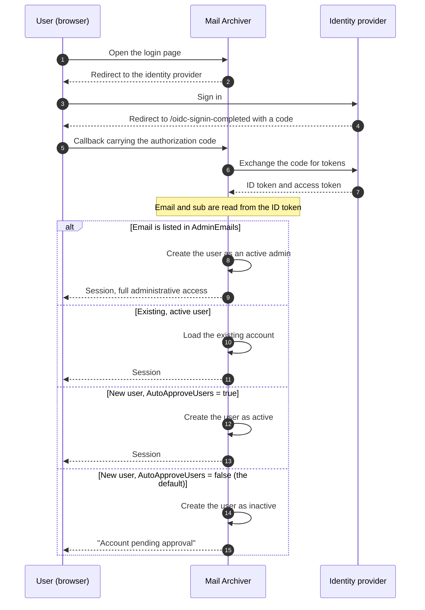

# 🔐 OpenID Connect (OIDC) Authentication Guide {#openid-connect-oidc-authentication-guide}

[← Zurück zum Dokumentationsindex](index.md)

## 📋 Übersicht {#overview}

Diese Anleitung bietet umfassende Anweisungen zur Einrichtung der OpenID Connect (OIDC) Authentifizierung in der Mail Archiver Anwendung, mit spezifischen Beispielen für die Microsoft Entra ID (Azure AD) Integration. OIDC ermöglicht eine sichere Single Sign-On (SSO) Authentifizierung unter Verwendung externer Identity Provider.

## 📚 Inhaltsverzeichnis {#table-of-contents}

1. [Wie der Login-Ablauf funktioniert](#how-the-login-flow-works)
2. [Übersicht](#overview)
3. [Voraussetzungen](#prerequisites)
4. [OIDC-Konfiguration](#oidc-configuration)
   - [OIDC in der Konfiguration aktivieren](#enable-oidc-in-configuration)
   - [Umgebungsvariablen](#environment-variables)
5. [Microsoft Entra ID Setup](#microsoft-entra-id-setup)
   - [App-Registrierung erstellen](#create-app-registration)
   - [Authentifizierung konfigurieren](#configure-authentication)
   - [API-Berechtigungen konfigurieren](#configure-api-permissions)
   - [Client Secret generieren](#generate-client-secret)
6. [Authelia Setup](#authelia-setup)
   - [Authelia-Konfiguration](#authelia-configuration)
   - [Details zur Client-Registrierung](#client-registration-details)
7. [Testen und Validierung](#testing-and-validation)
8. [Benutzerverwaltung mit OIDC](#user-management-with-oidc)
9. [OIDC-Benutzer automatisch genehmigen](#auto-approve-oidc-users)
10. [Konfiguration für passwortloses Login](#passwordless-login-configuration)
11. [Provider-Kompatibilität](#provider-compatibility)

## 🔄 Funktionsweise des Login-Flows {#how-the-login-flow-works}

Das Diagramm zeigt den gesamten Roundtrip — Browser, Mail Archiver und Identity Provider — und, was noch wichtiger ist, die lokale Entscheidung, die Mail Archiver trifft, *nachdem* der Provider den Benutzer bereits akzeptiert hat.



Eine erfolgreiche Anmeldung beim Provider ist daher **nicht** das Ende der Geschichte.
Mit der Standard-`AutoApproveUsers=false` wird ein neuer Benutzer inaktiv erstellt und ein Administrator muss das Konto aktivieren. Ein Benutzer, der sich korrekt authentifiziert und sich trotzdem nicht anmelden kann, ist fast immer an dieses Gate gestoßen und nicht an eine OIDC-Fehlkonfiguration.

## 🌐 Übersicht {#overview}

Die Mail Archiver Anwendung unterstützt die OpenID Connect (OIDC) Authentifizierung, wodurch Benutzer die Authentifizierung über externe Identity Provider wie Microsoft Entra ID und andere OIDC-konforme Anbieter durchführen können. Diese Funktion erhöht die Sicherheit durch die Nutzung von Enterprise-Identity-Management-Systemen und ermöglicht Single Sign-On (SSO)-Funktionen.

## 🛠️ Voraussetzungen {#prerequisites}

- Administratorzugriff auf Ihren gewählten OIDC-Identitätsanbieter (z. B. Microsoft Entra ID)
- Mail Archiver Anwendung bereits bereitgestellt und über HTTPS erreichbar
- DNS-Name für Ihre Mail Archiver Instanz konfiguriert (erforderlich für Callback-URLs)
- Administratorzugriff auf die Mail Archiver Anwendung und das Host-System zur Konfiguration
- Falls ein Reverse Proxy verwendet wird, eine ordnungsgemäße [Reverse-Proxy-Konfiguration](ReverseProxy.md) für die Handhabung von HTTPS-Headern

## 🔧 Reverse Proxy Konfiguration für OIDC {#reverse-proxy-configuration-for-oidc}

Bei der Bereitstellung von Mail Archiver hinter einem Reverse Proxy mit OIDC-Authentifizierung kann eine zusätzliche Konfiguration erforderlich sein, um eine ordnungsgemäße Handhabung von Authentifizierungs-Flows und Token-Austausch zu gewährleisten. Die OIDC-Authentifizierung beinhaltet größere HTTP-Header und Response-Bodies, die in einigen Reverse-Proxy-Konfigurationen die standardmäßigen Puffergrößen überschreiten können.

### Nginx Proxy Manager Konfiguration {#nginx-proxy-manager-configuration}

Wenn Sie den Nginx Proxy Manager als Ihren Reverse Proxy verwenden, müssen Sie möglicherweise die folgende Konfiguration hinzufügen, um die OIDC-Authentifizierung ordnungsgemäß zu verarbeiten:

```nginx
proxy_busy_buffers_size 512k;
proxy_buffers 4 512k;
proxy_buffer_size 256k;
```

Diese Einstellungen erhöhen die Puffergrößen, um größere OIDC-Token und Authentifizierungsantworten unterzubringen. Ohne diese Einstellungen können Probleme bei den Authentifizierungs-Flows auftreten, insbesondere bei Anbietern, die große ID-Token zurückgeben, oder wenn zusätzliche Scopes verwendet werden.

### Allgemeine Überlegungen zum Reverse Proxy {#general-reverse-proxy-considerations}

- Stellen Sie sicher, dass Ihr Reverse Proxy die HTTPS-Header beibehält (`X-Forwarded-Proto`, `X-Forwarded-Host`)
- Konfigurieren Sie angemessene Timeout-Einstellungen für Authentifizierungs-Flows
- Überprüfen Sie, ob große Header-Größen unterstützt werden
- Testen Sie den Authentifizierungs-Flow gründlich nach Konfigurationsänderungen

Für detaillierte Anleitungen zur Reverse-Proxy-Konfiguration lesen Sie bitte den [Reverse Proxy Configuration Guide](ReverseProxy.md).

## ⚙️ OIDC-Konfiguration {#oidc-configuration}

### OIDC in der Konfiguration aktivieren {#enable-oidc-in-configuration}

Um die OIDC-Authentifizierung zu aktivieren, müssen Sie den OAuth-Abschnitt in Ihrer `appsettings.json`-Datei oder die Umgebungsvariablen für das Docker-Deployment konfigurieren (siehe [Installation and Setup](Setup.md)).

#### Beispielkonfiguration (appsettings.json) {#example-configuration-appsettingsjson}

```json
{
  "OAuth": {
    "Enabled": true,
    "Authority": "https://sts.windows.net/{TENANT-ID}/",
    "ClientId": "YOUR-CLIENT-ID",
    "ClientSecret": "YOUR-CLIENT-SECRET",
    "ClientScopes": [
      "openid",
      "profile",
      "email"
    ],
    "DisablePasswordLogin": false
  }
}
```

### Umgebungsvariablen {#environment-variables}

Wenn Sie Docker Compose oder Umgebungsvariablen verwenden, konfigurieren Sie die folgenden Variablen in Ihrer `docker-compose.yml`-Datei unter dem Abschnitt `environment` des `mailarchive-app`-Dienstes:

```yaml
environment:
  # OIDC Configuration
  - OAuth__Enabled=true
  - OAuth__Authority=https://sts.windows.net/{TENANT-ID}/
  - OAuth__ClientId=YOUR-CLIENT-ID
  - OAuth__ClientSecret=YOUR-CLIENT-SECRET
  - OAuth__DisplayName=PocketID SSO
  - OAuth__ClientScopes__0=openid
  - OAuth__ClientScopes__1=profile
  - OAuth__ClientScopes__2=email
  - OAuth__DisablePasswordLogin=false
  - OAuth__AutoApproveUsers=false
```

### Erläuterung der Konfigurationsparameter {#configuration-parameters-explained}

- **OAuth__Enabled**: Auf `true` setzen, um die OIDC-Authentifizierung zu aktivieren
- **OAuth__Authority**: Die OpenID Connect Authority-URL Ihres Identity-Providers
- **OAuth__ClientId**: Die von Ihrem Identity-Provider zugewiesene Client-ID
- **OAuth__ClientSecret**: Das von Ihrem Identity-Provider zugewiesene Client-Secret
- **OAuth__DisplayName**: Optionaler Anzeigename für die OIDC-Login-Schaltfläche (beispielsweise wird `PocketID SSO` als `Login with PocketID SSO` dargestellt)
- **OAuth__ClientScopes**: Array der vom Identity-Provider angeforderten Scopes
- **OAuth__ResponseMode**: Antwortmodus der Autorisierungsanfrage: `query`, `fragment` oder `form_post`. Lassen Sie das Feld leer, um den Standardwert (`form_post`) beizubehalten. Anbieter, die `form_post` nicht unterstützen, benötigen `query`; siehe [Provider Compatibility](#provider-compatibility)
- **OAuth__DisablePasswordLogin**: Auf `true` setzen, um die traditionelle Benutzername/Passwort-Anmeldung zu deaktivieren und eine reine OAuth-Authentifizierung zu erzwingen (siehe Passwordless Login Configuration für weitere Details)
- **OAuth__AutoApproveUsers**: Auf `true` setzen, um neue OIDC-Benutzer automatisch ohne Administrator-Genehmigung zuzulassen (Standard: `false`). Details finden Sie unter [Auto-Approve OIDC Users](#auto-approve-oidc-users)

> ⚠️ **Wichtig**: Das Client-Secret muss sicher aufbewahrt werden. Verwenden Sie Docker-Secrets oder Umgebungsvariablen in Produktionsumgebungen.

## ☁️ Microsoft Entra ID Setup {#microsoft-entra-id-setup}

Dieser Abschnitt enthält Schritt-für-Schritt-Anleitungen zur Konfiguration von Microsoft Entra ID (ehemals Azure AD) als OIDC-Identitätsanbieter für Mail Archiver.

### 🚀 App-Registrierung erstellen {#create-app-registration}

1. Navigieren Sie zum [Microsoft Entra Admin Center](https://entra.microsoft.com)
2. Melden Sie sich mit Ihrem Administrator-Konto an
3. Wählen Sie im linken Navigationsbereich **App registrations**
4. Klicken Sie oben auf der Seite App registrations auf **+ New registration**
5. Füllen Sie die folgenden Details aus:
   - **Name**: Geben Sie einen beschreibenden Namen ein (z. B. "Mail Archiver OIDC")
   - **Supported account types**: Wählen Sie **Accounts in this organizational directory only**
   - **Redirect URI**: Wählen Sie **Web** und geben Sie Ihre Mail Archiver Callback-URL ein:
     ```
     https://your-mail-archiver-domain/oidc-signin-completed
     ```
     Ersetzen Sie `your-mail-archiver-domain` durch Ihre tatsächliche Domain (z. B. `mailarchiver.example.com`)
6. Klicken Sie auf **Register**

### 🔐 Authentifizierung konfigurieren {#configure-authentication}

1. Notieren Sie sich nach der Registrierung die folgenden Werte von der Seite **Overview** der App-Registrierung:
   - **Application (client) ID** – Diese benötigen Sie als `OAuth__ClientId`
   - **Directory (tenant) ID** – Diese benötigen Sie zum Erstellen der Authority URL
2. Erstellen Sie die **Authority URL** aus der **Directory (tenant) ID**, die Sie gerade kopiert haben. Für Microsoft Entra ID wird die Authority wie folgt aufgebaut:
   ```
   https://sts.windows.net/<TENANT-ID>/
   ```
   Ersetzen Sie `<TENANT-ID>` (auch als Mandanten-ID bezeichnet) durch den Wert, der neben der Application (client) ID auf der Overview-Seite der App-Registrierung angezeigt wird. Wenn Ihre Directory (tenant) ID beispielsweise `11111111-2222-3333-4444-555555555555` ist, wird Ihre Authority zu:
   ```
   https://sts.windows.net/11111111-2222-3333-4444-555555555555/
   ```
   Verwenden Sie diesen Wert als `OAuth__Authority` in Ihrer Konfiguration. Stellen Sie sicher, dass der abschließende Schrägstrich enthalten ist.
   > ℹ️ **Hinweis**: Sowohl `https://sts.windows.net/<TENANT-ID>/` als auch `https://login.microsoftonline.com/<TENANT-ID>/v2.0` sind gültige Entra ID Authority-Endpunkte. Die `sts.windows.net`-Form verwendet den v1.0-Endpunkt und wird für diese Anleitung empfohlen.
3. Wählen Sie im linken Menü **Authentication**
4. Klicken Sie auf **Settings**
5. Stellen Sie unter **Implicit grant and hybrid flows** sicher, dass **ID tokens** markiert ist
6. Überprüfen Sie unter **Supported account types**, ob Ihre Auswahl Ihren Anforderungen entspricht
7. Stellen Sie unter **Redirect URIs** sicher, dass Ihre Callback-URL korrekt aufgeführt ist

### 🎯 API-Berechtigungen konfigurieren {#configure-api-permissions}

1. Wählen Sie im linken Menü **API permissions**
2. Klicken Sie auf **+ Add a permission**
3. Wählen Sie **Microsoft Graph**
4. Wählen Sie **Delegated permissions**
5. Fügen Sie die folgenden Berechtigungen hinzu (falls für zusätzliche Funktionen erforderlich):
   - **openid** – Benutzer anmelden
   - **email** – E-Mail-Adresse des Benutzers anzeigen
   - **profile** – Basisprofil des Benutzers anzeigen
6. Klicken Sie auf **Add permissions**
7. Klicken Sie auf **Grant admin consent for [Your Organization]**, wenn Sie die Anwendung vorab autorisieren möchten

### 🔑 Client-Geheimnis generieren {#generate-client-secret}

1. Navigieren Sie im linken Menü zu **Certificates & secrets**
2. Klicken Sie unter **Client secrets** auf **+ New client secret**
3. Geben Sie eine Beschreibung an (z. B. "Mail Archiver Auth Secret")
4. Wählen Sie einen Ablaufzeitraum aus
5. Klicken Sie auf **Add**
6. **Wichtig**: Kopieren Sie den **Value** sofort und speichern Sie ihn sicher. Dieses Geheimnis wird nicht erneut angezeigt. Es wird als `OAuth__ClientSecret` benötigt

## 🔐 Authelia Setup {#authelia-setup}

Dieser Abschnitt enthält Konfigurationsdetails für die Einrichtung von Authelia als OIDC-Identitätsanbieter für Mail Archiver. Authelia ist ein Open-Source-Authentifizierungs- und Autorisierungsserver, der OIDC unterstützt.

### 🛠️ Authelia Konfiguration {#authelia-configuration}

```yaml
identity_providers:
  oidc:
    clients:
      - client_id: 'mailarchiver'
        client_name: 'mailarchiver'
        client_secret: '$xyzg'  # The digest of 'insecure_secret'.
        public: false
        redirect_uris:
          - 'https://your-mail-archiver-domain/oidc-signin-completed'
        scopes:
          - 'openid'
          - 'profile'
          - 'email'
        response_types:
          - 'code'
        grant_types:
          - 'authorization_code'
        token_endpoint_auth_method: 'client_secret_post'
```

### 📝 Details zur Client-Registrierung {#client-registration-details}

- **client_id**: `mailarchiver` - Die eindeutige Kennung für die Mail Archiver Anwendung
- **client_name**: `mailarchiver` - Der bei der Authentifizierung angezeigte Anzeigename
- **client_secret**: Das gehashte Secret, das zur Client-Authentifizierung verwendet wird (ersetzen Sie es in der Produktion durch Ihr eigenes sicheres Secret)
- **redirect_uris**: Die Callback-URL, an die Authelia die Benutzer nach der Authentifizierung weiterleitet. Ersetzen Sie `[YOUR_MAILARCHIVER_URL]` durch Ihre tatsächliche Mail Archiver Domain
- **scopes**: Die von Authelia angeforderten Berechtigungen:
  - `openid`: Erforderlich für die OIDC-Authentifizierung
  - `profile`: Zugriff auf grundlegende Profilinformationen
  - `email`: Zugriff auf die E-Mail-Adresse
- **response_types**: `code` - Authorization code flow
- **grant_types**: `authorization_code` - Authorization code grant type
- **token_endpoint_auth_method**: `client_secret_post` - Client-Authentifizierungsmethode

> ⚠️ **Sicherheitshinweis**: Das Beispiel verwendet ein Standard-Secret zu Demonstrationszwecken. Generieren Sie in der Produktion ein sicheres Secret und hashen Sie es mit den Tools von Authelia. Verwenden Sie niemals das Beispiel-Secret in Produktionsumgebungen.

## 🧪 Testen und Validierung {#testing-and-validation}

### Testen der Ersteinrichtung {#initial-setup-testing}

1. Starten Sie Ihre Mail Archiver Anwendung nach der Konfiguration der OIDC-Einstellungen neu
2. Navigieren Sie zu Ihrer Mail Archiver Login-Seite
3. Sie sollten neben dem regulären Login-Formular eine neue OAuth-Login-Schaltfläche sehen. Bei `OAuth__DisplayName=PocketID SSO` lautet die Beschriftung der Schaltfläche `Login with PocketID SSO`.
4. Klicken Sie auf die OAuth-Login-Schaltfläche, um den OIDC-Flow zu starten
5. Sie sollten zur Login-Seite Ihres Identity-Providers weitergeleitet werden
6. Nach erfolgreicher Authentifizierung sollten Sie zurück zu Mail Archiver weitergeleitet werden

### Validierung der Benutzerbereitstellung {#user-provisioning-validation}

- OIDC-Benutzer, die sich zum ersten Mal anmelden, werden automatisch in der Mail Archiver Datenbank erstellt
- Benutzer werden mit der Standardrolle „User“ erstellt und benötigen eine Admin-Genehmigung für den Zugriff

## 👥 Benutzerverwaltung mit OIDC {#user-management-with-oidc}

### Benutzerrollen und Berechtigungen {#user-roles-and-permissions}

OIDC-Benutzer folgen derselben rollenbasierten Zugriffskontrolle wie lokale Benutzer:
- **Admin**: Vollständiger Systemzugriff (erfordert manuelle Zuweisung durch einen bestehenden Admin oder automatisch über die AdminEmails-Konfiguration)
- **User**: Standard-Benutzerzugriff auf zugewiesene Mail-Konten
- **Self-Manager**: Kann das eigene Konto verwalten und neue Konten hinzufügen

### Automatische Bereitstellung von Administratoren {#auto-provisioning-administrators}

Sie können bestimmte E-Mail-Adressen so konfigurieren, dass sie automatisch als Administratoren bereitgestellt werden, wenn sie sich zum ersten Mal über OIDC anmelden:

```json
{
  "OAuth": {
    "AdminEmails": [
      "admin@example.com",
      "it-manager@example.com"
    ]
  }
}
```

Wenn sich ein Benutzer mit einer dieser E-Mail-Adressen zum ersten Mal anmeldet:
- Wird er automatisch als aktiver Administrator erstellt
- Es ist keine manuelle Genehmigung erforderlich
- Er erhält sofort volle Administratorrechte
- Der E-Mail-Abgleich erfolgt unabhänig von der Groß-/Kleinschreibung

**Sicherheitshinweis**: Fügen Sie nur vertrauenswürdige E-Mail-Adressen dieser Liste hinzu, da diese Benutzer vollen Systemzugriff haben werden.

### Benutzer-Bereitstellungsablauf {#user-provisioning-flow}

#### Neue Benutzer (Nicht in AdminEmails) {#new-users-not-in-adminemails}
1. Benutzer authentifiziert sich über den OAuth-Anbieter
2. System prüft, ob die E-Mail in der lokalen Datenbank existiert
3. Wenn neuer Benutzer:
   - Das Konto wird mit einem Benutzernamen erstellt, der aus den OIDC-Claims abgeleitet wird, in dieser bevorzugten Reihenfolge:
     1. Der **lokale Teil der E-Mail** (alles vor `@`), z. B. `example.mailarchiver` für `example.mailarchiver@xxxxxxxxx.onmicrosoft.com`
     2. Der vollständige `sub`-Claim, wenn kein E-Mail-Claim vorhanden ist
     3. `oidc_<12-char-hash>` als letzte Ausweichmöglichkeit
     Der generierte Wert wird auf 320 Zeichen gekürzt. Wenn bereits ein lokaler Benutzer mit demselben Benutzernamen existiert, wird `" (n)"` angehängt, bis ein eindeutiger Name gefunden wurde.
   - Der Benutzer wird als **inaktiv** markiert und **erfordert Genehmigung**
   - Ein Admin muss den Benutzer in der Benutzerverwaltung manuell aktivieren
4. Der Benutzer erhält die Meldung „Konto wartet auf Genehmigung“

#### Neue Benutzer (In AdminEmails) {#new-users-in-adminemails}
1. Benutzer authentifiziert sich über den OAuth-Anbieter
2. System erkennt, dass die E-Mail in der AdminEmails-Liste enthalten ist
3. Das Konto wird automatisch erstellt:
   - Der Benutzer wird als **aktiv** und **admin** markiert
   - Keine Genehmigung erforderlich
   - Der Benutzer kann sofort auf das System zugreifen
4. Der Benutzer ist erfolgreich eingeloggt

### Passwortverwaltung {#password-management}

OIDC-Benutzer können innerhalb von Mail Archiver keine Passwörter haben oder ändern, da die Authentifizierung über den externen Identitätsanbieter erfolgt:
- Die Option „Passwort ändern“ wird für OIDC-Benutzer deaktiviert sein
- Die Passwortrücksetzung muss über den OIDC-Anbieter erfolgen
- Lokale Passwortfelder bleiben für OIDC-Benutzer leer

## ✅ OIDC-Benutzer automatisch genehmigen {#auto-approve-oidc-users}

Standardmäßig müssen neue OIDC-Benutzer von einem lokalen Administrator manuell genehmigt werden, bevor sie auf die Anwendung zugreifen können. Dies bietet ein Double-Gating-Modell, bei dem sowohl der IdP als auch der lokale Administrator den Zugriff gewähren müssen.

Für **OIDC-first-Bereitstellungen**, bei denen der Identity Provider (IdP) die einzige Quelle der Wahrheit für die Zugriffskontrolle ist, kann dieser manuelle Genehmigungsschritt übersprungen werden, indem die Option `AutoApproveUsers` aktiviert wird.

### Aktivieren der automatischen Genehmigung {#enabling-auto-approve}

Setzen Sie `AutoApproveUsers` in Ihrer Konfiguration auf `true`:

```json
{
  "OAuth": {
    "Enabled": true,
    "AutoApproveUsers": true,
    "Authority": "https://your-provider.com",
    "ClientId": "your-client-id",
    "ClientSecret": "your-secret"
  }
}
```

Oder über eine Umgebungsvariable:

```yaml
environment:
  - OAuth__AutoApproveUsers=true
```

### Verhalten {#behavior}

| Einstellung | Verhalten für neue OIDC-Benutzer |
|---|---|
| `AutoApproveUsers: false` (Standard) | Benutzer wird als **inaktiv** erstellt und **erfordert Admin-Genehmigung**, bevor der Zugriff gewährt wird |
| `AutoApproveUsers: true` | Benutzer wird als **aktiv** erstellt und kann sofort auf die Anwendung zugreifen |

> **Hinweis**: `AdminEmails` hat immer Vorrang — Benutzer, die `AdminEmails` entsprechen, werden immer automatisch als Administratoren genehmigt, unabhängig von dieser Einstellung.

### Wann man dies verwenden sollte {#when-to-use}

Diese Option wird für Umgebungen empfohlen, in denen:
- Der **IdP den Anwendungszugriff steuert** (z. B. über App-Zuweisung oder Gruppenmitgliedschaft in Authentik, Entra ID, Authelia usw.)
- Sie das **Double-Gating-Modell eliminieren** möchten (IdP-Zuweisung + lokale Admin-Genehmigung)
- Der **Widerruf des Zugriffs auf IdP-Ebene verwaltet wird** (das Entfernen der App-Zuweisung verhindert automatisch den Login)

### Beispiel für ein vollständiges OIDC-First-Setup {#complete-oidc-first-setup-example}

```json
{
  "OAuth": {
    "Enabled": true,
    "Authority": "https://sts.windows.net/YOUR_TENANT_ID/",
    "ClientId": "your-client-id",
    "ClientSecret": "your-secret",
    "DisplayName": "PocketID SSO",
    "ClientScopes": ["openid", "profile", "email"],
    "DisablePasswordLogin": true,
    "AutoRedirect": true,
    "AutoApproveUsers": true,
    "AdminEmails": ["admin@company.com"]
  }
}
```

In diesem Setup:
- Werden Benutzer automatisch zum OIDC-Anbieter weitergeleitet
- Werden neue Benutzer beim ersten Login automatisch genehmigt
- Werden Admin-E-Mails automatisch als Administratoren bereitgestellt
- Wird die Zugriffskontrolle vollständig auf IdP-Ebene verwaltet

### Sicherheitsaspekte {#security-considerations}

- **Vertrauen**: Das Aktivieren von `AutoApproveUsers` bedeutet, dass Sie dem IdP vertrauen, zu steuern, wer auf die Anwendung zugreifen kann. Stellen Sie sicher, dass Ihr IdP korrekt mit entsprechenden App-Zuweisungen oder gruppenbasierter Zugriffskontrolle konfiguriert ist.
- **Rollenzuweisung**: Automatisch genehmigte Benutzer werden mit Standard-Benutzerberechtigungen (nicht Admin) erstellt. Der Admin-Zugriff erfordert weiterhin entweder eine `AdminEmails`-Konfiguration oder eine manuelle Rollenzuweisung.
- **Widerruf**: Wenn der Zugriff eines Benutzers im IdP entfernt wird, kann er sich nicht mehr über OIDC authentifizieren. Sein lokales Konto bleibt jedoch aktiv. Um den Zugriff vollständig zu widerrufen, deaktivieren Sie den Benutzer zusätzlich im Admin-Panel des Mail Archiver.
- **Abwärtskompatibilität**: Der Standardwert ist `false`, wodurch das bestehende Verhalten für aktuelle Bereitstellungen beibehalten wird.

## 🔒 Konfiguration des passwortlosen Logins {#passwordless-login-configuration}

> ⚠️ **Wichtig**: Selbst bei einer Konfiguration für das passwortlose Login wird beim ersten Start weiterhin ein initialer Admin-Benutzer erstellt. Sie müssen ein sicheres Passwort für diesen Admin-Benutzer in Ihrer `appsettings.json`- oder `docker-compose.yml`-Datei festlegen, um die Systemsicherheit zu gewährleisten.

Für Organisationen, die eine reine OAuth-Authentifizierung erzwingen möchten, unterstützt die Anwendung die vollständige Deaktivierung des Passwort-Logins.

### Deaktivieren des Passwort-Logins {#disabling-password-login}

Setzen Sie `DisablePasswordLogin` auf `true`, um den Benutzername/Passwort-Login zu deaktivieren:

```json
{
  "OAuth": {
    "Enabled": true,
    "DisablePasswordLogin": true,
    "Authority": "https://your-provider.com",
    "ClientId": "your-client-id",
    "ClientSecret": "your-secret"
  }
}
```

**Ergebnis**: Die Login-Seite zeigt nur noch die OAuth-Login-Schaltfläche an, und der Server lehnt jeden Passwort-POST (`/Auth/Login`) mit einer Weiterleitung zurück zur Login-Seite ab. Lokale Passwörter bleiben in der Datenbank gespeichert, können aber nicht mehr zum Anmelden verwendet werden, solange der reine OAuth-Modus aktiv ist. Wenn `DisplayName` konfiguriert ist, verwendet die Schaltfläche diesen Wert (zum Beispiel `Login with PocketID SSO`).

### Automatische Weiterleitung zum OAuth-Anbieter {#auto-redirect-to-oauth-provider}

Aktivieren Sie `AutoRedirect`, um Benutzer automatisch zu Ihrem OAuth-Anbieter weiterzuleiten:

```json
{
  "OAuth": {
    "Enabled": true,
    "DisablePasswordLogin": true,
    "AutoRedirect": true,
    "Authority": "https://your-provider.com",
    "ClientId": "your-client-id",
    "ClientSecret": "your-secret"
  }
}
```

**Anforderungen**: 
- `DisablePasswordLogin` muss `true` sein
- `OAuth.Enabled` muss `true` sein

**Ergebnis**: Benutzer sehen einen kurzen Ladebildschirm und werden automatisch zum OAuth-Anbieter weitergeleitet.

### Beispiel für ein vollständiges passwortloses Setup {#complete-passwordless-setup-example}

```json
{
  "OAuth": {
    "Enabled": true,
    "Authority": "https://sts.windows.net/YOUR_TENANT_ID/",
    "ClientId": "your-client-id",
    "ClientSecret": "your-secret",
    "DisplayName": "PocketID SSO",
    "ClientScopes": ["openid", "profile", "email"],
    "DisablePasswordLogin": true,
    "AutoRedirect": true,
    "AdminEmails": ["admin@company.com", "it@company.com"]
  }
}
```

### Sicherheitsaspekte {#security-considerations}

- **Bereitstellung der Admin-E-Mail**: Dem OAuth-Anbieter wird vertraut, E-Mail-Adressen zu verifizieren. Fügen Sie nur vertrauenswürdigen Adressen zu AdminEmails hinzu.
- **Notfallzugriff**: Mit `DisablePasswordLogin=true` kann kein lokales Passwort mehr zum Anmelden verwendet werden, einschließlich des Bootstrap-Admin-Kontos. Stellen Sie sicher, dass mindestens eine OAuth-Identität als Admin bereitgestellt wurde (siehe `AdminEmails`), bevor Sie diese Einstellung aktivieren, da Sie sich sonst selbst aussperren. Um den Zugriff wiederherzustellen, setzen Sie `OAuth__DisablePasswordLogin=false`, starten Sie neu, melden Sie sich mit dem lokalen Admin-Passwort an und aktivieren Sie die Einstellung anschließend wieder.
- **Testen**: Testen Sie die OAuth-Authentifizierung gründlich, bevor Sie den Passwort-Login in der Produktionsumgebung deaktivieren.
- **SSO-Umgebung**: Die automatische Weiterleitung eignet sich am besten für Single-Sign-On-Umgebungen, in denen sich alle Benutzer über denselben Anbieter authentifizieren.

## 🧩 Provider-Kompatibilität {#provider-compatibility}

Nicht jeder Identity Provider implementiert die vollständige OIDC-Spezifikation. Beide unten aufgeführten Einstellungen existieren aus diesem Grund, und beide werden für den Synology SSO Server benötigt.

### Response Mode {#response-mode}

Die Autorisierungsanfrage wird mit dem Response Mode `form_post` gesendet, dem Standard des zugrunde liegenden ASP.NET Core OpenID Connect Handlers. Ein Provider, der dies nicht unterstützt, schlägt in der Regel mit einer eigenen Fehlermeldung fehl, ohne dass etwas im Mail Archiver Log erscheint.

Der Synology SSO Server verhält sich so: Sein Discovery-Dokument lässt `response_modes_supported` weg, und die Anmeldung bricht mit der Meldung „Unable to sign in via SSO due to setting issues“ ab. Setzen Sie den Response Mode explizit:

```env
OAuth__ResponseMode=query
```

Gültige Werte sind `query`, `fragment` und `form_post`. Lassen Sie die Einstellung leer, um den Standard beizubehalten. Im Zweifelsfall ist `query` die sicherste Wahl: Es ist der einzige Response Mode, den jeder OIDC-Provider unterstützen muss.

### Name and Email Claims {#name-and-email-claims}

Der Anzeigename eines neuen Benutzers wird aus der User-Info-Antwort in dieser Reihenfolge übernommen:

1. `name`
2. `preferred_username`
3. `given_name`
4. `username`

Claims, die vorhanden, aber leer oder kein String sind, werden übersprungen. `username` ist kein OIDC-Standard-Claim, aber einige Provider geben ihn als einzigen namenähnlichen Wert zurück (wiederum der Synology SSO Server). Die E-Mail-Adresse wird aus `email` gelesen, dann aus `mail`, dann aus `upn`, und fällt auf die Claims des ID-Tokens zurück.

Wenn keiner der Namens-Claims vorhanden ist, schlägt die Anmeldung fehl. Der Benutzer wird mit einer lesbaren Meldung, die die gesuchten Claims nennt, zur Anmeldeseite zurückgeführt, und der Grund wird im Log auf Error-Level geschrieben.

---

**Hinweis**: Dieser Leitfaden ist aktuell mit Stand 2025. Identity-Provider-Dienste aktualisieren regelmäßig ihre Schnittstellen und Funktionen, daher können einige UI-Elemente abweichen. Beziehen Sie sich für die aktuellsten Informationen immer auf die neueste Dokumentation Ihres Identity Providers.
