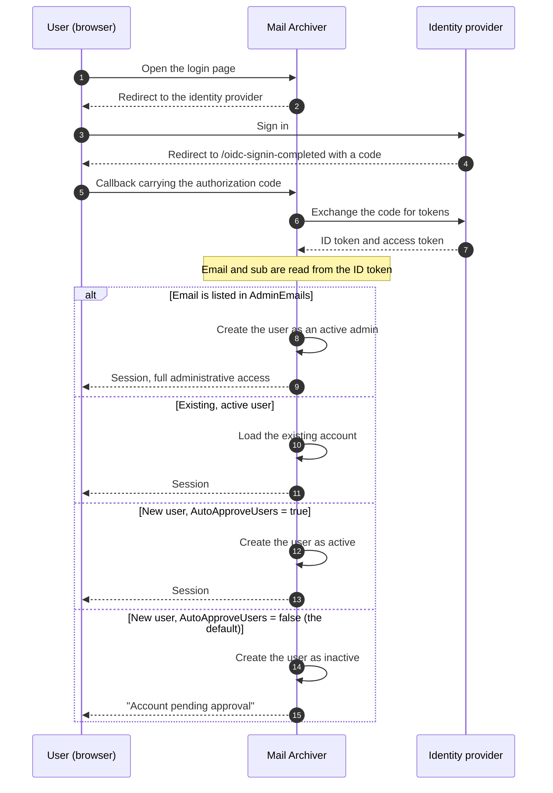

# 🔐 Guía de autenticación OpenID Connect (OIDC) {#openid-connect-oidc-authentication-guide}

[← Volver al índice de documentación](index.md)

## 📋 Resumen {#overview}

Esta guía proporciona instrucciones detalladas para la configuración de la autenticación OpenID Connect (OIDC) en la aplicación Mail Archiver, con ejemplos específicos para la integración con Microsoft Entra ID (Azure AD). OIDC permite la autenticación de inicio de sesión único (SSO) segura utilizando proveedores de identidad externos.

## 📚 Tabla de contenidos {#table-of-contents}

1. [Cómo funciona el flujo de inicio de sesión](#how-the-login-flow-works)
2. [Descripción general](#overview)
3. [Prerrequisitos](#prerequisites)
4. [Configuración de OIDC](#oidc-configuration)
   - [Habilitar OIDC en la Configuración](#enable-oidc-in-configuration)
   - [Variables de entorno](#environment-variables)
5. [Configuración de Microsoft Entra ID](#microsoft-entra-id-setup)
   - [Crear registro de aplicación](#create-app-registration)
   - [Configurar autenticación](#configure-authentication)
   - [Configurar permisos de API](#configure-api-permissions)
   - [Generar Client Secret](#generate-client-secret)
6. [Configuración de Authelia](#authelia-setup)
   - [Configuración de Authelia](#authelia-configuration)
   - [Detalles de registro del cliente](#client-registration-details)
7. [Pruebas y validación](#testing-and-validation)
8. [Gestión de usuarios con OIDC](#user-management-with-oidc)
9. [Aprobación automática de usuarios OIDC](#auto-approve-oidc-users)
10. [Configuración de inicio de sesión sin contraseña](#passwordless-login-configuration)
11. [Compatibilidad del proveedor](#provider-compatibility)

## 🔄 Cómo funciona el flujo de inicio de sesión {#how-the-login-flow-works}

El diagrama muestra todo el recorrido —navegador, Mail Archiver y proveedor de identidad— y, lo que es más importante, la decisión local que Mail Archiver toma *después* de que el proveedor ya ha aceptado al usuario.



Por lo tanto, un inicio de sesión exitoso en el proveedor **no** es el final de la historia.
Con el `AutoApproveUsers=false` predeterminado, se crea un nuevo usuario inactivo y un administrador tiene que activar la Cuenta. Un usuario que se autentica correctamente y aun así no puede entrar casi siempre se ha topado con este obstáculo en lugar de una configuración incorrecta de OIDC.

## 🌐 Descripción general {#overview}

La aplicación Mail Archiver admite la autenticación OpenID Connect (OIDC), lo que permite a los usuarios autenticarse utilizando proveedores de identidad externos como Microsoft Entra ID y otros proveedores compatibles con OIDC. Esta característica mejora la seguridad al aprovechar los sistemas de gestión de identidad empresarial y permite capacidades de inicio de sesión único (SSO).

## 🛠️ Requisitos previos {#prerequisites}

- Acceso administrativo a su proveedor de identidad OIDC elegido (p. ej., Microsoft Entra ID)
- Aplicación Mail Archiver ya desplegada y accesible a través de HTTPS
- Nombre DNS configurado para su instancia de Mail Archiver (requerido para las URLs de callback)
- Acceso administrativo a la aplicación Mail Archiver y al sistema host para la configuración
- Si utiliza un proxy inverso, la [configuración del proxy inverso](ReverseProxy.md) adecuada para el manejo de encabezados HTTPS

## 🔧 Configuración del Reverse Proxy para OIDC {#reverse-proxy-configuration-for-oidc}

Al desplegar Mail Archiver detrás de un reverse proxy con autenticación OIDC, es posible que se requiera una configuración adicional para garantizar el manejo adecuado de los flujos de autenticación y los intercambios de tokens. La autenticación OIDC implica encabezados HTTP y cuerpos de respuesta más grandes que pueden exceder los tamaños de búfer predeterminados en algunas configuraciones de reverse proxy.

### Configuración de Nginx Proxy Manager {#nginx-proxy-manager-configuration}

Si está utilizando Nginx Proxy Manager como su reverse proxy, es posible que deba agregar la siguiente configuración para manejar la autenticación OIDC correctamente:

```nginx
proxy_busy_buffers_size 512k;
proxy_buffers 4 512k;
proxy_buffer_size 256k;
```

Estos ajustes aumentan los tamaños de búfer para acomodar tokens OIDC y respuestas de autenticación más grandes. Sin estos ajustes, es posible que encuentre problemas con los flujos de autenticación, particularmente con proveedores que devuelven ID tokens grandes o cuando se utilizan scopes adicionales.

### Consideraciones Generales del Reverse Proxy {#general-reverse-proxy-considerations}

- Asegúrese de que su reverse proxy preserve los encabezados HTTPS (`X-Forwarded-Proto`, `X-Forwarded-Host`)
- Configure los ajustes de timeout adecuados para los flujos de autenticación
- Verifique que se admitan tamaños de encabezado grandes
- Pruebe exhaustivamente el flujo de autenticación después de los cambios de configuración

Para obtener una guía detallada sobre la configuración del reverse proxy, consulte la [Reverse Proxy Configuration Guide](ReverseProxy.md).

## ⚙️ Configuración de OIDC {#oidc-configuration}

### Habilitar OIDC en la Configuración {#enable-oidc-in-configuration}

Para habilitar la autenticación OIDC, debe configurar la sección OAuth en su archivo `appsettings.json` o en las variables de entorno para el despliegue de docker (ver [Instalación y Configuración](Setup.md)).

#### Ejemplo de Configuración (appsettings.json) {#example-configuration-appsettingsjson}

```json
{
  "OAuth": {
    "Enabled": true,
    "Authority": "https://sts.windows.net/{TENANT-ID}/",
    "ClientId": "YOUR-CLIENT-ID",
    "ClientSecret": "YOUR-CLIENT-SECRET",
    "ClientScopes": [
      "openid",
      "profile",
      "email"
    ],
    "DisablePasswordLogin": false
  }
}
```

### Variables de Entorno {#environment-variables}

Al usar Docker Compose o variables de entorno, configure las siguientes variables en su archivo `docker-compose.yml` bajo la sección de entorno del servicio `mailarchive-app`:

```yaml
environment:
  # OIDC Configuration
  - OAuth__Enabled=true
  - OAuth__Authority=https://sts.windows.net/{TENANT-ID}/
  - OAuth__ClientId=YOUR-CLIENT-ID
  - OAuth__ClientSecret=YOUR-CLIENT-SECRET
  - OAuth__DisplayName=PocketID SSO
  - OAuth__ClientScopes__0=openid
  - OAuth__ClientScopes__1=profile
  - OAuth__ClientScopes__2=email
  - OAuth__DisablePasswordLogin=false
  - OAuth__AutoApproveUsers=false
```

### Explicación de los Parámetros de Configuración {#configuration-parameters-explained}

- **OAuth__Enabled**: Establecido en `true` para habilitar la autenticación OIDC
- **OAuth__Authority**: La URL de autoridad de OpenID Connect de su proveedor de identidad
- **OAuth__ClientId**: El ID de cliente asignado por su proveedor de identidad
 el ID de cliente asignado por su proveedor de identidad
- **OAuth__ClientSecret**: El secreto de cliente asignado por su proveedor de identidad
- **OAuth__DisplayName**: Nombre de visualización opcional para el botón de inicio de sesión OIDC (por ejemplo, `PocketID SSO` se renderiza como `Login with PocketID SSO`)
- **OAuth__ClientScopes**: Matriz de alcances (scopes) solicitados al proveedor de identidad
- **OAuth__ResponseMode**: Modo de respuesta de la solicitud de autorización: `query`, `fragment` o `form_post`. Deje vacío para mantener el valor por defecto (`form_post`). Los proveedores que no soportan `form_post` requieren `query`; ver [Compatibilidad de Proveedores](#provider-compatibility)
- **OAuth__DisablePasswordLogin**: Establecido en `true` para deshabilitar el inicio de sesión tradicional de usuario/contraseña y forzar la autenticación exclusiva de OAuth (ver Configuración de Inicio de Sesión sin Contraseña para más detalles)
- **OAuth__AutoApproveUsers**: Establecido en `true` para aprobar automáticamente a los nuevos usuarios de OIDC sin requerir aprobación de administrador (por defecto: `false`). Ver [Auto-Aprobación de Usuarios OIDC](#auto-approve-oidc-users) para más detalles

> ⚠️ **Importante**: El Client Secret debe mantenerse seguro. Utilice secretos de Docker o variables de entorno en entornos de producción.

## ☁️ Configuración de Microsoft Entra ID {#microsoft-entra-id-setup}

Esta sección proporciona instrucciones paso a paso para configurar Microsoft Entra ID (anteriormente Azure AD) como un proveedor de identidad OIDC para Mail Archiver.

### 🚀 Crear el registro de la aplicación {#create-app-registration}

1. Navegue al [Microsoft Entra Admin Center](https://entra.microsoft.com)
2. Inicie sesión con su Cuenta de administrador
3. En el panel de navegación izquierdo, seleccione **App registrations**
4. Haga clic en **+ New registration** en la parte superior de la página de App registrations
5. Complete los siguientes detalles:
   - **Name**: Ingrese un nombre descriptivo (p. ej., "Mail Archiver OIDC")
   - **Supported account types**: Seleccione **Accounts in this organizational directory only**
   - **Redirect URI**: Seleccione **Web** e ingrese su URL de callback de Mail Archiver:
     ```
     https://your-mail-archiver-domain/oidc-signin-completed
     ```
     Reemplace `your-mail-archiver-domain` con su dominio real (p. ej., `mailarchiver.example.com`)
6. Haga clic en **Register**

### 🔐 Configurar la autenticación {#configure-authentication}

1. Después del registro, tome nota de los siguientes valores de la página **Overview** del registro de la aplicación:
   - **Application (client) ID** - Necesitará esto como `OAuth__ClientId`
   - **Directory (tenant) ID** - Necesitará esto para construir la Authority URL
2. Construya la **Authority URL** a partir del **Directory (tenant) ID** que acaba de copiar. Para Microsoft Entra ID, la Authority se construye como:
   ```
   https://sts.windows.net/<TENANT-ID>/
   ```
   Reemplace `<TENANT-ID>` (también referido como Mandanten-ID) con el valor que se muestra junto al Application (client) ID en la página Overview del registro de la aplicación. Por ejemplo, si su Directory (tenant) ID es `11111111-2222-3333-4444-555555555555`, su Authority se convierte en:
   ```
   https://sts.windows.net/11111111-2222-3333-4444-555555555555/
   ```
   Use este valor como `OAuth__Authority` en su configuración. Asegúrese de incluir la barra diagonal final.
   > ℹ️ **Nota**: Tanto `https://sts.windows.net/<TENANT-ID>/` como `https://login.microsoftonline.com/<TENANT-ID>/v2.0` son endpoints de autoridad de Entra ID válidos. La forma `sts.windows.net` utiliza el endpoint v1.0 y se recomienda para esta guía.
3. En el menú izquierdo, seleccione **Authentication**
4. Haga clic en **Settings**
5. En **Implicit grant and hybrid flows**, asegúrese de que **ID tokens** esté marcado
6. En **Supported account types**, verifique que su selección coincida con sus requisitos
7. En **Redirect URIs**, asegúrese de que su URL de callback esté listada correctamente

### 🎯 Configurar permisos de API {#configure-api-permissions}

1. En el menú izquierdo, seleccione **API permissions**
2. Haga clic en **+ Add a permission**
3. Seleccione **Microsoft Graph**
4. Elija **Delegated permissions**
5. Agregue los siguientes permisos (si son necesarios para funciones adicionales):
   - **openid** - Iniciar sesión de los usuarios
   - **email** - Ver la dirección de correo electrónico de los usuarios
   - **profile** - Ver el perfil básico de los usuarios
6. Haga clic en **Add permissions**
7. Haga clic en **Grant admin consent for [Your Organization]** si desea preautorizar la aplicación

### 🔑 Generar el Client Secret {#generate-client-secret}

1. Navegue a **Certificates & secrets** en el menú izquierdo
2. En **Client secrets**, haga clic en **+ New client secret**
3. Proporcione una descripción (p. ej., "Mail Archiver Auth Secret")
4. Seleccione un período de expiración
5. Haga clic en **Add**
6. **Importante**: Copie el **Value** inmediatamente y guárdelo de forma segura. Este secreto no se mostrará de nuevo. Se necesita como el `OAuth__ClientSecret`

## 🔐 Configuración de Authelia {#authelia-setup}

Esta sección proporciona los detalles de configuración para establecer Authelia como un proveedor de identidad OIDC para Mail Archiver. Authelia es un servidor de autenticación y autorización de código abierto que admite OIDC.

### 🛠️ Configuración de Authelia {#authelia-configuration}

```yaml
identity_providers:
  oidc:
    clients:
      - client_id: 'mailarchiver'
        client_name: 'mailarchiver'
        client_secret: '$xyzg'  # The digest of 'insecure_secret'.
        public: false
        redirect_uris:
          - 'https://your-mail-archiver-domain/oidc-signin-completed'
        scopes:
          - 'openid'
          - 'profile'
          - 'email'
        response_types:
          - 'code'
        grant_types:
          - 'authorization_code'
        token_endpoint_auth_method: 'client_secret_post'
```

### 📝 Detalles de Registro del Cliente {#client-registration-details}

- **client_id**: `mailarchiver` - El identificador único para la aplicación Mail Archiver
- **client_name**: `mailarchiver` - El nombre de visualización que se muestra a los usuarios durante la autenticación
- **client_secret**: El secreto hasheado utilizado para la autenticación del cliente (reemplácelo con su propio secreto seguro en producción)
- **redirect_uris**: La URL de callback donde Authelia redirigirá a los usuarios después de la autenticación. Reemplace `[YOUR_MAILARCHIVER_URL]` con su dominio real de Mail Archiver
- **scopes**: Los permisos solicitados a Authelia:
  - `openid`: Requerido para la autenticación OIDC
  - `profile`: Acceso a la información básica del perfil
  - `email`: Acceso a la dirección de correo electrónico
- **response_types**: `code` - Flujo de código de autorización
- **grant_types**: `authorization_code` - Tipo de concesión de código de autorización
- **token_endpoint_auth_method**: `client_secret_post` - Método de autenticación del cliente

> ⚠️ **Nota de seguridad**: El ejemplo utiliza un secreto predeterminado para fines de demostración. En producción, genere un secreto seguro y hashealo utilizando las herramientas de Authelia. Nunca utilice el secreto de ejemplo en entornos de producción.

## 🧪 Pruebas y validación {#testing-and-validation}

### Pruebas de configuración inicial {#initial-setup-testing}

1. Reinicie su aplicación Mail Archiver después de configurar los ajustes de OIDC
2. Navegue a la página de inicio de sesión de su Mail Archiver
3. Debería ver un nuevo botón de inicio de sesión OAuth junto al formulario de inicio de sesión habitual. Con `OAuth__DisplayName=PocketID SSO`, el botón dice `Login with PocketID SSO`.
4. Haga clic en el botón de inicio de sesión OAuth para iniciar el flujo de OIDC
5. Debería ser redirigido a la página de inicio de sesión de su proveedor de identidad
6. Tras una autenticación correcta, debería ser redirigido de vuelta a Mail Archiver

### Validación de aprovisionamiento de usuarios {#user-provisioning-validation}

- Los usuarios de OIDC que utilicen el servicio por primera vez se crearán automáticamente en la base de datos de Mail Archiver
- Los usuarios se crearán con el rol predeterminado "User" y necesitarán la aprobación del administrador para acceder

## 👥 Gestión de usuarios con OIDC {#user-management-with-oidc}

### Roles y Permisos de usuario {#user-roles-and-permissions}

Los usuarios de OIDC siguen el mismo control de acceso basado en roles que los usuarios locales:
- **Admin**: Acceso completo al sistema (requiere asignación manual por un admin existente, o automática mediante la configuración AdminEmails)
- **User**: Acceso de usuario estándar a las cuentas de correo asignadas
- **Self-Manager**: Puede gestionar su propia Cuenta y añadir nuevas cuentas

### Auto-aprovisionamiento de administradores {#auto-provisioning-administrators}

Puede configurar direcciones de correo electrónico específicas para que se aprovisionen automáticamente como administradores cuando inicien sesión por primera vez a través de OIDC:

```json
{
  "OAuth": {
    "AdminEmails": [
      "admin@example.com",
      "it-manager@example.com"
    ]
  }
}
```

Cuando un usuario con una de estas direcciones de correo electrónico inicia sesión por primera vez:
- Se crea automáticamente como un administrador activo
- No se requiere aprobación manual
- Obtiene privilegios administrativos completos de inmediato
- La coincidencia de correo electrónico no distingue entre mayúsculas y minúsculas

**Nota de seguridad**: Solo añada direcciones de correo electrónico de confianza a esta lista, ya que estos usuarios tendrán acceso completo al sistema.

### Flujo de aprovisionamiento de usuarios {#user-provisioning-flow}

#### Usuarios nuevos (No están en AdminEmails) {#new-users-not-in-adminemails}
1. El usuario se autentica a través del proveedor OAuth
2. El sistema comprueba si el correo electrónico existe en la base de datos local
3. Si es un usuario nuevo:
   - La Cuenta se crea con un nombre de usuario derivado de los claims de OIDC, en este orden de preferencia:
     1. La **parte local del correo electrónico** (todo lo que precede a `@`), ej. `example.mailarchiver` para `example.mailarchiver@xxxxxxxxx.onmicrosoft.com`
     2. El claim `sub` completo cuando no hay un claim de correo electrónico presente
     3. `oidc_<12-char-hash>` como último recurso de respaldo
     El valor generado se trunca a 320 caracteres. Si ya existe un usuario local con el mismo nombre de usuario, se añade `" (n)"` hasta encontrar un nombre único.
   - El usuario se marca como **inactivo** y **requiere aprobación**
   - El admin debe activar manualmente al usuario en la gestión de Usuarios
4. El usuario recibe el mensaje "Account pending approval"

#### Usuarios nuevos (Están en AdminEmails) {#new-users-in-adminemails}
1. El usuario se autentica a través del proveedor OAuth
2. El sistema reconoce que el correo electrónico está en la lista AdminEmails
3. La Cuenta se crea automáticamente:
   - El usuario se marca como **activo** y **admin**
   - No requiere aprobación
   - El usuario puede acceder al sistema inmediatamente
4. El usuario inicia sesión correctamente

### Gestión de contraseñas {#password-management}

Los usuarios de OIDC no pueden tener ni cambiar contraseñas dentro de Mail Archiver, ya que la autenticación es gestionada por el proveedor de identidad externo:
- La opción "Change Password" estará deshabilitada para los usuarios de OIDC
- El restablecimiento de la contraseña debe gestionarse a través del proveedor de OIDC
- Los campos de contraseña local permanecerán vacíos para los usuarios de OIDC

## ✅ Auto-aprobar usuarios OIDC {#auto-approve-oidc-users}

Por defecto, los nuevos usuarios OIDC deben ser aprobados manualmente por un administrador local antes de que puedan acceder a la aplicación. Esto proporciona un modelo de doble control donde tanto el IdP como el administrador local deben otorgar el acceso.

Para **despliegues centrados en OIDC** donde el Proveedor de Identidad (IdP) es la única fuente de verdad para el control de acceso, este paso de aprobación manual puede omitirse habilitando la opción `AutoApproveUsers`.

### Habilitar la auto-aprobación {#enabling-auto-approve}

Establezca `AutoApproveUsers` en `true` en su configuración:

```json
{
  "OAuth": {
    "Enabled": true,
    "AutoApproveUsers": true,
    "Authority": "https://your-provider.com",
    "ClientId": "your-client-id",
    "ClientSecret": "your-secret"
  }
}
```

O mediante una variable de entorno:

```yaml
environment:
  - OAuth__AutoApproveUsers=true
```

### Comportamiento {#behavior}

| Configuración | Comportamiento de nuevo usuario OIDC |
|---|---|
| `AutoApproveUsers: false` (por defecto) | El usuario se crea como **inactivo** y **requiere aprobación del administrador** antes de que se conceda el acceso |
| `AutoApproveUsers: true` | El usuario se crea como **activo** y puede acceder inmediatamente a la aplicación |

> **Nota**: `AdminEmails` siempre tiene prioridad — los usuarios que coincidan con `AdminEmails` siempre se auto-aprueban como administradores independientemente de esta configuración.

### Cuándo usarlo {#when-to-use}

Esta opción se recomienda para entornos donde:
- El **IdP controla el acceso a la aplicación** (por ejemplo, mediante la asignación de aplicaciones o la pertenencia a grupos en Authentik, Entra ID, Authelia, etc.)
- Desea **eliminar el modelo de doble control** (concesión del IdP + aprobación del administrador local)
- La **revocación del acceso se gestiona a nivel de IdP** (eliminar la asignación de la aplicación impide automáticamente el inicio de sesión)

### Ejemplo de configuración completa centrada en OIDC {#complete-oidc-first-setup-example}

```json
{
  "OAuth": {
    "Enabled": true,
    "Authority": "https://sts.windows.net/YOUR_TENANT_ID/",
    "ClientId": "your-client-id",
    "ClientSecret": "your-secret",
    "DisplayName": "PocketID SSO",
    "ClientScopes": ["openid", "profile", "email"],
    "DisablePasswordLogin": true,
    "AutoRedirect": true,
    "AutoApproveUsers": true,
    "AdminEmails": ["admin@company.com"]
  }
}
```

En esta configuración:
- Los usuarios son redirigidos automáticamente al proveedor OIDC
- Los nuevos usuarios se aprueban automáticamente en su primer inicio de sesión
- Los correos electrónicos de los administradores se aprovisionan automáticamente como administradores
- El control de acceso se gestiona totalmente a nivel de IdP

### Consideraciones de seguridad {#security-considerations}

- **Confianza**: Habilitar `AutoApproveUsers` significa que usted confía en que el IdP controla quién puede acceder a la aplicación. Asegúrese de que su IdP esté configurado correctamente con las asignaciones de aplicaciones o el acceso basado en grupos adecuados.
- **Asignación de roles**: Los usuarios auto-aprobados se crean con permisos de usuario estándar (no de administrador). El acceso de administrador sigue requiriendo la configuración `AdminEmails` o la asignación manual de roles.
- **Revocación**: Cuando se elimina el acceso de un usuario en el IdP, este ya no puede autenticarse a través de OIDC. Sin embargo, su Cuenta local permanece activa. Para revocar el acceso por completo, desactive también al usuario en el panel de administración de Mail Archiver.
- **Compatibilidad con versiones anteriores**: El valor por defecto es `false`, lo que preserva el comportamiento existente para los despliegues actuales.

## 🔒 Configuración de Inicio de Sesión sin Contraseña {#passwordless-login-configuration}

> ⚠️ **Importante**: Incluso con la configuración de inicio de sesión sin contraseña, se crea un usuario administrador inicial durante el primer arranque. Debe establecer una contraseña segura para este usuario administrador en su archivo `appsettings.json` o `docker-compose.yml` para garantizar la seguridad del sistema.

Para las organizaciones que desean aplicar la autenticación exclusiva de OAuth, la aplicación permite la desactivación completa del inicio de sesión con contraseña.

### Desactivar el Inicio de Sesión con Contraseña {#disabling-password-login}

Establezca `DisablePasswordLogin` en `true` para desactivar el inicio de sesión con usuario/contraseña:

```json
{
  "OAuth": {
    "Enabled": true,
    "DisablePasswordLogin": true,
    "Authority": "https://your-provider.com",
    "ClientId": "your-client-id",
    "ClientSecret": "your-secret"
  }
}
```

**Resultado**: La página de inicio de sesión muestra únicamente el botón de inicio de sesión de OAuth, y el servidor rechaza cada POST de contraseña (`/Auth/Login`) con una redirección de vuelta a la página de inicio de sesión. Las contraseñas locales permanecen almacenadas en la base de datos pero ya no pueden utilizarse para iniciar sesión mientras el modo exclusivo de OAuth esté activo. Si `DisplayName` está configurado, el botón utiliza ese valor (por ejemplo, `Login with PocketID SSO`).

### Redirección Automática al Proveedor de OAuth {#auto-redirect-to-oauth-provider}

Habilite `AutoRedirect` para redirigir automáticamente a los usuarios a su proveedor de OAuth:

```json
{
  "OAuth": {
    "Enabled": true,
    "DisablePasswordLogin": true,
    "AutoRedirect": true,
    "Authority": "https://your-provider.com",
    "ClientId": "your-client-id",
    "ClientSecret": "your-secret"
  }
}
```

**Requisitos**: 
- `DisablePasswordLogin` debe ser `true`
- `OAuth.Enabled` debe ser `true`

**Resultado**: Los usuarios ven una breve pantalla de carga y son redirigidos automáticamente al proveedor de OAuth.

### Ejemplo de Configuración Completa sin Contraseña {#complete-passwordless-setup-example}

```json
{
  "OAuth": {
    "Enabled": true,
    "Authority": "https://sts.windows.net/YOUR_TENANT_ID/",
    "ClientId": "your-client-id",
    "ClientSecret": "your-secret",
    "DisplayName": "PocketID SSO",
    "ClientScopes": ["openid", "profile", "email"],
    "DisablePasswordLogin": true,
    "AutoRedirect": true,
    "AdminEmails": ["admin@company.com", "it@company.com"]
  }
}
```

### Consideraciones de Seguridad {#security-considerations}

- **Provisión de Correo Electrónico de Administrador**: Se confía en el proveedor de OAuth para verificar las direcciones de correo electrónico. Solo añada direcciones de confianza a AdminEmails.
- **Acceso de Emergencia**: Con `DisablePasswordLogin=true` no se puede utilizar ninguna contraseña local para iniciar sesión, incluyendo la Cuenta de administrador de arranque. Asegúrese de que al menos una identidad de OAuth esté provisionada como administrador (ver `AdminEmails`) antes de habilitar este ajuste; de lo contrario, se bloqueará el acceso. Para recuperar el acceso, establezca `OAuth__DisablePasswordLogin=false`, reinicie, inicie sesión con la contraseña de administrador local y vuelva a habilitarlo después.
- **Pruebas**: Pruebe exhaustivamente la autenticación de OAuth antes de desactivar el inicio de sesión con contraseña en producción.
- **Entorno SSO**: La redirección automática es ideal para entornos de inicio de sesión único donde todos los usuarios se autentican a través del mismo proveedor.

## 🧩 Compatibilidad del proveedor {#provider-compatibility}

No todos los proveedores de identidad implementan la especificación OIDC completa. Ambos ajustes
a continuación existen debido a esto, y ambos son necesarios para el Synology SSO Server.

### Response Mode {#response-mode}

La solicitud de autorización se envía con el response mode `form_post`, el predeterminado del
manejador de OpenID Connect de ASP.NET Core subyacente. Un proveedor que no lo soporte
generalmente falla con un mensaje propio y nada en el registro de Mail Archiver.

Synology SSO Server se comporta de esa manera: su documento de descubrimiento omite
`response_modes_supported`, y el inicio de sesión se detiene con "Unable to sign in via SSO due
to setting issues". Establezca el response mode explícitamente:

```env
OAuth__ResponseMode=query
```

Los valores válidos son `query`, `fragment` y `form_post`. Deje el ajuste vacío para
mantener el predeterminado. En caso de duda, `query` es la opción más segura: es el único
response mode que todo proveedor de OIDC está obligado a soportar.

### Name and Email Claims {#name-and-email-claims}

El nombre de visualización de un nuevo usuario se toma de la respuesta de información de usuario, en este orden:

1. `name`
2. `preferred_username`
3. `given_name`
4. `username`

Los claims que están presentes pero vacíos o no son una cadena de texto se omiten. `username` no es un
claim estándar de OIDC, pero algunos proveedores lo devuelven como el único valor de tipo nombre
(nuevamente, Synology SSO Server). La dirección de correo electrónico se lee de `email`, luego `mail`,
luego `upn`, y recurre a los claims del ID token.

Si ninguno de los name claims está presente, el inicio de sesión falla. El usuario es devuelto a la
página de inicio de sesión con un mensaje legible que nombra los claims que se buscaron, y el
motivo se escribe en el registro con nivel de error.

---

**Nota**: Esta guía está actualizada a 2025. Los servicios de proveedores de identidad actualizan regularmente sus interfaces y funciones, por lo que algunos elementos de la interfaz de usuario pueden diferir. Consulte siempre la documentación más reciente de su proveedor de identidad para obtener la información más actualizada.
