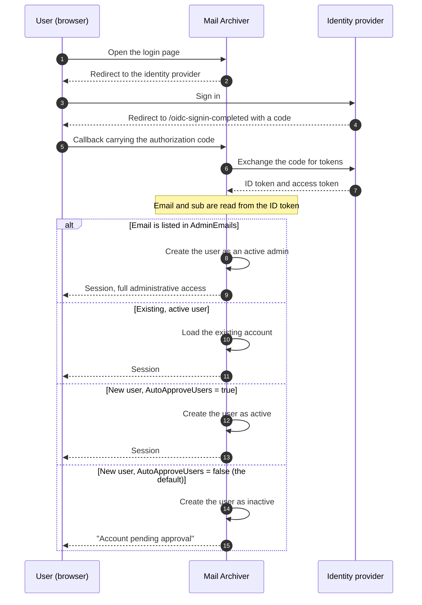

# 🔐 Guide d'authentification OpenID Connect (OIDC) {#openid-connect-oidc-authentication-guide}

[← Retour à l'index de la documentation](index.md)

## 📋 Aperçu {#overview}

Ce guide fournit des instructions complètes pour la configuration de l'authentification OpenID Connect (OIDC) dans l'application Mail Archiver, avec des exemples spécifiques pour l'intégration de Microsoft Entra ID (Azure AD). OIDC permet une authentification sécurisée par authentification unique (SSO) en utilisant des fournisseurs d'identité externes.

## 📚 Table des matières {#table-of-contents}

1. [Comment fonctionne le flux de connexion](#how-the-login-flow-works)
2. [Aperçu](#overview)
3. [Prérequis](#prerequisites)
4. [Configuration OIDC](#oidc-configuration)
   - [Activer OIDC dans la Configuration](#enable-oidc-in-configuration)
   - [Variables d'environnement](#environment-variables)
5. [Configuration de Microsoft Entra ID](#microsoft-entra-id-setup)
   - [Créer une Enregistrement d'application](#create-app-registration)
   - [Configurer l'Authentification](#configure-authentication)
   - [Configurer les Autorisations API](#configure-api-permissions)
   - [Générer le Client Secret](#generate-client-secret)
6. [Configuration d'Authelia](#authelia-setup)
   - [Configuration d'Authelia](#authelia-configuration)
   - [Détails de l'Enregistrement du client](#client-registration-details)
7. [Tests et Validation](#testing-and-validation)
8. [Gestion des utilisateurs avec OIDC](#user-management-with-oidc)
9. [Approbation automatique des utilisateurs OIDC](#auto-approve-oidc-users)
10. [Configuration de la connexion sans mot de passe](#passwordless-login-configuration)
11. [Compatibilité du fournisseur](#provider-compatibility)

## 🔄 Fonctionnement du flux de connexion {#how-the-login-flow-works}

Le diagramme montre l'intégralité du cycle — navigateur, Mail Archiver et fournisseur d'identité — et, plus important encore, la décision locale prise par Mail Archiver *après* que le fournisseur a déjà accepté l'utilisateur.



Une connexion réussie auprès du fournisseur n'est donc **pas** la fin de l'histoire. Avec le `AutoApproveUsers=false` par défaut, un nouvel utilisateur est créé de manière inactive et un administrateur doit activer le Compte. Un utilisateur qui s'authentifie correctement mais ne parvient toujours pas à se connecter a presque toujours rencontré cette barrière plutôt qu'une mauvaise configuration OIDC.

## 🌐 Aperçu {#overview}

L'application Mail Archiver prend en charge l'authentification OpenID Connect (OIDC), permettant aux utilisateurs de s'authentifier via des fournisseurs d'identité externes tels que Microsoft Entra ID et d'autres fournisseurs conformes à OIDC. Cette fonctionnalité renforce la sécurité en exploitant les systèmes de gestion d'identité d'entreprise et permet des capacités d'authentification unique (SSO).

## 🛠️ Prérequis {#prerequisites}

- Accès administratif à votre fournisseur d'identité OIDC choisi (ex: Microsoft Entra ID)
- Application Mail Archiver déjà déployée et accessible via HTTPS
- Nom DNS configuré pour votre instance Mail Archiver (requis pour les URL de callback)
- Accès administratif à l'application Mail Archiver et au système hôte pour la configuration
- Si vous utilisez un reverse proxy, une [configuration de reverse proxy](ReverseProxy.md) appropriée pour la gestion des en-têtes HTTPS

## 🔧 Configuration du Reverse Proxy pour OIDC {#reverse-proxy-configuration-for-oidc}

Lors du déploiement de Mail Archiver derrière un reverse proxy avec l'authentification OIDC, une configuration supplémentaire peut être nécessaire pour assurer une gestion correcte des flux d'authentification et des échanges de jetons. L'authentification OIDC implique des en-têtes HTTP et des corps de réponse plus volumineux qui peuvent dépasser les tailles de tampon par défaut dans certaines configurations de reverse proxy.

### Configuration de Nginx Proxy Manager {#nginx-proxy-manager-configuration}

Si vous utilisez Nginx Proxy Manager comme reverse proxy, vous devrez peut-être ajouter la configuration suivante pour gérer correctement l'authentification OIDC :

```nginx
proxy_busy_buffers_size 512k;
proxy_buffers 4 512k;
proxy_buffer_size 256k;
```

Ces paramètres augmentent les tailles de tampon pour accommoder les jetons OIDC et les réponses d'authentification plus volumineux. Sans ces paramètres, vous pourriez rencontrer des problèmes avec les flux d'authentification, particulièrement avec les fournisseurs qui renvoient des jetons ID volumineux ou lors de l'utilisation de scopes supplémentaires.

### Considérations Générales pour le Reverse Proxy {#general-reverse-proxy-considerations}

- Assurez-vous que votre reverse proxy préserve les en-têtes HTTPS (`X-Forwarded-Proto`, `X-Forwarded-Host`)
- Configurez des paramètres de timeout appropriés pour les flux d'authentification
- Vérifiez que les tailles d'en-tête importantes sont prises en charge
- Testez minutieusement le flux d'authentification après les changements de configuration

Pour des conseils détaillés sur la configuration du reverse proxy, reportez-vous au [Reverse Proxy Configuration Guide](ReverseProxy.md).

## ⚙️ Configuration OIDC {#oidc-configuration}

### Activer OIDC dans la Configuration {#enable-oidc-in-configuration}

Pour activer l'authentification OIDC, vous devez configurer la section OAuth dans votre fichier `appsettings.json` ou via les variables d'environnement pour le déploiement docker (voir [Installation and Setup](Setup.md)).

#### Exemple de Configuration (appsettings.json) {#example-configuration-appsettingsjson}

```json
{
  "OAuth": {
    "Enabled": true,
    "Authority": "https://sts.windows.net/{TENANT-ID}/",
    "ClientId": "YOUR-CLIENT-ID",
    "ClientSecret": "YOUR-CLIENT-SECRET",
    "ClientScopes": [
      "openid",
      "profile",
      "email"
    ],
    "DisablePasswordLogin": false
  }
}
```

### Variables d'Environnement {#environment-variables}

Lorsque vous utilisez Docker Compose ou des variables d'environnement, configurez les variables suivantes dans votre fichier `docker-compose.yml` sous la section environment du service `mailarchive-app` :

```yaml
environment:
  # OIDC Configuration
  - OAuth__Enabled=true
  - OAuth__Authority=https://sts.windows.net/{TENANT-ID}/
  - OAuth__ClientId=YOUR-CLIENT-ID
  - OAuth__ClientSecret=YOUR-CLIENT-SECRET
  - OAuth__DisplayName=PocketID SSO
  - OAuth__ClientScopes__0=openid
  - OAuth__ClientScopes__1=profile
  - OAuth__ClientScopes__2=email
  - OAuth__DisablePasswordLogin=false
  - OAuth__AutoApproveUsers=false
```

### Explication des Paramètres de Configuration {#configuration-parameters-explained}

- **OAuth__Enabled** : Définir sur `true` pour activer l'authentification OIDC
- **OAuth__Authority** : L'URL d'autorité OpenID Connect de votre fournisseur d'identité
- **OAuth__ClientId** : L'ID client assigné par votre fournisseur d'identité
- **OAuth__ClientSecret** : Le secret client assigné par votre fournisseur d'identité
- **OAuth__DisplayName** : Nom d'affichage optionnel pour le bouton de connexion OIDC (par exemple, `PocketID SSO` s'affiche comme `Login with PocketID SSO`)
- **OAuth__ClientScopes** : Tableau des scopes demandés au fournisseur d'identité
- **OAuth__ResponseMode** : Mode de réponse de la requête d'autorisation : `query`, `fragment` ou `form_post`. Laissez vide pour conserver la valeur par défaut (`form_post`). Les fournisseurs ne supportant pas `form_post` nécessitent `query` ; voir [Provider Compatibility](#provider-compatibility)
- **OAuth__DisablePasswordLogin** : Définir sur `true` pour désactiver la connexion traditionnelle par nom d'utilisateur/mot de passe et imposer une authentification uniquement via OAuth (voir Passwordless Login Configuration pour plus de détails)
- **OAuth__AutoApproveUsers** : Définir sur `true` pour approuver automatiquement les nouveaux utilisateurs OIDC sans nécessiter l'approbation d'un administrateur (par défaut : `false`). Voir [Auto-Approve OIDC Users](#auto-approve-oidc-users) pour plus de détails

> ⚠️ **Important** : Le Client Secret doit être conservé en toute sécurité. Utilisez les secrets Docker ou les variables d'environnement dans les environnements de production.

## ☁️ Configuration de Microsoft Entra ID {#microsoft-entra-id-setup}

Cette section fournit des instructions étape par étape pour configurer Microsoft Entra ID (anciennement Azure AD) en tant que fournisseur d'identité OIDC pour Mail Archiver.

### 🚀 Créer une inscription d'application {#create-app-registration}

1. Accédez au [Microsoft Entra Admin Center](https://entra.microsoft.com)
2. Connectez-vous avec votre Compte administrateur
3. Dans le volet de navigation de gauche, sélectionnez **App registrations**
4. Cliquez sur **+ New registration** en haut de la page App registrations
5. Remplissez les détails suivants :
   - **Name** : Saisissez un nom descriptif (ex: "Mail Archiver OIDC")
   - **Supported account types** : Sélectionnez **Accounts in this organizational directory only**
   - **Redirect URI** : Sélectionnez **Web** et saisissez l'URL de rappel de votre Mail Archiver :
     ```
     https://your-mail-archiver-domain/oidc-signin-completed
     ```
     Remplacez `your-mail-archiver-domain` par votre domaine réel (ex: `mailarchiver.example.com`)
6. Cliquez sur **Register**

### 🔐 Configurer l'authentification {#configure-authentication}

1. Après l'inscription, notez les valeurs suivantes sur la page **Overview** de l'inscription de l'application :
   - **Application (client) ID** - Vous en aurez besoin en tant que `OAuth__ClientId`
   - **Directory (tenant) ID** - Vous en aurez besoin pour construire l'URL Authority
2. Construisez l'**Authority URL** à partir du **Directory (tenant) ID** que vous venez de copier. Pour Microsoft Entra ID, l'Authority est construite comme suit :
   ```
   https://sts.windows.net/<TENANT-ID>/
   ```
   Remplacez `<TENANT-ID>` (également appelé Mandanten-ID) par la valeur affichée à côté de l'Application (client) ID sur la page Overview de l'inscription de l'application. Par exemple, si votre Directory (tenant) ID est `11111111-2222-3333-4444-555555555555`, votre Authority devient :
   ```
   https://sts.windows.net/11111111-2222-3333-4444-555555555555/
   ```
   Utilisez cette valeur comme `OAuth__Authority` dans votre configuration. Assurez-vous d'inclure le slash final.
   > ℹ️ **Note** : `https://sts.windows.net/<TENANT-ID>/` et `https://login.microsoftonline.com/<TENANT-ID>/v2.0` sont tous deux des points de terminaison d'autorité Entra ID valides. La forme `sts.windows.net` utilise le point de terminaison v1.0 et est recommandée pour ce guide.
3. Dans le menu de gauche, sélectionnez **Authentication**
4. Cliquez sur **Settings**
5. Sous **Implicit grant and hybrid flows**, assurez-vous que **ID tokens** est coché
6. Sous **Supported account types**, vérifiez que votre sélection correspond à vos besoins
7. Sous **Redirect URIs**, assurez-vous que votre URL de rappel est correctement répertoriée

### 🎯 Configurer les permissions API {#configure-api-permissions}

1. Dans le menu de gauche, sélectionnez **API permissions**
2. Cliquez sur **+ Add a permission**
3. Sélectionnez **Microsoft Graph**
4. Choisissez **Delegated permissions**
5. Ajoutez les permissions suivantes (si nécessaire pour des fonctionnalités supplémentaires) :
   - **openid** - Connecter les utilisateurs 
   - **email** - Voir l'adresse e-mail des utilisateurs
   - **profile** - Voir le profil de base des utilisateurs
6. Cliquez sur **Add permissions**
7. Cliquez sur **Grant admin consent for [Your Organization]** si vous souhaitez pré-autoriser l'application

### 🔑 Générer un Client Secret {#generate-client-secret}

1. Accédez à **Certificates & secrets** dans le menu de gauche
2. Sous **Client secrets**, cliquez sur **+ New client secret**
3. Fournissez une description (ex: "Mail Archiver Auth Secret")
4. Sélectionnez une période d'expiration
5. Cliquez sur **Add**
6. **Important** : Copiez la **Value** immédiatement et stockez-la de manière sécurisée. Ce secret ne sera plus affiché par la suite. Il est nécessaire en tant que `OAuth__ClientSecret`

## 🔐 Configuration d'Authelia {#authelia-setup}

Cette section fournit les détails de configuration pour configurer Authelia en tant que fournisseur d'identité OIDC pour Mail Archiver. Authelia est un serveur d'authentification et d'autorisation open-source qui prend en charge OIDC.

### 🛠️ Configuration d'Authelia {#authelia-configuration}

```yaml
identity_providers:
  oidc:
    clients:
      - client_id: 'mailarchiver'
        client_name: 'mailarchiver'
        client_secret: '$xyzg'  # The digest of 'insecure_secret'.
        public: false
        redirect_uris:
          - 'https://your-mail-archiver-domain/oidc-signin-completed'
        scopes:
          - 'openid'
          - 'profile'
          - 'email'
        response_types:
          - 'code'
        grant_types:
          - 'authorization_code'
        token_endpoint_auth_method: 'client_secret_post'
```

### 📝 Détails de l'enregistrement du client {#client-registration-details}

- **client_id**: `mailarchiver` - L'identifiant unique pour l'application Mail Archiver
- **client_name**: `mailarchiver` - Le nom d'affichage montré aux utilisateurs lors de l'authentification
- **client_secret**: Le secret haché utilisé pour l'authentification du client (remplacez par votre propre secret sécurisé en production)
- **redirect_uris**: L'URL de rappel où Authelia redirigera les utilisateurs après l'authentification. Remplacez `[YOUR_MAILARCHIVER_URL]` par votre domaine Mail Archiver réel
- **scopes**: Les Autorisation demandées à Authelia :
  - `openid`: Requis pour l'authentification OIDC
  - `profile`: Accès aux informations de profil de base
  - `email`: Accès à l'adresse e-mail
- **response_types**: `code` - Flux de code d'autorisation
- **grant_types**: `authorization_code` - Type d'octroi de code d'autorisation
- **token_endpoint_auth_method**: `client_secret_post` - Méthode d'authentification du client

> ⚠️ **Note de sécurité** : L'exemple utilise un secret par défaut pour la démonstration. En production, générez un secret sécurisé et hachez-le à l'aide des outils d'Authelia. N'utilisez jamais le secret de l'exemple dans des environnements de production.

## 🧪 Tests et validation {#testing-and-validation}

### Tests de configuration initiale {#initial-setup-testing}

1. Redémarrez votre application Mail Archiver après avoir configuré les paramètres OIDC
2. Accédez à votre page de connexion Mail Archiver
3. Vous devriez voir un nouveau bouton de connexion OAuth à côté du formulaire de connexion habituel. Avec `OAuth__DisplayName=PocketID SSO`, le bouton affiche `Login with PocketID SSO`.
4. Cliquez sur le bouton de connexion OAuth pour initier le flux OIDC
5. Vous devriez être redirigé vers la page de connexion de votre fournisseur d'identité
6. Après une authentification réussie, vous devriez être redirigé vers Mail Archiver

### Validation du provisionnement des utilisateurs {#user-provisioning-validation}

- Les utilisateurs OIDC utilisant le service pour la première fois seront automatiquement créés dans la base de données Mail Archiver
- Les utilisateurs seront créés avec le rôle par défaut "User" et devront obtenir l'approbation d'un administrateur pour accéder au service

## 👥 Gestion des utilisateurs avec OIDC {#user-management-with-oidc}

### Rôles et Autorisations des utilisateurs {#user-roles-and-permissions}

Les utilisateurs OIDC suivent le même contrôle d'accès basé sur les rôles que les utilisateurs locaux :
- **Admin** : Accès complet au système (nécessite une affectation manuelle par un admin existant, ou automatique via la configuration AdminEmails)
- **User** : Accès utilisateur standard aux comptes de messagerie assignés
- **Self-Manager** : Peut gérer son propre Compte et ajouter de nouveaux comptes

### Provisionnement automatique des administrateurs {#auto-provisioning-administrators}

Vous pouvez configurer des adresses e-mail spécifiques pour qu'elles soient automatiquement provisionnées en tant qu'administrateurs lors de leur première connexion via OIDC :

```json
{
  "OAuth": {
    "AdminEmails": [
      "admin@example.com",
      "it-manager@example.com"
    ]
  }
}
```

Lorsqu'un utilisateur possédant l'une de ces adresses e-mail se connecte pour la première fois :
- Il est automatiquement créé en tant qu'administrateur actif
- Aucune approbation manuelle n'est requise
- Il obtient immédiatement les privilèges administratifs complets
- La correspondance des e-mails ne tient pas compte de la casse

**Note de sécurité** : N'ajoutez que des adresses e-mail de confiance à cette liste, car ces utilisateurs auront un accès complet au système.

### Flux de provisionnement des utilisateurs {#user-provisioning-flow}

#### Nouveaux utilisateurs (Hors AdminEmails) {#new-users-not-in-adminemails}
1. L'utilisateur s'authentifie via le fournisseur OAuth
2. Le système vérifie si l'e-mail existe dans la base de données locale
3. Si l'utilisateur est nouveau :
   - Le Compte est créé avec un nom d'utilisateur dérivé des revendications OIDC, dans cet ordre de préférence :
     1. La **partie locale de l'e-mail** (tout ce qui précède `@`), ex : `example.mailarchiver` pour `example.mailarchiver@xxxxxxxxx.onmicrosoft.com`
     2. La revendication complète `sub` lorsqu'aucune revendication d'e-mail n'est présente
     3. `oidc_<12-char-hash>` comme solution de repli de dernier recours
     La valeur générée est tronquée à 320 caractères. Si un utilisateur local avec le même nom d'utilisateur existe déjà, `" (n)"` est ajouté jusqu'à ce qu'un nom unique soit trouvé.
   - L'utilisateur est marqué comme **inactif** et **nécessite une approbation**
   - L'admin doit activer manuellement l'utilisateur dans la gestion des Utilisateurs
4. L'utilisateur reçoit le message "Compte en attente d'approbation"

#### Nouveaux utilisateurs (Dans AdminEmails) {#new-users-in-adminemails}
1. L'utilisateur s'authentifie via le fournisseur OAuth
2. Le système reconnaît que l'e-mail est dans la liste AdminEmails
3. Le Compte est automatiquement créé :
   - L'utilisateur est marqué comme **actif** et **admin**
   - Aucune approbation requise
   - L'utilisateur peut accéder immédiatement au système
4. L'utilisateur est connecté avec succès

### Gestion des mots de passe {#password-management}

Les utilisateurs OIDC ne peuvent pas avoir ou changer de mots de passe au sein de Mail Archiver puisque l'authentification est gérée par le fournisseur d'identité externe :
- L'option "Change Password" sera désactivée pour les utilisateurs OIDC
- La réinitialisation du mot de passe doit être gérée via le fournisseur OIDC
- Les champs de mot de passe locaux resteront vides pour les utilisateurs OIDC

## ✅ Auto-Approuver les utilisateurs OIDC {#auto-approve-oidc-users}

Par défaut, les nouveaux utilisateurs OIDC doivent être approuvés manuellement par un administrateur local avant de pouvoir accéder à l'application. Cela fournit un modèle de double contrôle où l'IdP et l'administrateur local doivent tous deux accorder l'accès.

Pour les **déploiements OIDC-first** où le fournisseur d'identité (IdP) est la source unique de vérité pour le contrôle d'accès, cette étape d'approbation manuelle peut être ignorée en activant l'option `AutoApproveUsers`.

### Activer l'auto-approbation {#enabling-auto-approve}

Définissez `AutoApproveUsers` sur `true` dans votre configuration :

```json
{
  "OAuth": {
    "Enabled": true,
    "AutoApproveUsers": true,
    "Authority": "https://your-provider.com",
    "ClientId": "your-client-id",
    "ClientSecret": "your-secret"
  }
}
```

Ou via une variable d'environnement :

```yaml
environment:
  - OAuth__AutoApproveUsers=true
```

### Comportement {#behavior}

| Paramètre | Comportement des nouveaux utilisateurs OIDC |
|---|---|
| `AutoApproveUsers: false` (par défaut) | L'utilisateur est créé comme **inactif** et **nécessite l'approbation d'un administrateur** avant que l'accès ne soit accordé |
| `AutoApproveUsers: true` | L'utilisateur est créé comme **actif** et peut accéder immédiatement à l'application |

> **Note** : `AdminEmails` prend toujours la priorité — les utilisateurs correspondant à `AdminEmails` sont toujours auto-approuvés en tant qu'administrateurs, quel que soit ce paramètre.

### Quand l'utiliser {#when-to-use}

Cette option est recommandée pour les environnements où :
- L'**IdP contrôle l'accès à l'application** (par exemple, via l'affectation d'application ou l'appartenance à un groupe dans Authentik, Entra ID, Authelia, etc.)
- Vous souhaitez **éliminer le modèle de double contrôle** (octroi par l'IdP + approbation de l'administrateur local)
- La **révocation de l'accès est gérée au niveau de l'IdP** (la suppression de l'affectation de l'application empêche automatiquement la connexion)

### Exemple de configuration complète OIDC-First {#complete-oidc-first-setup-example}

```json
{
  "OAuth": {
    "Enabled": true,
    "Authority": "https://sts.windows.net/YOUR_TENANT_ID/",
    "ClientId": "your-client-id",
    "ClientSecret": "your-secret",
    "DisplayName": "PocketID SSO",
    "ClientScopes": ["openid", "profile", "email"],
    "DisablePasswordLogin": true,
    "AutoRedirect": true,
    "AutoApproveUsers": true,
    "AdminEmails": ["admin@company.com"]
  }
}
```

Dans cette configuration :
- Les utilisateurs sont automatiquement redirigés vers le fournisseur OIDC
- Les nouveaux utilisateurs sont automatiquement approuvés lors de leur première connexion
- Les e-mails des administrateurs sont auto-provisionnés en tant qu'administrateurs
- Le contrôle d'accès est entièrement géré au niveau de l'IdP

### Considérations de sécurité {#security-considerations}

- **Confiance** : Activer `AutoApproveUsers` signifie que vous faites confiance à l'IdP pour contrôler qui peut accéder à l'application. Assurez-vous que votre IdP est correctement configuré avec les affectations d'applications ou les accès basés sur les groupes appropriés.
- **Attribution de rôle** : Les utilisateurs auto-approuvés sont créés avec des permissions d'utilisateur standard (pas d'admin). L'accès administrateur nécessite toujours soit une configuration `AdminEmails`, soit une attribution de rôle manuelle.
- **Révocation** : Lorsqu'un accès utilisateur est supprimé dans l'IdP, il ne peut plus s'authentifier via OIDC. Cependant, son Compte local reste actif. Pour révoquer complètement l'accès, désactivez également l'utilisateur dans le panneau d'administration de Mail Archiver.
- **Compatibilité ascendante** : La valeur par défaut est `false`, préservant le comportement existant pour les déploiements actuels.

## 🔒 Configuration de la connexion sans mot de passe {#passwordless-login-configuration}

> ⚠️ **Important** : Même avec une configuration de connexion sans mot de passe, un utilisateur administrateur initial est toujours créé lors du premier démarrage. Vous devez définir un mot de passe sécurisé pour cet utilisateur administrateur dans votre fichier `appsettings.json` ou `docker-compose.yml` pour garantir la sécurité du système.

Pour les organisations qui souhaitent imposer une authentification exclusivement via OAuth, l'application permet de désactiver entièrement la connexion par mot de passe.

### Désactivation de la connexion par mot de passe {#disabling-password-login}

Définissez `DisablePasswordLogin` sur `true` pour désactiver la connexion par nom d'utilisateur/mot de passe :

```json
{
  "OAuth": {
    "Enabled": true,
    "DisablePasswordLogin": true,
    "Authority": "https://your-provider.com",
    "ClientId": "your-client-id",
    "ClientSecret": "your-secret"
  }
}
```

**Résultat** : La page de connexion n'affiche que le bouton de connexion OAuth, et le serveur rejette chaque POST de mot de passe (`/Auth/Login`) avec une redirection vers la page de connexion. Les mots de passe locaux restent stockés dans la base de données mais ne peuvent plus être utilisés pour se connecter tant que le mode exclusivement OAuth est actif. Si `DisplayName` est configuré, le bouton utilise cette valeur (par exemple, `Login with PocketID SSO`).

### Redirection automatique vers le fournisseur OAuth {#auto-redirect-to-oauth-provider}

Activez `AutoRedirect` pour rediriger automatiquement les utilisateurs vers votre fournisseur OAuth :

```json
{
  "OAuth": {
    "Enabled": true,
    "DisablePasswordLogin": true,
    "AutoRedirect": true,
    "Authority": "https://your-provider.com",
    "ClientId": "your-client-id",
    "ClientSecret": "your-secret"
  }
}
```

**Configuration requise** : 
- `DisablePasswordLogin` doit être `true`
- `OAuth.Enabled` doit être `true`

**Résultat** : Les utilisateurs voient un bref écran de chargement et sont automatiquement redirigés vers le fournisseur OAuth.

### Exemple de configuration complète sans mot de passe {#complete-passwordless-setup-example}

```json
{
  "OAuth": {
    "Enabled": true,
    "Authority": "https://sts.windows.net/YOUR_TENANT_ID/",
    "ClientId": "your-client-id",
    "ClientSecret": "your-secret",
    "DisplayName": "PocketID SSO",
    "ClientScopes": ["openid", "profile", "email"],
    "DisablePasswordLogin": true,
    "AutoRedirect": true,
    "AdminEmails": ["admin@company.com", "it@company.com"]
  }
}
```

### Considérations relatives à la sécurité {#security-considerations}

- **Provisionnement de l'e-mail administrateur** : Le fournisseur OAuth est considéré comme fiable pour vérifier les adresses e-mail. N'ajoutez que des adresses de confiance à AdminEmails.
- **Accès d'urgence** : Avec `DisablePasswordLogin=true`, aucun mot de passe local ne peut être utilisé pour se connecter, y compris le Compte administrateur de démarrage. Assurez-vous qu'au moins une identité OAuth est provisionnée en tant qu'administrateur (voir `AdminEmails`) avant d'activer ce paramètre, sinon vous vous bloquerez l'accès. Pour regagner l'accès, définissez `OAuth__DisablePasswordLogin=false`, redémarrez, connectez-vous avec le mot de passe administrateur local, puis réactivez-le par la suite.
- **Tests** : Testez minutieusement l'authentification OAuth avant de désactiver la connexion par mot de passe en production.
- **Environnement SSO** : La redirection automatique est particulièrement adaptée aux environnements de single sign-on où tous les utilisateurs s'authentifient via le même fournisseur.

## 🧩 Compatibilité du fournisseur {#provider-compatibility}

Tous les fournisseurs d'identité n'implémentent pas l'intégralité de la spécification OIDC. Les deux paramètres ci-dessous existent pour cette raison, et tous deux sont nécessaires pour le Synology SSO Server.

### Response Mode {#response-mode}

La requête d'autorisation est envoyée avec le response mode `form_post`, le mode par défaut du gestionnaire OpenID Connect ASP.NET Core sous-jacent. Un fournisseur qui ne le prend pas en charge échoue généralement avec son propre message et rien n'apparaît dans le journal du Mail Archiver.

Le Synology SSO Server se comporte de cette manière : son document de découverte omet `response_modes_supported`, et la connexion s'arrête avec le message "Unable to sign in via SSO due to setting issues". Définissez explicitement le response mode :

```env
OAuth__ResponseMode=query
```

Les valeurs valides sont `query`, `fragment` et `form_post`. Laissez le paramètre vide pour conserver la valeur par défaut. En cas de doute, `query` est le choix le plus sûr : c'est le seul response mode que chaque fournisseur OIDC est tenu de prendre en charge.

### Name and Email Claims {#name-and-email-claims}

Le nom d'affichage d'un nouvel utilisateur est extrait de la réponse user info, dans cet ordre :

1. `name`
2. `preferred_username`
3. `given_name`
4. `username`

Les claims présents mais vides ou n'étant pas une chaîne de caractères sont ignorés. `username` n'est pas un claim standard OIDC, mais certains fournisseurs le renvoient comme seule valeur de type nom (encore une fois, le Synology SSO Server). L'adresse e-mail est lue à partir de `email`, puis `mail`, puis `upn`, et utilise par défaut les claims du ID token.

Si aucun des name claims n'est présent, la connexion échoue. L'utilisateur est renvoyé vers la page de connexion avec un message lisible nommant les claims recherchés, et la raison est écrite dans le journal au niveau error.

---

**Note** : Ce guide est à jour en 2025. Les services de fournisseurs d'identité mettent régulièrement à jour leurs interfaces et leurs fonctionnalités, certains éléments de l'interface utilisateur peuvent donc différer. Référez-vous toujours à la documentation la plus récente de votre fournisseur d'identité pour obtenir les informations les plus à jour.
