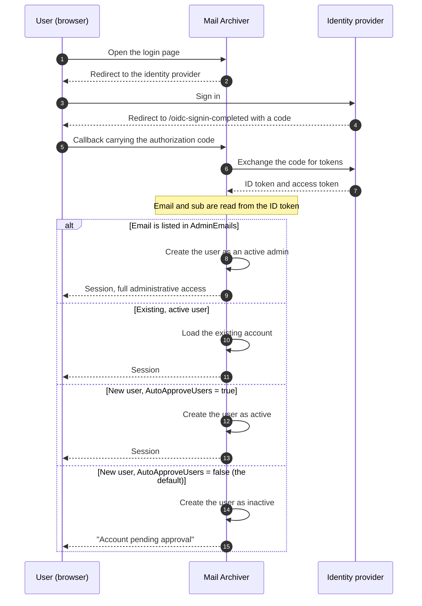

# 🔐 OpenID Connect (OIDC) Authentication Guide {#openid-connect-oidc-authentication-guide}

[← Vissza a dokumentáció indexéhez](index.md)

## 📋 Overview {#overview}

Ez a útmutató átfogó utasításokat nyújt az OpenID Connect (OIDC) hitelesítés beállításához a Mail Archiver alkalmazásban, Microsoft Entra ID (Azure AD) integrációra vonatkozó konkrét példákkal. Az OIDC lehetővé teszi a biztonságos, egységes bejelentkezés (SSO) hitelesítését külső identitáskezelő szolgáltatók használatával.

## 📚 Tartalomjegyzék {#table-of-contents}

1. [Hogyan működik a bejelentkezési folyamat](#how-the-login-flow-works)
2. [Áttekintés](#overview)
3. [Előfeltételek](#prerequisites)
4. [OIDC konfiguráció](#oidc-configuration)
   - [OIDC engenablemesi a konfigurációban](#enable-oidc-in-configuration)
   - [Környezeti változók](#environment-variables)
5. [Microsoft Entra ID beállítás](#microsoft-entra-id-setup)
   - [Alkalmazás regisztráció létrehozása](#create-app-registration)
   - [Hitelesítés konfigurálása](#configure-authentication)
   - [API jogosultságok konfigurálása](#configure-api-permissions)
   - [Client Secret generálása](#generate-client-secret)
6. [Authelia beállítás](#authelia-setup)
   - [Authelia konfiguráció](#authelia-configuration)
   - [Client regisztrációs adatok](#client-registration-details)
7. [Tesztelés és validálás](#testing-and-validation)
8. [Felhasználói kezelés OIDC használatával](#user-management-with-oidc)
9. [OIDC felhasználók automatikus jóváhagyása](#auto-approve-oidc-users)
10. [Jelszó nélküli bejelentkezés konfigurációja](#passwordless-login-configuration)
11. [Provider kompatibilitás](#provider-compatibility)

## 🔄 Hogyan működik a bejelentkezési folyamat {#how-the-login-flow-works}

A diagram az egész folyamatot mutatja — a böngészőt, a Mail Archivert és az identitásmegelőzőt (identity provider) — és, ami még fontosabb, azt a helyi döntést, amelyet a Mail Archiver hoz *miután* a szolgáltató már elfogadta a felhasználót.



A szolgáltatónál sikeres bejelentkezés tehát **nem** a történet vége. A gyári `AutoApproveUsers=false` esetén az új felhasználó inaktív állapotban kerül létrevetésre, amelyet egy adminisztrátornak kell aktiválnia. A felhasználó, aki megfelelően hitelesíti magát, de még mindig nem tud bejelentkezni, szinte minden esetben ebbe az akadályba ütközik, nem pedig az OIDC hibás konfigurációba.

## 🌐 Áttekintés {#overview}

A Mail Archiver alkalmazás támogatja az OpenID Connect (OIDC) hitelesítést, lehetővé téve a felhasználók számára a hitelesítést olyan külső identitáskezelő szolgáltatók használatával, mint a Microsoft Entra ID és egyéb, az OIDC szabványnak megfelelő szolgáltatók. Ez a funkció fokozott biztonságot biztosít az enterprise identitáskezelési rendszerek kihasználásával, valamint lehetővé teszi az egyetlen feljelentkezési (SSO) lehetőségeket is.

## 🛠️ Előfeltételek {#prerequisites}

- Adminisztrációs hozzáférés a választott OIDC identitásmegelőzőhöz (pl. Microsoft Entra ID)
- A Mail Archiver alkalmazás már telepítve van és elérhető HTTPS protokollon keresztül
- A Mail Archiver példányhoz konfigurált DNS név (szükséges a callback URL-ekhez)
- Adminisztrációs hozzáférés a Mail Archiver alkalmazáshoz és a konfigurációhoz a gazdagéphez
- Ha reverse proxy-t használ, a megfelelő [reverse proxy configuration](ReverseProxy.md) az HTTPS header kezeléshez

## 🔧 OIDC Reverse Proxy konfiguráció {#reverse-proxy-configuration-for-oidc}

Amikor a Mail Archiver-t OIDC hitelesítéssel rendelkező reverse proxy mögé helyezik ki, további konfigurációra lehet szükség az autentikációs folyamatok és a token-cserék megfelelő kezeléséhez. Az OIDC hitelesítés nagyobb HTTP headereket és választesteket (response bodies) involveál, amelyek egyes reverse proxy konfigurációk esetén meghaladhatják a gyári buffer méreteket.

### Nginx Proxy Manager konfiguráció {#nginx-proxy-manager-configuration}

Ha az Nginx Proxy Manager-t használja reverse proxyként, a következő konfigurációt kellően hozzáadhatja az OIDC hitelesítés megfelelő kezeléséhez:

```nginx
proxy_busy_buffers_size 512k;
proxy_buffers 4 512k;
proxy_buffer_size 256k;
```

Ezek a beállítások növelik a buffer méreteket, hogy helyet biztosítsanak a nagyobb OIDC tokenek és autentikációs válaszok számára. Ezek nélkül problémákba ütközhet az autentikációs folyamatokkal, különösen olyan szolgáltatókkal, amelyek nagy ID tokeneket küldenek vissza, vagy amikor további scope-okat használnak.

### Általános Reverse Proxy szempontok {#general-reverse-proxy-considerations}

- Győződjön meg róla, hogy a reverse proxy megőrzi az HTTPS headereket (`X-Forwarded-Proto`, `X-Forwarded-Host`)
- Konfiguráljon megfelelő timeout beállításokat az autentikációs folyamatokhoz
- Ellenőrizze, hogy a nagy header méretek támogatása biztosított-e
- Grundoljon át alaposan az autentikációs folyamatot a konfigurációs változtatások után

A részletes reverse proxy konfigurációs útmutatóért tekintse át a [Reverse Proxy Configuration Guide](ReverseProxy.md) dokumentációt.

## ⚙️ OIDC Konfiguráció {#oidc-configuration}

### OIDC engedélyezése a Konfigurációban {#enable-oidc-in-configuration}

Az OIDC hitelesítés engedélyezéséhez konfigurálnia kell az OAuth szakaszt a `appsettings.json` fájlban, vagy a Docker deployment esetén a környezeti változókat (lásd: [Installation and Setup](Setup.md)).

#### Konfigurációs példa (appsettings.json) {#example-configuration-appsettingsjson}

```json
{
  "OAuth": {
    "Enabled": true,
    "Authority": "https://sts.windows.net/{TENANT-ID}/",
    "ClientId": "YOUR-CLIENT-ID",
    "ClientSecret": "YOUR-CLIENT-SECRET",
    "ClientScopes": [
      "openid",
      "profile",
      "email"
    ],
    "DisablePasswordLogin": false
  }
}
```

### Környezeti változók {#environment-variables}

Docker Compose vagy környezeti változók használata esetén konfigurálja az alábbi változókat a `docker-compose.yml` fájlban a `mailarchive-app` service environment szekció alatt:

```yaml
environment:
  # OIDC Configuration
  - OAuth__Enabled=true
  - OAuth__Authority=https://sts.windows.net/{TENANT-ID}/
  - OAuth__ClientId=YOUR-CLIENT-ID
  - OAuth__ClientSecret=YOUR-CLIENT-SECRET
  - OAuth__DisplayName=PocketID SSO
  - OAuth__ClientScopes__0=openid
  - OAuth__ClientScopes__1=profile
  - OAuth__ClientScopes__2=email
  - OAuth__DisablePasswordLogin=false
  - OAuth__AutoApproveUsers=false
```

### A Konfigurációs Paraméterek Magyarázata {#configuration-parameters-explained}

- **OAuth__Enabled**: Állítsa `true` értékre az OIDC hitelesítés engedélyezéséhez
- **OAuth__Authority**: Az identitásmegelőző (identity provider) OpenID Connect authority URL-je
- **OAuth__ClientId**: Az identitásmegelőző által kiosztott client ID
- **OAuth__ClientSecret**: Az identitásmegelőző által kiosztott client secret
- **OAuth__DisplayName**: Opcionális megjelenítési név az OIDC bejelentkezési gombhoz (például: `PocketID SSO` úgy jelenik meg, mint `Login with PocketID SSO`)
- **OAuth__ClientScopes**: Az identitásmegelőzőtől kért scope-ok tömbje
- **OAuth__ResponseMode**: Az engedélyezési kérés válaszrežime (response mode): `query`, `fragment` vagy `form_post`. Hagyja üresen az alapértelmezett (`form_post`) érték megtartásához. Az `form_post` támogatását nem biztosító szolgáltatókhoz `query` szükséges; lásd: [Provider Compatibility](#provider-compatibility)
- **OAuth__DisablePasswordLogin**: Állítsa `true` értékre a hagyományos felhasználónév/jelszó bejelentkezés letiltásához, és kizárólag OAuth hitelesítés kényszerítéséhez (lásd: Passwordless Login Configuration a további részletekért)
- **OAuth__AutoApproveUsers**: Állítsa `true` értékre, hogy az új OIDC felhasználókat adminisztrátori jóváhagyás nélkül, automatikusan jóváhagyja (alapértelmezett: `false`). Részletekért lásd: [Auto-Approve OIDC Users](#auto-approve-oidc-users)

> ⚠️ **Fontos**: A Client Secretet biztonságosan kell kezelni. Termelési környezetben használjon Docker secrets vagy környezeti változókat.

## ☁️ Microsoft Entra ID beállítás {#microsoft-entra-id-setup}

Ez a szakasz lépésről lépésre kidolgozott utasításokat nyújt a Microsoft Entra ID (korábban Azure AD) konfigurálásához az OIDC identitás-ellátóként a Mail Archiver számára.

### 🚀 Alkalmazás regisztráció létrehozása {#create-app-registration}

1. Navigáljon a [Microsoft Entra Admin Center](https://entra.microsoft.com) felületre
2. Jelentkezzen be adminisztrátori fiókjával
3. A bal oldali navigációs panelel a **App registrations** lehetőséget válassza ki
4. Kattintson a az App registrations oldal tetején található **+ New registration** gombra
5. Töltse ki az alábbi adatokat:
   - **Name**: Adjon meg egy leíró jellegű nevet (pl. "Mail Archiver OIDC")
   - **Supported account types**: Válassza az **Accounts in this organizational directory only** lehetőséget
   - **Redirect URI**: Válassza a **Web** lehetőséget, majd adja meg a Mail Archiver callback URL-jét:
     ```
     https://your-mail-archiver-domain/oidc-signin-completed
     ```
     A `your-mail-archiver-domain` helyére adja meg a saját domain nevét (pl. `mailarchiver.example.com`)
6. Kattintson a **Register** gombra

### 🔐 Hitelesítés konfigurálása {#configure-authentication}

1. A regisztráció után jegyezze fel az alábbi értékeket az alkalmazás regisztráció **Overview** oldaláról:
   - **Application (client) ID** - Erre szüksége lesz `OAuth__ClientId` formában
   - **Directory (tenant) ID** - Erre szüksége lesz az Authority URL felépítéséhez
2. Az imént másolt **Directory (tenant) ID** alapján állítsa össze az **Authority URL**-t. A Microsoft Entra ID esetén az Authority az alábbi módon épül fel:
   ```
   https://sts.windows.net/<TENANT-ID>/
   ```
   A `<TENANT-ID>` (amely Mandanten-ID-ként is ismert) helyére írja be az alkalmazás regisztráció Overview oldalán az Application (client) ID mellett látható értéket. Például, ha a Directory (tenant) ID `11111111-2222-3333-4444-555555555555`, akkor az Authority az alábbi lesz:
   ```
   https://sts.windows.net/11111111-2222-3333-4444-555555555555/
   ```
   Ezt az értéket használja `OAuth__Authority`-ként a konfigurációban. Ügyeljen arra, hogy a végén legyen záró per (slash).
   > ℹ️ **Megjegyzés**: A `https://sts.windows.net/<TENANT-ID>/` és a `https://login.microsoftonline.com/<TENANT-ID>/v2.0` egyaránt érvényes Entra ID authority végpontok. A `sts.windows.net` formátum a v1.0 végpontot használja, és ez ajánlott ebben a útmutatóban.
3. A bal oldali menüben válassza az **Authentication** lehetőséget
4. Kattintson a **Settings** gombra
5. Az **Implicit grant and hybrid flows** alatt győződjön meg arról, hogy az **ID tokens** be van pipálva
6. Az **Supported account types** alatt ellenőrizze, hogy a választás megfelel-e a követelményeknek
7. Az **Redirect URIs** alatt ellenőrizze, hogy a callback URL helyesen szerepel a listában

### 🎯 API jogosultságok konfigurálása {#configure-api-permissions}

1. A bal oldali menüben válassza az **API permissions** lehetőséget
2. Kattintson a **+ Add a permission** gombra
3. Válassza a **Microsoft Graph** lehetőséget
4. Válassza a **Delegated permissions** lehetőséget
5. Adja hozzá az alábbi jogosultságokat (ha további funkciókhoz szükséges):
   - **openid** - Felhasználók bejelentkezése
   - **email** - Felhasználók e-mail címének megtekintése
   - **profile** - Felhasználók alapvető profiljának megtekintése
6. Kattintson a **Add permissions** gombra
7. Kattintson a **Grant admin consent for [Your Organization]** gombra, ha előzetesen engedélyezni szeretné az alkalmazást

### 🔑 Client Secret generálása {#generate-client-secret}

1. Navigáljon a bal oldali menüben a **Certificates & secrets** részhez
2. Az **Client secrets** alatt kattintson a **+ New client secret** gombra
3. Adjon meg egy leírást (pl. "Mail Archiver Auth Secret")
4. Válasszon egy lejárati időt
5. Kattintson az **Add** gombra
6. **Fontos**: A **Value** értéket azonnal másolja ki, és tárolja biztonságosan. Ez a titkos érték (secret) nem fogja újra megjelenni. Erre szüksége lesz `OAuth__ClientSecret` formában

## 🔐 Authelia beállítás {#authelia-setup}

Ez a szakasz konfigurációs részleteket tartalmaz az Authelia beállításához, mint OIDC identitásszolgáltatóhoz a Mail Archiverhez. Az Authelia egy nyílt forráskódú hitelesítési és engedélyezési szerver, amely támogatja az OIDC-t.

### 🛠️ Authelia konfiguráció {#authelia-configuration}

```yaml
identity_providers:
  oidc:
    clients:
      - client_id: 'mailarchiver'
        client_name: 'mailarchiver'
        client_secret: '$xyzg'  # The digest of 'insecure_secret'.
        public: false
        redirect_uris:
          - 'https://your-mail-archiver-domain/oidc-signin-completed'
        scopes:
          - 'openid'
          - 'profile'
          - 'email'
        response_types:
          - 'code'
        grant_types:
          - 'authorization_code'
        token_endpoint_auth_method: 'client_secret_post'
```

### 📝 Client regisztrációs adatok {#client-registration-details}

- **client_id**: `mailarchiver` - A Mail Archiver alkalmazás egyedi azonosítója
- **client_name**: `mailarchiver` - A felhasználóknak a hitelesítés során megjelenő megjelenítési név
- **client_secret**: A klient hitelesítéséhez használt hashelt titkos szert (természetes környezetben helyettesítse saját, biztonságos titkával)
- **redirect_uris**: A visszahívási URL, ahová az Authelia a hitelesítés után visszirányítja a felhasználókat. Helyettesítse `[YOUR_MAILARCHIVER_URL]` értéket a valódi Mail Archiver domain nevével
- **scopes**: Az Authelia felé kért engedélyek:
  - `openid`: Szükséges az OIDC hitelesítéshez
  - `profile`: Alapvető profilinformációk elérése
  - `email`: E-mail cím elérése
- **response_types**: `code` - Authorization code flow
- **grant_types**: `authorization_code` - Authorization code grant type
- **token_endpoint_auth_method**: `client_secret_post` - Client authentication method

> ⚠️ **Biztonsági megjegyzés**: A példa egy alapértelmezett titkót használ a demonstrációhoz. Természetes környezetben generáljon biztonságos titkot, és hashelje azt az Authelia eszközeivel. Soha ne használja a példányban szereplő titkót termelési környezetben.

## 🧪 Tesztelés és Validálás {#testing-and-validation}

### Kezdő beállítási tesztelés {#initial-setup-testing}

1. Indítsa újra a Mail Archiver alkalmazást az OIDC beállítások konfigurálása után
2. Navigáljon a Mail Archiver bejelentkezési oldalára
3. Egy új OAuth bejelentkezési gombot kell látnia a normál bejelentkezési űrlap mellett. `OAuth__DisplayName=PocketID SSO` esetén a gomb felirata `Login with PocketID SSO`.
4. Kattintson az OAuth bejelentkezési gombra az OIDC folyamat elindításához
5. Átirányítást kell tapasztalnia az identitásmegfelelő (identity provider) bejelentkezési oldalára
6. A sikeres hitelesítés után vissza kell irányítania a Mail Archiver alkalmazásba

### Felhasználói provizionálás validálása {#user-provisioning-validation}

- Az első alkalommal használó OIDC felhasználók automatikusan létre werdennek a Mail Archiver adatbázisban
- A felhasználók a par défaut "User" rolával kerülnek létre, és hozzáféréshez admin jóváhagyásra lesz szükségük

## 👥 Felhasználói kezelés OIDC használatával {#user-management-with-oidc}

### Felhasználói szerepkörök és jogosultságok {#user-roles-and-permissions}

Az OIDC felhasználók ugyanazt a szerepköralapú hozzáférés-kezelést követik, mint a helyi felhasználók:
- **Admin**: Teljes rendszerszintű hozzáférés (megköveteli a meglévő admin manuális hozzáadását, vagy automatikus az AdminEmails konfiguráción keresztül)
- **User**: Standard felhasználói hozzáférés a hozzárendelt levelezési fiókokhoz
- **Self-Manager**: Képes kezelni a saját fiókját és új fiókokat hozzáadni

### Adminisztrátorok automatikus biztosítása (Auto-Provisioning) {#auto-provisioning-administrators}

Konfigurálhat olyan specifikus e-mail címeket, amelyek az első OIDC alapú bejelentkezéskor automatikusan adminisztrátoros joggal kerülnek biztosításra:

```json
{
  "OAuth": {
    "AdminEmails": [
      "admin@example.com",
      "it-manager@example.com"
    ]
  }
}
```

Amikor az alábbi e-mail címek egyikével rendelkező felhasználó először jelentkezik be:
- Automatikusan aktív adminisztrátorként kerül létrevetésre
- Nincs szükség manuális jóváhagyásra
- Azonnal teljes adminisztrátori jogosultságokat kap
- Az e-mail cím egyezése nem érzékeny a kis- és nagybetűre

**Biztonsági megjegyzés**: Csak megbízható e-mail címeket adjon hozzá ehhez a listához, mivel ezek a felhasználók teljes rendszerszintű hozzáféréssel rendelkeznek.

### Felhasználók létrehozási folyamata (User Provisioning Flow) {#user-provisioning-flow}

#### Új felhasználók (Nem szerepelnek az AdminEmails listában) {#new-users-not-in-adminemails}
1. A felhasználó az OAuth szolgáltatón keresztül autentikálódik
2. A rendszer ellenőrzi, hogy az e-mail cím szerepel-e a helyi adatbázisban
3. Ha új felhasználó:
   - A fiók létrehozásra kerül, a felhasználónév az OIDC claim-ekből származik, az alábbi sorrendben:
     1. Az **e-mail cím helyi része** (minden a `@` előtt), pl. `example.mailarchiver` esetén `example.mailarchiver@xxxxxxxxx.onmicrosoft.com`
     2. A teljes `sub` claim, ha nincs e-mail claim elérhető
     3. `oidc_<12-char-hash>`, mint utolsó megoldás (fallback)
     A generált értéket 320 karakterre tördeljük. Ha ugyanazon felhasználónévvel már létezik helyi felhasználó, `" (n)"` kerül hozzáadásra, amíg egy egyedi név nem található.
   - A felhasználót **inaktívnak** jelölik, és **jóváhagyás szükséges**
   - Az adminnak manuálisan aktívvá kell tennie a felhasználót a Users menüpontban
4. A felhasználó "Account pending approval" üzenetet kap

#### Új felhasználók (Szerepelnek az AdminEmails listában) {#new-users-in-adminemails}
1. A felhasználó az OAuth szolgáltatón keresztül autentikálódik
2. A rendszer felismeri, hogy az e-mail cím az AdminEmails listában szerepel
3. A fiók automatikusan létrehozásra kerül:
   - A felhasználót **aktívnak** és **adminnak** jelölik
   - Nincs szükség jóváhagyásra
   - A felhasználó azonnal hozzáfér a rendszerhez
4. A felhasználó sikeresen bejelentkezik

### Jelszókezelés {#password-management}

Az OIDC felhasználók nem állhatnak rendelkezésre jelszóval, és nem is változtathatnak jelszót a Mail Archiveren belül, mivel az autentikációt a külső identitáskezelő (identity provider) kezeli:
- A "Change Password" opció letiltva lesz az OIDC felhasználók számára
- A jelszó-visszaállításot az OIDC szolgáltatón keresztül kell kezelni
- A helyi jelszó mezők üresek maradnak az OIDC felhasználók esetében

## ✅ OIDC felhasználók automatikus jóváhagyása {#auto-approve-oidc-users}

Alapértelmezés szerint az új OIDC felhasználókat manuálisan jóvá kell engednie egy helyi adminisztrátornak, mielőtt hozzáférhetnének az alkalmazáshoz. Ez egy kettős ellenőrzési modellt biztosít, ahol az IdP-nek és a helyi adminisztrátornak is engedélyeznie kell a hozzáférést.

**OIDC-first telepítéseknél**, ahol az Identitásellátó (IdP) a hozzáférés-kezelés egyetlen hiteles forrása, ez a manuális jóváhagyási lépés kihagyható a `AutoApproveUsers` opció engedélyezésével.

### Az automatikus jóváhagyás engedélyezése {#enabling-auto-approve}

Állítsa a `AutoApproveUsers` értéket `true` értékre a konfigurációban:

```json
{
  "OAuth": {
    "Enabled": true,
    "AutoApproveUsers": true,
    "Authority": "https://your-provider.com",
    "ClientId": "your-client-id",
    "ClientSecret": "your-secret"
  }
}
```

Vagy környezeti változón keresztül:

```yaml
environment:
  - OAuth__AutoApproveUsers=true
```

### Viselkedés {#behavior}

| Beállítás | Új OIDC felhasználó viselkedése |
|---|---|
| `AutoApproveUsers: false` (alapértelmezett) | A felhasználó **inaktív** állapotban jön létre, és **adminisztrátori jóváhagyásra van szükség** a hozzáférés megadásához |
| `AutoApproveUsers: true` | A felhasználó **aktív** állapotban jön létre, és azonnal hozzáfér az alkalmazáshoz |

> **Megjegyzés**: A `AdminEmails` mindig elsőbbséget élvez — az `AdminEmails` feltételeinek megfelelő felhasználók mindig automatikusan jóvá vannak hagyva adminisztrátorként ezen beállítástól függetlenül.

### Mikor használjuk {#when-to-use}

Ez az opció ajánlott olyan környezetekben, ahol:
- Az **IdP szabályozza az alkalmazáshoz való hozzáférést** (pl. az alkalmazás hozzárendelése vagy csoporttagság révén az Authentik, Entra ID, Authelia stb. esetén)
- El akarja **eltüntetni a kettős ellenőrzési modellt** (IdP engedély + helyi admin jóváhagyás)
- A hozzáférés **visszavonása az IdP szintjén történik** (az alkalmazás hozzárendelésének eltávolítása automatikusan megakadályozza a bejelentkezést)

### Teljes OIDC-First beállítás példa {#complete-oidc-first-setup-example}

```json
{
  "OAuth": {
    "Enabled": true,
    "Authority": "https://sts.windows.net/YOUR_TENANT_ID/",
    "ClientId": "your-client-id",
    "ClientSecret": "your-secret",
    "DisplayName": "PocketID SSO",
    "ClientScopes": ["openid", "profile", "email"],
    "DisablePasswordLogin": true,
    "AutoRedirect": true,
    "AutoApproveUsers": true,
    "AdminEmails": ["admin@company.com"]
  }
}
```

Ebben a beállításban:
- A felhasználókat automatikusan az OIDC szolgáltatóhoz irányítják
- Az új felhasználók az első bejelentkezéskor automatikusan jóvá vannak hagyva
- Az adminisztrátor e-mail címek automatikusan adminisztrátorokként kerülnek előre ismérve
- A hozzáférés-kezelés teljes mértékben az IdP szintjén történik

### Biztonsági megfontolások {#security-considerations}

- **Bizalom**: A `AutoApproveUsers` engedélyezése azt jelenti, hogy bízik az IdP-ben, hogy az ő szabályozza, ki férhet hozzá az alkalmazáshoz. Győződjön meg arról, hogy az IdP megfelelően van konfigurálva a megfelelő alkalmazás-hozzárendelésekkel vagy csoportalapú hozzáféréssel.
- **Szerepkör-hozzназнаítás**: Az automatikusan jóváhagyott felhasználók standard felhasználói jogosultsággal jönnek létre (nem adminisztrátorként). Az adminisztrátori hozzáférés továbbra is megköveteli vagy a `AdminEmails` konfigurációt, vagy a manuális szerepkör-hozzназнаást.
- **Visszavonás**: Amikor egy felhasználó hozzáférését eltávolítják az IdP-ben, már nem tud bejelentkezni OIDC keresztül. A helyi fiókja azonban aktív marad. A hozzáférés teljes visszavonásához deaktiválja a felhasználót a Mail Archiver adminisztrációs paneljében is.
- **Visszaegészíthetőség**: Az alapértelmezett érték `false`, ami megőrzi a meglévő működést a jelenlegi telepítéseknél.

## 🔒 Jelszó nélküli bejelentés konfigurációja {#passwordless-login-configuration}

> ⚠️ **Fontos**: Jelszó nélküli bejelentés konfiguráció esetén is egy kezdeti admin felhasználó jön létre az első indítás során. A rendszer biztonsága érdekében a `appsettings.json` vagy `docker-compose.yml` fájlban egy biztonságos jelszót kell megadnia ennek az admin felhasználónak.

Azok számára, amelyek az OAuth-alapú hitelesítés kényszerítését szeretnék alkalmazni, az alkalmazás támogatja a jelszó alapú bejelentés teljes körű kikapcsolását is.

### Jelszó alapú bejelentés kikapcsolása {#disabling-password-login}

A felhasználónév/jelszó alapú bejelentés kikapcsolásához állítsa a `DisablePasswordLogin` értéket `true` értékre:

```json
{
  "OAuth": {
    "Enabled": true,
    "DisablePasswordLogin": true,
    "Authority": "https://your-provider.com",
    "ClientId": "your-client-id",
    "ClientSecret": "your-secret"
  }
}
```

**Eredmény**: A bejelentkezési oldal csak az OAuth bejelentkezési gombot jeleníti meg, a szerver pedig minden jelszó POST (`/Auth/Login`) kérést visszairányít a bejelentkezési oldalra. A helyi jelszavak továbbra is tárolva maradnak az adatbázisban, de az OAuth-only mód aktív idejében már nem használhatók bejelentkezésre. Ha a `DisplayName` konfigurálva van, a gomb azt az értéket használja (például: `Login with PocketID SSO`).

### Automatikus átirányítás OAuth szolgáltatóhoz {#auto-redirect-to-oauth-provider}

Engedélyezheti a `AutoRedirect` beállítást, hogy a felhasználókat automatikusan az Ön OAuth szolgáltatójához irányítsa:

```json
{
  "OAuth": {
    "Enabled": true,
    "DisablePasswordLogin": true,
    "AutoRedirect": true,
    "Authority": "https://your-provider.com",
    "ClientId": "your-client-id",
    "ClientSecret": "your-secret"
  }
}
```

**Követelmények**: 
- `DisablePasswordLogin` értéken kell lennie `true`
- `OAuth.Enabled` értéken kell lennie `true`

**Eredmény**: A felhasználók egy rövid betöltési képernyőt látnak, majd automatikusan az OAuth szolgáltatóhoz kerülnek átirányítva.

### Teljes jelszó nélküli beállítási példa {#complete-passwordless-setup-example}

```json
{
  "OAuth": {
    "Enabled": true,
    "Authority": "https://sts.windows.net/YOUR_TENANT_ID/",
    "ClientId": "your-client-id",
    "ClientSecret": "your-secret",
    "DisplayName": "PocketID SSO",
    "ClientScopes": ["openid", "profile", "email"],
    "DisablePasswordLogin": true,
    "AutoRedirect": true,
    "AdminEmails": ["admin@company.com", "it@company.com"]
  }
}
```

### Biztonsági szempontok {#security-considerations}

- **Admin e-mail el látási (Provisioning)**: Az OAuth szolgáltató megbízható az e-mail címek ellenőrzésében. Csak megbízható címeket adjon hozzá az AdminEmails listához.
- **Vészhelyzeti hozzáférés**: A `DisablePasswordLogin=true` beállítás mellett semmilyen helyi jelszó nem használható bejelentkezésre, beleértve a bootstrap admin fiókot sem. Győződjön meg róla, hogy legalább egy OAuth identitást adminként állítottak létre (lásd `AdminEmails`), mielőtt ezt a beállítást engedélyezi, különben kizárhatja magát a rendszerből. A hozzáférés helyreállításához állítsa be a `OAuth__DisablePasswordLogin=false` értéket, indítsa újra a rendszert, jelentkezzön be a helyi admin jelszóval, majd engedélyezze újra a beállítást.
- **Tesztelés**: A jelszó alapú bejelentés kikapcsolása előtt alaposan tesztelje az OAuth hitelesítést produkcióban.
- **SSO környezet**: Az automatikus átirányítás legjobban egyetlen azonosítású (SSO) környezetekhez alkalmas, ahol minden felhasználó ugyanazon a szolgáltatón keresztül hitelesíti magát.

## 🧩 Provider kompatibilitás {#provider-compatibility}

Nem minden identitásmező (identity provider) implementálja a teljes OIDC specifikációt. Az alábbi két beállítás azért létezik, mert ez a helyzet, és mindkettő szükséges a Synology SSO Serverhez.

### Response Mode {#response-mode}

A hitelesítési kérést a `form_post` response mode-dal küldik, ami az alapértelmezett az allying ASP.NET Core OpenID Connect handler esetén. Egy olyan provider, amely nem támogatja ezt, általában a saját üzenetével hibásodik, és semmi nem jelenik meg a Mail Archiver logban.

A Synology SSO Server így viselkedik: a discovery dokumentuma kihagyja a `response_modes_supported`-t, és a bejelentkezés a "Unable to sign in via SSO due to setting issues" üzenettel leáll. Állítsa be explicit módon a response mode-ot:

```env
OAuth__ResponseMode=query
```

A gyárilag megadott értékek: `query`, `fragment` és `form_post`. Hagyja üresen a beállítást a gyárilag megadott érték megtartásához. Ha bizonytalan, a `query` a legbiztosabb választás: ez az egyetlen response mode, amelyet minden OIDC providernek támogatnia kötelező.

### Name and Email Claims {#name-and-email-claims}

Az új felhasználó megjelenítési nevét a user info válaszból veszi fel, az alábbi sorrendben:

1. `name`
2. `preferred_username`
3. `given_name`
4. `username`

A jelen lévő, de üres vagy nem string típusú claim-eket kihagyjuk. A `username` nem OIDC standard claim, de néhány provider ezt adja vissza az egyetlen névszerű értékként (ismét a Synology SSO Server esetén). Az e-mail címet a `email`, majd a `mail`, majd a `upn` alapján olvassa ki, és ha ezek nem találhatók, az ID token claimjeire visszazuhan.

Ha egyik név-claim sem található meg, a bejelentkezés sikertelen lesz. A felhasználót a bejelentkezési oldalra visszaküldi egy olvasható üzenettel, amely megnevezné azokat a claim-eket, amelyeket keresett, az okot pedig a logba error szinten írja.

---

**Megjegyzés**: Ez az útmutató 2025-ös állapot szerint aktuális. Az identitásmező szolgáltatások rendszeresen frissítik felületeiket és funkcióikat, így egyes UI elemek eltérhetnek. Mindig fordítsa az identitásmező legfrissebb dokumentációjára a legpontosabb információkért.
