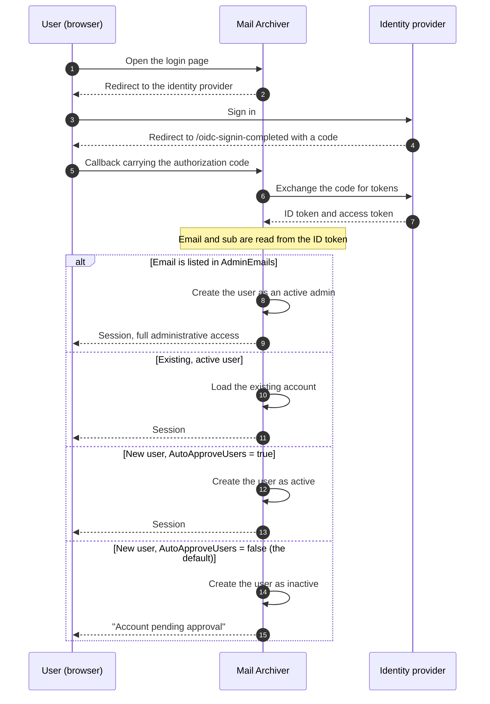

# 🔐 Guida all'autenticazione OpenID Connect (OIDC) {#openid-connect-oidc-authentication-guide}

[← Torna all'indice della documentazione](index.md)

## 📋 Panoramica {#overview}

Questa guida fornisce istruzioni complete per configurare l'autenticazione OpenID Connect (OIDC) nell'applicazione Mail Archiver, con esempi specifici per l'integrazione con Microsoft Entra ID (Azure AD). OIDC consente un'autenticazione single sign-on (SSO) sicura utilizzando provider di identità esterni.

## 📚 Indice {#table-of-contents}

1. [Come funziona il flusso di login](#how-the-login-flow-works)
2. [Panoramica](#overview)
3. [Prerequisiti](#prerequisites)
4. [Configurazione OIDC](#oidc-configuration)
   - [Abilitare OIDC in Configuration](#enable-oidc-in-configuration)
   - [Variabili d'ambiente](#environment-variables)
5. [Configurazione di Microsoft Entra ID](#microsoft-entra-id-setup)
   - [Creare App Registration](#create-app-registration)
   - [Configurare Authentication](#configure-authentication)
   - [Configurare API Permissions](#configure-api-permissions)
   - [Generare Client Secret](#generate-client-secret)
6. [Configurazione di Authelia](#authelia-setup)
   - [Configurazione di Authelia](#authelia-configuration)
   - [Dettagli di Client Registration](#client-registration-details)
7. [Test e Validazione](#testing-and-validation)
8. [Gestione Utenti con OIDC](#user-management-with-oidc)
9. [Approvazione Automatica Utenti OIDC](#auto-approve-oidc-users)
10. [Configurazione Login Passwordless](#passwordless-login-configuration)
11. [Compatibilità del Provider](#provider-compatibility)

## 🔄 Come funziona il flusso di login {#how-the-login-flow-works}

Il diagramma mostra l'intero viaggio di andata e ritorno — browser, Mail Archiver e identity provider — e, cosa più importante, la decisione locale che Mail Archiver prende *dopo* che il provider ha già accettato l'utente.



Un accesso riuscito al provider **non** è quindi la fine della storia.
Con il `AutoApproveUsers=false` predefinito, un nuovo utente viene creato inattivo e un amministratore deve attivare l'account. Un utente che si autentica correttamente ma non riesce comunque ad accedere ha quasi sempre incontrato questo ostacolo piuttosto che una misconfigurazione OIDC.

## 🌐 Panoramica {#overview}

L'applicazione Mail Archiver supporta l'autenticazione OpenID Connect (OIDC), consentendo agli utenti di autenticarsi utilizzando provider di identità esterni come Microsoft Entra ID e altri provider conformi a OIDC. Questa funzionalità migliora la sicurezza sfruttando i sistemi di gestione dell'identità aziendale e abilita le capacità di single sign-on (SSO).

## 🛠️ Prerequisiti {#prerequisites}

- Accesso amministrativo al provider di identità OIDC scelto (ad es. Microsoft Entra ID)
- Applicazione Mail Archiver già distribuita e accessibile tramite HTTPS
- Nome DNS configurato per la propria istanza Mail Archiver (necessario per gli URL di callback)
- Accesso amministrativo all'applicazione Mail Archiver e al sistema host per la configurazione
- Se si utilizza un reverse proxy, una corretta [reverse proxy configuration](ReverseProxy.md) per la gestione degli header HTTPS

## 🔧 Configurazione del Reverse Proxy per OIDC {#reverse-proxy-configuration-for-oidc}

Quando si distribuisce Mail Archiver dietro un reverse proxy con autenticazione OIDC, potrebbe essere necessaria una configurazione aggiuntiva per garantire la corretta gestione dei flussi di autenticazione e degli scambi di token. L'autenticazione OIDC comporta header HTTP e corpi di risposta più grandi che potrebbero superare le dimensioni predefinite del buffer in alcune configurazioni di reverse proxy.

### Configurazione di Nginx Proxy Manager {#nginx-proxy-manager-configuration}

Se si utilizza Nginx Proxy Manager come reverse proxy, potrebbe essere necessario aggiungere la seguente configurazione per gestire correttamente l'autenticazione OIDC:

```nginx
proxy_busy_buffers_size 512k;
proxy_buffers 4 512k;
proxy_buffer_size 256k;
```

Queste impostazioni aumentano le dimensioni del buffer per ospitare token OIDC e risposte di autenticazione più grandi. Senza queste impostazioni, si potrebbero riscontrare problemi con i flussi di autenticazione, in particolare con i provider che restituiscono ID token di grandi dimensioni o quando si utilizzano scope aggiuntivi.

### Considerazioni Generali sul Reverse Proxy {#general-reverse-proxy-considerations}

- Assicurarsi che il reverse proxy preservi gli header HTTPS (`X-Forwarded-Proto`, `X-Forwarded-Host`)
- Configurare impostazioni di timeout appropriate per i flussi di autenticazione
- Verificare che le dimensioni elevate degli header siano supportate
- Testare accuratamente il flusso di autenticazione dopo le modifiche alla configurazione

Per una guida dettagliata sulla configurazione del reverse proxy, consultare la [Reverse Proxy Configuration Guide](ReverseProxy.md).

## ⚙️ Configurazione OIDC {#oidc-configuration}

### Abilitare OIDC in Configuration {#enable-oidc-in-configuration}

Per abilitare l'autenticazione OIDC, è necessario configurare la sezione OAuth nel file `appsettings.json` o nelle variabili d'ambiente per la distribuzione docker (vedere [Installation and Setup](Setup.md)).

#### Esempio di Configurazione (appsettings.json) {#example-configuration-appsettingsjson}

```json
{
  "OAuth": {
    "Enabled": true,
    "Authority": "https://sts.windows.net/{TENANT-ID}/",
    "ClientId": "YOUR-CLIENT-ID",
    "ClientSecret": "YOUR-CLIENT-SECRET",
    "ClientScopes": [
      "openid",
      "profile",
      "email"
    ],
    "DisablePasswordLogin": false
  }
}
```

### Variabili d'ambiente {#environment-variables}

Quando si utilizza Docker Compose o variabili d'ambiente, configurare le seguenti variabili nel file `docker-compose.yml` sotto la sezione environment del servizio `mailarchive-app`:

```yaml
environment:
  # OIDC Configuration
  - OAuth__Enabled=true
  - OAuth__Authority=https://sts.windows.net/{TENANT-ID}/
  - OAuth__ClientId=YOUR-CLIENT-ID
  - OAuth__ClientSecret=YOUR-CLIENT-SECRET
  - OAuth__DisplayName=PocketID SSO
  - OAuth__ClientScopes__0=openid
  - OAuth__ClientScopes__1=profile
  - OAuth__ClientScopes__2=email
  - OAuth__DisablePasswordLogin=false
  - OAuth__AutoApproveUsers=false
```

### Spiegazione dei parametri di configurazione {#configuration-parameters-explained}

- **OAuth__Enabled**: Impostare a `true` per abilitare l'autenticazione OIDC
- **OAuth__Authority**: L'URL dell'authority OpenID Connect del proprio identity provider
- **OAuth__ClientId**: Il client ID assegnato dal proprio identity provider
- **OAuth__ClientSecret**: Il client secret assegnato dal proprio identity provider
- **OAuth__DisplayName**: Nome visualizzato opzionale per il pulsante di login OIDC (ad esempio, `PocketID SSO` viene renderizzato come `Login with PocketID SSO`)
- **OAuth__ClientScopes**: Array di scope richiesti all'identity provider
- **OAuth__ResponseMode**: Modalità di risposta della richiesta di autorizzazione: `query`, `fragment` o `form_post`. Lasciare vuoto per mantenere il valore predefinito (`form_post`). I provider che non supportano `form_post` richiedono `query`; vedere [Provider Compatibility](#provider-compatibility)
- **OAuth__DisablePasswordLogin**: Impostare a `true` per disabilitare il login tradizionale con username/password e imporre l'autenticazione solo tramite OAuth (vedere Passwordless Login Configuration per ulteriori dettagli)
- **OAuth__AutoApproveUsers**: Impostare a `true` per approvare automaticamente i nuovi utenti OIDC senza richiedere l'approvazione dell'amministratore (predefinito: `false`). Vedere [Auto-Approve OIDC Users](#auto-approve-oidc-users) per i dettagli

> ⚠️ **Importante**: Il Client Secret deve essere mantenuto al sicuro. Utilizzare Docker secrets o variabili d'ambiente negli ambienti di produzione.

## ☁️ Configurazione di Microsoft Entra ID {#microsoft-entra-id-setup}

Questa sezione fornisce istruzioni passo dopo passo per configurare Microsoft Entra ID (precedentemente Azure AD) come provider di identità OIDC per Mail Archiver.

### 🚀 Creazione della registrazione dell'app {#create-app-registration}

1. Navigare in [Microsoft Entra Admin Center](https://entra.microsoft.com)
2. Accedere con il proprio Account amministratore
3. Nel pannello di navigazione a sinistra, selezionare **App registrations**
4. Fare clic su **+ New registration** nella parte superiore della pagina App registrations
5. Inserire i seguenti dettagli:
   - **Name**: Inserire un nome descrittivo (ad es. "Mail Archiver OIDC")
   - **Supported account types**: Selezionare **Accounts in this organizational directory only**
   - **Redirect URI**: Selezionare **Web** e inserire l'URL di callback di Mail Archiver:
     ```
     https://your-mail-archiver-domain/oidc-signin-completed
     ```
     Sostituire `your-mail-archiver-domain` con il proprio dominio effettivo (ad es. `mailarchiver.example.com`)
6. Fare clic su **Register**

### 🔐 Configurazione dell'autenticazione {#configure-authentication}

1. Dopo la registrazione, annotare i seguenti valori dalla pagina **Overview** della registrazione dell'app:
   - **Application (client) ID** - Sarà necessario come `OAuth__ClientId`
   - **Directory (tenant) ID** - Sarà necessario per costruire l'URL Authority
2. Costruire l'**Authority URL** a partire dal **Directory (tenant) ID** appena copiato. Per Microsoft Entra ID, l'Authority è costruito come:
   ```
   https://sts.windows.net/<TENANT-ID>/
   ```
   Sostituire `<TENANT-ID>` (chiamato anche Mandanten-ID) con il valore visualizzato accanto all'Application (client) ID nella pagina Overview della registrazione dell'app. Ad esempio, se il Directory (tenant) ID è `11111111-2222-3333-4444-555555555555`, la propria Authority diventa:
   ```
   https://sts.windows.net/11111111-2222-3333-4444-555555555555/
   ```
   Utilizzare questo valore come `OAuth__Authority` nella propria configurazione. Assicurarsi di includere la barra finale.
   > ℹ️ **Nota**: Sia `https://sts.windows.net/<TENANT-ID>/` che `https://login.microsoftonline.com/<TENANT-ID>/v2.0` sono endpoint authority validi per Entra ID. La forma `sts.windows.net` utilizza l'endpoint v1.0 ed è raccomandata per questa guida.
3. Nel menu a sinistra, selezionare **Authentication**
4. Fare clic su **Settings**
5. Sotto **Implicit grant and hybrid flows**, assicurarsi che **ID tokens** sia selezionato
6. Sotto **Supported account types**, verificare che la selezione corrisponda ai propri requisiti
7. Sotto **Redirect URIs**, assicurarsi che l'URL di callback sia elencato correttamente

### 🎯 Configurazione dei permessi API {#configure-api-permissions}

1. Nel menu a sinistra, selezionare **API permissions**
2. Fare clic su **+ Add a permission**
3. Selezionare **Microsoft Graph**
4. Scegliere **Delegated permissions**
5. Aggiungere i seguenti permessi (se necessari per funzionalità aggiuntive):
   - **openid** - Effettua l'accesso degli utenti
   - **email** - Visualizza l'indirizzo email degli utenti
   - **profile** - Visualizza il profilo di base degli utenti
6. Fare clic su **Add permissions**
7. Fare clic su **Grant admin consent for [Your Organization]** se si desidera pre-autorizzare l'applicazione

### 🔑 Generazione del Client Secret {#generate-client-secret}

1. Navigare in **Certificates & secrets** nel menu a sinistra
2. Sotto **Client secrets**, fare clic su **+ New client secret**
3. Fornire una descrizione (ad es. "Mail Archiver Auth Secret")
4. Selezionare un periodo di scadenza
5. Fare clic su **Add**
6. **Importante**: Copiare immediatamente il **Value** e conservarlo in modo sicuro. Questo segreto non verrà mostrato nuovamente. È necessario come `OAuth__ClientSecret`

## 🔐 Configurazione di Authelia {#authelia-setup}

Questa sezione fornisce i dettagli di configurazione per impostare Authelia come provider di identità OIDC per Mail Archiver. Authelia è un server di autenticazione e autorizzazione open-source che supporta OIDC.

### 🛠️ Configurazione di Authelia {#authelia-configuration}

```yaml
identity_providers:
  oidc:
    clients:
      - client_id: 'mailarchiver'
        client_name: 'mailarchiver'
        client_secret: '$xyzg'  # The digest of 'insecure_secret'.
        public: false
        redirect_uris:
          - 'https://your-mail-archiver-domain/oidc-signin-completed'
        scopes:
          - 'openid'
          - 'profile'
          - 'email'
        response_types:
          - 'code'
        grant_types:
          - 'authorization_code'
        token_endpoint_auth_method: 'client_secret_post'
```

### 📝 Dettagli di Registrazione del Client {#client-registration-details}

- **client_id**: `mailarchiver` - L'identificatore univoco per l'applicazione Mail Archiver
- **client_name**: `mailarchiver` - Il nome visualizzato agli utenti durante l'autenticazione
- **client_secret**: Il segreto hash utilizzato per l'autenticazione del client (sostituire con il proprio segreto sicuro in produzione)
- **redirect_uris**: L'URL di callback dove Authelia reindirizzerà gli utenti dopo l'autenticazione. Sostituire `[YOUR_MAILARCHIVER_URL]` con il proprio dominio Mail Archiver effettivo
- **scopes**: Le autorizzazioni richieste ad Authelia:
  - `openid`: Richiesto per l'autenticazione OIDC
  - `profile`: Accesso alle informazioni di base del profilo
  - `email`: Accesso all'indirizzo email
- **response_types**: `code` - Authorization code flow
- **grant_types**: `authorization_code` - Authorization code grant type
- **token_endpoint_auth_method**: `client_secret_post` - Metodo di autenticazione del client

> ⚠️ **Nota sulla sicurezza**: L'esempio utilizza un segreto predefinito a scopo dimostrativo. In produzione, generare un segreto sicuro e applicare l'hash utilizzando gli strumenti di Authelia. Non utilizzare mai il segreto di esempio in ambienti di produzione.

## 🧪 Test e Validazione {#testing-and-validation}

### Test di Configurazione Iniziale {#initial-setup-testing}

1. Riavvia l'applicazione Mail Archiver dopo aver configurato le impostazioni OIDC
2. Naviga alla pagina di login di Mail Archiver
3. Dovresti vedere un nuovo pulsante di login OAuth accanto al modulo di login regolare. Con `OAuth__DisplayName=PocketID SSO`, il pulsante riporta la dicitura `Login with PocketID SSO`.
4. Clicca sul pulsante di login OAuth per avviare il flusso OIDC
5. Dovresti essere reindirizzato alla pagina di login del tuo identity provider
6. Dopo l'autenticazione avvenuta con successo, dovresti essere reindirizzato nuovamente a Mail Archiver

### Validazione del Provisioning Utenti {#user-provisioning-validation}

- Gli utenti OIDC al primo accesso verranno creati automaticamente nel database di Mail Archiver
- Gli utenti verranno creati con il ruolo predefinito "User" e avranno bisogno dell'approvazione dell'amministratore per l'accesso

## 👥 Gestione Utenti con OIDC {#user-management-with-oidc}

### Ruoli Utente e Autorizzazioni {#user-roles-and-permissions}

Gli utenti OIDC seguono lo stesso controllo degli accessi basato sui ruoli degli utenti locali:
- **Admin**: Accesso completo al sistema (richiede l'assegnazione manuale da parte di un admin esistente, o automatica tramite la configurazione AdminEmails)
- **User**: Accesso utente standard alle Caselle di posta assegnate
- **Self-Manager**: Può gestire il proprio Account e aggiungere nuovi Account

### Auto-Provisioning Amministratori {#auto-provisioning-administrators}

È possibile configurare indirizzi email specifici affinché vengano automaticamente configurati come amministratori al primo accesso tramite OIDC:

```json
{
  "OAuth": {
    "AdminEmails": [
      "admin@example.com",
      "it-manager@example.com"
    ]
  }
}
```

Quando un utente con uno di questi indirizzi email effettua il primo accesso:
- Viene creato automaticamente come amministratore attivo
- Non è richiesta alcuna approvazione manuale
- Ottiene immediatamente pieni privilegi amministrativi
- Il confronto dell'email non è case-sensitive

**Nota di Sicurezza**: Aggiungere solo indirizzi email attendibili a questo elenco, poiché questi utenti avranno l'accesso completo al sistema.

### Flusso di Provisioning Utente {#user-provisioning-flow}

#### Nuovi Utenti (Non in AdminEmails) {#new-users-not-in-adminemails}
1. L'utente si autentica tramite il provider OAuth
2. Il sistema controlla se l'email esiste nel database locale
3. Se l'utente è nuovo:
   - L'Account viene creato con lo username derivato dai claim OIDC, in questo ordine di preferenza:
     1. La **parte locale dell'email** (tutto ciò che precede `@`), ad es. `example.mailarchiver` per `example.mailarchiver@xxxxxxxxx.onmicrosoft.com`
     2. Il claim completo `sub` quando non è presente il claim email
     3. `oidc_<12-char-hash>` come fallback di ultima istanza
     Il valore generato è troncato a 320 caratteri. Se esiste già un utente locale con lo stesso username, viene aggiunto `" (n)"` finché non viene trovato un nome univoco.
   - L'utente viene contrassegnato come **inattivo** e **richiede approvazione**
   - L'Admin deve attivare manualmente l'utente nella gestione Utenti
4. L'utente riceve il messaggio "Account in attesa di approvazione"

#### Nuovi Utenti (In AdminEmails) {#new-users-in-adminemails}
1. L'utente si autentica tramite il provider OAuth
2. Il sistema riconosce che l'email è presente nell'elenco AdminEmails
3. L'Account viene creato automaticamente:
   - L'utente è contrassegnato come **attivo** e **admin**
   - Nessuna approvazione richiesta
   - L'utente può accedere immediatamente al sistema
4. L'utente effettua l'accesso con successo

### Gestione Password {#password-management}

Gli utenti OIDC non possono avere o cambiare password all'interno di Mail Archiver poiché l'autenticazione è gestita dal provider di identità esterno:
- L'opzione "Change Password" sarà disabilitata per gli utenti OIDC
- Il reset della password deve essere gestito tramite il provider OIDC
- I campi della password locale rimarranno vuoti per gli utenti OIDC

## ✅ Approvazione automatica degli utenti OIDC {#auto-approve-oidc-users}

Per impostazione predefinita, i nuovi utenti OIDC devono essere approvati manualmente da un amministratore locale prima di poter accedere all'applicazione. Ciò fornisce un modello di doppio controllo in cui sia l'IdP che l'amministratore locale devono concedere l'accesso.

Per le **installazioni OIDC-first** in cui l'Identity Provider (IdP) è l'unica fonte di verità per il controllo degli accessi, questo passaggio di approvazione manuale può essere saltato abilitando l'opzione `AutoApproveUsers`.

### Abilitazione dell'approvazione automatica {#enabling-auto-approve}

Imposta `AutoApproveUsers` a `true` nella tua configurazione:

```json
{
  "OAuth": {
    "Enabled": true,
    "AutoApproveUsers": true,
    "Authority": "https://your-provider.com",
    "ClientId": "your-client-id",
    "ClientSecret": "your-secret"
  }
}
```

Oppure tramite variabile d'ambiente:

```yaml
environment:
  - OAuth__AutoApproveUsers=true
```

### Comportamento {#behavior}

| Impostazione | Comportamento nuovo utente OIDC |
|---|---|
| `AutoApproveUsers: false` (predefinito) | L'utente viene creato come **inattivo** e **richiede l'approvazione dell'amministratore** prima che l'accesso venga concesso |
| `AutoApproveUsers: true` | L'utente viene creato come **attivo** e può accedere immediatamente all'applicazione |

> **Nota**: `AdminEmails` ha sempre la precedenza — gli utenti che corrispondono a `AdminEmails` vengono sempre approvati automaticamente come amministratori indipendentemente da questa impostazione.

### Quando usarlo {#when-to-use}

Questa opzione è raccomandata per gli ambienti in cui:
- L'**IdP controlla l'accesso all'applicazione** (ad es. tramite l'assegnazione dell'app o l'appartenenza a un gruppo in Authentik, Entra ID, Authelia, ecc.)
- Si desidera **eliminare il modello di doppio controllo** (concessione IdP + approvazione amministratore locale)
- La **revoca dell'accesso è gestita a livello di IdP** (la rimozione dell'assegnazione dell'app impedisce automaticamente il login)

### Esempio di configurazione completa OIDC-First {#complete-oidc-first-setup-example}

```json
{
  "OAuth": {
    "Enabled": true,
    "Authority": "https://sts.windows.net/YOUR_TENANT_ID/",
    "ClientId": "your-client-id",
    "ClientSecret": "your-secret",
    "DisplayName": "PocketID SSO",
    "ClientScopes": ["openid", "profile", "email"],
    "DisablePasswordLogin": true,
    "AutoRedirect": true,
    "AutoApproveUsers": true,
    "AdminEmails": ["admin@company.com"]
  }
}
```

In questa configurazione:
- Gli utenti vengono reindirizzati automaticamente al provider OIDC
- I nuovi utenti vengono approvati automaticamente al primo login
- Gli indirizzi email degli amministratori vengono approvvigionati automaticamente come amministratori
- Il controllo degli accessi è interamente gestito a livello di IdP

### Considerazioni sulla sicurezza {#security-considerations}

- **Fiducia**: Abilitare `AutoApproveUsers` significa che ti fidi dell'IdP per controllare chi può accedere all'applicazione. Assicurati che il tuo IdP sia configurato correttamente con le appropriate assegnazioni delle app o l'accesso basato sui gruppi.
- **Assegnazione dei ruoli**: Gli utenti approvati automaticamente vengono creati con autorizzazioni utente standard (non admin). L'accesso admin richiede comunque la configurazione `AdminEmails` o l'assegnazione manuale del ruolo.
- **Revoca**: Quando l'accesso di un utente viene rimosso nell'IdP, non può più autenticarsi tramite OIDC. Tuttavia, il suo Account locale rimane attivo. Per revocare completamente l'accesso, disattiva anche l'utente nel pannello di amministrazione di Mail Archiver.
- **Compatibilità con le versioni precedenti**: Il valore predefinito è `false`, preservando il comportamento esistente per le installazioni attuali.

## 🔒 Configurazione del Login Passwordless {#passwordless-login-configuration}

> ⚠️ **Importante**: Anche con la configurazione del login passwordless, viene comunque creato un utente admin iniziale durante il primo avvio. È necessario impostare una password sicura per questo utente admin nel file `appsettings.json` o `docker-compose.yml` per garantire la sicurezza del sistema.

Per le organizzazioni che desiderano imporre l'autenticazione esclusivamente tramite OAuth, l'applicazione supporta la disabilitazione completa del login tramite password.

### Disabilitazione del Login tramite Password {#disabling-password-login}

Imposta `DisablePasswordLogin` a `true` per disabilitare il login con username/password:

```json
{
  "OAuth": {
    "Enabled": true,
    "DisablePasswordLogin": true,
    "Authority": "https://your-provider.com",
    "ClientId": "your-client-id",
    "ClientSecret": "your-secret"
  }
}
```

**Risultato**: La pagina di login visualizza solo il pulsante di login OAuth e il server rifiuta ogni POST della password (`/Auth/Login`) con un reindirizzamento alla pagina di login. Le password locali rimangono memorizzate nel database ma non possono più essere utilizzate per l'accesso mentre la modalità OAuth-only è attiva. Se `DisplayName` è configurato, il pulsante utilizza quel valore (ad esempio, `Login with PocketID SSO`).

### Reindirizzamento Automatico al Provider OAuth {#auto-redirect-to-oauth-provider}

Abilita `AutoRedirect` per reindirizzare automaticamente gli utenti al tuo provider OAuth:

```json
{
  "OAuth": {
    "Enabled": true,
    "DisablePasswordLogin": true,
    "AutoRedirect": true,
    "Authority": "https://your-provider.com",
    "ClientId": "your-client-id",
    "ClientSecret": "your-secret"
  }
}
```

**Requisiti**: 
- `DisablePasswordLogin` deve essere `true`
- `OAuth.Enabled` deve essere `true`

**Risultato**: Gli utenti vedono una breve schermata di caricamento e vengono reindirizzati automaticamente al provider OAuth.

### Esempio di Configurazione Passwordless Completa {#complete-passwordless-setup-example}

```json
{
  "OAuth": {
    "Enabled": true,
    "Authority": "https://sts.windows.net/YOUR_TENANT_ID/",
    "ClientId": "your-client-id",
    "ClientSecret": "your-secret",
    "DisplayName": "PocketID SSO",
    "ClientScopes": ["openid", "profile", "email"],
    "DisablePasswordLogin": true,
    "AutoRedirect": true,
    "AdminEmails": ["admin@company.com", "it@company.com"]
  }
}
```

### Considerazioni sulla Sicurezza {#security-considerations}

- **Provisioning dell'Email dell'Admin**: Il provider OAuth è considerato affidabile per la verifica degli indirizzi email. Aggiungi solo indirizzi fidati a AdminEmails.
- **Accesso di Emergenza**: Con `DisablePasswordLogin=true` non è possibile utilizzare alcuna password locale per l'accesso, incluso l'account admin di bootstrap. Assicurati che almeno un'identità OAuth sia configurata come admin (vedi `AdminEmails`) prima di abilitare questa impostazione, altrimenti rimarrai escluso dal sistema. Per riacquistare l'accesso, imposta `OAuth__DisablePasswordLogin=false`, riavvia, effettua l'accesso con la password admin locale e riabilitala in seguito.
- **Test**: Testa accuratamente l'autenticazione OAuth prima di disabilitare il login tramite password in produzione.
- **Ambiente SSO**: Il reindirizzamento automatico è ideale per gli ambienti di single sign-on in cui tutti gli utenti si autenticano tramite lo stesso provider.

## 🧩 Compatibilità del Provider {#provider-compatibility}

Non tutti gli identity provider implementano la specifica OIDC completa. Entrambe le impostazioni
sotto riportate esistono per questo motivo, e sono entrambe necessarie per il Synology SSO Server.

### Response Mode {#response-mode}

La richiesta di autorizzazione viene inviata con il response mode `form_post`, il valore predefinito
dell'handler ASP.NET Core OpenID Connect sottostante. Un provider che non lo supporta
solitamente fallisce con un proprio messaggio e nulla appare nel registro di Mail Archiver.

Il Synology SSO Server si comporta in questo modo: il suo documento di discovery omette
`response_modes_supported`, e l'accesso si interrompe con "Unable to sign in via SSO due
to setting issues". Imposta esplicitamente il response mode:

```env
OAuth__ResponseMode=query
```

I valori validi sono `query`, `fragment` e `form_post`. Lascia l'impostazione vuota per
mantenere il valore predefinito. In caso di dubbio, `query` è la scelta più sicura: è l'unico
response mode che ogni provider OIDC è tenuto a supportare.

### Name and Email Claims {#name-and-email-claims}

Il nome visualizzato di un nuovo utente viene prelevato dalla risposta user info, in questo ordine:

1. `name`
2. `preferred_username`
3. `given_name`
4. `username`

I claim presenti ma vuoti o non di tipo stringa vengono saltati. `username` non è un
claim standard OIDC, ma alcuni provider lo restituiscono come unico valore simile a un nome
(nuovamente Synology SSO Server). L'indirizzo email viene letto da `email`, poi da `mail`,
poi da `upn`, e in ultima istanza dai claim dell'ID token.

Se nessuno dei claim relativi al nome è presente, l'accesso fallisce. L'utente viene riportato alla
pagina di login con un messaggio leggibile che indica i claim cercati, e la
causa viene scritta nel registro al livello di errore.

---

**Nota**: Questa guida è aggiornata al 2025. I servizi degli identity provider aggiornano regolarmente le loro interfacce e funzionalità, pertanto alcuni elementi dell'interfaccia utente potrebbero differire. Fare sempre riferimento alla documentazione più recente del proprio identity provider per le informazioni più aggiornate.
