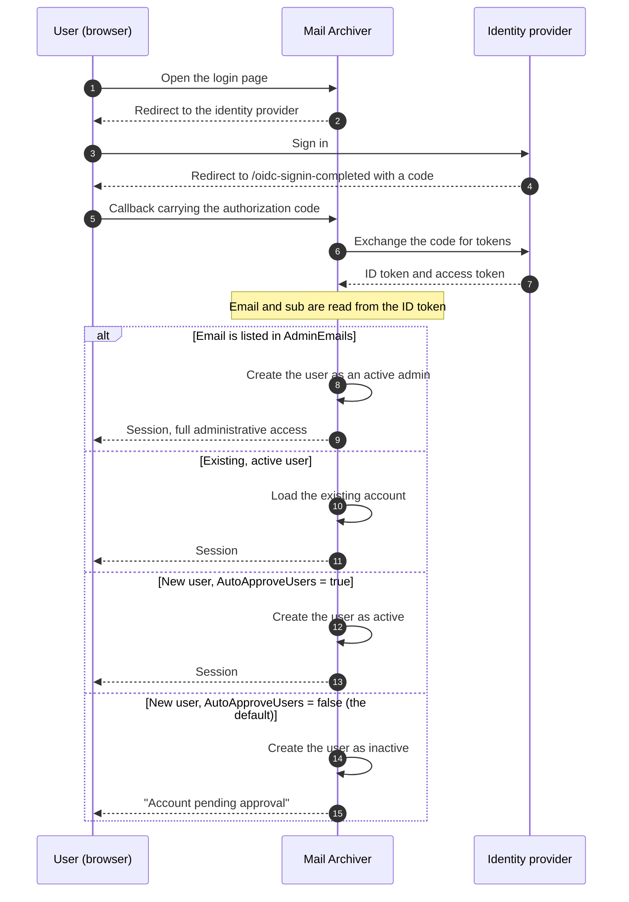

# 🔐 OpenID Connect (OIDC) Authentication Guide {#openid-connect-oidc-authentication-guide}

[← Documentation Index に戻る](index.md)

## 📋 Overview {#overview}

このガイドでは、Mail Archiver アプリケーションにおける OpenID Connect (OIDC) 認証の設定に関する包括的な手順を、Microsoft Entra ID (Azure AD) との統合に関する具体的な例とともに提供します。OIDC を使用すると、外部の ID プロバイダーを使用したセキュアなシングルサインオン (SSO) 認証が可能になります。

## 📚 目次 {#table-of-contents}

1. [ログインフローの仕組み](#how-the-login-flow-works)
2. [概要](#overview)
3. [前提条件](#prerequisites)
4. [OIDC 設定](#oidc-configuration)
   - [設定での OIDC の有効化](#enable-oidc-in-configuration)
   - [環境変数](#environment-variables)
5. [Microsoft Entra ID のセットアップ](#microsoft-entra-id-setup)
   - [アプリの登録の作成](#create-app-registration)
   - [認証の設定](#configure-authentication)
   - [API のアクセス許可の設定](#configure-api-permissions)
   - [クライアント シークレットの生成](#generate-client-secret)
6. [Authelia のセットアップ](#authelia-setup)
   - [Authelia の設定](#authelia-configuration)
   - [クライアント登録の詳細](#client-registration-details)
7. [テストと検証](#testing-and-validation)
8. [OIDC によるユーザー管理](#user-management-with-oidc)
9. [OIDC ユーザーの自動承認](#auto-approve-oidc-users)
10. [パスワードレス ログインの設定](#passwordless-login-configuration)
11. [プロバイダーの互換性](#provider-compatibility)

## 🔄 ログインフローの仕組み {#how-the-login-flow-works}

この図は、ブラウザ、Mail Archiver、およびアイデンティティプロバイダーによる一連の往復プロセス、そしてより重要な点として、プロバイダーがユーザーを承認した*後*に Mail Archiver が行うローカルな決定を示しています。



したがって、プロバイダーでのサインインが成功したことは、必ずしもプロセスの終了を意味する**わけではありません**。
デフォルトの `AutoApproveUsers=false` では、新しいユーザーは非アクティブな状態で作成されるため、管理者がアカウントを有効化する必要があります。正しく認証しているにもかかわらずログインできない場合、その原因は OIDC の設定ミスではなく、ほとんどの場合このゲート（制限）にあります。

## 🌐 概要 {#overview}

Mail Archiver アプリケーションは OpenID Connect (OIDC) 認証をサポートしており、Microsoft Entra ID やその他の OIDC 準拠のプロバイダーなどの外部 ID プロバイダーを使用してユーザーが認証を行うことができます。この機能は、エンタープライズの ID 管理システムを活用することでセキュリティを強化し、シングルサインオン (SSO) 機能を実現します。

## 🛠️ 前提条件 {#prerequisites}

- 選択した OIDC ID プロバイダー（例：Microsoft Entra ID）への管理者アクセス権
- すでにデプロイされ、HTTPS 経由でアクセス可能な Mail Archiver アプリケーション
- Mail Archiver インスタンス用に設定された DNS 名（コールバック URL に必要）
- 設定を行うための Mail Archiver アプリケーションおよびホストシステムへの管理者アクセス権
- リバースプロキシを使用している場合は、HTTPS ヘッダー処理のための適切な [reverse proxy configuration](ReverseProxy.md)

## 🔧 OIDC用のリバースプロキシ設定 {#reverse-proxy-configuration-for-oidc}

OIDC認証を備えたリバースプロキシの背後にMail Archiverをデプロイする場合、認証フローとトークン交換を適切に処理するために追加の設定が必要になる場合があります。OIDC認証では、一部のリバースプロキシ設定におけるデフォルトのバッファサイズを超える、大きなHTTPヘッダーおよびレスポンスボディが使用されます。

### Nginx Proxy Managerの設定 {#nginx-proxy-manager-configuration}

リバースプロキシとしてNginx Proxy Managerを使用している場合、OIDC認証を適切に処理するために以下の設定を追加する必要がある場合があります：

```nginx
proxy_busy_buffers_size 512k;
proxy_buffers 4 512k;
proxy_buffer_size 256k;
```

これらの設定は、より大きなOIDCトークンや認証レスポンスに対応するためにバッファサイズを拡張します。これらの設定がない場合、認証フロー、特に大きなIDトークンを返すプロバイダーを使用する場合や、追加のスコープを使用する場合に問題が発生する可能性があります。

### 一般的なリバースプロキシに関する考慮事項 {#general-reverse-proxy-considerations}

- リバースプロキシがHTTPSヘッダー（`X-Forwarded-Proto`、`X-Forwarded-Host`）を保持していることを確認してください
- 認証フローに対して適切なタイムアウト設定を構成してください
- 大きなヘッダーサイズがサポートされていることを確認してください
- 設定変更後は、認証フローを徹底的にテストしてください

リバースプロキシ設定の詳細なガイダンスについては、[Reverse Proxy Configuration Guide](ReverseProxy.md)を参照してください。

## ⚙️ OIDC 設定 {#oidc-configuration}

### 設定での OIDC の有効化 {#enable-oidc-in-configuration}

OIDC 認証を有効にするには、`appsettings.json` ファイル内の OAuth セクション、または Docker デプロイメントの場合は環境変数で設定を行う必要があります（[Installation and Setup](Setup.md) を参照）。

#### 設定例 (appsettings.json) {#example-configuration-appsettingsjson}

```json
{
  "OAuth": {
    "Enabled": true,
    "Authority": "https://sts.windows.net/{TENANT-ID}/",
    "ClientId": "YOUR-CLIENT-ID",
    "ClientSecret": "YOUR-CLIENT-SECRET",
    "ClientScopes": [
      "openid",
      "profile",
      "email"
    ],
    "DisablePasswordLogin": false
  }
}
```


### 環境変数 {#environment-variables}

Docker Compose または環境変数を使用する場合は、`docker-compose.yml` ファイルの `mailarchive-app` サービス環境セクションで以下の変数を設定してください。

```yaml
environment:
  # OIDC Configuration
  - OAuth__Enabled=true
  - OAuth__Authority=https://sts.windows.net/{TENANT-ID}/
  - OAuth__ClientId=YOUR-CLIENT-ID
  - OAuth__ClientSecret=YOUR-CLIENT-SECRET
  - OAuth__DisplayName=PocketID SSO
  - OAuth__ClientScopes__0=openid
  - OAuth__ClientScopes__1=profile
  - OAuth__ClientScopes__2=email
  - OAuth__DisablePasswordLogin=false
  - OAuth__AutoApproveUsers=false
```


### 設定パラメータの説明 {#configuration-parameters-explained}

- **OAuth__Enabled**: `true` に設定すると OIDC 認証が有効になります
- **OAuth__Authority**: ID プロバイダーの OpenID Connect 認証局 URL
- **OAuth__ClientId**: ID プロバイダーから割り当てられたクライアント ID
- **OAuth__ClientSecret**: ID プロバイダーから割り当てられたクライアント シークレット
- **OAuth__DisplayName**: OIDC ログインボタンに表示する任意の表示名（例えば、`PocketID SSO` は `Login with PocketID SSO` としてレンダリングされます）
- **OAuth__ClientScopes**: ID プロバイダーに要求するスコープの配列
- **OAuth__ResponseMode**: 認可リクエストのレスポンスモード: `query`、`fragment`、または `form_post`。デフォルト（`form_post`）を維持する場合は空のままにします。`form_post` をサポートしていないプロバイダーには `query` が必要です。詳細は [Provider Compatibility](#provider-compatibility) を参照してください
- **OAuth__DisablePasswordLogin**: `true` に設定すると、従来のユーザー名/パスワードによるログインを無効にし、OAuth のみの認証を強制します（詳細は Passwordless Login Configuration を参照）
- **OAuth__AutoApproveUsers**: `true` に設定すると、管理者の承認を必要とせずに新しい OIDC ユーザーを自動的に承認します（デフォルト: `false`）。詳細は [Auto-Approve OIDC Users](#auto-approve-oidc-users) を参照してください

> ⚠️ **重要**: Client Secret は安全に保管してください。本番環境では Docker secrets または環境変数を使用してください。

## ☁️ Microsoft Entra ID Setup {#microsoft-entra-id-setup}

このセクションでは、Mail Archiver の OIDC ID プロバイダーとして Microsoft Entra ID (旧 Azure AD) を構成するためのステップバイステップの手順を提供します。

### 🚀 Create App Registration {#create-app-registration}

1. [Microsoft Entra Admin Center](https://entra.microsoft.com) に移動します
2. 管理者アカウントでサインインします
3. 左側のナビゲーション ペインで **App registrations** を選択します
4. App registrations ページのトップにある **+ New registration** をクリックします
5. 以下の詳細を入力します：
   - **Name**: 説明的な名前を入力します (例: "Mail Archiver OIDC")
   - **Supported account types**: **Accounts in this organizational directory only** を選択します
   - **Redirect URI**: **Web** を選択し、Mail Archiver のコールバック URL を入力します：
     ```
     https://your-mail-archiver-domain/oidc-signin-completed
     ```
     `your-mail-archiver-domain` を実際のドメイン (例: `mailarchiver.example.com`) に置き換えてください
6. **Register** をクリックします

### 🔐 Configure Authentication {#configure-authentication}

1. レジストレーション後、アプリ レジストレーションの **Overview** ページから以下の値を確認してメモしてください：
   - **Application (client) ID** - これを `OAuth__ClientId` として使用します
   - **Directory (tenant) ID** - これを Authority URL の構築に使用します
2. コピーした **Directory (tenant) ID** から **Authority URL** を構築します。Microsoft Entra ID の場合、Authority は次のように構築されます：
   ```
   https://sts.windows.net/<TENANT-ID>/
   ```
   `<TENANT-ID>` (Mandanten-ID とも呼ばれます) を、アプリ レジストレーションの Overview ページで Application (client) ID の横に表示されている値に置き換えます。例えば、Directory (tenant) ID が `11111111-2222-3333-4444-555555555555` の場合、Authority は次のようになります：
   ```
   https://sts.windows.net/11111111-2222-3333-4444-555555555555/
   ```
   この値を設定の `OAuth__Authority` として使用してください。末尾のスラッシュを含めるようにしてください。
   > ℹ️ **Note**: `https://sts.windows.net/<TENANT-ID>/` と `https://login.microsoftonline.com/<TENANT-ID>/v2.0` はどちらも有効な Entra ID authority エンドポイントです。`sts.windows.net` 形式は v1.0 エンドポイントを使用しており、本ガイドではこちらを推奨します。
3. 左メニューで **Authentication** を選択します
4. **Settings** をクリックします
5. **Implicit grant and hybrid flows** の下で、**ID tokens** にチェックが入っていることを確認します
6. **Supported account types** の下で、選択内容が要件と一致していることを確認します
7. **Redirect URIs** の下で、コールバック URL が正しくリストされていることを確認します

### 🎯 Configure API Permissions {#configure-api-permissions}

1. 左メニューで **API permissions** を選択します
2. **+ Add a permission** をクリックします
3. **Microsoft Graph** を選択します
4. **Delegated permissions** を選択します
5. 以下の権限を追加します (追加機能が必要な場合)：
   - **openid** - ユーザーをサインインさせる
   - **email** - ユーザーのメールアドレスを表示する
   - **profile** - ユーザーの基本プロファイルを表示する
6. **Add permissions** をクリックします
7. アプリケーションを事前承認したい場合は、**Grant admin consent for [Your Organization]** をクリックします

### 🔑 Generate Client Secret {#generate-client-secret}

1. 左メニューの **Certificates & secrets** に移動します
2. **Client secrets** の下で、**+ New client secret** をクリックします
3. 説明を入力します (例: "Mail Archiver Auth Secret")
4. 有効期限を選択します
5. **Add** をクリックします
6. **Important**: すぐに **Value** をコピーし、安全に保管してください。このシークレットは二度と表示されません。これは `OAuth__ClientSecret` として必要です。

## 🔐 Authelia のセットアップ {#authelia-setup}

このセクションでは、Mail Archiver の OIDC ID プロバイダーとして Authelia をセットアップするための設定詳細を提供します。Authelia は、OIDC をサポートするオープンソースの認証・認可サーバーです。

### 🛠️ Authelia の設定 {#authelia-configuration}

```yaml
identity_providers:
  oidc:
    clients:
      - client_id: 'mailarchiver'
        client_name: 'mailarchiver'
        client_secret: '$xyzg'  # The digest of 'insecure_secret'.
        public: false
        redirect_uris:
          - 'https://your-mail-archiver-domain/oidc-signin-completed'
        scopes:
          - 'openid'
          - 'profile'
          - 'email'
        response_types:
          - 'code'
        grant_types:
          - 'authorization_code'
        token_endpoint_auth_method: 'client_secret_post'
```

### 📝 クライアント登録の詳細 {#client-registration-details}

- **client_id**: `mailarchiver` - Mail Archiver アプリケーションの一意識別子
- **client_name**: `mailarchiver` - 認証中にユーザーに表示される表示名
- **client_secret**: クライアント認証に使用されるハッシュ化されたシークレット（本番環境では独自の安全なシークレットに置き換えてください）
- **redirect_uris**: 認証後に Authelia がユーザーをリダイレクトするコールバック URL。`[YOUR_MAILARCHIVER_URL]` を実際の Mail Archiver ドメインに置き換えてください
- **scopes**: Authelia に要求される権限:
  - `openid`: OIDC 認証に必要
  - `profile`: 基本的なプロフィール情報へのアクセス
  - `email`: メールアドレスへのアクセス
- **response_types**: `code` - Authorization code flow
- **grant_types**: `authorization_code` - Authorization code grant type
- **token_endpoint_auth_method**: `client_secret_post` - クライアント認証方法

> ⚠️ **セキュリティに関する注意**: この例では、デモンストレーション用にデフォルトのシークレットを使用しています。本番環境では、安全なシークレットを生成し、Authelia のツールを使用してハッシュ化してください。本番環境では、例示されているシークレットを絶対に使用しないでください。

## 🧪 テストと検証 {#testing-and-validation}

### 初期セットアップのテスト {#initial-setup-testing}

1. OIDC設定の構成後、Mail Archiverアプリケーションを再起動します
2. Mail Archiverのログインページに移動します
3. 通常のログインフォームの横に、新しいOAuthログインボタンが表示されているはずです。`OAuth__DisplayName=PocketID SSO`を使用している場合、ボタンには`Login with PocketID SSO`と表示されます。
4. OAuthログインボタンをクリックして、OIDCフローを開始します
5. IDプロバイダーのログインページにリダイレクトされるはずです
6. 認証に成功した後、Mail Archiverにリダイレクトされるはずです

### ユーザープロビジョニングの検証 {#user-provisioning-validation}

- 初めてOIDCを利用するユーザーは、Mail Archiverのデータベースに自動的に作成されます
- ユーザーはデフォルトの「User」ロールで作成され、アクセスには管理者による承認が必要になります

## 👥 OIDCによるユーザー管理 {#user-management-with-oidc}

### ユーザーのロールと権限 {#user-roles-and-permissions}

OIDCユーザーは、ローカルユーザーと同じロールベースのアクセス制御に従います：
- **Admin**: システムへのフルアクセス（既存の管理者による手動割り当て、またはAdminEmails設定による自動割り当てが必要）
- **User**: 割り当てられたメールアカウントへの標準的なユーザーアクセス
- **Self-Manager**: 自身の管理および新しいアカウントの追加が可能

### 管理者の自動プロビジョニング {#auto-provisioning-administrators}

特定のメールアドレスを、OIDC経由で最初にログインした際に管理者として自動的にプロビジョニングするように設定できます：

```json
{
  "OAuth": {
    "AdminEmails": [
      "admin@example.com",
      "it-manager@example.com"
    ]
  }
}
```

これらのメールアドレスのいずれかを持つユーザーが初めてログインすると：
- アクティブな管理者として自動的に作成されます
- 手動の承認は不要です
- 即座にフル管理権限が付与されます
- メールアドレスの一致は、大文字と小文字を区別しません

**セキュリティに関する注意**: これらのユーザーはシステムへのフルアクセス権を持つため、信頼できるメールアドレスのみをこのリストに追加してください。

### ユーザープロビジョニングフロー {#user-provisioning-flow}

#### 新規ユーザー (AdminEmailsに含まれない場合) {#new-users-not-in-adminemails}
1. ユーザーがOAuthプロバイダー経由で認証
2. システムがローカルデータベースにメールアドレスが存在するか確認
3. 新規ユーザーの場合：
   - 以下の優先順位で、OIDCクレームから派生したユーザー名でアカウントが作成されます：
     1. **メールアドレスのローカル部分**（`@`より前のすべての文字列）、例：`example.mailarchiver@xxxxxxxxx.onmicrosoft.com`の場合の`example.mailarchiver`
     2. emailクレームが存在しない場合、完全な`sub`クレーム
     3. 最終的なフォールバックとして`oidc_<12-char-hash>`
     生成された値は320文字に切り詰められます。同じユーザー名を持つローカルユーザーが既に存在する場合、一意の名前が見つかるまで`" (n)"`が追加されます。
   - ユーザーは**inactive**（非アクティブ）かつ**requires approval**（承認が必要）としてマークされます
   - 管理者はUsers管理画面で手動でユーザーをアクティブ化する必要があります
4. ユーザーに「Account pending approval（アカウントは承認待ちです）」というメッセージが表示されます

#### 新規ユーザー (AdminEmailsに含まれる場合) {#new-users-in-adminemails}
1. ユーザーがOAuthプロバイダー経由で認証
2. システムがメールアドレスがAdminEmailsリストにあることを認識
3. アカウントが自動的に作成されます：
   - ユーザーは**active**（アクティブ）かつ**admin**（管理者）としてマークされます
   - 承認は不要です
   - ユーザーは即座にシステムにアクセスできます
4. ユーザーのログインが成功します

### パスワード管理 {#password-management}

認証は外部のアイデンティティプロバイダーによって処理されるため、OIDCユーザーはMail Archiver内でパスワードを持つことや変更することはできません：
- OIDCユーザーに対しては「Change Password」オプションが無効化されます
- パスワードのリセットはOIDCプロバイダーを通じて行う必要があります
- OIDCユーザーのローカルパスワードフィールドは空のままとなります

## ✅ OIDCユーザーの自動承認 {#auto-approve-oidc-users}

デフォルトでは、新しいOIDCユーザーがアプリケーションにアクセスするには、ローカル管理者による手動の承認が必要です。これにより、IdPとローカル管理者の両方がアクセスを許可する必要があるダブルゲートモデルが提供されます。

Identity Provider (IdP) がアクセス制御の唯一の信頼できる情報源（Single Source of Truth）となる **OIDC-first デプロイメント** の場合、`AutoApproveUsers` オプションを有効にすることで、この手動承認ステップをスキップできます。

### 自動承認の有効化 {#enabling-auto-approve}

設定ファイルで `AutoApproveUsers` を `true` に設定します：

```json
{
  "OAuth": {
    "Enabled": true,
    "AutoApproveUsers": true,
    "Authority": "https://your-provider.com",
    "ClientId": "your-client-id",
    "ClientSecret": "your-secret"
  }
}
```

または環境変数経由で：

```yaml
environment:
  - OAuth__AutoApproveUsers=true
```

### 動作 {#behavior}

| 設定 | 新しいOIDCユーザーの動作 |
|---|---|
| `AutoApproveUsers: false` (デフォルト) | ユーザーは **inactive** として作成され、アクセスが許可される前に **管理者の承認が必要** になります |
| `AutoApproveUsers: true` | ユーザーは **active** として作成され、すぐにアプリケーションにアクセスできます |

> **注意**: `AdminEmails` が常に優先されます — `AdminEmails` に一致するユーザーは、この設定に関わらず常に管理者として自動承認されます。

### 使用すべきケース {#when-to-use}

このオプションは、以下のような環境で推奨されます：
- **IdPがアプリケーションへのアクセスを制御している** 場合（例：Authentik、Entra ID、Autheliaなどにおけるアプリの割り当てやグループメンバーシップ経由）
- **ダブルゲートモデル**（IdPの許可 + ローカル管理者の承認）を**排除したい**場合
- アクセス**権限の取り消しがIdPレベルで管理されている**場合（アプリの割り当てを削除することで、自動的にログインが防止される）

### 完全なOIDC-First セットアップの例 {#complete-oidc-first-setup-example}

```json
{
  "OAuth": {
    "Enabled": true,
    "Authority": "https://sts.windows.net/YOUR_TENANT_ID/",
    "ClientId": "your-client-id",
    "ClientSecret": "your-secret",
    "DisplayName": "PocketID SSO",
    "ClientScopes": ["openid", "profile", "email"],
    "DisablePasswordLogin": true,
    "AutoRedirect": true,
    "AutoApproveUsers": true,
    "AdminEmails": ["admin@company.com"]
  }
}
```

このセットアップでは：
- ユーザーは自動的にOIDCプロバイダーにリダイレクトされます
- 新規ユーザーは初回ログイン時に自動的に承認されます
- 管理者のメールアドレスは管理者に自動プロビジョニングされます
- アクセス制御は完全にIdPレベルで管理されます

### セキュリティに関する考慮事項 {#security-considerations}

- **信頼**: `AutoApproveUsers` を有効にすることは、誰がアプリケーションにアクセスできるかを制御する権限をIdPに委ねることを意味します。IdPが適切なアプリの割り当てやグループベースのアクセス制御で正しく構成されていることを確認してください。
- **ロールの割り当て**: 自動承認されたユーザーは、標準的なユーザー権限（管理者ではない）で作成されます。管理者アクセスには、引き続き `AdminEmails` の設定または手動のロール割り当てが必要です。
- **権限の取り消し**: IdPでユーザーのアクセス権が削除されると、そのユーザーはOIDC経由で認証できなくなります。ただし、ローカルアカウントはアクティブなまま残ります。アクセスを完全に無効にするには、Mail Archiverの管理パネルでもユーザーを無効化してください。
- **後方互換性**: デフォルト値は `false` であり、現在のデプロイメントにおける既存の動作が維持されます。

## 🔒 パスワードレスログインの設定 {#passwordless-login-configuration}

> ⚠️ **重要**: パスワードレスログインの設定を行っている場合でも、初回起動時には初期管理者ユーザーが作成されます。システムのセキュリティを確保するために、`appsettings.json`または`docker-compose.yml`ファイル内でこの管理者ユーザーに対して安全なパスワードを設定する必要があります。

OAuthのみの認証を強制したい組織向けに、アプリケーションはパスワードログインを完全に無効化することをサポートしています。

### パスワードログインの無効化 {#disabling-password-login}

ユーザー名/パスワードによるログインを無効にするには、`DisablePasswordLogin`を`true`に設定します：

```json
{
  "OAuth": {
    "Enabled": true,
    "DisablePasswordLogin": true,
    "Authority": "https://your-provider.com",
    "ClientId": "your-client-id",
    "ClientSecret": "your-secret"
  }
}
```

**結果**: ログインページにはOAuthログインボタンのみが表示され、サーバーはすべてのパスワードPOST（`/Auth/Login`）を拒否し、ログインページへリダイレクトします。ローカルのパスワードはデータベースに保存されたままですが、OAuthのみモードが有効な間はサインインに使用できなくなります。`DisplayName`が設定されている場合、ボタンはその値（例：`Login with PocketID SSO`）を使用します。

### OAuthプロバイダーへの自動リダイレクト {#auto-redirect-to-oauth-provider}

ユーザーをOAuthプロバイダーに自動的にリダイレクトするには、`AutoRedirect`を有効にします：

```json
{
  "OAuth": {
    "Enabled": true,
    "DisablePasswordLogin": true,
    "AutoRedirect": true,
    "Authority": "https://your-provider.com",
    "ClientId": "your-client-id",
    "ClientSecret": "your-secret"
  }
}
```

**要件**: 
- `DisablePasswordLogin`が`true`であること
- `OAuth.Enabled`が`true`であること

**結果**: ユーザーに短いロード画面が表示され、自動的にOAuthプロバイダーへリダイレクトされます。

### パスワードレス設定の完全な例 {#complete-passwordless-setup-example}

```json
{
  "OAuth": {
    "Enabled": true,
    "Authority": "https://sts.windows.net/YOUR_TENANT_ID/",
    "ClientId": "your-client-id",
    "ClientSecret": "your-secret",
    "DisplayName": "PocketID SSO",
    "ClientScopes": ["openid", "profile", "email"],
    "DisablePasswordLogin": true,
    "AutoRedirect": true,
    "AdminEmails": ["admin@company.com", "it@company.com"]
  }
}
```

### セキュリティに関する考慮事項 {#security-considerations}

- **管理者メールアドレスのプロビジョニング**: OAuthプロバイダーはメールアドレスを検証するものとして信頼されます。信頼できるアドレスのみをAdminEmailsに追加してください。
- **緊急アクセス**: `DisablePasswordLogin=true`が有効な場合、ブートストラップ管理者アカウントを含むローカルパスワードを使用してサインインすることはできません。この設定を有効にする前に、少なくとも1つのOAuthアイデンティティが管理者としてプロビジョニングされていることを確認してください（`AdminEmails`を参照）。そうしないと、自身がロックアウトされてしまいます。アクセスを回復するには、`OAuth__DisablePasswordLogin=false`を設定して再起動し、ローカルの管理者パスワードでサインインした後、再度設定を有効にしてください。
- **テスト**: 本番環境でパスワードログインを無効にする前に、OAuth認証を徹底的にテストしてください。
- **SSO環境**: 自動リダイレクトは、すべてのユーザーが同じプロバイダーを介して認証を行うシングルサインオン（SSO）環境に最適です。

## 🧩 プロバイダーの互換性 {#provider-compatibility}

すべてのアイデンティティプロバイダーが OIDC 仕様を完全に実装しているわけではありません。そのため、以下の両方の設定が存在しており、Synology SSO Server ではその両方が必要になります。

### Response Mode {#response-mode}

認可リクエストは、基盤となる ASP.NET Core OpenID Connect ハンドラーのデフォルトであるレスポンスモード `form_post` で送信されます。これをサポートしていないプロバイダーは、通常、プロバイダー独自のメッセージでエラーとなり、Mail Archiver のログには何も記録されません。

Synology SSO Server もそのように動作します。そのディスカバリドキュメントでは `response_modes_supported` が省略されており、ログインは「設定の問題により SSO を介したサインインができません」というメッセージとともに停止します。レスポンスモードを明示的に設定してください：

```env
OAuth__ResponseMode=query
```

有効な値は `query`、`fragment`、および `form_post` です。デフォルトを維持するには、設定を空のままにしてください。不明な場合は、`query` が最も安全な選択肢です。これは、すべての OIDC プロバイダーがサポートを義務付けられている唯一のレスポンスモードです。

### Name and Email Claims {#name-and-email-claims}

新規ユーザーの表示名は、ユーザー情報レスポンスから以下の順序で取得されます：

1. `name`
2. `preferred_username`
3. `given_name`
4. `username`

クレームが存在していても、空であるか文字列でない場合はスキップされます。`username` は OIDC の標準クレームではありませんが、一部のプロバイダーではこれを唯一の名前のような値として返します（Synology SSO Server も同様です）。メールアドレスは `email`、次に `mail`、次に `upn` から読み取られ、最終的に ID トークンのクレームにフォールバックします。

名前のクレームが一つも存在しない場合、ログインは失敗します。ユーザーは、検索されたクレームの名前と理由を示す読みやすいメッセージとともにログインページに戻され、その理由はエラーレベルでログに書き込まれます。

---

**注意**: このガイドは 2025 年時点のものです。アイデンティティプロバイダーのサービスは定期的にインターフェースや機能を更新するため、一部の UI 要素が異なる場合があります。常に最新の情報については、ご利用のアイデンティティプロバイダーの最新のドキュメントを参照してください。
