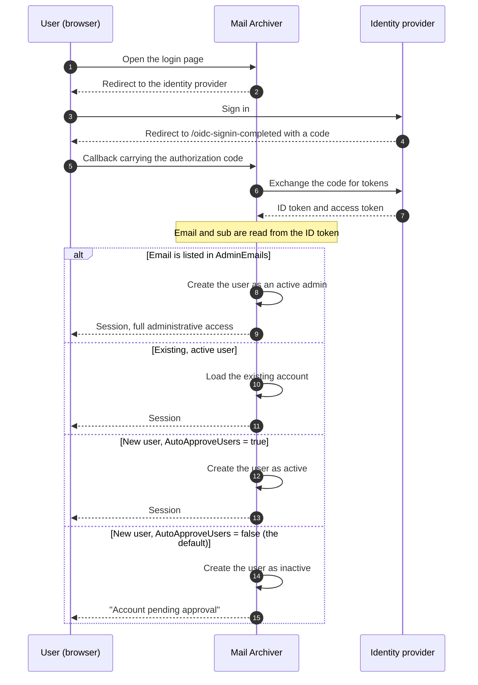

# 🔐 OpenID Connect (OIDC) Authentication Guide {#openid-connect-oidc-authentication-guide}

[← Terug naar de Documentatie-index](index.md)

## 📋 Overzicht {#overview}

Deze gids biedt uitgebreide instructies voor het instellen van OpenID Connect (OIDC) authenticatie in de Mail Archiver-applicatie, met specifieke voorbeelden voor Microsoft Entra ID (Azure AD) integratie. OIDC maakt veilige single sign-on (SSO) authenticatie mogelijk met behulp van externe identiteitsproviders.

## 📚 Inhoudsopgave {#table-of-contents}

1. [Hoe de Login Flow werkt](#how-the-login-flow-works)
2. [Overzicht](#overview)
3. [Voorwaarden](#prerequisites)
4. [OIDC Configuratie](#oidc-configuration)
   - [OIDC inschakelen in Configuratie](#enable-oidc-in-configuration)
   - [Omgevingsvariabelen](#environment-variables)
5. [Microsoft Entra ID Setup](#microsoft-entra-id-setup)
   - [Maak App Registration aan](#create-app-registration)
   - [Authenticatie configureren](#configure-authentication)
   - [API Permissions configureren](#configure-api-permissions)
   - [Client Secret genereren](#generate-client-secret)
6. [Authelia Setup](#authelia-setup)
   - [Authelia Configuratie](#authelia-configuration)
   - [Client Registration Details](#client-registration-details)
7. [Testen en Validatie](#testing-and-validation)
8. [Gebruikersbeheer met OIDC](#user-management-with-oidc)
9. [OIDC Gebruikers automatisch goedkeuren](#auto-approve-oidc-users)
10. [Passwordless Login Configuratie](#passwordless-login-configuration)
11. [Provider Compatibiliteit](#provider-compatibility)

## 🔄 Hoe de inlogflow werkt {#how-the-login-flow-works}

Het diagram laat de volledige reis zien — browser, Mail Archiver en de identity provider — en, belangrijker nog, de lokale beslissing die Mail Archiver neemt *nadat* de provider de gebruiker al heeft geaccepteerd.



Een succesvolle aanmelding bij de provider is daarom **niet** het einde van het verhaal.
Met de standaard `AutoApproveUsers=false` wordt een nieuwe gebruiker inactief aangemaakt en moet een administrator het Account activeren. Een gebruiker die correct authenticeert maar nog steeds niet kan inloggen, is bijna altijd tegen deze barrière aangelopen in plaats van tegen een OIDC-misconfiguratie.

## 🌐 Overzicht {#overview}

De Mail Archiver-applicatie ondersteunt OpenID Connect (OIDC) authenticatie, waardoor gebruikers zich kunnen authenticeren via externe identiteitsproviders zoals Microsoft Entra ID en andere OIDC-conforme providers. Deze functie verhoogt de beveiliging door gebruik te maken van enterprise identity management-systemen en maakt single sign-on (SSO) mogelijkheden mogelijk.

## 🛠️ Vereisten {#prerequisites}

- Administratieve toegang tot de gekozen OIDC-identiteitsprovider (bijv. Microsoft Entra ID)
- Mail Archiver-applicatie reeds geïnstalleerd en toegankelijk via HTTPS
- DNS-naam geconfigureerd voor uw Mail Archiver-instantie (vereist voor callback-URL's)
- Administratieve toegang tot de Mail Archiver-applicatie en het host-systeem voor configuratie
- Indien een reverse proxy wordt gebruikt, de juiste [reverse proxy configuration](ReverseProxy.md) voor de afhandeling van HTTPS-headers

## 🔧 Reverse Proxy Configuratie voor OIDC {#reverse-proxy-configuration-for-oidc}

Bij het implementeren van Mail Archiver achter een reverse proxy met OIDC-authenticatie kan aanvullende configuratie vereist zijn om een correcte afhandeling van authenticatieflows en token-uitwisselingen te garanderen. OIDC-authenticatie omvat grotere HTTP-headers en response bodies die de standaard buffergroottes in sommige reverse proxy-configuraties kunnen overschrijden.

### Nginx Proxy Manager Configuratie {#nginx-proxy-manager-configuration}

Als u Nginx Proxy Manager gebruikt als uw reverse proxy, moet u mogelijk de volgende configuratie toevoegen om OIDC-authenticatie correct af te handelen:

```nginx
proxy_busy_buffers_size 512k;
proxy_buffers 4 512k;
proxy_buffer_size 256k;
```

Deze instellingen vergroten de buffergroottes om grotere OIDC-tokens en authenticatieresponses te kunnen accommoderen. Zonder deze instellingen kunt u problemen ondervinden met authenticatieflows, met name bij providers die grote ID-tokens retourneren of bij het gebruik van extra scopes.

### Algemene overwegingen voor Reverse Proxy {#general-reverse-proxy-considerations}

- Zorg ervoor dat uw reverse proxy HTTPS-headers behoudt (`X-Forwarded-Proto`, `X-Forwarded-Host`)
- Configureer passende timeout-instellingen voor authenticatieflows
- Verifieer of grote headergroottes worden ondersteund
- Test de authenticatieflow grondig na configuratiewijzigingen

Raadpleeg de [Reverse Proxy Configuration Guide](ReverseProxy.md) voor gedetailleerde instructies over reverse proxy-configuratie.

## ⚙️ OIDC-configuratie {#oidc-configuration}

### OIDC inschakelen in de configuratie {#enable-oidc-in-configuration}

Om OIDC-authenticatie in te schakelen, moet u de OAuth-sectie configureren in uw `appsettings.json`-bestand of de omgevingsvariabelen voor de docker-implementatie (zie [Installation and Setup](Setup.md)).

#### Voorbeeldconfiguratie (appsettings.json) {#example-configuration-appsettingsjson}

```json
{
  "OAuth": {
    "Enabled": true,
    "Authority": "https://sts.windows.net/{TENANT-ID}/",
    "ClientId": "YOUR-CLIENT-ID",
    "ClientSecret": "YOUR-CLIENT-SECRET",
    "ClientScopes": [
      "openid",
      "profile",
      "email"
    ],
    "DisablePasswordLogin": false
  }
}
```

### Omgevingsvariabelen {#environment-variables}

Wanneer u Docker Compose of omgevingsvariabelen gebruikt, configureert u de volgende variabelen in uw `docker-compose.yml`-bestand onder de `mailarchive-app` service environment-sectie:

```yaml
environment:
  # OIDC Configuration
  - OAuth__Enabled=true
  - OAuth__Authority=https://sts.windows.net/{TENANT-ID}/
  - OAuth__ClientId=YOUR-CLIENT-ID
  - OAuth__ClientSecret=YOUR-CLIENT-SECRET
  - OAuth__DisplayName=PocketID SSO
  - OAuth__ClientScopes__0=openid
  - OAuth__ClientScopes__1=profile
  - OAuth__ClientScopes__2=email
  - OAuth__DisablePasswordLogin=false
  - OAuth__AutoApproveUsers=false
```

### Uitleg van configuratieparameters {#configuration-parameters-explained}

- **OAuth__Enabled**: Stel in op `true` om OIDC-authenticatie in te schakelen
- **OAuth__Authority**: De OpenID Connect authority URL van uw identity provider
- **OAuth__ClientId**: De client ID toegewezen door uw identity provider
- **OAuth__ClientSecret**: Het client secret toegewezen door uw identity provider
- **OAuth__DisplayName**: Optionele weergavenaam voor de OIDC-inlogknop (bijvoorbeeld: `PocketID SSO` wordt weergegeven als `Login with PocketID SSO`)
- **OAuth__ClientScopes**: Array van scopes die worden opgevraagd bij de identity provider
- **OAuth__ResponseMode**: Response mode van de autorisatieaanvraag: `query`, `fragment` of `form_post`. Laat dit leeg om de standaardwaarde (`form_post`) aan te houden. Providers die `form_post` niet ondersteunen, hebben `query` nodig; zie [Provider Compatibility](#provider-compatibility)
- **OAuth__DisablePasswordLogin**: Stel in op `true` om traditionele gebruikersnaam/wachtwoord-login uit te schakelen en uitsluitend OAuth-authenticatie af te dwingen (zie Passwordless Login Configuration voor meer details)
- **OAuth__AutoApproveUsers**: Stel in op `true` om nieuwe OIDC-gebruikers automatisch goed te keuren zonder dat er goedkeuring van een admin nodig is (standaard: `false`). Zie [Auto-Approve OIDC Users](#auto-approve-oidc-users) voor details

> ⚠️ **Belangrijk**: Het Client Secret moet veilig worden bewaard. Gebruik Docker secrets of omgevingsvariabelen in productieomgevingen.

## ☁️ Microsoft Entra ID Setup {#microsoft-entra-id-setup}

Deze sectie biedt stapsgewijze instructies voor het configureren van Microsoft Entra ID (voorheen Azure AD) als een OIDC-identiteitsprovider voor Mail Archiver.

### 🚀 Create App Registration {#create-app-registration}

1. Navigeer naar het [Microsoft Entra Admin Center](https://entra.microsoft.com)
2. Meld u aan met uw administrator Account
3. Selecteer in het navigatievenster aan de linkerkant **App registrations**
4. Klik bovenaan de App registrations-pagina op **+ New registration**
5. Vul de volgende gegevens in:
   - **Name**: Voer een beschrijvende naam in (bijv. "Mail Archiver OIDC")
   - **Supported account types**: Selecteer **Accounts in this organizational directory only**
   - **Redirect URI**: Selecteer **Web** en voer uw Mail Archiver callback URL in:
     ```
     https://your-mail-archiver-domain/oidc-signin-completed
     ```
     Vervang `your-mail-archiver-domain` door uw eigenlijke domein (bijv. `mailarchiver.example.com`)
6. Klik op **Register**

### 🔐 Configure Authentication {#configure-authentication}

1. Noteer na de registratie de volgende waarden van de **Overview**-pagina van de app registration:
   - **Application (client) ID** - Dit heeft u nodig als `OAuth__ClientId`
   - **Directory (tenant) ID** - Dit heeft u nodig om de Authority URL te construeren
2. Construeer de **Authority URL** op basis van de **Directory (tenant) ID** die u zojuist heeft gekopieerd. Voor Microsoft Entra ID wordt de Authority als volgt opgebouwd:
   ```
   https://sts.windows.net/<TENANT-ID>/
   ```
   Vervang `<TENANT-ID>` (ook aangeduid als Mandanten-ID) door de waarde die naast de Application (client) ID op de Overview-pagina van de app registration staat. Als uw Directory (tenant) ID bijvoorbeeld `11111111-2222-3333-4444-555555555555` is, wordt uw Authority:
   ```
   https://sts.windows.net/11111111-2222-3333-4444-555555555555/
   ```
   Gebruik deze waarde als `OAuth__Authority` in uw configuratie. Zorg ervoor dat u de afsluitende schuine streep (slash) opneemt.
   > ℹ️ **Note**: Zowel `https://sts.windows.net/<TENANT-ID>/` als `https://login.microsoftonline.com/<TENANT-ID>/v2.0` zijn geldige Entra ID authority endpoints. De `sts.windows.net`-vorm gebruikt het v1.0 endpoint en wordt aanbevolen voor deze handleiding.
3. Selecteer in het menu aan de linkerkant **Authentication**
4. Klik op **Settings**
5. Zorg onder **Implicit grant and hybrid flows** dat **ID tokens** is aangevinkt
6. Controleer onder **Supported account types** of uw selectie overeenkomt met uw vereisten
7. Zorg onder **Redirect URIs** dat uw callback URL correct wordt vermeld

### 🎯 Configure API Permissions {#configure-api-permissions}

1. Selecteer in het menu aan de linkerkant **API permissions**
2. Klik op **+ Add a permission**
3. Selecteer **Microsoft Graph**
4. Kies **Delegated permissions**
5. Voeg de volgende machtigingen toe (indien nodig voor extra functies):
   - **openid** - Gebruikers aanmelden
   - **email** - E-mailadres van gebruikers bekijken
   - **profile** - Basisprofiel van gebruikers bekijken
6. Klik op **Add permissions**
7. Klik op **Grant admin consent for [Your Organization]** als u de applicatie vooraf wilt autoriseren

### 🔑 Generate Client Secret {#generate-client-secret}

1. Navigeer naar **Certificates & secrets** in het menu aan de linkerkant
2. Klik onder **Client secrets** op **+ New client secret**
3. Geef een beschrijving op (bijv. "Mail Archiver Auth Secret")
4. Selecteer een vervaldatum
5. Klik op **Add**
6. **Important**: Kopieer de **Value** onmiddellijk en sla deze veilig op. Dit geheim wordt niet meer getoond. Het is nodig als de `OAuth__ClientSecret`

## 🔐 Authelia Setup {#authelia-setup}

Deze sectie biedt configuratiedetails voor het instellen van Authelia als een OIDC-identiteitsprovider voor Mail Archiver. Authelia is een open-source authenticatie- en autorisatieserver die OIDC ondersteunt.

### 🛠️ Authelia Configuration {#authelia-configuration}

```yaml
identity_providers:
  oidc:
    clients:
      - client_id: 'mailarchiver'
        client_name: 'mailarchiver'
        client_secret: '$xyzg'  # The digest of 'insecure_secret'.
        public: false
        redirect_uris:
          - 'https://your-mail-archiver-domain/oidc-signin-completed'
        scopes:
          - 'openid'
          - 'profile'
          - 'email'
        response_types:
          - 'code'
        grant_types:
          - 'authorization_code'
        token_endpoint_auth_method: 'client_secret_post'
```

### 📝 Client Registration Details {#client-registration-details}

- **client_id**: `mailarchiver` - De unieke identifier voor de Mail Archiver applicatie
- **client_name**: `mailarchiver` - De weergavenaam die aan gebruikers wordt getoond tijdens authenticatie
- **client_secret**: Het gehashte geheim dat wordt gebruikt voor client authenticatie (vervang dit in productie door uw eigen beveiligde geheim)
- **redirect_uris**: De callback URL waar Authelia gebruikers zal doorsturen na authenticatie. Vervang `[YOUR_MAILARCHIVER_URL]` door uw eigenlijke Mail Archiver domein
- **scopes**: De machtigingen die worden aangevraagd bij Authelia:
  - `openid`: Vereist voor OIDC authenticatie
  - `profile`: Toegang tot basis profielinformatie
  - `email`: Toegang tot e-mailadres
- **response_types**: `code` - Authorization code flow
- **grant_types**: `authorization_code` - Authorization code grant type
- **token_endpoint_auth_method**: `client_secret_post` - Client authenticatiemethode

> ⚠️ **Security Note**: Het voorbeeld gebruikt een standaard geheim voor demonstratiedoeleinden. Genereer in productie een beveiligd geheim en hash dit met de tools van Authelia. Gebruik het voorbeeldgeheim nooit in productieomgevingen.

## 🧪 Testen en Validatie {#testing-and-validation}

### Initiële Setup Testen {#initial-setup-testing}

1. Start uw Mail Archiver-applicatie opnieuw op nadat u de OIDC-instellingen heeft geconfigureerd
2. Navigeer naar uw Mail Archiver-inlogpagina
3. U ziet een nieuwe OAuth-inlogknop naast het reguliere inlogformulier. Met `OAuth__DisplayName=PocketID SSO` luidt de knop `Login with PocketID SSO`.
4. Klik op de OAuth-inlogknop om de OIDC-flow te starten
5. U wordt omgeleid naar de inlogpagina van uw identity provider
6. Na een succesvolle authenticatie wordt u teruggestuurd naar Mail Archiver

### Validatie van User Provisioning {#user-provisioning-validation}

- OIDC-gebruikers die voor het eerst inloggen, worden automatisch aangemaakt in de Mail Archiver-database
- Gebruikers worden aangemaakt met de standaardrol "User" en hebben admin-goedkeuring nodig voor toegang

## 👥 Gebruikersbeheer met OIDC {#user-management-with-oidc}

### Gebruikersrollen en Machtigingen {#user-roles-and-permissions}

OIDC-gebruikers volgen dezelfde rolgebaseerde toegangscontrole als lokale gebruikers:
- **Admin**: Volledige systeemsystemtoegang (vereist handmatige toewijzing door een bestaande admin, of automatisch via de AdminEmails-configuratie)
- **User**: Standaard gebruikerstoegang tot toegewezen mailaccounts
- **Self-Manager**: Kan het eigen Account beheren en nieuwe accounts toevoegen

### Automatische Provisionering van Beheerders {#auto-provisioning-administrators}

U kunt specifieke e-mailadressen configureren om automatisch als administrator te worden geprovisioneerd wanneer zij voor het eerst inloggen via OIDC:

```json
{
  "OAuth": {
    "AdminEmails": [
      "admin@example.com",
      "it-manager@example.com"
    ]
  }
}
```

Wanneer een gebruiker met een van deze e-mailadressen voor het eerst inlogt:
- Wordt deze automatisch aangemaakt als een actieve administrator
- Is er geen handmatige goedkeuring vereist
- Krijgen zij onmiddellijk volledige administratieve privileges
- E-mailkoppeling is niet hoofdlettergevoelig

**Beveiligingsnotitie**: Voeg alleen vertrouwde e-mailadressen toe aan deze lijst, aangezien deze gebruikers volledige systeemsystemtoegang zullen hebben.

### Gebruikers Provisioneringsstroom {#user-provisioning-flow}

#### Nieuwe Gebruikers (Niet in AdminEmails) {#new-users-not-in-adminemails}
1. Gebruiker authenticeert via OAuth-provider
2. Systeem controleert of het e-mailadres bestaat in de lokale database
3. Indien nieuwe gebruiker:
   - Account wordt aangemaakt met een gebruikersnaam afgeleid van de OIDC claims, in deze voorkeursvolgorde:
     1. Het **lokale deel van de e-mail** (alles voor `@`), bijv. `example.mailarchiver` voor `example.mailarchiver@xxxxxxxxx.onmicrosoft.com`
     2. De volledige `sub` claim wanneer er geen e-mail claim aanwezig is
     3. `oidc_<12-char-hash>` als laatste redmiddel (fallback)
     De gegenereerde waarde wordt afgekort tot 320 tekens. Als er al een lokale gebruiker met dezelfde gebruikersnaam bestaat, wordt `" (n)"` toegevoegd totdat er een unieke naam is gevonden.
   - Gebruiker wordt gemarkeerd als **inactief** en **vereist goedkeuring**
   - Admin moet de gebruiker handmatig activeren in het Gebruikersbeheer
4. Gebruiker ontvangt de melding "Account in afwachting van goedkeuring"

#### Nieuwe Gebruikers (In AdminEmails) {#new-users-in-adminemails}
1. Gebruiker authenticeert via OAuth-provider
2. Systeem herkent dat het e-mailadres in de AdminEmails-lijst staat
3. Account wordt automatisch aangemaakt:
   - Gebruiker wordt gemarkeerd als **actief** en **admin**
   - Geen goedkeuring vereist
   - Gebruiker heeft onmiddellijk toegang tot het systeem
4. Gebruiker is succesvol ingelogd

### Wachtwoordbeheer {#password-management}

OIDC-gebruikers kunnen geen wachtwoorden hebben of wijzigen binnen Mail Archiver, aangezien de authenticatie wordt afgehandeld door de externe identiteitsprovider:
- De optie "Wachtwoord wijzigen" wordt uitgeschakeld voor OIDC-gebruikers
- Wachtwoordreset moet worden afgehandeld via de OIDC-provider
- Lokale wachtwoordvelden blijven leeg voor OIDC-gebruikers

## ✅ OIDC-gebruikers automatisch goedkeuren {#auto-approve-oidc-users}

Standaard moeten nieuwe OIDC-gebruikers handmatig worden goedgekeurd door een lokale administrator voordat ze toegang krijgen tot de applicatie. Dit biedt een model met dubbele controle waarbij zowel de IdP als de lokale admin toegang moeten verlenen.

Voor **OIDC-first implementaties** waarbij de Identity Provider (IdP) de enige bron van waarheid is voor toegangsbeheer, kan deze handmatige goedkeuringsstap worden overgeslagen door de `AutoApproveUsers`-optie in te schakelen.

### Automatisch goedkeuren inschakelen {#enabling-auto-approve}

Stel `AutoApproveUsers` in op `true` in uw configuratie:

```json
{
  "OAuth": {
    "Enabled": true,
    "AutoApproveUsers": true,
    "Authority": "https://your-provider.com",
    "ClientId": "your-client-id",
    "ClientSecret": "your-secret"
  }
}
```

Of via een omgevingsvariabele:

```yaml
environment:
  - OAuth__AutoApproveUsers=true
```

### Gedrag {#behavior}

| Instelling | Gedrag voor nieuwe OIDC-gebruiker |
|---|---|
| `AutoApproveUsers: false` (standaard) | Gebruiker wordt aangemaakt als **inactief** en **vereist admin-goedkeuring** voordat toegang wordt verleend |
| `AutoApproveUsers: true` | Gebruiker wordt aangemaakt als **actief** en heeft direct toegang tot de applicatie |

> **Let op**: `AdminEmails` heeft altijd voorrang — gebruikers die voldoen aan `AdminEmails` worden altijd automatisch goedgekeurd als administrators, ongeacht deze instelling.

### Wanneer te gebruiken {#when-to-use}

Deze optie wordt aanbevolen voor omgevingen waar:
- De **IdP de applicatietoegang beheert** (bijv. via app-toewijzing of groepslidmaatschap in Authentik, Entra ID, Authelia, etc.)
- U het **model met dubbele controle wilt elimineren** (IdP-verlening + lokale admin-goedkeuring)
- Het **intrekken van toegang wordt beheerd op IdP-niveau** (het verwijderen van de app-toewijzing voorkomt automatisch inloggen)

### Volledig OIDC-First Setup Voorbeeld {#complete-oidc-first-setup-example}

```json
{
  "OAuth": {
    "Enabled": true,
    "Authority": "https://sts.windows.net/YOUR_TENANT_ID/",
    "ClientId": "your-client-id",
    "ClientSecret": "your-secret",
    "DisplayName": "PocketID SSO",
    "ClientScopes": ["openid", "profile", "email"],
    "DisablePasswordLogin": true,
    "AutoRedirect": true,
    "AutoApproveUsers": true,
    "AdminEmails": ["admin@company.com"]
  }
}
```

In deze setup:
- Gebruikers worden automatisch doorverwezen naar de OIDC-provider
- Nieuwe gebruikers worden automatisch goedgekeurd bij de eerste login
- Admin-e-mailadressen worden automatisch voorzien als administrators
- Toegangsbeheer wordt volledig beheerd op IdP-niveau

### Beveiligingsoverwegingen {#security-considerations}

- **Vertrouwen**: Het inschakelen van `AutoApproveUsers` betekent dat u de IdP vertrouwt om te controleren wie toegang heeft tot de applicatie. Zorg ervoor dat uw IdP correct is geconfigureerd met de juiste app-toewijzingen of groepgebaseerde toegang.
- **Roltoewijzing**: Automatisch goedgekeurde gebruikers worden aangemaakt met standaard gebruikersrechten (geen admin). Admin-toegang vereist nog steeds ofwel `AdminEmails`-configuratie of handmatige roltoewijzing.
- **Intrekken van toegang**: Wanneer de toegang van een gebruiker in de IdP wordt verwijderd, kan deze niet langer authenticeren via OIDC. Hun lokale Account blijft echter actief. Om de toegang volledig in te trekken, moet u de gebruiker ook deactiveren in het Mail Archiver admin-paneel.
- **Backward Compatibility**: De standaardwaarde is `false`, waardoor het bestaande gedrag voor huidige implementaties behouden blijft.

## 🔒 Configuratie voor wachtwoordloze login {#passwordless-login-configuration}

> ⚠️ **Belangrijk**: Zelfs met een configuratie voor wachtwoordloze login wordt tijdens de eerste opstart nog steeds een initiële admin-gebruiker aangemaakt. U moet een veilig wachtwoord instellen voor deze admin-gebruiker in uw `appsettings.json` of `docker-compose.yml` bestand om de systeembeveiliging te waarborgen.

Voor organisaties die uitsluitend OAuth-authenticatie willen afdwingen, ondersteunt de applicatie het volledig uitschakelen van de wachtwoordlogin.

### Wachtwoordlogin uitschakelen {#disabling-password-login}

Stel `DisablePasswordLogin` in op `true` om de gebruikersnaam/wachtwoordlogin uit te schakelen:

```json
{
  "OAuth": {
    "Enabled": true,
    "DisablePasswordLogin": true,
    "Authority": "https://your-provider.com",
    "ClientId": "your-client-id",
    "ClientSecret": "your-secret"
  }
}
```

**Resultaat**: De inlogpagina toont alleen de OAuth-inlogknop en de server wijst elke wachtwoord POST (`/Auth/Login`) af met een redirect terug naar de inlogpagina. Lokale wachtwoorden blijven opgeslagen in de database, maar kunnen niet meer worden gebruikt om in te loggen zolang de OAuth-only modus actief is. Als `DisplayName` is geconfigureerd, gebruikt de knop die waarde (bijvoorbeeld `Login with PocketID SSO`).

### Automatische redirect naar OAuth-provider {#auto-redirect-to-oauth-provider}

Schakel `AutoRedirect` in om gebruikers automatisch door te sturen naar uw OAuth-provider:

```json
{
  "OAuth": {
    "Enabled": true,
    "DisablePasswordLogin": true,
    "AutoRedirect": true,
    "Authority": "https://your-provider.com",
    "ClientId": "your-client-id",
    "ClientSecret": "your-secret"
  }
}
```

**Vereisten**: 
- `DisablePasswordLogin` moet `true` zijn
- `OAuth.Enabled` moet `true` zijn

**Resultaat**: Gebruikers zien een kort laadscherm en worden automatisch doorverwezen naar de OAuth-provider.

### Voorbeeld van een volledige wachtwoordloze setup {#complete-passwordless-setup-example}

```json
{
  "OAuth": {
    "Enabled": true,
    "Authority": "https://sts.windows.net/YOUR_TENANT_ID/",
    "ClientId": "your-client-id",
    "ClientSecret": "your-secret",
    "DisplayName": "PocketID SSO",
    "ClientScopes": ["openid", "profile", "email"],
    "DisablePasswordLogin": true,
    "AutoRedirect": true,
    "AdminEmails": ["admin@company.com", "it@company.com"]
  }
}
```

### Beveiligingsoverwegingen {#security-considerations}

- **Provisioning van Admin E-mail**: De OAuth-provider wordt vertrouwd voor het verifiëren van e-mailadressen. Voeg alleen vertrouwde adressen toe aan AdminEmails.
- **Noodtoegang**: Met `DisablePasswordLogin=true` kan er geen lokaal wachtwoord meer worden gebruikt om in te loggen, inclusief het bootstrap admin-account. Zorg ervoor dat ten minste één OAuth-identiteit als admin is geprovisioneerd (zie `AdminEmails`) voordat u deze instelling inschakelt, anders sluit u uzelf buiten. Om de toegang te herstellen, stelt u `OAuth__DisablePasswordLogin=false` in, start u opnieuw op, logt u in met het lokale admin-wachtwoord en schakelt u het daarna weer in.
- **Testen**: Test de OAuth-authenticatie grondig voordat u de wachtwoordlogin in productie uitschakelt.
- **SSO-omgeving**: Auto-redirect is het meest geschikt voor single sign-on omgevingen waar alle gebruikers authenticeren via dezelfde provider.

## 🧩 Provider Compatibiliteit {#provider-compatibility}

Niet elke identiteitsprovider implementeert de volledige OIDC-specificatie. Beide onderstaande instellingen bestaan daarom, en beide zijn nodig voor de Synology SSO Server.

### Response Mode {#response-mode}

Het autorisatieverzoek wordt verzonden met de response mode `form_post`, de standaardinstelling van de onderliggende ASP.NET Core OpenID Connect handler. Een provider die dit niet ondersteunt, faalt meestal met een eigen foutmelding en er verschijnt niets in het Mail Archiver logboek.

Synology SSO Server gedraagt zich op die manier: het discovery document laat `response_modes_supported` weg, en de login stopt met "Unable to sign in via SSO due to setting issues". Stel de response mode expliciet in:

```env
OAuth__ResponseMode=query
```

Geldige waarden zijn `query`, `fragment` en `form_post`. Laat de instelling leeg om de standaardwaarde te behouden. Bij twijfel is `query` de veiligste keuze: dit is de enige response mode die elke OIDC-provider verplicht moet ondersteunen.

### Name and Email Claims {#name-and-email-claims}

De weergavenaam van een nieuwe gebruiker wordt overgenomen uit de user info response, in deze volgorde:

1. `name`
2. `preferred_username`
3. `given_name`
4. `username`

Claims die aanwezig zijn maar leeg of geen string zijn, worden overgeslagen. `username` is geen OIDC-standaard claim, maar sommige providers geven deze terug als de enige naam-achtige waarde (opnieuw Synology SSO Server). Het e-mailadres wordt gelezen uit `email`, dan `mail`, dan `upn`, en valt terug op de claims van de ID token.

Als geen van de naam-claims aanwezig is, mislukt de login. De gebruiker wordt teruggestuurd naar de inlogpagina met een leesbare melding waarin de gezochte claims worden genoemd, en de reden wordt op error-niveau naar het logboek geschreven.

---

**Opmerking**: Deze gids is actueel per 2025. Services van identiteitsproviders updaten regelmatig hun interfaces en functies, waardoor sommige UI-elementen kunnen afwijken. Raadpleeg altijd de nieuwste documentatie van uw identiteitsprovider voor de meest actuele informatie.
