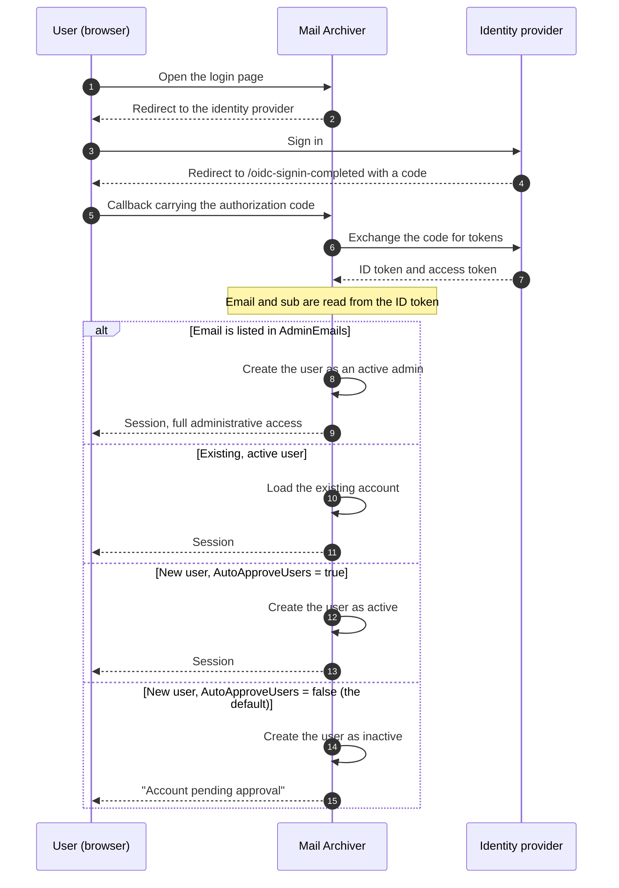

# 🔐 Przewodnik po uwierzytelnianiu OpenID Connect (OIDC) {#openid-connect-oidc-authentication-guide}

[← Powrót do spisu treści dokumentacji](index.md)

## 📋 Przegląd {#overview}

Niniejszy przewodnik zawiera szczegółowe instrukcje dotyczące konfiguracji uwierzytelniania OpenID Connect (OIDC) w aplikacji Mail Archiver, wraz ze szczegółowymi przykładami integracji z Microsoft Entra ID (Azure AD). OIDC umożliwia bezpieczne uwierzytelnianie typu single sign-on (SSO) przy użyciu zewnętrznych dostawców tożsamości.

## 📚 Spis treści {#table-of-contents}

1. [Jak działa przepływ logowania](#how-the-login-flow-works)
2. [Przegląd](#overview)
3. [Wymagania wstępne](#prerequisites)
4. [Konfiguracja OIDC](#oidc-configuration)
   - [Włączenie OIDC w konfiguracji](#enable-oidc-in-configuration)
   - [Zmienne środowiskowe](#environment-variables)
5. [Konfiguracja Microsoft Entra ID](#microsoft-entra-id-setup)
   - [Utworzenie rejestracji aplikacji](#create-app-registration)
   - [Konfiguracja uwierzytelniania](#configure-authentication)
   - [Konfiguracja uprawnień API](#configure-api-permissions)
   - [Generowanie Client Secret](#generate-client-secret)
6. [Konfiguracja Authelia](#authelia-setup)
   - [Konfiguracja Authelia](#authelia-configuration)
   - [Szczegóły rejestracji klienta](#client-registration-details)
7. [Testowanie i walidacja](#testing-and-validation)
8. [Zarządzanie użytkownikami za pomocą OIDC](#user-management-with-oidc)
9. [Automatyczne zatwierdzanie użytkowników OIDC](#auto-approve-oidc-users)
10. [Konfiguracja logowania bezhasłowego](#passwordless-login-configuration)
11. [Kompatybilność dostawców](#provider-compatibility)

## 🔄 Jak działa proces logowania {#how-the-login-flow-works}

Diagram pokazuje całą drogę powrotną — przeglądarkę, Mail Archiver oraz dostawcę tożsamości — a co ważniejsze, lokalną decyzję, którą Mail Archiver podejmuje *po* tym, jak dostawca zaakceptował już użytkownika.



Pomyślne zalogowanie u dostawcy nie jest zatem **końcem** historii.
Przy domyślnym `AutoApproveUsers=false`, nowy użytkownik jest tworzony jako nieaktywny i administrator musi aktywować to Konto. Użytkownik, który poprawnie się uwierzytelnia, a mimo to nie może się zalogować, prawie zawsze napotkał tę barierę, a nie błąd w konfiguracji OIDC.

## 🌐 Przegląd {#overview}

Aplikacja Mail Archiver obsługuje uwierzytelnianie OpenID Connect (OIDC), co pozwala użytkownikom na uwierzytelnianie za pomocą zewnętrznych dostawców tożsamości, takich jak Microsoft Entra ID oraz innych dostawców zgodnych z OIDC. Funkcja ta zwiększa bezpieczeństwo poprzez wykorzystanie korporacyjnych systemów zarządzania tożsamością i umożliwia funkcje pojedynczego logowania (SSO).

## 🛠️ Wymagania wstępne {#prerequisites}

- Uprawnienia administracyjne do wybranego dostawcy tożsamości OIDC (np. Microsoft Entra ID)
- Aplikacja Mail Archiver została już wdrożona i jest dostępna za pośrednictwem HTTPS
- Nazwa DNS skonfigurowana dla instancji Mail Archiver (wymagana dla adresów URL callback)
- Uprawnienia administracyjne do aplikacji Mail Archiver oraz systemu hosta w celu przeprowadzenia konfiguracji
- W przypadku korzystania z reverse proxy, właściwa [reverse proxy configuration](ReverseProxy.md) dla obsługi nagłówków HTTPS

## 🔧 Konfiguracja Reverse Proxy dla OIDC {#reverse-proxy-configuration-for-oidc}

Podczas wdrażania Mail Archiver za reverse proxy z uwierzytelnianiem OIDC może być wymagana dodatkowa konfiguracja, aby zapewnić poprawne obsługę przepływów uwierzytelniania i wymiany tokenów. Uwierzytelnianie OIDC wiąże się z większymi nagłówkami HTTP i ciałami odpowiedzi, które mogą przekraczać domyślne rozmiary bufora w niektórych konfiguracjach reverse proxy.

### Konfiguracja Nginx Proxy Manager {#nginx-proxy-manager-configuration}

Jeśli używasz Nginx Proxy Manager jako swojego reverse proxy, możesz być zmuszony do dodania następującej konfiguracji, aby poprawnie obsługiwać uwierzytelnianie OIDC:

```nginx
proxy_busy_buffers_size 512k;
proxy_buffers 4 512k;
proxy_buffer_size 256k;
```

Powyższe ustawienia zwiększają rozmiary buforów, aby pomieścić większe tokeny OIDC i odpowiedzi uwierzytelniające. Bez tych ustawień możesz napotkać problemy z przepływami uwierzytelniania, szczególnie w przypadku dostawców zwracających duże tokeny ID lub podczas używania dodatkowych zakresów (scopes).

### Ogólne uwagi dotyczące Reverse Proxy {#general-reverse-proxy-considerations}

- Upewnij się, że Twój reverse proxy zachowuje nagłówki HTTPS (`X-Forwarded-Proto`, `X-Forwarded-Host`)
- Skonfiguruj odpowiednie ustawienia timeout dla przepływów uwierzytelniania
- Zweryfikuj, czy duże rozmiary nagłówków są obsługiwane
- Dokładnie przetestuj przepływ uwierzytelniania po wprowadzeniu zmian w konfiguracji

Aby uzyskać szczegółowe wytyczne dotyczące konfiguracji reverse proxy, zapoznaj się z [Reverse Proxy Configuration Guide](ReverseProxy.md).

## ⚙️ Konfiguracja OIDC {#oidc-configuration}

### Włącz OIDC w Konfiguracji {#enable-oidc-in-configuration}

Aby włączyć uwierzytelnianie OIDC, należy skonfigurować sekcję OAuth w pliku `appsettings.json` lub w zmiennych środowiskowych dla wdrożenia docker (patrz [Installation and Setup](Setup.md)).

#### Przykład Konfiguracji (appsettings.json) {#example-configuration-appsettingsjson}

```json
{
  "OAuth": {
    "Enabled": true,
    "Authority": "https://sts.windows.net/{TENANT-ID}/",
    "ClientId": "YOUR-CLIENT-ID",
    "ClientSecret": "YOUR-CLIENT-SECRET",
    "ClientScopes": [
      "openid",
      "profile",
      "email"
    ],
    "DisablePasswordLogin": false
  }
}
```

### Zmienne Środowiskowe {#environment-variables}

Używając Docker Compose lub zmiennych środowiskowych, należy skonfigurować następujące zmienne w pliku `docker-compose.yml` w sekcji environment usługi `mailarchive-app`:

```yaml
environment:
  # OIDC Configuration
  - OAuth__Enabled=true
  - OAuth__Authority=https://sts.windows.net/{TENANT-ID}/
  - OAuth__ClientId=YOUR-CLIENT-ID
  - OAuth__ClientSecret=YOUR-CLIENT-SECRET
  - OAuth__DisplayName=PocketID SSO
  - OAuth__ClientScopes__0=openid
  - OAuth__ClientScopes__1=profile
  - OAuth__ClientScopes__2=email
  - OAuth__DisablePasswordLogin=false
  - OAuth__AutoApproveUsers=false
```

### Wyjaśnienie Parametrów Konfiguracji {#configuration-parameters-explained}

- **OAuth__Enabled**: Ustaw na `true`, aby włączyć uwierzytelnianie OIDC
- **OAuth__Authority**: Adres URL autorytetu OpenID Connect Twojego dostawcy tożsamości
- **OAuth__ClientId**: Identyfikator klienta (client ID) przypisany przez dostawcę tożsamości
- **OAuth__ClientSecret**: Sekret klienta (client secret) przypisany przez dostawcę tożsamości
- **OAuth__DisplayName**: Opcjonalna nazwa wyświetlana dla przycisku logowania OIDC (na przykład `PocketID SSO` renderuje się jako `Login with PocketID SSO`)
- **OAuth__ClientScopes**: Tablica zakresów (scopes) żądanych od dostawcy tożsamości
- **OAuth__ResponseMode**: Tryb odpowiedzi żądania autoryzacji: `query`, `fragment` lub `form_post`. Pozostaw puste, aby zachować domyślne ustawienie (`form_post`). Dostawcy, którzy nie obsługują `form_post`, wymagają `query`; patrz [Provider Compatibility](#provider-compatibility)
- **OAuth__DisablePasswordLogin**: Ustaw na `true`, aby wyłączyć tradycyjne logowanie nazwą użytkownika/hasłem i wymusić uwierzytelnianie wyłącznie przez OAuth (patrz Passwordless Login Configuration, aby uzyskać więcej szczegółów)
- **OAuth__AutoApproveUsers**: Ustaw na `true`, aby automatycznie zatwierdzać nowych użytkowników OIDC bez konieczności zatwierdzenia przez administratora (domyślnie: `false`). Szczegóły w [Auto-Approve OIDC Users](#auto-approve-oidc-users)

> ⚠️ **Ważne**: Sekret klienta (Client Secret) powinien być przechowywany w bezpieczny sposób. W środowiskach produkcyjnych należy używać Docker secrets lub zmiennych środowiskowych.

## ☁️ Konfiguracja Microsoft Entra ID {#microsoft-entra-id-setup}

Ta sekcja zawiera instrukcje krok po kroku dotyczące konfiguracji Microsoft Entra ID (dawniej Azure AD) jako dostawcy tożsamości OIDC dla Mail Archiver.

### 🚀 Utwórz rejestrację aplikacji {#create-app-registration}

1. Przejdź do [Microsoft Entra Admin Center](https://entra.microsoft.com)
2. Zaloguj się przy użyciu swojego konta administratora
3. W lewym panelu nawigacyjnym wybierz **App registrations**
4. Kliknij **+ New registration** na górze strony App registrations
5. Wypełnij następujące szczegóły:
   - **Name**: Wprowadź opisową nazwę (np. "Mail Archiver OIDC")
   - **Supported account types**: Wybierz **Accounts in this organizational directory only**
   - **Redirect URI**: Wybierz **Web** i wprowadź swój adres URL powrotny (callback URL) Mail Archiver:
     ```
     https://your-mail-archiver-domain/oidc-signin-completed
     ```
     Zastąp `your-mail-archiver-domain` swoją rzeczywistą domeną (np. `mailarchiver.example.com`)
6. Kliknij **Register**

### 🔐 Konfiguracja uwierzytelniania {#configure-authentication}

1. Po rejestracji zanotuj następujące wartości ze strony **Overview** rejestracji aplikacji:
   - **Application (client) ID** - Będziesz go potrzebować jako `OAuth__ClientId`
   - **Directory (tenant) ID** - Będziesz go potrzebować do skonstruowania adresu URL Authority
2. Skonstruuj **Authority URL** na podstawie skopiowanego właśnie **Directory (tenant) ID**. Dla Microsoft Entra ID, adres Authority buduje się w następujący sposób:
   ```
   https://sts.windows.net/<TENANT-ID>/
   ```
   Zastąp `<TENANT-ID>` (nazywany również Mandanten-ID) wartością wyświetlaną obok Application (client) ID na stronie Overview rejestracji aplikacji. Na przykład, jeśli Twój Directory (tenant) ID to `11111111-2222-3333-4444-555555555555`, Twój adres Authority będzie wyglądał następująco:
   ```
   https://sts.windows.net/11111111-2222-3333-4444-555555555555/
   ```
   Użyj tej wartości jako `OAuth__Authority` w swojej konfiguracji. Upeń się, że zawiera ona końcowy ukośnik.
   > ℹ️ **Uwaga**: Zarówno `https://sts.windows.net/<TENANT-ID>/`, jak i `https://login.microsoftonline.com/<TENANT-ID>/v2.0` są poprawnymi punktami końcowymi (endpoints) authority Entra ID. Forma `sts.windows.net` używa punktu końcowego v1.0 i jest zalecana w niniejszym przewodniku.
3. W lewym menu wybierz **Authentication**
4. Kliknij **Settings**
5. W sekcji **Implicit grant and hybrid flows** upewnij się, że opcja **ID tokens** jest zaznaczona
6. W sekcji **Supported account types** sprawdź, czy wybrana opcja odpowiada Twoim wymaganiom
7. W sekcji **Redirect URIs** upewnij się, że Twój adres URL powrotny jest poprawnie wymieniony

### 🎯 Konfiguracja uprawnień API {#configure-api-permissions}

1. W lewym menu wybierz **API permissions**
2. Kliknij **+ Add a permission**
3. Wybierz **Microsoft Graph**
4. Wybierz **Delegated permissions**
5. Dodaj następujące uprawnienia (jeśli są wymagane dla dodatkowych funkcji):
   - **openid** - Logowanie użytkowników
   - **email** - Wyświetlanie adresów e-mail użytkowników
   - **profile** - Wyświetlanie podstawowego profilu użytkownika
6. Kliknij **Add permissions**
7. Kliknij **Grant admin consent for [Your Organization]**, jeśli chcesz uprzednio autoryzować aplikację

### 🔑 Generowanie Client Secret {#generate-client-secret}

1. Przejdź do **Certificates & secrets** w lewym menu
2. W sekcji **Client secrets** kliknij **+ New client secret**
3. Podaj opis (np. "Mail Archiver Auth Secret")
4. Wybierz okres ważności
5. Kliknij **Add**
6. **Ważne**: Niezwłocznie skopiuj wartość **Value** i przechowuj ją w bezpieczny sposób. Ta wartość nie zostanie wyświetlona ponownie. Jest ona potrzebna jako `OAuth__ClientSecret`

## 🔐 Konfiguracja Authelia {#authelia-setup}

Ta sekcja zawiera szczegóły konfiguracyjne dotyczące ustawienia Authelia jako dostawcy tożsamości OIDC dla Mail Archiver. Authelia to serwer uwierzytelniania i autoryzacji open-source, który obsługuje OIDC.

### 🛠️ Konfiguracja Authelia {#authelia-configuration}

```yaml
identity_providers:
  oidc:
    clients:
      - client_id: 'mailarchiver'
        client_name: 'mailarchiver'
        client_secret: '$xyzg'  # The digest of 'insecure_secret'.
        public: false
        redirect_uris:
          - 'https://your-mail-archiver-domain/oidc-signin-completed'
        scopes:
          - 'openid'
          - 'profile'
          - 'email'
        response_types:
          - 'code'
        grant_types:
          - 'authorization_code'
        token_endpoint_auth_method: 'client_secret_post'
```

### 📝 Szczegóły rejestracji klienta {#client-registration-details}

- **client_id**: `mailarchiver` - Unikalny identyfikator aplikacji Mail Archiver
- **client_name**: `mailarchiver` - Nazwa wyświetlana użytkownikom podczas uwierzytelniania
- **client_secret**: Zahashowany sekret używany do uwierzytelniania klienta (w środowisku produkcyjnym zastąp go własnym bezpiecznym sekretem)
- **redirect_uris**: Adres URL powrotnego połączenia, na który Authelia przekieruje użytkowników po uwierzytelnieniu. Zastąp `[YOUR_MAILARCHIVER_URL]` właściwą domeną Mail Archiver
- **scopes**: Uprawnienia wnioskowane od Authelia:
  - `openid`: Wymagane do uwierzytelniania OIDC
  - `profile`: Dostęp do podstawowych informacji profilowych
  - `email`: Dostęp do adresu e-mail
- **response_types**: `code` - Przepływ kodu autoryzacji (Authorization code flow)
- **grant_types**: `authorization_code` - Typ przyznawania kodu autoryzacji (Authorization code grant type)
- **token_endpoint_auth_method**: `client_secret_post` - Metoda uwierzytelniania klienta

> ⚠️ **Uwaga dotycząca bezpieczeństwa**: Przykład używa domyślnego sekretu w celach demonstracyjnych. W środowisku produkcyjnym wygeneruj bezpieczny sekret i zahashuj go za pomocą narzędzi Authelia. Nigdy nie używaj sekretu z przykładu w środowiskach produkcyjnych.

## 🧪 Testowanie i walidacja {#testing-and-validation}

### Testowanie wstępnej konfiguracji {#initial-setup-testing}

1. Uruchom ponownie aplikację Mail Archiver po skonfigurowaniu ustawień OIDC
2. Przejdź do strony logowania Mail Archiver
3. Powinieneś zobaczyć nowy przycisk logowania OAuth obok standardowego formularza logowania. W przypadku `OAuth__DisplayName=PocketID SSO`, przycisk ma tekst `Login with PocketID SSO`.
4. Kliknij przycisk logowania OAuth, aby zainicjować proces OIDC
5. Powinieneś zostać przekierowany na stronę logowania Twojego dostawcy tożsamości
6. Po pomyślnej autoryzacji powinieneś zostać przekierowany z powrotem do Mail Archiver

### Walidacja aprovisionowania użytkowników {#user-provisioning-validation}

- Użytkownicy OIDC korzystający z usługi po raz pierwszy zostaną automatycznie utworzeni w bazie danych Mail Archiver
- Użytkownicy zostaną utworzeni z domyślną rolą "User" i będą wymagać zatwierdzenia przez administratora w celu uzyskania dostępu

## 👥 Zarządzanie użytkownikami za pomocą OIDC {#user-management-with-oidc}

### Role i uprawnienia użytkowników {#user-roles-and-permissions}

Użytkownicy OIDC podlegają tym samym zasadom kontroli dostępu opartej na rolach, co użytkownicy lokalni:
- **Admin**: Pełny dostęp do systemu (wymaga ręcznego przypisania przez istniejącego administratora lub automatycznego poprzez konfigurację AdminEmails)
- **User**: Standardowy dostęp użytkownika do przypisanych skrzynek pocztowych
- **Self-Manager**: Może zarządzać własnym kontem i dodawać nowe konta

### Automatyczne aprovisionowanie administratorów {#auto-provisioning-administrators}

Możesz skonfigurować określone adresy e-mail, aby były automatycznie aprovisionowane jako administratorzy podczas ich pierwszego logowania za pomocą OIDC:

```json
{
  "OAuth": {
    "AdminEmails": [
      "admin@example.com",
      "it-manager@example.com"
    ]
  }
}
```

Gdy użytkownik z jednym z tych adresów e-mail zaloguje się po raz pierwszy:
- Zostanie automatycznie utworzony jako aktywny administrator
- Nie jest wymagana ręczna akceptacja
- Natychmiast uzyskuje pełne uprawnienia administracyjne
- Dopasowanie adresu e-mail nie uwzględnia wielkości liter

**Uwaga dotycząca bezpieczeństwa**: Do tej listy dodawaj tylko zaufane adresy e-mail, ponieważ użytkownicy ci będą mieli pełny dostęp do systemu.

### Przepływ aprovisionowania użytkowników {#user-provisioning-flow}

#### Nowi użytkownicy (nieobecni w AdminEmails) {#new-users-not-in-adminemails}
1. Użytkownik uwierzytelnia się za pomocą dostawcy OAuth
2. System sprawdza, czy adres e-mail istnieje w lokalnej bazie danych
3. Jeśli użytkownik jest nowy:
   - Konto zostaje utworzone z nazwą użytkownika wywnioskowaną z twierdzeń (claims) OIDC, w następującej kolejności preferencji:
     1. **część lokalna adresu e-mail** (wszystko przed `@`), np. `example.mailarchiver` dla `example.mailarchiver@xxxxxxxxx.onmicrosoft.com`
     2. pełne twierdzenie `sub`, gdy nie ma twierdzenia e-mail
     3. `oidc_<12-char-hash>` jako rozwiązanie ostateczne
     Wygenerowana wartość zostaje skrócona do 320 znaków. Jeśli istnieje już lokalny użytkownik o tej samej nazwie, do nazwy dopisywane jest `" (n)"`, aż zostanie znaleziona unikalna nazwa.
   - Użytkownik zostaje oznaczony jako **nieaktywny** i **wymagający zatwierdzenia**
   - Administrator musi ręcznie aktywować użytkownika w zarządzaniu użytkownikami (Users)
4. Użytkownik otrzymuje komunikat „Account pending approval” (Konto oczekuje na zatwierdzenie)

#### Nowi użytkownicy (obecni w AdminEmails) {#new-users-in-adminemails}
1. Użytkownik uwierzytelnia się za pomocą dostawcy OAuth
2. System rozpoznaje, że adres e-mail znajduje się na liście AdminEmails
3. Konto zostaje utworzone automatycznie:
   - Użytkownik zostaje oznaczony jako **aktywny** i **admin**
   - Nie jest wymagane zatwierdzenie
   - Użytkownik może natychmiast uzyskać dostęp do systemu
4. Użytkownik zostaje pomyślnie zalogowany

### Zarządzanie hasłami {#password-management}

Użytkownicy OIDC nie mogą posiadać ani zmieniać haseł wewnątrz Mail Archiver, ponieważ uwierzytelnianie jest obsługiwane przez zewnętrznego dostawcę tożsamości:
- Opcja „Change Password” będzie wyłączona dla użytkowników OIDC
- Resetowanie hasła musi odbywać się za pośrednictwem dostawcy OIDC
- Pola lokalnych haseł pozostaną puste dla użytkowników OIDC

## ✅ Automatyczne zatwierdzanie użytkowników OIDC {#auto-approve-oidc-users}

Domyślnie nowi użytkownicy OIDC muszą zostać ręcznie zatwierdzeni przez lokalnego administratora, zanim uzyska dostęp do aplikacji. Zapewnia to model podwójnej weryfikacji, w którym zarówno IdP, jak i lokalny administrator muszą udzielić dostępu.

W przypadku **wdrożeń typu OIDC-first**, gdzie dostawca tożsamości (IdP) jest jedynym źródłem prawdy dla kontroli dostępu, ten krok ręcznego zatwierdzania można pominąć, włączając opcję `AutoApproveUsers`.

### Włączanie automatycznego zatwierdzania {#enabling-auto-approve}

Ustaw `AutoApproveUsers` na `true` w swojej konfiguracji:

```json
{
  "OAuth": {
    "Enabled": true,
    "AutoApproveUsers": true,
    "Authority": "https://your-provider.com",
    "ClientId": "your-client-id",
    "ClientSecret": "your-secret"
  }
}
```

Lub za pomocą zmiennej środowiskowej:

```yaml
environment:
  - OAuth__AutoApproveUsers=true
```

### Zachowanie {#behavior}

| Ustawienie | Zachowanie nowego użytkownika OIDC |
|---|---|
| `AutoApproveUsers: false` (domyślne) | Użytkownik jest tworzony jako **nieaktywny** i **wymaga zatwierdzenia przez administratora** przed przyznaniem dostępu |
| `AutoApproveUsers: true` | Użytkownik jest tworzony jako **aktywny** i może natychmiast uzyskać dostęp do aplikacji |

> **Uwaga**: `AdminEmails` ma zawsze pierwszeństwo — użytkownicy pasujący do `AdminEmails` są zawsze automatycznie zatwierdzani jako administratorzy, niezależnie od tego ustawienia.

### Kiedy stosować {#when-to-use}

Ta opcja jest zalecana w środowiskach, gdzie:
- **IdP kontroluje dostęp do aplikacji** (np. poprzez przypisanie aplikacji lub przynależność do grupy w Authentik, Entra ID, Authelia itp.)
- Chcesz **wyeliminować model podwójnej weryfikacji** (udzielenie dostępu przez IdP + zatwierdzenie przez lokalnego administratora)
- **Cofanie dostępu jest zarządzane na poziomie IdP** (usunięcie przypisania aplikacji automatycznie uniemożliwia logowanie)

### Przykład pełnej konfiguracji OIDC-First {#complete-oidc-first-setup-example}

```json
{
  "OAuth": {
    "Enabled": true,
    "Authority": "https://sts.windows.net/YOUR_TENANT_ID/",
    "ClientId": "your-client-id",
    "ClientSecret": "your-secret",
    "DisplayName": "PocketID SSO",
    "ClientScopes": ["openid", "profile", "email"],
    "DisablePasswordLogin": true,
    "AutoRedirect": true,
    "AutoApproveUsers": true,
    "AdminEmails": ["admin@company.com"]
  }
}
```

W tej konfiguracji:
- Użytkownicy są automatycznie przekierowywani do dostawcy OIDC
- Nowi użytkownicy są automatycznie zatwierdzani przy pierwszym logowaniu
- Adresy e-mail administratorów są automatycznie tworzone jako administratorzy
- Kontrola dostępu jest w pełni zarządzana na poziomie IdP

### Uwagi dotyczące bezpieczeństwa {#security-considerations}

- **Zaufanie**: Włączenie `AutoApproveUsers` oznacza, że ufasz IdP w kwestii kontrolowania tego, kto może uzyskać dostęp do aplikacji. Upewnij się, że Twój IdP jest poprawnie skonfigurowany z odpowiednimi przypisaniami aplikacji lub dostępem opartym na grupach.
- **Przypisywanie ról**: Automatycznie zatwierdzeni użytkownicy są tworzeni ze standardowymi uprawnieniami użytkownika (nie administratora). Dostęp administratora nadal wymaga konfiguracji `AdminEmails` lub ręcznego przypisania roli.
- **Cofanie dostępu**: Gdy dostęp użytkownika zostanie usunięty w IdP, nie może on już uwierzytelnić się za pomocą OIDC. Jednak jego lokalne Konto pozostaje aktywne. Aby całkowicie cofnąć dostęp, należy również dezaktywować użytkownika w panelu administratora Mail Archiver.
- **Kompatybilność wsteczna**: Domyślna wartość to `false`, co zachowuje istniejące zachowanie dla obecnych wdrożeń.

## 🔒 Konfiguracja logowania bezhasłowego {#passwordless-login-configuration}

> ⚠️ **Ważne**: Nawet przy konfiguracji logowania bezhasłowego, podczas pierwszego uruchomienia nadal tworzony jest początkowy użytkownik administratora. Musisz ustawić bezpieczne hasło dla tego użytkownika administratora w swoim pliku `appsettings.json` lub `docker-compose.yml`, aby zapewnić bezpieczeństwo systemu.

Dla organizacji, które chcą wymusić uwierzytelnianie wyłącznie przez OAuth, aplikacja umożliwia całkowite wyłączenie logowania za pomocą hasła.

### Wyłączanie logowania hasłem {#disabling-password-login}

Ustaw `DisablePasswordLogin` na `true`, aby wyłączyć logowanie nazwą użytkownika i hasłem:

```json
{
  "OAuth": {
    "Enabled": true,
    "DisablePasswordLogin": true,
    "Authority": "https://your-provider.com",
    "ClientId": "your-client-id",
    "ClientSecret": "your-secret"
  }
}
```

**Wynik**: Strona logowania wyświetla tylko przycisk logowania OAuth, a serwer odrzuca każdy POST hasła (`/Auth/Login`), przekierowując z powrotem do strony logowania. Lokalne hasła pozostają zapisane w bazie danych, ale nie można ich już używać do logowania, gdy aktywny jest tryb wyłącznie OAuth. Jeśli skonfigurowano `DisplayName`, przycisk używa tej wartości (na przykład `Login with PocketID SSO`).

### Automatyczne przekierowanie do dostawcy OAuth {#auto-redirect-to-oauth-provider}

Włącz `AutoRedirect`, aby automatycznie przekierowywać użytkowników do Twojego dostawcy OAuth:

```json
{
  "OAuth": {
    "Enabled": true,
    "DisablePasswordLogin": true,
    "AutoRedirect": true,
    "Authority": "https://your-provider.com",
    "ClientId": "your-client-id",
    "ClientSecret": "your-secret"
  }
}
```

**Wymagania**: 
- `DisablePasswordLogin` musi być `true`
- `OAuth.Enabled` musi być `true`

**Wynik**: Użytkownicy widzą krótki ekran ładowania i są automatycznie przekierowywani do dostawcy OAuth.

### Przykład pełnej konfiguracji bezhasłowej {#complete-passwordless-setup-example}

```json
{
  "OAuth": {
    "Enabled": true,
    "Authority": "https://sts.windows.net/YOUR_TENANT_ID/",
    "ClientId": "your-client-id",
    "ClientSecret": "your-secret",
    "DisplayName": "PocketID SSO",
    "ClientScopes": ["openid", "profile", "email"],
    "DisablePasswordLogin": true,
    "AutoRedirect": true,
    "AdminEmails": ["admin@company.com", "it@company.com"]
  }
}
```

### Kwestie bezpieczeństwa {#security-considerations}

- **Provisioning adresu e-mail administratora**: Dostawcy OAuth ufa się w zakresie weryfikacji adresów e-mail. Do AdminEmails dodawaj tylko zaufane adresy.
- **Dostęp awaryjny**: Przy `DisablePasswordLogin=true` nie można użyć lokalnego hasła do logowania, w tym konta administratora bootstrap. Upewnij się, że co najmniej jedna tożsamość OAuth została utworzona jako administrator (patrz `AdminEmails`) przed włączeniem tej opcji, w przeciwnym razie zablokujesz sobie dostęp. Aby odzyskać dostęp, ustaw `OAuth__DisablePasswordLogin=false`, zrestartuj system, zaloguj się za pomocą lokalnego hasła administratora, a następnie ponownie włącz tę opcję.
- **Testowanie**: Dokładnie przetestuj uwierzytelnianie OAuth przed wyłączeniem logowania hasłem na środowisku produkcyjnym.
- **Środowisko SSO**: Automatyczne przekierowanie najlepiej sprawdza się w środowiskach Single Sign-On, gdzie wszyscy użytkownicy uwierzytelniają się za pośrednictwem tego samego dostawcy.

## 🧩 Kompatybilność dostawcy {#provider-compatibility}

Nie każdy dostawca tożsamości implementuje pełną specyfikację OIDC. Obie poniższe ustawienia istnieją właśnie z tego powodu i oba są wymagane dla Synology SSO Server.

### Response Mode {#response-mode}

Żądanie autoryzacji jest wysyłane z trybem odpowiedzi `form_post`, który jest domyślnym trybem podstawowego obsługującego OpenID Connect mechanizmu ASP.NET Core. Dostawca, który go nie obsługuje, zazwyczaj zgłasza własny komunikat błędu, a w dzienniku Mail Archiver nie pojawia się nic.

Synology SSO Server zachowuje się w ten sposób: jego dokument odkrywania pomija `response_modes_supported`, a logowanie zostaje przerwane komunikatem "Unable to sign in via SSO due to setting issues". Ustaw tryb odpowiedzi jawnie:

```env
OAuth__ResponseMode=query
```

Poprawne wartości to `query`, `fragment` i `form_post`. Pozostawienie pustego ustawienia zachowa wartość domyślną. W razie wątpliwości `query` jest najbezpieczniejszym wyborem: jest to jedyny tryb odpowiedzi, który każdy dostawca OIDC ma obowiązek obsługiwać.

### Name and Email Claims {#name-and-email-claims}

Nazwa wyświetlana nowego użytkownika jest pobierana z odpowiedzi user info w następującej kolejności:

1. `name`
2. `preferred_username`
3. `given_name`
4. `username`

Roszczenia (claims), które są obecne, ale puste lub nie są ciągiem znaków, są pomijane. `username` nie jest standardowym roszczeniem OIDC, ale niektórzy dostawcy zwracają je jako jedyną wartość przypominającą nazwę (ponownie Synology SSO Server). Adres e-mail jest odczytywany z `email`, następnie z `mail`, potem z `upn`, a w ostateczności z roszczeń tokenu ID.

Jeśli żadne z roszczeń dotyczących nazwy nie jest obecne, logowanie kończy się niepowodzeniem. Użytkownik zostaje przekierowany do strony logowania z czytelnym komunikatem wymieniającym poszukiwane roszczenia, a przyczyna jest zapisywana w dzienniku na poziomie błędu.

---

**Uwaga**: Niniejszy przewodnik jest aktualny na rok 2025. Usługi dostawców tożsamości regularnie aktualizują swoje interfejsy i funkcje, więc niektóre elementy interfejsu użytkownika mogą się różnić. Zawsze należy korzystać z najnowszej dokumentacji dostawcy tożsamości, aby uzyskać najbardziej aktualne informacje.
