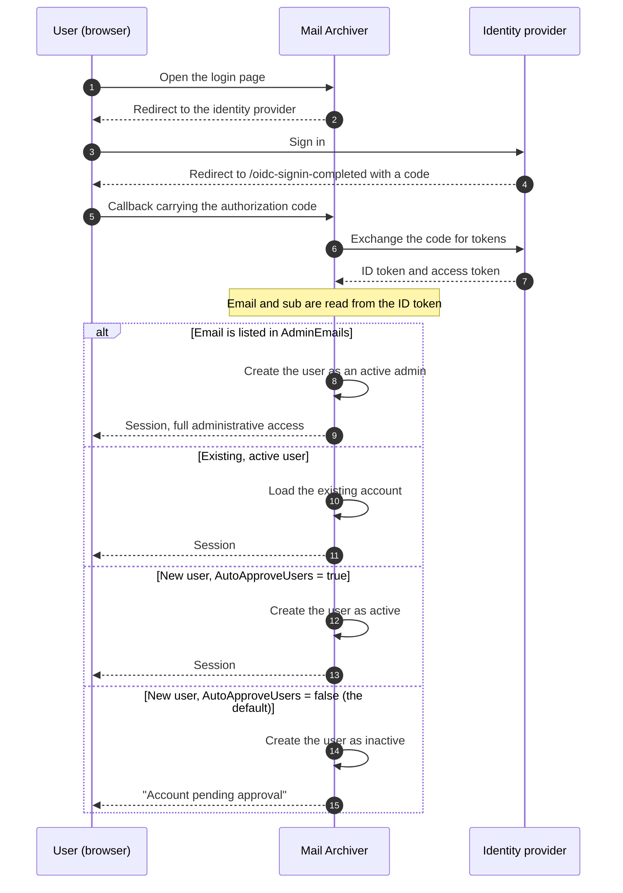

# 🔐 Guia de Autenticação OpenID Connect (OIDC) {#openid-connect-oidc-authentication-guide}

[← Voltar para o Índice de Documentação](index.md)

## 📋 Visão Geral {#overview}

Este guia fornece instruções abrangentes para configurar a autenticação OpenID Connect (OIDC) no aplicativo Mail Archiver, com exemplos específicos para integração com Microsoft Entra ID (Azure AD). O OIDC permite a autenticação segura de logon único (SSO) usando provedores de identidade externos.

## 📚 Sumário {#table-of-contents}

1. [Como o Fluxo de Login Funciona](#how-the-login-flow-works)
2. [Visão Geral](#overview)
3. [Pré-requisitos](#prerequisites)
4. [Configuração OIDC](#oidc-configuration)
   - [Habilitar OIDC na Configuração](#enable-oidc-in-configuration)
   - [Variáveis de Ambiente](#environment-variables)
5. [Configuração do Microsoft Entra ID](#microsoft-entra-id-setup)
   - [Criar Registro de Aplicativo](#create-app-registration)
   - [Configurar Autenticação](#configure-authentication)
   - [Configurar Permissões de API](#configure-api-permissions)
   - [Gerar Client Secret](#generate-client-secret)
6. [Configuração do Authelia](#authelia-setup)
   - [Configuração do Authelia](#authelia-configuration)
   - [Detalhes do Registro do Cliente](#client-registration-details)
7. [Teste e Validação](#testing-and-validation)
8. [Gerenciamento de Usuários com OIDC](#user-management-with-oidc)
9. [Aprovação Automática de Usuários OIDC](#auto-approve-oidc-users)
10. [Configuração de Login Sem Senha](#passwordless-login-configuration)
11. [Compatibilidade de Provedor](#provider-compatibility)

## 🔄 Como o Fluxo de Login Funciona {#how-the-login-flow-works}

O diagrama mostra toda a viagem de ida e volta — navegador, Mail Archiver e provedor de identidade — e, mais importante, a decisão local que o Mail Archiver toma *após* o provedor já ter aceitado o usuário.



Um login bem-sucedido no provedor, portanto, **não** é o fim da história.
Com o `AutoApproveUsers=false` padrão, um novo usuário é criado inativo e um administrador precisa ativar a Conta. Um usuário que se autentica corretamente e ainda assim não consegue entrar quase sempre esbarrou nesse bloqueio, em vez de uma configuração incorreta de OIDC.

## 🌐 Visão Geral {#overview}

O aplicativo Mail Archiver suporta autenticação OpenID Connect (OIDC), permitindo que os usuários se autentiquem usando provedores de identidade externos, como o Microsoft Entra ID e outros provedores compatíveis com OIDC. Este recurso aumenta a segurança ao aproveitar sistemas de gerenciamento de identidade empresarial e permite recursos de single sign-on (SSO).

## 🛠️ Pré-requisitos {#prerequisites}

- Acesso administrativo ao seu provedor de identidade OIDC escolhido (ex: Microsoft Entra ID)
- Aplicação Mail Archiver já implantada e acessível via HTTPS
- Nome DNS configurado para sua instância do Mail Archiver (necessário para URLs de callback)
- Acesso administrativo à aplicação Mail Archiver e ao sistema host para configuração
- Se estiver usando um reverse proxy, [configuração de reverse proxy](ReverseProxy.md) adequada para o tratamento de cabeçalhos HTTPS

## 🔧 Configuração de Reverse Proxy para OIDC {#reverse-proxy-configuration-for-oidc}

Ao implantar o Mail Archiver atrás de um reverse proxy com autenticação OIDC, configurações adicionais podem ser necessárias para garantir o manuseio adequado dos fluxos de autenticação e trocas de tokens. A autenticação OIDC envolve cabeçalhos HTTP e corpos de resposta maiores que podem exceder os tamanhos de buffer padrão em algumas configurações de reverse proxy.

### Configuração do Nginx Proxy Manager {#nginx-proxy-manager-configuration}

Se você estiver usando o Nginx Proxy Manager como seu reverse proxy, poderá ser necessário adicionar a seguinte configuração para lidar com a autenticação OIDC adequadamente:

```nginx
proxy_busy_buffers_size 512k;
proxy_buffers 4 512k;
proxy_buffer_size 256k;
```

Essas configurações aumentam os tamanhos de buffer para acomodar tokens OIDC e respostas de autenticação maiores. Sem essas configurações, você pode encontrar problemas com os fluxos de autenticação, particularmente com provedores que retornam ID tokens grandes ou ao usar escopos adicionais.

### Considerações Gerais de Reverse Proxy {#general-reverse-proxy-considerations}

- Certifique-se de que seu reverse proxy preserve os cabeçalhos HTTPS (`X-Forwarded-Proto`, `X-Forwarded-Host`)
- Configure definições de timeout apropriadas para os fluxos de autenticação
- Verifique se tamanhos de cabeçalho grandes são suportados
- Teste o fluxo de autenticação minuciosamente após as alterações de configuração

Para orientações detalhadas sobre configuração de reverse proxy, consulte o [Reverse Proxy Configuration Guide](ReverseProxy.md).

## ⚙️ Configuração de OIDC {#oidc-configuration}

### Habilitar OIDC na Configuração {#enable-oidc-in-configuration}

Para habilitar a autenticação OIDC, você precisa configurar a seção OAuth no seu arquivo `appsettings.json` ou nas variáveis de ambiente para a implantação docker (veja [Instalação e Configuração](Setup.md)).

#### Exemplo de Configuração (appsettings.json) {#example-configuration-appsettingsjson}

```json
{
  "OAuth": {
    "Enabled": true,
    "Authority": "https://sts.windows.net/{TENANT-ID}/",
    "ClientId": "YOUR-CLIENT-ID",
    "ClientSecret": "YOUR-CLIENT-SECRET",
    "ClientScopes": [
      "openid",
      "profile",
      "email"
    ],
    "DisablePasswordLogin": false
  }
}
```

### Variáveis de Ambiente {#environment-variables}

Ao usar Docker Compose ou variáveis de ambiente, configure as seguintes variáveis no seu arquivo `docker-compose.yml` sob a seção de ambiente do serviço `mailarchive-app`:

```yaml
environment:
  # OIDC Configuration
  - OAuth__Enabled=true
  - OAuth__Authority=https://sts.windows.net/{TENANT-ID}/
  - OAuth__ClientId=YOUR-CLIENT-ID
  - OAuth__ClientSecret=YOUR-CLIENT-SECRET
  - OAuth__DisplayName=PocketID SSO
  - OAuth__ClientScopes__0=openid
  - OAuth__ClientScopes__1=profile
  - OAuth__ClientScopes__2=email
  - OAuth__DisablePasswordLogin=false
  - OAuth__AutoApproveUsers=false
```

### Explicação dos Parâmetros de Configuração {#configuration-parameters-explained}

- **OAuth__Enabled**: Defina como `true` para habilitar a autenticação OIDC
- **OAuth__Authority**: A URL de autoridade OpenID Connect do seu provedor de identidade
- **OAuth__ClientId**: O ID do cliente atribuído pelo seu provedor de identidade
- **OAuth__ClientSecret**: O segredo do cliente atribuído pelo seu provedor de identidade
- **OAuth__DisplayName**: Nome de exibição opcional para o botão de login OIDC (por exemplo, `PocketID SSO` renderiza como `Login with PocketID SSO`)
- **OAuth__ClientScopes**: Array de escopos solicitados ao provedor de identidade
- **OAuth__ResponseMode**: Modo de resposta da solicitação de autorização: `query`, `fragment` ou `form_post`. Deixe vazio para manter o padrão (`form_post`). Provedores que não suportam `form_post` precisam de `query`; veja [Compatibilidade de Provedor](#provider-compatibility)
- **OAuth__DisablePasswordLogin**: Defina como `true` para desabilitar o login tradicional de usuário/senha e forçar a autenticação apenas via OAuth (veja Configuração de Login Sem Senha para mais detalhes)
- **OAuth__AutoApproveUsers**: Defina como `true` para aprovar automaticamente novos usuários OIDC sem exigir aprovação do administrador (padrão: `false`). Veja [Auto-Aprovação de Usuários OIDC](#auto-approve-oidc-users) para detalhes

> ⚠️ **Importante**: O Client Secret deve ser mantido seguro. Use segredos do Docker ou variáveis de ambiente em ambientes de produção.

## ☁️ Configuração do Microsoft Entra ID {#microsoft-entra-id-setup}

Esta seção fornece instruções passo a passo para configurar o Microsoft Entra ID (anteriormente Azure AD) como um provedor de identidade OIDC para o Mail Archiver.

### 🚀 Criar Registro de Aplicativo {#create-app-registration}

1. Navegue até o [Microsoft Entra Admin Center](https://entra.microsoft.com)
2. Faça login com sua Conta de administrador
3. No painel de navegação à esquerda, selecione **App registrations**
4. Clique em **+ New registration** no topo da página de App registrations
5. Preencha os seguintes detalhes:
   - **Name**: Insira um nome descritivo (ex: "Mail Archiver OIDC")
   - **Supported account types**: Selecione **Accounts in this organizational directory only**
   - **Redirect URI**: Selecione **Web** e insira a sua URL de callback do Mail Archiver:
     ```
     https://your-mail-archiver-domain/oidc-signin-completed
     ```
     Substitua `your-mail-archiver-domain` pelo seu domínio real (ex: `mailarchiver.example.com`)
6. Clique em **Register**

### 🔐 Configurar Autenticação {#configure-authentication}

1. Após o registro, anote os seguintes valores da página **Overview** do registro do aplicativo:
   - **Application (client) ID** - Você precisará disso como `OAuth__ClientId`
   - **Directory (tenant) ID** - Você precisará disso para construir a Authority URL
2. Construa a **Authority URL** a partir do **Directory (tenant) ID** que você acabou de copiar. Para o Microsoft Entra ID, a Authority é construída como:
   ```
   https://sts.windows.net/<TENANT-ID>/
   ```
   Substitua `<TENANT-ID>` (também referido como Mandanten-ID) pelo valor mostrado ao lado do Application (client) ID na página Overview do registro do aplicativo. Por exemplo, se o seu Directory (tenant) ID for `11111111-2222-3333-4444-555555555555`, sua Authority torna-se:
   ```
   https://sts.windows.net/11111111-2222-3333-4444-555555555555/
   ```
   Use este valor como `OAuth__Authority` em sua configuração. Certifique-se de incluir a barra final.
   > ℹ️ **Nota**: Tanto `https://sts.windows.net/<TENANT-ID>/` quanto `https://login.microsoftonline.com/<TENANT-ID>/v2.0` são endpoints de authority válidos do Entra ID. A forma `sts.windows.net` usa o endpoint v1.0 e é recomendada para este guia.
3. No menu à esquerda, selecione **Authentication**
4. Clique em **Settings**
5. Em **Implicit grant and hybrid flows**, certifique-se de que **ID tokens** esteja marcado
6. Em **Supported account types**, verifique se sua seleção corresponde aos seus requisitos
7. Em **Redirect URIs**, certifique-se de que sua URL de callback esteja listada corretamente

### 🎯 Configurar Permissões de API {#configure-api-permissions}

1. No menu à esquerda, selecione **API permissions**
2. Clique em **+ Add a permission**
3. Selecione **Microsoft Graph**
4. Escolha **Delegated permissions**
5. Adicione as seguintes permissões (se necessário para recursos adicionais):
   - **openid** - Realizar o login dos usuários 
   - **email** - Visualizar o endereço de e-mail dos usuários
   - **profile** - Visualizar o perfil básico dos usuários
6. Clique em **Add permissions**
7. Clique em **Grant admin consent for [Your Organization]** se você quiser pré-autorizar o aplicativo

### 🔑 Gerar Client Secret {#generate-client-secret}

1. Navegue até **Certificates & secrets** no menu à esquerda
2. Em **Client secrets**, clique em **+ New client secret**
3. Forneça uma descrição (ex: "Mail Archiver Auth Secret")
4. Selecione um período de expiração
5. Clique em **Add**
6. **Importante**: Copie o **Value** imediatamente e armazene-o com segurança. Este segredo não será exibido novamente. Ele é necessário como o `OAuth__ClientSecret`

## 🔐 Configuração do Authelia {#authelia-setup}

Esta seção fornece detalhes de configuração para configurar o Authelia como um provedor de identidade OIDC para o Mail Archiver. O Authelia é um servidor de autenticação e autorização de código aberto que suporta OIDC.

### 🛠️ Configuração do Authelia {#authelia-configuration}

```yaml
identity_providers:
  oidc:
    clients:
      - client_id: 'mailarchiver'
        client_name: 'mailarchiver'
        client_secret: '$xyzg'  # The digest of 'insecure_secret'.
        public: false
        redirect_uris:
          - 'https://your-mail-archiver-domain/oidc-signin-completed'
        scopes:
          - 'openid'
          - 'profile'
          - 'email'
        response_types:
          - 'code'
        grant_types:
          - 'authorization_code'
        token_endpoint_auth_method: 'client_secret_post'
```

### 📝 Detalhes de Registro do Cliente {#client-registration-details}

- **client_id**: `mailarchiver` - O identificador único para o aplicativo Mail Archiver
- **client_name**: `mailarchiver` - O nome de exibição mostrado aos usuários durante a autenticação
- **client_secret**: O segredo com hash usado para a autenticação do cliente (substitua pelo seu próprio segredo seguro em produção)
- **redirect_uris**: A URL de callback para onde o Authelia redirecionará os usuários após a autenticação. Substitua `[YOUR_MAILARCHIVER_URL]` pelo seu domínio real do Mail Archiver
- **scopes**: As permissões solicitadas ao Authelia:
  - `openid`: Necessário para autenticação OIDC
  - `profile`: Acesso a informações básicas de perfil
  - `email`: Acesso ao endereço de e-mail
- **response_types**: `code` - Fluxo de código de autorização
- **grant_types**: `authorization_code` - Tipo de concessão de código de autorização
- **token_endpoint_auth_method**: `client_secret_post` - Método de autenticação do cliente

> ⚠️ **Nota de Segurança**: O exemplo usa um segredo padrão para demonstração. Em produção, gere um segredo seguro e faça o hash usando as ferramentas do Authelia. Nunca use o segredo de exemplo em ambientes de produção.

## 🧪 Teste e Validação {#testing-and-validation}

### Teste de Configuração Inicial {#initial-setup-testing}

1. Reinicie seu aplicativo Mail Archiver após configurar as configurações de OIDC
2. Navegue até a página de login do seu Mail Archiver
3. Você deverá ver um novo botão de login OAuth ao lado do formulário de login regular. Com `OAuth__DisplayName=PocketID SSO`, o botão exibe `Login with PocketID SSO`.
4. Clique no botão de login OAuth para iniciar o fluxo OIDC
5. Você deverá ser redirecionado para a página de login do seu provedor de identidade
6. Após a autenticação bem-sucedida, você deverá ser redirecionado de volta para o Mail Archiver

### Validação de Provisionamento de Usuário {#user-provisioning-validation}

- Usuários de OIDC de primeira viagem serão criados automaticamente no banco de dados do Mail Archiver
- Os usuários serão criados com a função padrão "User" e precisarão de aprovação do administrador para acesso

## 👥 Gerenciamento de Usuários com OIDC {#user-management-with-oidc}

### Funções e Permissões de Usuário {#user-roles-and-permissions}

Os usuários OIDC seguem o mesmo controle de acesso baseado em funções que os usuários locais:
- **Admin**: Acesso total ao sistema (requer atribuição manual por um admin existente, ou automática via configuração AdminEmails)
- **User**: Acesso de usuário padrão às contas de e-mail atribuídas
- **Self-Manager**: Pode gerenciar sua própria Conta e adicionar novas contas

### Provisionamento Automático de Administradores {#auto-provisioning-administrators}

Você pode configurar endereços de e-mail específicos para serem provisionados automaticamente como administradores quando fizerem o primeiro login via OIDC:

```json
{
  "OAuth": {
    "AdminEmails": [
      "admin@example.com",
      "it-manager@example.com"
    ]
  }
}
```

Quando um usuário com um desses endereços de e-mail fizer o login pela primeira vez:
- Ele é criado automaticamente como um administrador ativo
- Nenhuma aprovação manual é necessária
- Ele ganha privilégios administrativos totais imediatamente
- A correspondência de e-mail não diferencia maiúsculas de minúsculas

**Nota de Segurança**: Adicione apenas endereços de e-mail confiáveis a esta lista, pois esses usuários terão acesso total ao sistema.

### Fluxo de Provisionamento de Usuário {#user-provisioning-flow}

#### Novos Usuários (Não estão em AdminEmails) {#new-users-not-in-adminemails}
1. O usuário se autentica via provedor OAuth
2. O sistema verifica se o e-mail existe no banco de dados local
3. Se for um novo usuário:
   - A Conta é criada com o nome de usuário derivado das claims do OIDC, nesta ordem de preferência:
     1. A **parte local do e-mail** (tudo antes de `@`), ex: `example.mailarchiver` para `example.mailarchiver@xxxxxxxxx.onmicrosoft.com`
     2. A claim `sub` completa quando nenhuma claim de e-mail está presente
     3. `oidc_<12-char-hash>` como um fallback de último recurso
     O valor gerado é truncado para 320 caracteres. Se um usuário local com o mesmo nome de usuário já existir, `" (n)"` é anexado até que um nome exclusivo seja encontrado.
   - O usuário é marcado como **inativo** e **requer aprovação**
   - O Admin deve ativar manualmente o usuário no gerenciamento de Users
4. O usuário recebe a mensagem "Account pending approval"

#### Novos Usuários (Estão em AdminEmails) {#new-users-in-adminemails}
1. O usuário se autentica via provedor OAuth
2. O sistema reconhece que o e-mail está na lista AdminEmails
3. A Conta é criada automaticamente:
   - O usuário é marcado como **ativo** e **admin**
   - Nenhuma aprovação é necessária
   - O usuário pode acessar o sistema imediatamente
4. O usuário faz login com sucesso

### Gerenciamento de Senhas {#password-management}

Usuários OIDC não podem ter ou alterar senhas dentro do Mail Archiver, já que a autenticação é tratada pelo provedor de identidade externo:
- A opção "Change Password" será desabilitada para usuários OIDC
- A redefinição de senha deve ser tratada através do provedor OIDC
- Os campos de senha local permanecerão vazios para usuários OIDC

## ✅ Auto-Aprovação de Usuários OIDC {#auto-approve-oidc-users}

Por padrão, novos usuários OIDC devem ser aprovados manualmente por um administrador local antes de poderem acessar o aplicativo. Isso fornece um modelo de dupla barreira onde tanto o IdP quanto o administrador local devem conceder o acesso.

Para **implantações OIDC-first** onde o Provedor de Identidade (IdP) é a única fonte de verdade para o controle de acesso, esta etapa de aprovação manual pode ser ignorada habilitando a opção `AutoApproveUsers`.

### Habilitando a Auto-Aprovação {#enabling-auto-approve}

Defina `AutoApproveUsers` como `true` em sua configuração:

```json
{
  "OAuth": {
    "Enabled": true,
    "AutoApproveUsers": true,
    "Authority": "https://your-provider.com",
    "ClientId": "your-client-id",
    "ClientSecret": "your-secret"
  }
}
```

Ou via variável de ambiente:

```yaml
environment:
  - OAuth__AutoApproveUsers=true
```

### Comportamento {#behavior}

| Configuração | Comportamento de Novo Usuário OIDC |
|---|---|
| `AutoApproveUsers: false` (padrão) | O usuário é criado como **inativo** e **requer aprovação do administrador** antes que o acesso seja concedido |
| `AutoApproveUsers: true` | O usuário é criado como **ativo** e pode acessar o aplicativo imediatamente |

> **Nota**: `AdminEmails` sempre tem precedência — usuários que correspondam a `AdminEmails` são sempre auto-aprovados como administradores, independentemente desta configuração.

### Quando Usar {#when-to-use}

Esta opção é recomendada para ambientes onde:
- O **IdP controla o acesso ao aplicativo** (ex: via atribuição de app ou associação de grupo no Authentik, Entra ID, Authelia, etc.)
- Você deseja **eliminar o modelo de dupla barreira** (concessão do IdP + aprovação do administrador local)
- A **revogação de acesso é gerenciada no nível do IdP** (remover a atribuição do app impede automaticamente o login)

### Exemplo de Configuração Completa OIDC-First {#complete-oidc-first-setup-example}

```json
{
  "OAuth": {
    "Enabled": true,
    "Authority": "https://sts.windows.net/YOUR_TENANT_ID/",
    "ClientId": "your-client-id",
    "ClientSecret": "your-secret",
    "DisplayName": "PocketID SSO",
    "ClientScopes": ["openid", "profile", "email"],
    "DisablePasswordLogin": true,
    "AutoRedirect": true,
    "AutoApproveUsers": true,
    "AdminEmails": ["admin@company.com"]
  }
}
```

Nesta configuração:
- Os usuários são redirecionados automaticamente para o provedor OIDC
- Novos usuários são aprovados automaticamente no primeiro login
- E-mails de administradores são provisionados automaticamente como administradores
- O controle de acesso é totalmente gerenciado no nível do IdP

### Considerações de Segurança {#security-considerations}

- **Confiança**: Habilitar `AutoApproveUsers` significa que você confia no IdP para controlar quem pode acessar o aplicativo. Certifique-se de que seu IdP esteja configurado corretamente com as atribuições de app ou acesso baseado em grupo apropriados.
- **Atribuição de Funções**: Usuários auto-aprovados são criados com permissões de usuário padrão (não admin). O acesso de administrador ainda requer a configuração `AdminEmails` ou atribuição manual de função.
- **Revogação**: Quando o acesso de um usuário é removido no IdP, ele não pode mais se autenticar via OIDC. No entanto, sua Conta local permanece ativa. Para revogar totalmente o acesso, desative também o usuário no painel de administração do Mail Archiver.
- **Compatibilidade com Versões Anteriores**: O valor padrão é `false`, preservando o comportamento existente para implantações atuais.

## 🔒 Configuração de Login sem Senha {#passwordless-login-configuration}

> ⚠️ **Importante**: Mesmo com a configuração de login sem senha, um usuário administrador inicial ainda é criado durante a primeira inicialização. Você deve definir uma senha segura para este usuário administrador em seu arquivo `appsettings.json` ou `docker-compose.yml` para garantir a segurança do sistema.

Para organizações que desejam impor a autenticação apenas via OAuth, o aplicativo suporta a desativação completa do login por senha.

### Desativando o Login por Senha {#disabling-password-login}

Defina `DisablePasswordLogin` como `true` para desativar o login por nome de usuário/senha:

```json
{
  "OAuth": {
    "Enabled": true,
    "DisablePasswordLogin": true,
    "Authority": "https://your-provider.com",
    "ClientId": "your-client-id",
    "ClientSecret": "your-secret"
  }
}
```

**Resultado**: A página de login exibe apenas o botão de login OAuth, e o servidor rejeita todo POST de senha (`/Auth/Login`) com um redirecionamento de volta para a página de login. As senhas locais permanecem armazenadas no banco de dados, mas não podem mais ser usadas para entrar enquanto o modo apenas OAuth estiver ativo. Se `DisplayName` estiver configurado, o botão usará esse valor (por exemplo, `Login with PocketID SSO`).

### Redirecionamento Automático para o Provedor OAuth {#auto-redirect-to-oauth-provider}

Ative `AutoRedirect` para redirecionar automaticamente os usuários para o seu provedor OAuth:

```json
{
  "OAuth": {
    "Enabled": true,
    "DisablePasswordLogin": true,
    "AutoRedirect": true,
    "Authority": "https://your-provider.com",
    "ClientId": "your-client-id",
    "ClientSecret": "your-secret"
  }
}
```

**Requisitos**: 
- `DisablePasswordLogin` deve ser `true`
- `OAuth.Enabled` deve ser `true`

**Resultado**: Os usuários veem uma breve tela de carregamento e são redirecionados automaticamente para o provedor OAuth.

### Exemplo de Configuração Completa sem Senha {#complete-passwordless-setup-example}

```json
{
  "OAuth": {
    "Enabled": true,
    "Authority": "https://sts.windows.net/YOUR_TENANT_ID/",
    "ClientId": "your-client-id",
    "ClientSecret": "your-secret",
    "DisplayName": "PocketID SSO",
    "ClientScopes": ["openid", "profile", "email"],
    "DisablePasswordLogin": true,
    "AutoRedirect": true,
    "AdminEmails": ["admin@company.com", "it@company.com"]
  }
}
```

### Considerações de Segurança {#security-considerations}

- **Provisionamento de E-mail de Administrador**: O provedor OAuth é confiável para verificar endereços de e-mail. Adicione apenas endereços confiáveis ao AdminEmails.
- **Acesso de Emergência**: Com `DisablePasswordLogin=true` nenhuma senha local pode ser usada para entrar, incluindo a Conta de administrador de inicialização. Certifique-se de que pelo menos uma identidade OAuth esteja provisionada como administrador (veja `AdminEmails`) antes de ativar esta configuração; caso contrário, você perderá o acesso. Para recuperar o acesso, defina `OAuth__DisablePasswordLogin=false`, reinicie, faça login com a senha de administrador local e reative-a posteriormente.
- **Testes**: Teste minuciosamente a autenticação OAuth antes de desativar o login por senha em produção.
- **Ambiente SSO**: O redirecionamento automático é mais adequado para ambientes de single sign-on onde todos os usuários se autenticam através do mesmo provedor.

## 🧩 Compatibilidade do Provedor {#provider-compatibility}

Nem todo provedor de identidade implementa a especificação OIDC completa. Ambas as configurações abaixo existem por causa disso, e ambas são necessárias para o Synology SSO Server.

### Response Mode {#response-mode}

A solicitação de autorização é enviada com o response mode `form_post`, o padrão do handler ASP.NET Core OpenID Connect subjacente. Um provedor que não o suporte geralmente falha com uma mensagem própria e nada no registro do Mail Archiver.

O Synology SSO Server se comporta dessa maneira: seu documento de descoberta omite `response_modes_supported`, e o login para com "Unable to sign in via SSO due to setting issues". Defina o response mode explicitamente:

```env
OAuth__ResponseMode=query
```

Os valores válidos são `query`, `fragment` e `form_post`. Deixe a configuração vazia para manter o padrão. Em caso de dúvida, `query` é a escolha mais segura: é o único response mode que todo provedor OIDC é obrigado a suportar.

### Name and Email Claims {#name-and-email-claims}

O nome de exibição de um novo usuário é extraído da resposta de informações do usuário, nesta ordem:

1. `name`
2. `preferred_username`
3. `given_name`
4. `username`

Claims que estão presentes, mas vazios ou não são uma string, são ignorados. `username` não é um claim padrão do OIDC, mas alguns provedores o retornam como o único valor semelhante a um nome (novamente, o Synology SSO Server). O endereço de e-mail é lido de `email`, depois `mail`, depois `upn`, e recorre aos claims do ID token.

Se nenhum dos name claims estiver presente, o login falha. O usuário é retornado à página de login com uma mensagem legível nomeando os claims que foram procurados, e o motivo é escrito no log no nível de erro.

---

**Nota**: Este guia está atualizado até 2025. Serviços de provedores de identidade atualizam regularmente suas interfaces e recursos, portanto, alguns elementos da interface do usuário podem diferir. Consulte sempre a documentação mais recente do seu provedor de identidade para obter as informações mais atualizadas.
