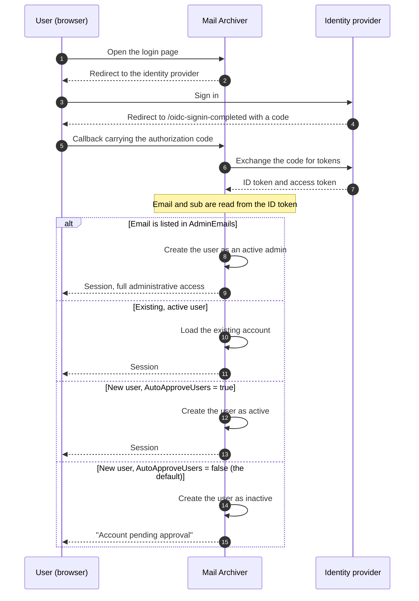

# 🔐 OpenID Connect (OIDC) Authentication Guide {#openid-connect-oidc-authentication-guide}

[← Back to Documentation Index](index.md)

## 📋 Overview {#overview}

Данное руководство содержит подробные инструкции по настройке аутентификации OpenID Connect (OIDC) в приложении Mail Archiver, включая конкретные примеры интеграции с Microsoft Entra ID (Azure AD). OIDC обеспечивает безопасную аутентификацию через единый вход (SSO) с использованием внешних поставщиков удостоверений.

## 📚 Содержание {#table-of-contents}

1. [Как работает процесс входа](#how-the-login-flow-works)
2. [Обзор](#overview)
3. [Предварительные требования](#prerequisites)
4. [Конфигурация OIDC](#oidc-configuration)
   - [Включение OIDC в конфигурации](#enable-oidc-in-configuration)
   - [Переменные окружения](#environment-variables)
5. [Настройка Microsoft Entra ID](#microsoft-entra-id-setup)
   - [Создание регистрации приложения](#create-app-registration)
   - [Настройка аутентификации](#configure-authentication)
   - [Настройка разрешений API](#configure-api-permissions)
   - [Генерация Client Secret](#generate-client-secret)
6. [Настройка Authelia](#authelia-setup)
   - [Конфигурация Authelia](#authelia-configuration)
   - [Детали регистрации клиента](#client-registration-details)
7. [Тестирование и проверка](#testing-and-validation)
8. [Управление пользователями через OIDC](#user-management-with-oidc)
9. [Автоматическое одобрение пользователей OIDC](#auto-approve-oidc-users)
10. [Настройка входа без пароля](#passwordless-login-configuration)
11. [Совместимость провайдеров](#provider-compatibility)

## 🔄 Как работает процесс входа в систему {#how-the-login-flow-works}

На диаграмме показан весь цикл взаимодействия — браузер, Mail Archiver и провайдер идентификации — и, что более важно, локальное решение, которое принимает Mail Archiver *после того*, как провайдер уже принял пользователя.



Таким образом, успешный вход в систему у провайдера — это **не** конец истории.
При использовании стандартного `AutoApproveUsers=false` новый пользователь создается неактивным, и администратор должен активировать учетную запись. Если пользователь проходит аутентификацию корректно, но все равно не может войти в систему, это почти всегда означает, что он столкнулся именно с этим ограничением, а не с ошибкой конфигурации OIDC.

## 🌐 Обзор {#overview}

Приложение Mail Archiver поддерживает аутентификацию OpenID Connect (OIDC), что позволяет пользователям проходить аутентификацию с помощью внешних поставщиков удостоверений, таких как Microsoft Entra ID и других поставщиков, совместимых с OIDC. Эта функция повышает безопасность за счет использования корпоративных систем управления идентификацией и обеспечивает возможности единого входа (SSO).

## 🛠️ Предварительные требования {#prerequisites}

- Административный доступ к выбранному вами OIDC-провайдеру идентификации (например, Microsoft Entra ID)
- Приложение Mail Archiver уже развернуто и доступно по протоколу HTTPS
- Настроенное DNS-имя для вашего экземпляра Mail Archiver (необходимо для callback URL)
- Административный доступ к приложению Mail Archiver и хост-системе для выполнения конфигурации
- При использовании обратного прокси-сервера — правильная [reverse proxy configuration](ReverseProxy.md) для обработки HTTPS-заголовков

## 🔧 Конфигурация Reverse Proxy для OIDC {#reverse-proxy-configuration-for-oidc}

При развертывании Mail Archiver за обратным прокси-сервером с аутентификацией OIDC может потребоваться дополнительная настройка для обеспечения правильной обработки потоков аутентификации и обмена токенами. Аутентификация OIDC подразумевает использование более объемных HTTP-заголовков и тел ответов, которые могут превышать размеры буферов по умолчанию в некоторых конфигурациях обратных прокси.

### Конфигурация Nginx Proxy Manager {#nginx-proxy-manager-configuration}

Если вы используете Nginx Proxy Manager в качестве обратного прокси, вам может потребоваться добавить следующую конфигурацию для корректной работы аутентификации OIDC:

```nginx
proxy_busy_buffers_size 512k;
proxy_buffers 4 512k;
proxy_buffer_size 256k;
```

Эти настройки увеличивают размеры буферов для размещения более крупных токенов OIDC и ответов аутентификации. Без этих настроек вы можете столкнуться с проблемами в процессах аутентификации, особенно с провайдерами, возвращающими большие ID-токены, или при использовании дополнительных scopes.

### Общие рекомендации для Reverse Proxy {#general-reverse-proxy-considerations}

- Убедитесь, что ваш обратный прокси сохраняет HTTPS-заголовки (`X-Forwarded-Proto`, `X-Forwarded-Host`)
- Настройте соответствующие параметры таймаута для потоков аутентификации
- Убедитесь, что поддерживаются большие размеры заголовков
- Тщательно протестируйте процесс аутентификации после внесения изменений в конфигурацию

Для получения подробных инструкций по настройке обратного прокси обратитесь к [Reverse Proxy Configuration Guide](ReverseProxy.md).

## ⚙️ Конфигурация OIDC {#oidc-configuration}

### Включение OIDC в конфигурации {#enable-oidc-in-configuration}

Чтобы включить аутентификацию OIDC, вам необходимо настроить раздел OAuth в вашем файле `appsettings.json` или в переменных окружения для развертывания в docker (см. [Installation and Setup](Setup.md)).

#### Пример конфигурации (appsettings.json) {#example-configuration-appsettingsjson}

```json
{
  "OAuth": {
    "Enabled": true,
    "Authority": "https://sts.windows.net/{TENANT-ID}/",
    "ClientId": "YOUR-CLIENT-ID",
    "ClientSecret": "YOUR-CLIENT-SECRET",
    "ClientScopes": [
      "openid",
      "profile",
      "email"
    ],
    "DisablePasswordLogin": false
  }
}
```

### Переменные окружения {#environment-variables}

При использовании Docker Compose или переменных окружения настройте следующие переменные в вашем файле `docker-compose.yml` в разделе environment сервиса `mailarchive-app`:

```yaml
environment:
  # OIDC Configuration
  - OAuth__Enabled=true
  - OAuth__Authority=https://sts.windows.net/{TENANT-ID}/
  - OAuth__ClientId=YOUR-CLIENT-ID
  - OAuth__ClientSecret=YOUR-CLIENT-SECRET
  - OAuth__DisplayName=PocketID SSO
  - OAuth__ClientScopes__0=openid
  - OAuth__ClientScopes__1=profile
  - OAuth__ClientScopes__2=email
  - OAuth__DisablePasswordLogin=false
  - OAuth__AutoApproveUsers=false
```

### Описание параметров конфигурации {#configuration-parameters-explained}

- **OAuth__Enabled**: установите значение `true`, чтобы включить аутентификацию OIDC
- **OAuth__Authority**: URL-адрес authority OpenID Connect вашего провайдера идентификации
- **OAuth__ClientId**: ID клиента, назначенный вашим провайдером идентификации
- **OAuth__ClientSecret**: секрет клиента, назначенный вашим провайдером идентификации
- **OAuth__DisplayName**: необязательное отображаемое имя для кнопки входа OIDC (например, `PocketID SSO` отображается как `Login with PocketID SSO`)
- **OAuth__ClientScopes**: массив областей доступа (scopes), запрашиваемых у провайдера идентификации
- **OAuth__ResponseMode**: режим ответа запроса авторизации: `query`, `fragment` или `form_post`. Оставьте пустым, чтобы сохранить значение по умолчанию (`form_post`). Провайдерам, которые не поддерживают `form_post`, требуется `query`; см. [Provider Compatibility](#provider-compatibility)
- **OAuth__DisablePasswordLogin**: установите значение `true`, чтобы отключить традиционный вход по имени пользователя/паролю и принудительно использовать только OAuth-аутентификацию (см. Passwordless Login Configuration для получения более подробной информации)
- **OAuth__AutoApproveUsers**: установите значение `true`, чтобы автоматически одобрять новых пользователей OIDC без необходимости одобрения администратором (по умолчанию: `false`). Подробности см. в [Auto-Approve OIDC Users](#auto-approve-oidc-users)

> ⚠️ **Важно**: Client Secret должен храниться в безопасности. Используйте Docker secrets или переменные окружения в продуктовых средах.

## ☁️ Настройка Microsoft Entra ID {#microsoft-entra-id-setup}

В этом разделе приведены пошаговые инструкции по настройке Microsoft Entra ID (ранее Azure AD) в качестве поставщика удостоверений OIDC для Mail Archiver.

### 🚀 Создание регистрации приложения {#create-app-registration}

1. Перейдите в [Microsoft Entra Admin Center](https://entra.microsoft.com)
2. Войдите в систему, используя учетную запись администратора
3. В левой навигационной панели выберите **App registrations**
4. Нажмите **+ New registration** в верхней части страницы App registrations
5. Заполните следующие сведения:
   - **Name**: Введите описательное имя (например, "Mail Archiver OIDC")
   - **Supported account types**: Выберите **Accounts in this organizational directory only**
   - **Redirect URI**: Выберите **Web** и введите URL-адрес обратного вызова вашего Mail Archiver:
     ```
     https://your-mail-archiver-domain/oidc-signin-completed
     ```
     Замените `your-mail-archiver-domain` на ваш фактический домен (например, `mailarchiver.example.com`)
6. Нажмите **Register**

### 🔐 Настройка аутентификации {#configure-authentication}

1. После регистрации запишите следующие значения со страницы **Overview** регистрации приложения:
   - **Application (client) ID** — он понадобится вам в качестве `OAuth__ClientId`
   - **Directory (tenant) ID** — он понадобится вам для формирования Authority URL
2. Сформируйте **Authority URL**, используя скопированный **Directory (tenant) ID**. Для Microsoft Entra ID Authority строится следующим образом:
   ```
   https://sts.windows.net/<TENANT-ID>/
   ```
   Замените `<TENANT-ID>` (также называемый Mandanten-ID) на значение, указанное рядом с Application (client) ID на странице Overview регистрации приложения. Например, если ваш Directory (tenant) ID — `11111111-2222-3333-4444-555555555555`, ваш Authority станет:
   ```
   https://sts.windows.net/11111111-2222-3333-4444-555555555555/
   ```
   Используйте это значение как `OAuth__Authority` в вашей конфигурации. Обязательно включите завершающий слеш.
   > ℹ️ **Примечание**: И `https://sts.windows.net/<TENANT-ID>/`, и `https://login.microsoftonline.com/<TENANT-ID>/v2.0` являются допустимыми конечными точками authority для Entra ID. Форма `sts.windows.net` использует конечную точку v1.0 и рекомендуется для данного руководства.
3. В левом меню выберите **Authentication**
4. Нажмите **Settings**
5. В разделе **Implicit grant and hybrid flows** убедитесь, что флажок **ID tokens** установлен
6. В разделе **Supported account types** убедитесь, что ваш выбор соответствует вашим требованиям
7. В разделе **Redirect URIs** убедитесь, что ваш URL-адрес обратного вызова указан правильно

### 🎯 Настройка разрешений API {#configure-api-permissions}

1. В левом меню выберите **API permissions**
2. Нажмите **+ Add a permission**
3. Выберите **Microsoft Graph**
4. Выберите **Delegated permissions**
5. Добавьте следующие разрешения (если они необходимы для дополнительных функций):
   - **openid** — вход пользователей в систему
   - **email** — просмотр адреса электронной почты пользователей
   - **profile** — просмотр базового профиля пользователей
6. Нажмите **Add permissions**
7. Нажмите **Grant admin consent for [Your Organization]**, если вы хотите предварительно авторизовать приложение

### 🔑 Генерация Client Secret {#generate-client-secret}

1. Перейдите в раздел **Certificates & secrets** в левом меню
2. В разделе **Client secrets** нажмите **+ New client secret**
3. Введите описание (например, "Mail Archiver Auth Secret")
4. Выберите срок действия
5. Нажмите **Add**
6. **Важно**: Немедленно скопируйте **Value** и сохраните его в безопасном месте. Этот секрет больше не будет показан. Он необходим в качестве `OAuth__ClientSecret`

## 🔐 Настройка Authelia {#authelia-setup}

В этом разделе приведены сведения о конфигурации для настройки Authelia в качестве OIDC-провайдера удостоверений для Mail Archiver. Authelia — это сервер аутентификации и авторизации с открытым исходным кодом, поддерживающий OIDC.

### 🛠️ Конфигурация Authelia {#authelia-configuration}

```yaml
identity_providers:
  oidc:
    clients:
      - client_id: 'mailarchiver'
        client_name: 'mailarchiver'
        client_secret: '$xyzg'  # The digest of 'insecure_secret'.
        public: false
        redirect_uris:
          - 'https://your-mail-archiver-domain/oidc-signin-completed'
        scopes:
          - 'openid'
          - 'profile'
          - 'email'
        response_types:
          - 'code'
        grant_types:
          - 'authorization_code'
        token_endpoint_auth_method: 'client_secret_post'
```

### 📝 Данные регистрации клиента {#client-registration-details}

- **client_id**: `mailarchiver` — уникальный идентификатор приложения Mail Archiver
- **client_name**: `mailarchiver` — отображаемое имя, которое видят пользователи во время аутентификации
- **client_secret**: хешированный секрет, используемый для аутентификации клиента (замените на собственный безопасный секрет в рабочей среде)
- **redirect_uris**: URL-адрес обратного вызова, на который Authelia перенаправит пользователей после аутентификации. Замените `[YOUR_MAILARCHIVER_URL]` на ваш фактический домен Mail Archiver
- **scopes**: разрешения, запрашиваемые у Authelia:
  - `openid`: требуется для OIDC-аутентификации
  - `profile`: доступ к базовой информации профиля
  - `email`: доступ к адресу электронной почты
- **response_types**: `code` — поток кода авторизации (authorization code flow)
- **grant_types**: `authorization_code` — тип предоставления кода авторизации (authorization code grant type)
- **token_endpoint_auth_method**: `client_secret_post` — метод аутентификации клиента

> ⚠️ **Примечание по безопасности**: В примере используется секрет по умолчанию для демонстрации. В рабочей среде создайте безопасный секрет и захешируйте его с помощью инструментов Authelia. Никогда не используйте секрет из примера в рабочих средах.

## 🧪 Тестирование и проверка {#testing-and-validation}

### Первоначальное тестирование настройки {#initial-setup-testing}

1. Перезапустите приложение Mail Archiver после настройки параметров OIDC
2. Перейдите на страницу входа в Mail Archiver
3. Вы должны увидеть новую кнопку входа через OAuth рядом с обычной формой входа. При использовании `OAuth__DisplayName=PocketID SSO` на кнопке будет написано `Login with PocketID SSO`.
4. Нажмите кнопку входа через OAuth, чтобы инициировать процесс OIDC
5. Вы должны быть перенаправлены на страницу входа вашего провайдера идентификации (identity provider)
6. После успешной аутентификации вы должны быть перенаправлены обратно в Mail Archiver

### Проверка создания пользователей {#user-provisioning-validation}

- Пользователи, впервые использующие OIDC, будут автоматически созданы в базе данных Mail Archiver
- Пользователи будут созданы с ролью по умолчанию "User" и потребуют одобрения администратора для получения доступа

## 👥 Управление пользователями с помощью OIDC {#user-management-with-oidc}

### Роли и разрешения пользователей {#user-roles-and-permissions}

Пользователи OIDC подчиняются тем же правилам управления доступом на основе ролей, что и локальные пользователи:
- **Admin**: Полный доступ к системе (требуется ручное назначение существующим администратором или автоматическое через конфигурацию AdminEmails)
- **User**: Стандартный доступ пользователя к назначенным почтовым аккаунтам
- **Self-Manager**: Может управлять своим собственным аккаунтом и добавлять новые аккаунты

### Автоматическое предоставление прав администратора {#auto-provisioning-administrators}

Вы можете настроить определенные адреса электронной почты так, чтобы они автоматически получали права администратора при первом входе через OIDC:

```json
{
  "OAuth": {
    "AdminEmails": [
      "admin@example.com",
      "it-manager@example.com"
    ]
  }
}
```

Когда пользователь с одним из этих адресов электронной почты входит в систему впервые:
- Он автоматически создается как активный администратор
- Ручное подтверждение не требуется
- Он немедленно получает полные административные привилегии
- Сопоставление email нечувствительно к регистру

**Примечание по безопасности**: Добавляйте в этот список только доверенные адреса электронной почты, так как эти пользователи получат полный доступ к системе.

### Процесс предоставления прав пользователям (Provisioning) {#user-provisioning-flow}

#### Новые пользователи (не в AdminEmails) {#new-users-not-in-adminemails}
1. Пользователь проходит аутентификацию через OAuth-провайдера
2. Система проверяет, существует ли email в локальной базе данных
3. Если пользователь новый:
   - Аккаунт создается с именем пользователя, производным от утверждений (claims) OIDC в следующем порядке приоритета:
     1. **Локальная часть email** (все, что до `@`), например, `example.mailarchiver` для `example.mailarchiver@xxxxxxxxx.onmicrosoft.com`
     2. Полное утверждение `sub`, если утверждение email отсутствует
     3. `oidc_<12-char-hash>` в качестве последнего варианта резервного копирования
     Сгенерированное значение обрезается до 320 символов. Если локальный пользователь с таким же именем уже существует, к нему добавляется `" (n)"`, пока не будет найдено уникальное имя.
   - Пользователь помечается как **inactive** (неактивный) и **requires approval** (требует подтверждения)
   - Администратор должен вручную активировать пользователя в разделе управления пользователями (Users management)
4. Пользователь получает сообщение "Account pending approval" (Аккаунт ожидает подтверждения)

#### Новые пользователи (в AdminEmails) {#new-users-in-adminemails}
1. Пользователь проходит аутентификацию через OAuth-провайдера
2. Система распознает, что email находится в списке AdminEmails
3. Аккаунт создается автоматически:
   - Пользователь помечается как **active** (активный) и **admin** (администратор)
   - Подтверждение не требуется
   - Пользователь может немедленно получить доступ к системе
4. Пользователь успешно авторизован

### Управление паролями {#password-management}

Пользователи OIDC не могут иметь или изменять пароли внутри Mail Archiver, так как аутентификация осуществляется внешним поставщиком удостоверений:
- Опция "Change Password" будет отключена для пользователей OIDC
- Сброс пароля должен осуществляться через провайдера OIDC
- Поля локального пароля останутся пустыми для пользователей OIDC

## ✅ Автоматическое одобрение OIDC-пользователей {#auto-approve-oidc-users}

По умолчанию новые OIDC-пользователи должны быть одобрены локальным администратором вручную, прежде чем они смогут получить доступ к приложению. Это обеспечивает модель двойного контроля, при которой доступ должны предоставить и IdP, и локальный администратор.

Для **развертываний по модели OIDC-first**, где Identity Provider (IdP) является единственным источником истины для управления доступом, этот шаг ручного одобрения можно пропустить, включив опцию `AutoApproveUsers`.

### Включение автоматического одобрения {#enabling-auto-approve}

Установите `AutoApproveUsers` в значение `true` в вашей конфигурации:

```json
{
  "OAuth": {
    "Enabled": true,
    "AutoApproveUsers": true,
    "Authority": "https://your-provider.com",
    "ClientId": "your-client-id",
    "ClientSecret": "your-secret"
  }
}
```

Или через переменную окружения:

```yaml
environment:
  - OAuth__AutoApproveUsers=true
```

### Поведение {#behavior}

| Настройка | Поведение нового OIDC-пользователя |
|---|---|
| `AutoApproveUsers: false` (по умолчанию) | Пользователь создается как **неактивный** и **требует одобрения администратора** перед предоставлением доступа |
| `AutoApproveUsers: true` | Пользователь создается как **активный** и может немедленно получить доступ к приложению |

> **Примечание**: `AdminEmails` всегда имеет приоритет — пользователи, соответствующие `AdminEmails`, всегда автоматически одобряются как администраторы независимо от этой настройки.

### Когда использовать {#when-to-use}

Эта опция рекомендуется для сред, где:
- **IdP управляет доступом к приложению** (например, через назначение приложения или членство в группах в Authentik, Entra ID, Authelia и т. д.)
- Вы хотите **устранить модель двойного контроля** (предоставление доступа IdP + одобрение локальным администратором)
- **Отзыв доступа управляется на уровне IdP** (удаление назначения приложения автоматически предотвращает вход)

### Пример полной настройки OIDC-First {#complete-oidc-first-setup-example}

```json
{
  "OAuth": {
    "Enabled": true,
    "Authority": "https://sts.windows.net/YOUR_TENANT_ID/",
    "ClientId": "your-client-id",
    "ClientSecret": "your-secret",
    "DisplayName": "PocketID SSO",
    "ClientScopes": ["openid", "profile", "email"],
    "DisablePasswordLogin": true,
    "AutoRedirect": true,
    "AutoApproveUsers": true,
    "AdminEmails": ["admin@company.com"]
  }
}
```

В этой конфигурации:
- Пользователи автоматически перенаправляются к OIDC-провайдеру
- Новые пользователи автоматически одобряются при первом входе
- Email-адреса администраторов автоматически назначаются администраторами
- Управление доступом полностью осуществляется на уровне IdP

### Соображения безопасности {#security-considerations}

- **Доверие**: Включение `AutoApproveUsers` означает, что вы доверяете IdP управление тем, кто может иметь доступ к приложению. Убедитесь, что ваш IdP правильно настроен с соответствующими назначениями приложений или доступом на основе групп.
- **Назначение ролей**: Автоматически одобренные пользователи создаются со стандартными правами пользователя (не администратора). Доступ администратора по-прежнему требует либо конфигурации `AdminEmails`, либо ручного назначения ролей.
- **Отзыв доступа**: Когда доступ пользователя удаляется в IdP, он больше не может проходить аутентификацию через OIDC. Однако его локальная учетная запись остается активной. Чтобы полностью отозвать доступ, также деактивируйте пользователя в панели администратора Mail Archiver.
- **Обратная совместимость**: Значение по умолчанию — `false`, что сохраняет существующее поведение для текущих развертываний.

## 🔒 Конфигурация входа без пароля {#passwordless-login-configuration}

> ⚠️ **Важно**: Даже при конфигурации входа без пароля, во время первого запуска все равно создается начальный администратор. Вы должны установить надежный пароль для этого администратора в вашем файле `appsettings.json` или `docker-compose.yml`, чтобы обеспечить безопасность системы.

Для организаций, которые хотят принудительно использовать только аутентификацию OAuth, приложение поддерживает полное отключение входа по паролю.

### Отключение входа по паролю {#disabling-password-login}

Установите `DisablePasswordLogin` в значение `true`, чтобы отключить вход по имени пользователя/паролю:

```json
{
  "OAuth": {
    "Enabled": true,
    "DisablePasswordLogin": true,
    "Authority": "https://your-provider.com",
    "ClientId": "your-client-id",
    "ClientSecret": "your-secret"
  }
}
```

**Результат**: На странице входа отображается только кнопка входа через OAuth, а сервер отклоняет каждый POST-запрос пароля (`/Auth/Login`), перенаправляя пользователя обратно на страницу входа. Локальные пароли остаются сохраненными в базе данных, но их больше нельзя использовать для входа, пока активен режим «только OAuth». Если настроен `DisplayName`, кнопка будет использовать это значение (например, `Login with PocketID SSO`).

### Автоматический перенаправление на OAuth-провайдера {#auto-redirect-to-oauth-provider}

Включите `AutoRedirect`, чтобы автоматически перенаправлять пользователей на вашего OAuth-провайдера:

```json
{
  "OAuth": {
    "Enabled": true,
    "DisablePasswordLogin": true,
    "AutoRedirect": true,
    "Authority": "https://your-provider.com",
    "ClientId": "your-client-id",
    "ClientSecret": "your-secret"
  }
}
```

**Требования**: 
- `DisablePasswordLogin` должен быть `true`
- `OAuth.Enabled` должен быть `true`

**Результат**: Пользователи видят короткий экран загрузки и автоматически перенаправляются к OAuth-провайдеру.

### Пример полной настройки без пароля {#complete-passwordless-setup-example}

```json
{
  "OAuth": {
    "Enabled": true,
    "Authority": "https://sts.windows.net/YOUR_TENANT_ID/",
    "ClientId": "your-client-id",
    "ClientSecret": "your-secret",
    "DisplayName": "PocketID SSO",
    "ClientScopes": ["openid", "profile", "email"],
    "DisablePasswordLogin": true,
    "AutoRedirect": true,
    "AdminEmails": ["admin@company.com", "it@company.com"]
  }
}
```

### Соображения безопасности {#security-considerations}

- **Предоставление Email администратора**: OAuth-провайдер считается доверенным для проверки адресов электронной почты. Добавляйте в AdminEmails только проверенные адреса.
- **Экстренный доступ**: При включении `DisablePasswordLogin=true` ни один локальный пароль не может быть использован для входа, включая учетную запись администратора при первой настройке. Перед включением этой настройки убедитесь, что как минимум одна личность OAuth назначена администратором (см. `AdminEmails`), иначе вы заблокируете себе доступ. Чтобы восстановить доступ, установите `OAuth__DisablePasswordLogin=false`, перезапустите систему, войдите с локальным паролем администратора и включите настройку снова.
- **Тестирование**: Тщательно протестируйте аутентификацию OAuth перед отключением входа по паролю в рабочей среде.
- **Среда SSO**: Автоматическое перенаправление лучше всего подходит для сред единого входа (SSO), где все пользователи проходят аутентификацию через одного и того же провайдера.

## 🧩 Совместимость с провайдерами {#provider-compatibility}

Не каждый поставщик удостоверений реализует спецификацию OIDC в полном объеме. Именно по этой причине существуют оба параметра ниже, и оба они необходимы для Synology SSO Server.

### Response Mode {#response-mode}

Запрос на авторизацию отправляется с параметром response mode `form_post`, который является значением по умолчанию для базового обработчика ASP.NET Core OpenID Connect. Провайдер, который не поддерживает этот режим, обычно выдает собственное сообщение об ошибке, при этом в журнале Mail Archiver ничего не фиксируется.

Synology SSO Server ведет себя следующим образом: в его документе обнаружения (discovery document) отсутствует `response_modes_supported`, и процесс входа прерывается сообщением "Unable to sign in via SSO due to setting issues". Установите response mode явно:

```env
OAuth__ResponseMode=query
```

Допустимые значения: `query`, `fragment` и `form_post`. Оставьте поле пустым, чтобы сохранить значение по умолчанию. Если вы сомневаетесь, `query` — самый безопасный выбор: это единственный режим ответа, который обязан поддерживать каждый OIDC-провайдер.

### Name and Email Claims {#name-and-email-claims}

Отображаемое имя нового пользователя берется из ответа user info в следующем порядке:

1. `name`
2. `preferred_username`
3. `given_name`
4. `username`

Claims, которые присутствуют, но являются пустыми или не являются строкой, пропускаются. `username` не является стандартным claim для OIDC, но некоторые провайдеры возвращают его в качестве единственного значения, похожего на имя (снова пример с Synology SSO Server). Email-адрес считывается из `email`, затем из `mail`, затем из `upn`, и в качестве резервного варианта используются claims из ID token.

Если ни один из name claims не найден, вход не удается. Пользователь возвращается на страницу входа с понятным сообщением, перечисляющим искаемые claims, а причина записывается в журнал на уровне error.

---

**Примечание**: Данное руководство актуально на 2025 год. Сервисы поставщиков удостоверений регулярно обновляют свои интерфейсы и функции, поэтому некоторые элементы пользовательского интерфейса могут отличаться. Всегда обращайтесь к последней документации вашего поставщика удостоверений для получения самой актуальной информации.
