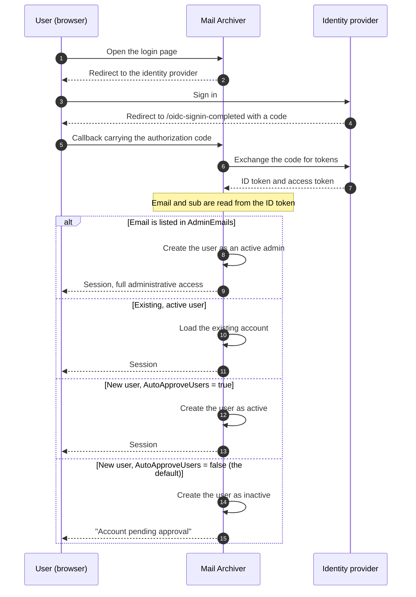

# 🔐 Vodnik za avtentikacijo OpenID Connect (OIDC) {#openid-connect-oidc-authentication-guide}

[← Nazaj na indeks dokumentacije](index.md)

## 📋 Pregled {#overview}

Ta vodnik nudi celovita navodila za nastavitev avtentikacije OpenID Connect (OIDC) v aplikaciji Mail Archiver, s specifičnimi primeri za integracijo z Microsoft Entra ID (Azure AD). OIDC omogoča varno avtentikacijo s pripadajočim enotnim prijavo (SSO) z uporabo zunanjih ponudnikov identitete.

## 📚 Kazalo vsebine {#table-of-contents}

1. [Kako deluje proces prijave](#how-the-login-flow-works)
2. [Pregled](#overview)
3. [Predpogoji](#prerequisites)
4. [OIDC konfiguracija](#oidc-configuration)
   - [Omogočanje OIDC v konfiguraciji](#enable-oidc-in-configuration)
   - [Spletne spremenljivke](#environment-variables)
5. [Nastavitev Microsoft Entra ID](#microsoft-entra-id-setup)
   - [Ustvarite registracijo aplikacije](#create-app-registration)
   - [Konfiguracija avtentikacije](#configure-authentication)
   - [Konfiguracija API dovoljenj](#configure-api-permissions)
   - [Generiranje Client Secret](#generate-client-secret)
6. [Nastavitev Authelia](#authelia-setup)
   - [Konfiguracija Authelia](#authelia-configuration)
   - [Podrobnosti registracije klijenta](#client-registration-details)
7. [Testiranje in validacija](#testing-and-validation)
8. [Upravljanje uporabnikov z OIDC](#user-management-with-oidc)
9. [Samodejna odobritev OIDC uporabnikov](#auto-approve-oidc-users)
10. [Konfiguracija prijave brez gesla](#passwordless-login-configuration)
11. [Združljivost ponudnikov](#provider-compatibility)

## 🔄 Kako deluje proces prijave {#how-the-login-flow-works}

Diagram prikazuje celoten ciklični proces — brskalnik, Mail Archiver in ponudnika identitete — in, kar je pomembneje, lokalno odločitev, ki jo Mail Archiver spreema *po tem*, ko je ponudnik uporabnika že sprejel.



Uspešna prijava pri ponudniku zato **ni** konec zgodbe.
Z privzetim `AutoApproveUsers=false` se novi uporabnik ustvari neaktiven in administrator mora aktivirati račun. Uporabnik, ki se pravilno avtentificira, a se še vedno ne more prijavi, je skoraj vedno naletel na to oviro namesto na napačno konfiguracijo OIDC.

## 🌐 Pregled {#overview}

Aplikacija Mail Archiver podpira avtentikacijo OpenID Connect (OIDC), kar uporabnikom omogoča avtentikacijo prek zunanjih ponudnikov identitete, kot sta Microsoft Entra ID in drugi ponudniki, ki so skladni s standardom OIDC. Ta funkcija povečuje varnost z uporabo sistemov za upravljanje identitete podjetij in omogoča funkcije za enotno prijavo (SSO).

## 🛠️ Predpogoj {#prerequisites}

- Administratorski dostop do izbranega OIDC ponudnika identitete (npr. Microsoft Entra ID)
- Aplikacija Mail Archiver, ki je že nameščena in dostopna prek HTTPS
- DNS ime, konfigurirano za vašo instanco Mail Archiver (zahtevano za callback URL-je)
- Administratorski dostop do aplikacije Mail Archiver in gostiteljskega sistema za konfiguracijo
- Če uporabljate obratni proxy, ustrezna [konfiguracija obratnega proxyja](ReverseProxy.md) za obdelavo HTTPS zaglavka

## 🔧 Konfiguracija obversega proxyja za OIDC {#reverse-proxy-configuration-for-oidc}

Pri implementaciji Mail Archiver za obversem proxyjem z OIDC avtentikacijo je morda potrebna dodatna konfiguracija, da zagotovite pravilno obdelavo procesov avtentikacije in izmenjave žetonov. OIDC avtentikacija vključuje večje HTTP glave in teles odgovorov, ki lahko presežejo privzete velikosti predpomnilnika v nekaterih konfiguracijah obversega proxyja.

### Konfiguracija Nginx Proxy Manager {#nginx-proxy-manager-configuration}

Če uporabljate Nginx Proxy Manager kot svoj obversem proxy, boste morda morali dodati naslednjo konfiguracijo za pravilno obdelavo OIDC avtentikacije:

```nginx
proxy_busy_buffers_size 512k;
proxy_buffers 4 512k;
proxy_buffer_size 256k;
```

Te nastavitve povečajo velikosti predpomnilnikov, da podpirajo večje OIDC žetonove in odgovore pri avtentikaciji. Brez teh nastavitev lahko pride do težav s procesi avtentikacije, zlasti pri ponudnikih, ki vračajo velike ID žetonove ali pri uporabi dodatnih scopeov.

### Splošni razgladi za obversem proxy {#general-reverse-proxy-considerations}

- Zagotovite, da vaš obversem proxy ohranja HTTPS glave (`X-Forwarded-Proto`, `X-Forwarded-Host`)
- Konfigurirajte ustrezne nastavitve časovnega izteka (timeout) za procese avtentikacije
- Preverite, czy so podprte velike velikosti glav
- Po spremembah konfiguracije temeljito preizkusite proces avtentikacije

Za podrobna navodila o konfiguraciji obversega proxyja si oglejte [Reverse Proxy Configuration Guide](ReverseProxy.md).

## ⚙️ OIDC konfiguracija {#oidc-configuration}

### Omogočite OIDC v konfiguraciji {#enable-oidc-in-configuration}

Za omogočitev OIDC 인증e želite konfigurirati OAuth razdelek v svoji datoteki `appsettings.json` ali v okoljskih spremenljivkah za docker разporeditev (poglejte [Installation and Setup](Setup.md)).

#### Primer konfiguracije (appsettings.json) {#example-configuration-appsettingsjson}

```json
{
  "OAuth": {
    "Enabled": true,
    "Authority": "https://sts.windows.net/{TENANT-ID}/",
    "ClientId": "YOUR-CLIENT-ID",
    "ClientSecret": "YOUR-CLIENT-SECRET",
    "ClientScopes": [
      "openid",
      "profile",
      "email"
    ],
    "DisablePasswordLogin": false
  }
}
```

### Okoljske spremenljivke {#environment-variables}

Pri uporabi Docker Compose ali okoljskih spremenljivk konfigurirajte naslednje spremenljivke v svoji datoteki `docker-compose.yml` pod razdelkom environment storitve `mailarchive-app`:

```yaml
environment:
  # OIDC Configuration
  - OAuth__Enabled=true
  - OAuth__Authority=https://sts.windows.net/{TENANT-ID}/
  - OAuth__ClientId=YOUR-CLIENT-ID
  - OAuth__ClientSecret=YOUR-CLIENT-SECRET
  - OAuth__DisplayName=PocketID SSO
  - OAuth__ClientScopes__0=openid
  - OAuth__ClientScopes__1=profile
  - OAuth__ClientScopes__2=email
  - OAuth__DisablePasswordLogin=false
  - OAuth__AutoApproveUsers=false
```

### Razložitev parametrov konfiguracije {#configuration-parameters-explained}

- **OAuth__Enabled**: Nastavite na `true` za omogočitev OIDC 인증e
- **OAuth__Authority**: OpenID Connect URL avtoritete vašega ponudnika identitete
- **OAuth__ClientId**: Klijantski ID, ki ga je dodelil vaš ponudnik identitete
- **OAuth__ClientSecret**: Klijantski tajni ključ, ki ga je dodelil vaš ponudnik identitete
- **OAuth__DisplayName**: Neobvezno ime za prikaz na gumbu za OIDC prijavu (na primer, `PocketID SSO` se prikaže kot `Login with PocketID SSO`)
- **OAuth__ClientScopes**: N 만큼 niz zakresov (scopes), ki se zahtevajo od ponudnika identitete
- **OAuth__ResponseMode**: Način odgovora za zahtevo za avtorizacijo: `query`, `fragment` ali `form_post`. Pustite prazno, da ohranite privzeto vrednost (`form_post`). Ponudniki, ki ne podpirajo `form_post`, potrebujejo `query`; poglejte [Provider Compatibility](#provider-compatibility)
- **OAuth__DisablePasswordLogin**: Nastavite na `true` za onemogočitev tradicionalne prijave z uporabniškim imenom/geslom in prisilno uporabo izključno OAuth 인증e (za več podrobnosti poglejte Passwordless Login Configuration)
- **OAuth__AutoApproveUsers**: Nastavite na `true` za samodejno odobritev novih OIDC uporabnikov brez zahtevanja odobritve administratorja (privzeto: `false`). Za podrobnosti poglejte [Auto-Approve OIDC Users](#auto-approve-oidc-users)

> ⚠️ **Pomembno**: Client Secret mora biti varovan. V produkcijskih okoljih uporabite Docker secrets ali okoljske spremenljivke.

## ☁️ Nastavitev Microsoft Entra ID {#microsoft-entra-id-setup}

Ta oddelek nudi navodila korak za korak za konfiguracijo Microsoft Entra ID (prej Azure AD) kot OIDC ponudnika identitete za Mail Archiver.

### 🚀 Ustvarite registracijo aplikacije {#create-app-registration}

1. Pojdite v [Microsoft Entra Admin Center](https://entra.microsoft.com)
2. Prijavite se s svojim računom administratorja
3. V desni navigacijski vrstici izberite **App registrations**
4. Na vrhu strani App registrations kliknite **+ New registration**
5. Izpolnite naslednje podrobnosti:
   - **Name**: Vnesite opisno ime (npr. "Mail Archiver OIDC")
   - **Supported account types**: Izberite **Accounts in this organizational directory only**
   - **Redirect URI**: Izberite **Web** in vnesite URL za povratni poziv Mail Archiver:
     ```
     https://your-mail-archiver-domain/oidc-signin-completed
     ```
     Zamenjajte `your-mail-archiver-domain` s vašo dejansko domeno (npr. `mailarchiver.example.com`)
6. Kliknite **Register**

### 🔐 Konfiguracija avtentikacije {#configure-authentication}

1. Po registraciji si zapišite naslednje vrednosti s strani **Overview** registracije aplikacije:
   - **Application (client) ID** - To boste potrebovali kot `OAuth__ClientId`
   - **Directory (tenant) ID** - To boste potrebovali za sestavo Authority URL
2. Sprostite **Authority URL** iz **Directory (tenant) ID**, ki ste ga pravkar kopirali. Za Microsoft Entra ID je Authority sestavljen takole:
   ```
   https://sts.windows.net/<TENANT-ID>/
   ```
   Zamenjajte `<TENANT-ID>` (tudi navedeno kot Mandanten-ID) z vrednostjo, ki je prikazana zraven Application (client) ID na strani Overview registracije aplikacije. Na primer, če je vaš Directory (tenant) ID `11111111-2222-3333-4444-555555555555`, postane vaš Authority:
   ```
   https://sts.windows.net/11111111-2222-3333-4444-555555555555/
   ```
   To vrednost uporabite kot `OAuth__Authority` v svoji konfiguraciji. Zagotovo vključite končno navodje (slash).
   > ℹ️ **Opomba**: Oba končnika `https://sts.windows.net/<TENANT-ID>/` in `https://login.microsoftonline.com/<TENANT-ID>/v2.0` sta veljavna Entra ID authority končnika. Oblika `sts.windows.net` uporablja v1.0 končnik in je priporočljiva za ta vodič.
3. V levem meniju izberite **Authentication**
4. Kliknite **Settings**
5. Pod **Implicit grant and hybrid flows** zagotovite, da je obkljukirana možnost **ID tokens**
6. Pod **Supported account types** preverite, ali se vaša izbira ujema z vašimi zahtevami
7. Pod **Redirect URIs** zagotovite, da je vaš URL za povratni poziv pravilno naveden

### 🎯 Konfiguracija API dovoljenj {#configure-api-permissions}

1. V levem meniju izberite **API permissions**
2. Kliknite **+ Add a permission**
3. Izberite **Microsoft Graph**
4. Izberite **Delegated permissions**
5. Dodajte naslednja dovoljenja (če so potrebna za dodatne funkcije):
   - **openid** - Prijava uporabnikov
   - **email** - Ogled e-poštnih naslovov uporabnikov
   - **profile** - Ogled osnovnega profila uporabnikov
6. Kliknite **Add permissions**
7. Kliknite **Grant admin consent for [Your Organization]**, če želite aplikacijo predhodno avtorizirati

### 🔑 Generiranje Client Secret {#generate-client-secret}

1. Pojdite na **Certificates & secrets** v levem meniju
2. Pod **Client secrets** kliknite **+ New client secret**
3. Navedite opis (npr. "Mail Archiver Auth Secret")
4. Izberite obdobje potečnosti
5. Kliknite **Add**
6. **Pomembno**: Takoj kopirajte **Value** in ga varno shranite. Ta secret ne bo več prikazan. Potreben je kot `OAuth__ClientSecret`

## 🔐 Nastavitev Authelia {#authelia-setup}

Ta oddelek nudi podrobnosti o konfiguraciji za nastavitev Authelia kot OIDC ponudnika identitete za Mail Archiver. Authelia je strežnik za avtentikacijo in avtorizacijo z odprtim kodom, ki podpira OIDC.

### 🛠️ Konfiguracija Authelia {#authelia-configuration}

```yaml
identity_providers:
  oidc:
    clients:
      - client_id: 'mailarchiver'
        client_name: 'mailarchiver'
        client_secret: '$xyzg'  # The digest of 'insecure_secret'.
        public: false
        redirect_uris:
          - 'https://your-mail-archiver-domain/oidc-signin-completed'
        scopes:
          - 'openid'
          - 'profile'
          - 'email'
        response_types:
          - 'code'
        grant_types:
          - 'authorization_code'
        token_endpoint_auth_method: 'client_secret_post'
```

### 📝 Podrobnosti o registraciji klijenta {#client-registration-details}

- **client_id**: `mailarchiver` - Unikotna identifikator za aplikacijo Mail Archiver
- **client_name**: `mailarchiver` - Ime, ki se prikazuje uporabnikom med avtentikacijo
- **client_secret**: Heširan tajni ključ, ki se uporablja za avtentikacijo klijenta (v produkciji zamenjajte s svojim varnim ključem)
- **redirect_uris**: Povratni URL, kamor bo Authelia preusmerila uporabnike po avtentikaciji. Zamenjajte `[YOUR_MAILARCHIVER_URL]` z vašo dejansko domeno Mail Archiver
- **scopes**: Privilegije, zahtevani od Authelia:
  - `openid`: Obvezno za OIDC avtentikacijo
  - `profile`: Dostop do osnovnih informacij o profilu
  - `email`: Dostop do e-poštnega naslova
- **response_types**: `code` - Potek avtorizacijske kode (Authorization code flow)
- **grant_types**: `authorization_code` - Vrsta odobritve avtorizacijske kode (Authorization code grant type)
- **token_endpoint_auth_method**: `client_secret_post` - Metoda avtentikacije klijenta

> ⚠️ **varnostna opomba**: Primer uporablja privzeto tajno ključ za demonstracijo. V produkciji generirajte varen tajni ključ in ga z heširajte z orodji Authelia. V produkcijskih okoljih nikoli ne uporabljajte primernika tajnega ključa.

## 🧪 Testiranje in validacija {#testing-and-validation}

### Testiranje inicialne nastavitve {#initial-setup-testing}

1. Po konfiguraciji OIDC nastavitev ponovno zaženite svojo aplikacijo Mail Archiver
2. Pojdite na stran za prijavo v Mail Archiver
3. Poleg običajnega obrazca za prijavo bi morali videti nov gumb za OAuth prijavo. Z `OAuth__DisplayName=PocketID SSO` gumb prikazuje `Login with PocketID SSO`.
4. Kliknite gumb za OAuth prijavo, da začnete OIDC proces
5. Morali bi biti preusmerjeni na stran za prijavo vašega ponudnika identitete
6. Po uspešni avtentikaciji bi morali biti preusmerjeni nazaj v Mail Archiver

### Validacija zagotavljanja uporabnikov {#user-provisioning-validation}

- Uporabniki OIDC, ki se prvič uveljavljajo, bodo v bazi podatkov Mail Archiver ustvarjeni samodejno
- Uporabniki bodo ustvarjeni z privzornimi vlogo "User" in bodo za dostop potrebovali odobritev administratorja

## 👥 Upravljanje uporabnikov z OIDC {#user-management-with-oidc}

### Vloge in pravice uporabnikov {#user-roles-and-permissions}

OIDC uporabniki sledijo istemu nadzoru dostopa na podlagi vlog, kot lokalni uporabniki:
- **Admin**: Polni dostop do sistema (zahteva ročno dodelitvijo s strani obstoječega admina ali samodejno prek konfiguracije AdminEmails)
- **User**: Standardni dostop uporabnika do dodeljenih poštanskih računov
- **Self-Manager**: Lahko upravlja s svojim računom in dodaja nove račune

### Samodejno dodeljevanje privilegiji administratorjev {#auto-provisioning-administrators}

 lahko določene e-poštne naslove nastavite tako, da se ob prvem prijavi prek OIDC samodejno dodelijo kot administratorji:

```json
{
  "OAuth": {
    "AdminEmails": [
      "admin@example.com",
      "it-manager@example.com"
    ]
  }
}
```

Ko se uporabnik z enim od teh e-poštnih naslovov prvič prijavi:
- Samodejno bo ustvarjen kot aktiven administrator
- Ni potrebna ročna odobritev
- Takoj pridobi polne administratorske privilegije
- Primerava e-poštnega naslova ni občutljiva na velike in male črke

**Opozorilo o varnosti**: Na ta seznam dodajte le zaupanjaworthy e-poštne naslove, saj bodo ti uporabniki imeli polni dostop do sistema.

### Potek dodeljevanja uporabnikov {#user-provisioning-flow}

#### Novi uporabniki (niso v AdminEmails) {#new-users-not-in-adminemails}
1. Uporabnik se avtentira prek OAuth ponudnika
2. Sistem preveri, ali e-poštni naslov obstaja v lokalni bazi podatkov
3. Če gre za novega uporabnika:
   - Račun je ustvarjen z uporabniškim imenom, izvedenim iz OIDC zahtev (claims), v tem prednostnem redu:
     1. **lokalni del e-poštnega naslova** (vse pred `@`), npr. `example.mailarchiver` za `example.mailarchiver@xxxxxxxxx.onmicrosoft.com`
     2. celotna `sub` zahteva, ko ni prisotna zahteva za e-pošto
     3. `oidc_<12-char-hash>` kot zadnja možnost
     Generirana vrednost je skrajšana na 320 znakov. Če že obstaja lokalni uporabnik z istim uporabniškim imenom, se doda `" (n)"`, dokler ni najden edinstven naziv.
   - Uporabnik je označen kot **neaktiven** in **zahteva odobritev**
   - Administrator mora uporabnika ročno aktivirati v upravljanju uporabnikov (Users management)
4. Uporabnik prejme sporočilo "Account pending approval"

#### Novi uporabniki (so v AdminEmails) {#new-users-in-adminemails}
1. Uporabnik se avtentira prek OAuth ponudnika
2. Sistem prepozna, da je e-poštni naslov na seznamu AdminEmails
3. Račun je ustvarjen samodejno:
   - Uporabnik je označen kot **aktiven** in **admin**
   - Odobritev ni potrebna
   - Uporabnik lahko takoj dostopa do sistema
4. Uporabnik je uspešno prijavljen

### Upravljanje gesli {#password-management}

Uporabniki OIDC nimajo gesli in jih ne morejo spremeniti znotraj Mail Archiver, saj avtentikacija poteka prek zunanjega ponudnika identitete:
- Možnost "Change Password" bo za OIDC uporabnike onemogočena
- Ponastavitev gesla mora biti izvedena prek OIDC ponudnika
- Lokalna polja za geslo bodo za OIDC uporabnike ostala prazna

## ✅ Samodejno odobravanje OIDC uporabnikov {#auto-approve-oidc-users}

Privzeto morajo nove OIDC uporabnike ročno odobriti lokalni administrator, preden lahko dostopajo do aplikacije. To zagotavlja model dvojnega nadzora, kjer morata dostop odobrita tako IdP kot lokalni administrator.

Za **namene, kjer je OIDC prioriteta (OIDC-first)**, kjer je znotraj IdP (Identity Provider) edini vir resničnosti za nadzor dostopa, lahko ta korak ročnega odobravanja preskočite z omogočanjem možnosti `AutoApproveUsers`.

### Omogočanje samodejnega odobravanja {#enabling-auto-approve}

V svojo konfiguracijo nastavite `AutoApproveUsers` na `true`:

```json
{
  "OAuth": {
    "Enabled": true,
    "AutoApproveUsers": true,
    "Authority": "https://your-provider.com",
    "ClientId": "your-client-id",
    "ClientSecret": "your-secret"
  }
}
```

Ali prek okoljske spremenljivke:

```yaml
environment:
  - OAuth__AutoApproveUsers=true
```

### Vedenje {#behavior}

| Nastavitev | Vedenje novega OIDC uporabnika |
|---|---|
| `AutoApproveUsers: false` (privzeto) | Uporabnik je ustvarjen kot **neaktiven** in **zahteva odobritev administratorja**, preden mu bo podeljen dostop |
| `AutoApproveUsers: true` | Uporabnik je ustvarjen kot **aktiven** in lahko takoj dostopa do aplikacije |

> **Opomba**: `AdminEmails` ima vedno prednost — uporabniki, ki ujemajo s `AdminEmails`, so vedno samodejno odobreni kot administratorji, ne glede na to nastavitev.

### Kdaj uporabiti {#when-to-use}

Ta možnost je priporočljiva za okolja, kjer:
- **IdP nadzoruje dostop do aplikacije** (npr. preko dodelitve aplikacije ali članstva v skupini v Authentik, Entra ID, Authelia itd.)
- Želite **odstraniti model dvojnega nadzora** (odobritev IdP + odobritev lokalnega administratorja)
- **Prekinitev dostopa se upravlja na ravni IdP** (odstranitev dodelitve aplikacije samodejno prepreči prijavo)

### Celovit primer nastavitve OIDC-first {#complete-oidc-first-setup-example}

```json
{
  "OAuth": {
    "Enabled": true,
    "Authority": "https://sts.windows.net/YOUR_TENANT_ID/",
    "ClientId": "your-client-id",
    "ClientSecret": "your-secret",
    "DisplayName": "PocketID SSO",
    "ClientScopes": ["openid", "profile", "email"],
    "DisablePasswordLogin": true,
    "AutoRedirect": true,
    "AutoApproveUsers": true,
    "AdminEmails": ["admin@company.com"]
  }
}
```

V tej nastavitvi:
- Uporabniki so samodejno preusmerjeni na OIDC ponudnika
- Novi uporabniki so ob prvi prijavi samodejno odobreni
- E-poštni naslovi administratorjev so samodejno pripravljeni kot administratorji
- Nadzor dostopa je v celoti upravljal na ravni IdP

### Varnostni vidiki {#security-considerations}

- **Zaupanje**: Omogočanje `AutoApproveUsers` pomeni, da zaupate IdP, da nadzoruje, kdo lahko dostopa do aplikacije. Zagotovite, da je vaš IdP pravilno konfiguriran z ustreznimi dodelitvami aplikacij ali dostopom na podlagi skupin.
- **Dodela vlog**: Samodejno odobreni uporabniki so ustvarjeni s standardnimi uporabniškimi dovoljenji (ne z admin). Dostop administratorja še vedno zahteva bodisi konfiguracijo `AdminEmails` ali ročno dodelo vlog.
- **Prekinitev dostopa**: Ko se uporabnikov dostop odstrani v IdP, se ne more več avtenticirati prek OIDC. Vendar pa njegov lokalni račun ostane aktiven. Za popolno preklinitev dostopa uporabnika deaktivirajte tudi v nadzorni plošči Mail Archiver.
- **Združljivost s prejšnjimi različicami**: Privzeto vrednost je `false`, kar ohranja obstoječe vedenje pri trenutnih namestitvah.

## 🔒 Konfiguracija prijave brez gesla {#passwordless-login-configuration}

> ⚠️ **Pomembno**: Tudi pri konfiguraciji prijave brez gesla se med prvim zagonom še vedno ustvari začetni uporabnik administratorja. Za zagotavljanje varnosti sistema morate temu uporabniku administratorja v datoteki `appsettings.json` ali `docker-compose.yml` nastaviti varno geslo.

Za organizacije, ki želijo uporabljati izključno OAuth avtentikacijo, aplikacija omogoča popolno onemogočanje prijave s geslom.

### Onemogočanje prijave s geslom {#disabling-password-login}

Nastavite `DisablePasswordLogin` na `true`, da onemogočite prijavo z uporabniškim imenom/geslom:

```json
{
  "OAuth": {
    "Enabled": true,
    "DisablePasswordLogin": true,
    "Authority": "https://your-provider.com",
    "ClientId": "your-client-id",
    "ClientSecret": "your-secret"
  }
}
```

**Rezultat**: Na strani za prijavo se prikaže le gumb za OAuth prijavo, strežnik pa zavrne vsako POST zahtevo za geslo (`/Auth/Login`) z nadaljnim preusmerjanjem na stran za prijavo. Lokalna gesla ostanejo shranjena v bazi podatkov, vendar jih v aktivnem načinu OAuth-only ni več mogoče uporabiti za prijavo. Če je konfiguriran `DisplayName`, gumb uporabi to vrednost (na primer, `Login with PocketID SSO`).

### Samodejno preusmerjanje na ponudnika OAuth {#auto-redirect-to-oauth-provider}

Omogočite `AutoRedirect` za samodejno preusmerjanje uporabnikov na vašega ponudnika OAuth:

```json
{
  "OAuth": {
    "Enabled": true,
    "DisablePasswordLogin": true,
    "AutoRedirect": true,
    "Authority": "https://your-provider.com",
    "ClientId": "your-client-id",
    "ClientSecret": "your-secret"
  }
}
```

**Zahteve**: 
- `DisablePasswordLogin` mora biti `true`
- `OAuth.Enabled` mora biti `true`

**Rezultat**: Uporabniki vidijo kratek zaslon nalaganja in so samodejno preusmerjeni na ponudnika OAuth.

### Primer popolne nastavitve brez gesla {#complete-passwordless-setup-example}

```json
{
  "OAuth": {
    "Enabled": true,
    "Authority": "https://sts.windows.net/YOUR_TENANT_ID/",
    "ClientId": "your-client-id",
    "ClientSecret": "your-secret",
    "DisplayName": "PocketID SSO",
    "ClientScopes": ["openid", "profile", "email"],
    "DisablePasswordLogin": true,
    "AutoRedirect": true,
    "AdminEmails": ["admin@company.com", "it@company.com"]
  }
}
```

### Varnostni razlozi {#security-considerations}

- **Dodajanje e-pošte administratorja**: Ponudniku OAuth zaupate preverjanje e-poštnih naslovov. V AdminEmails dodajte le zaupanjaworthy naslove.
- **Nujna dostopnost**: Z `DisablePasswordLogin=true` nobano lokalno geslo ni mogoče uporabiti za prijavo, vključno s začetnim računom administratorja. Pred omogočanjem te nastavitve se prepričajte, da je vsaj ena OAuth identiteta dodeljena kot administrator (poglejte `AdminEmails`), sicer se boste izključili iz sistema. Za ponovno pridobitev dostopa nastavite `OAuth__DisablePasswordLogin=false`, ponovno zaženite sistem, se prijavite z lokalnim geslom administratorja in nato to nastavitev ponovno omogočite.
- **Testiranje**: Pred onemogočanjem prijave s geslom v produkciji temeljito preizkusite OAuth avtentikacijo.
- **SSO okolje**: Samodejno preusmerjanje je najbolj primerno za okolja za enotno prijavo (SSO), kjer se vsi uporabniki avtenticirajo prek istega ponudnika.

## 🧩 Združljivost ponudnikov {#provider-compatibility}

Ne vsak ponudnik identitete implementira celotno specifikacijo OIDC. Oba spodnja nastavitvi obstajata prav zaradi tega in sta oba potrebna za Synology SSO Server.

### Response Mode {#response-mode}

Zahtev za avtorizacijo se pošlje z načinom odziva `form_post`, kar je privzeto za podlagajoči ASP.NET Core OpenID Connect obdelovalnik. Ponudnik, ki ga ne podpira, običajno odpove z lastnim sporočilom, v dnevniku Mail Archiver pa se ne izpiše nič.

Synology SSO Server se obnaša tako: njegov dokument za odkrivanje (discovery document) izpustimo `response_modes_supported`, prijava pa se ustavi z napako "Unable to sign in via SSO due to setting issues". Način odziva nastavite nedvomačno:

```env
OAuth__ResponseMode=query
```

Velične vrednosti so `query`, `fragment` in `form_post`. Nastavitev pustite prazno, da ohranite privzeto vrednost. Če niste prepričani, je `query` najvarnejša izbira: to je edini način odziva, ki ga mora podpirati vsak OIDC ponudnik.

### Name and Email Claims {#name-and-email-claims}

Ime za prikaz novega uporabnika se prevzame iz odgovora o informacijah o uporabniku (user info response) v naslednjem vrstnem redu:

1. `name`
2. `preferred_username`
3. `given_name`
4. `username`

Zahtevki (claims), ki so prisotni, vendar so prazni ali niso nizov (string), bodo preskočeni. `username` ni standardni OIDC zahtevka, vendar ga nekateri ponudniki vrnejo kot edino vrednost, ki je podobna imenu (spet Synology SSO Server). E-poštni naslov se bere iz `email`, nato iz `mail`, nato iz `upn`, in če nobena ne uspe, se uporabi zahtevki iz ID tokena.

Če nobena od zahtevkov za ime ni prisotna, se prijava ne izvede. Uporabnik se vrne na stran za prijavo z berljivim sporočilom, ki navaja zahtevke, ki so bili iskani, razlog pa je zapisan v dnevnik na ravni hroščanja (error level).

---

**Opomba**: Ta vodnik je aktualen do leta 2025. Storitve ponudnikov identitete redno posodabljajo svoje vmesnike in funkcije, zato se lahko nekateri elementi uporabniškega vmesnika razlikujejo. Za najnovejše informacije vedno preverite najsvejšo dokumentacijo svojega ponudnika identitete.
