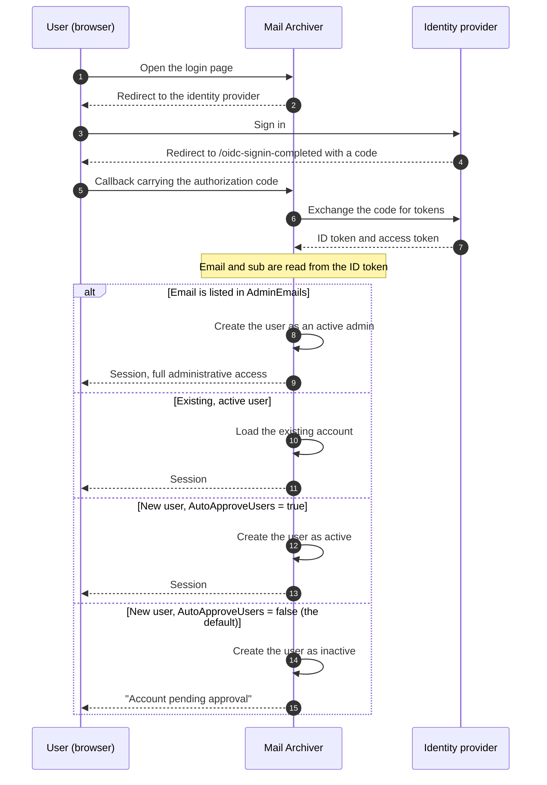

# 🔐 OpenID Connect (OIDC) Authentication Guide {#openid-connect-oidc-authentication-guide}

[← Back to Documentation Index](index.md)

## 📋 Overview {#overview}

本指南提供了在 Mail Archiver 应用程序中设置 OpenID Connect (OIDC) 身份验证的全面说明，并提供了 Microsoft Entra ID (Azure AD) 集成的具体示例。OIDC 通过外部身份提供商实现安全的单点登录 (SSO) 身份验证。

## 📚 目录 {#table-of-contents}

1. [登录流程的工作原理](#how-the-login-flow-works)
2. [概述](#overview)
3. [前提条件](#prerequisites)
4. [OIDC 配置](#oidc-configuration)
   - [在配置中启用 OIDC](#enable-oidc-in-configuration)
   - [环境变量](#environment-variables)
5. [Microsoft Entra ID 设置](#microsoft-entra-id-setup)
   - [创建应用注册](#create-app-registration)
   - [配置身份验证](#configure-authentication)
   - [配置 API 权限](#configure-api-permissions)
   - [生成客户端密钥](#generate-client-secret)
6. [Authelia 设置](#authelia-setup)
   - [Authelia 配置](#authelia-configuration)
   - [客户端注册详情](#client-registration-details)
7. [测试与验证](#testing-and-validation)
8. [使用 OIDC 进行用户管理](#user-management-with-oidc)
9. [自动批准 OIDC 用户](#auto-approve-oidc-users)
10. [无密码登录配置](#passwordless-login-configuration)
11. [提供商兼容性](#provider-compatibility)

## 🔄 登录流程的工作原理 {#how-the-login-flow-works}

该图展示了整个往返过程 —— 浏览器、Mail Archiver 以及身份提供商 —— 更重要的是，展示了在提供商已接受用户 *之后*，Mail Archiver 所做的本地决策。



因此，在提供商处成功登录并不意味着流程的结束。
在默认的 `AutoApproveUsers=false` 下，新用户会被创建为非活跃状态，管理员必须手动激活该账户。如果用户身份验证正确但仍然无法登录，绝大多数情况下是因为遇到了这个限制，而非 OIDC 配置错误。

## 🌐 概述 {#overview}

Mail Archiver 应用程序支持 OpenID Connect (OIDC) 身份验证，允许用户使用外部身份提供商（例如 Microsoft Entra ID 以及其他符合 OIDC 标准的提供商）进行身份验证。此功能通过利用企业身份管理系统增强了安全性，并实现了单点登录 (SSO) 能力。

## 🛠️ 前提条件 {#prerequisites}

- 对所选 OIDC 身份提供商（例如 Microsoft Entra ID）的管理员访问权限
- 已部署且可通过 HTTPS 访问的 Mail Archiver 应用程序
- 为您的 Mail Archiver 实例配置了 DNS 名称（回调 URL 所需）
- 对 Mail Archiver 应用程序和主机系统的配置管理员访问权限
- 如果使用反向代理，需配置正确的 [reverse proxy configuration](ReverseProxy.md) 以处理 HTTPS 请求头

## 🔧 OIDC 反向代理配置 {#reverse-proxy-configuration-for-oidc}

在将 Mail Archiver 部署在带有 OIDC 身份验证的反向代理之后，可能需要进行额外的配置，以确保正确处理身份验证流和令牌交换。OIDC 身份验证涉及较大的 HTTP 请求头和响应体，在某些反向代理配置中可能会超过默认的缓冲区大小。

### Nginx Proxy Manager 配置 {#nginx-proxy-manager-configuration}

如果您使用 Nginx Proxy Manager 作为反向代理，您可能需要添加以下配置以正确处理 OIDC 身份验证：

```nginx
proxy_busy_buffers_size 512k;
proxy_buffers 4 512k;
proxy_buffer_size 256k;
```


这些设置增加了缓冲区大小，以容纳较大的 OIDC 令牌和身份验证响应。如果没有这些设置，您可能会遇到身份验证流的问题，特别是对于返回大型 ID 令牌的提供商，或者在使用额外的 scope 时。

### 通用反向代理注意事项 {#general-reverse-proxy-considerations}

- 确保您的反向代理保留了 HTTPS 请求头 (`X-Forwarded-Proto`, `X-Forwarded-Host`)
- 为身份验证流配置适当的超时设置
- 验证是否支持较大的请求头大小
- 配置更改后，请彻底测试身份验证流

有关详细的反向代理配置指南，请参阅 [Reverse Proxy Configuration Guide](ReverseProxy.md)。

## ⚙️ OIDC 配置 {#oidc-configuration}

### 在配置中启用 OIDC {#enable-oidc-in-configuration}

要启用 OIDC 身份验证，您需要在 `appsettings.json` 文件中配置 OAuth 部分，或者为 docker 部署配置环境变量（参见 [Installation and Setup](Setup.md)）。

#### 配置示例 (appsettings.json) {#example-configuration-appsettingsjson}

```json
{
  "OAuth": {
    "Enabled": true,
    "Authority": "https://sts.windows.net/{TENANT-ID}/",
    "ClientId": "YOUR-CLIENT-ID",
    "ClientSecret": "YOUR-CLIENT-SECRET",
    "ClientScopes": [
      "openid",
      "profile",
      "email"
    ],
    "DisablePasswordLogin": false
  }
}
```


### 环境变量 {#environment-variables}

当使用 Docker Compose 或环境变量时，请在 `docker-compose.yml` 文件的 `mailarchive-app` 服务 environment 部分配置以下变量：

```yaml
environment:
  # OIDC Configuration
  - OAuth__Enabled=true
  - OAuth__Authority=https://sts.windows.net/{TENANT-ID}/
  - OAuth__ClientId=YOUR-CLIENT-ID
  - OAuth__ClientSecret=YOUR-CLIENT-SECRET
  - OAuth__DisplayName=PocketID SSO
  - OAuth__ClientScopes__0=openid
  - OAuth__ClientScopes__1=profile
  - OAuth__ClientScopes__2=email
  - OAuth__DisablePasswordLogin=false
  - OAuth__AutoApproveUsers=false
```


### 配置参数说明 {#configuration-parameters-explained}

- **OAuth__Enabled**: 设置为 `true` 以启用 OIDC 身份验证
- **OAuth__Authority**: 您的身份提供者的 OpenID Connect 权威 URL
- **OAuth__ClientId**: 您的身份提供者分配的客户端 ID
- **OAuth__ClientSecret**: 您的身份提供者分配的客户端密钥
- **OAuth__DisplayName**: OIDC 登录按钮的可选显示名称（例如，`PocketID SSO` 会渲染为 `Login with PocketID SSO`）
- **OAuth__ClientScopes**: 向身份提供者请求的 scope 数组
- **OAuth__ResponseMode**: 授权请求的响应模式：`query`、`fragment` 或 `form_post`。留空以保持默认值 (`form_post`)。不支持 `form_post` 的提供者需要 `query`；参见 [Provider Compatibility](#provider-compatibility)
- **OAuth__DisablePasswordLogin**: 设置为 `true` 以禁用传统的用户名/密码登录，并强制执行仅限 OAuth 的身份验证（有关更多详细信息，请参阅 Passwordless Login Configuration）
- **OAuth__AutoApproveUsers**: 设置为 `true` 以自动批准新的 OIDC 用户，无需管理员批准（默认值：`false`）。详情请参见 [Auto-Approve OIDC Users](#auto-approve-oidc-users)

> ⚠️ **重要提示**：应妥善保管 Client Secret。在生产环境中，请使用 Docker secrets 或环境变量。

## ☁️ Microsoft Entra ID 设置 {#microsoft-entra-id-setup}

本节提供将 Microsoft Entra ID（原 Azure AD）配置为 Mail Archiver 的 OIDC 身份提供程序的逐步说明。

### 🚀 创建应用注册 {#create-app-registration}

1. 导航至 [Microsoft Entra Admin Center](https://entra.microsoft.com)
2. 使用您的管理员帐户登录
3. 在左侧导航窗格中，选择 **App registrations**
4. 点击 App registrations 页面顶部的 **+ New registration**
5. 填写以下详细信息：
   - **Name**：输入描述性名称（例如 "Mail Archiver OIDC"）
   - **Supported account types**：选择 **Accounts in this organizational directory only**
   - **Redirect URI**：选择 **Web** 并输入您的 Mail Archiver 回调 URL：
     ```
     https://your-mail-archiver-domain/oidc-signin-completed
     ```
     将 `your-mail-archiver-domain` 替换为您的实际域名（例如 `mailarchiver.example.com`）
6. 点击 **Register**

### 🔐 配置身份验证 {#configure-authentication}

1. 注册完成后，请记录下应用注册 **Overview** 页面中的以下值：
   - **Application (client) ID** - 您将需要将其作为 `OAuth__ClientId` 使用
   - **Directory (tenant) ID** - 您将需要使用它来构建 Authority URL
2. 根据您刚刚复制的 **Directory (tenant) ID** 构建 **Authority URL**。对于 Microsoft Entra ID，Authority 的构建方式如下：
   ```
   https://sts.windows.net/<TENANT-ID>/
   ```
   将 `<TENANT-ID>`（也称为 Mandanten-ID）替换为应用注册 Overview 页面中 Application (client) ID 旁边显示的值。例如，如果您的 Directory (tenant) ID 是 `11111111-2222-3333-4444-555555555555`，则您的 Authority 变为：
   ```
   https://sts.windows.net/11111111-2222-3333-4444-555555555555/
   ```
   在您的配置中使用此值作为 `OAuth__Authority`。请确保包含末尾的斜杠。
   > ℹ️ **注意**：`https://sts.windows.net/<TENANT-ID>/` 和 `https://login.microsoftonline.com/<TENANT-ID>/v2.0` 都是有效的 Entra ID authority 端点。`sts.windows.net` 形式使用 v1.0 端点，本指南推荐使用此形式。
3. 在左侧菜单中，选择 **Authentication**
4. 点击 **Settings**
5. 在 **Implicit grant and hybrid flows** 下，确保勾选了 **ID tokens**
6. 在 **Supported account types** 下，验证您的选择是否符合您的要求
7. 在 **Redirect URIs** 下，确保您的回调 URL 已正确列出

### 🎯 配置 API 权限 {#configure-api-permissions}

1. 在左侧菜单中，选择 **API permissions**
2. 点击 **+ Add a permission**
3. 选择 **Microsoft Graph**
4. 选择 **Delegated permissions**
5. 添加以下权限（如果需要额外功能）：
   - **openid** - 登录用户
   - **email** - 查看用户的电子邮件地址
   - **profile** - 查看用户的基本个人资料
6. 点击 **Add permissions**
7. 如果您想预先授权该应用，请点击 **Grant admin consent for [Your Organization]**

### 🔑 生成客户端密钥 (Client Secret) {#generate-client-secret}

1. 在左侧菜单中，导航至 **Certificates & secrets**
2. 在 **Client secrets** 下，点击 **+ New client secret**
3. 提供描述（例如 "Mail Archiver Auth Secret"）
4. 选择有效期
5. 点击 **Add**
6. **重要提示**：立即复制 **Value** 并安全存储。此密钥之后将不再显示。它将作为 `OAuth__ClientSecret` 使用

## 🔐 Authelia 设置 {#authelia-setup}

本节提供了将 Authelia 配置为 Mail Archiver 的 OIDC 身份提供者的详细配置信息。Authelia 是一个支持 OIDC 的开源身份验证和授权服务器。

### 🛠️ Authelia 配置 {#authelia-configuration}

```yaml
identity_providers:
  oidc:
    clients:
      - client_id: 'mailarchiver'
        client_name: 'mailarchiver'
        client_secret: '$xyzg'  # The digest of 'insecure_secret'.
        public: false
        redirect_uris:
          - 'https://your-mail-archiver-domain/oidc-signin-completed'
        scopes:
          - 'openid'
          - 'profile'
          - 'email'
        response_types:
          - 'code'
        grant_types:
          - 'authorization_code'
        token_endpoint_auth_method: 'client_secret_post'
```


### 📝 客户端注册详情 {#client-registration-details}

- **client_id**: `mailarchiver` - Mail Archiver 应用的唯一标识符
- **client_name**: `mailarchiver` - 身份验证期间向用户显示的显示名称
- **client_secret**: 用于客户端身份验证的哈希密钥（在生产环境中请替换为您自己的安全密钥）
- **redirect_uris**: 身份验证后 Authelia 将重定向用户的回调 URL。请将 `[YOUR_MAILARCHIVER_URL]` 替换为您实际的 Mail Archiver 域名
- **scopes**: 请求 Authelia 的权限：
  - `openid`: OIDC 身份验证所需
  - `profile`: 访问基本个人资料信息
  - `email`: 访问电子邮件地址
- **response_types**: `code` - 授权码流 (Authorization code flow)
- **grant_types**: `authorization_code` - 授权码授权类型 (Authorization code grant type)
- **token_endpoint_auth_method**: `client_secret_post` - 客户端身份验证方法

> ⚠️ **安全提示**：示例中使用默认密钥仅用于演示。在生产环境中，请生成一个安全的密钥并使用 Authelia 的工具对其进行哈希处理。切勿在生产环境中使用示例中的密钥。

## 🧪 测试与验证 {#testing-and-validation}

### 初始设置测试 {#initial-setup-testing}

1. 配置 OIDC 设置后，重启您的 Mail Archiver 应用程序
2. 导航至您的 Mail Archiver 登录页面
3. 您应该会在常规登录表单旁边看到一个新的 OAuth 登录按钮。使用 `OAuth__DisplayName=PocketID SSO` 时，该按钮显示为 `Login with PocketID SSO`。
4. 点击 OAuth 登录按钮以启动 OIDC 流程
5. 您应该会被重定向到您的身份提供商的登录页面
6. 身份验证成功后，您应该会被重定向回 Mail Archiver

### 用户置备验证 {#user-provisioning-validation}

- 首次使用 OIDC 的用户将在 Mail Archiver 数据库中自动创建
- 用户将被创建为默认的 "User" 角色，并且需要管理员批准后才能获得访问权限

## 👥 使用 OIDC 进行用户管理 {#user-management-with-oidc}

### 用户角色与权限 {#user-roles-and-permissions}

OIDC 用户遵循与本地用户相同的基于角色的访问控制：
- **Admin**: 拥有完整的系统访问权限（需要由现有 admin 手动分配，或通过 AdminEmails 配置自动分配）
- **User**: 对分配的邮件账户拥有标准用户访问权限
- **Self-Manager**: 可以管理自己的账户并添加新账户

### 自动配置管理员 {#auto-provisioning-administrators}

您可以配置特定的电子邮件地址，使其在首次通过 OIDC 登录时自动配置为管理员：

```json
{
  "OAuth": {
    "AdminEmails": [
      "admin@example.com",
      "it-manager@example.com"
    ]
  }
}
```

当使用这些电子邮件地址之一的用户首次登录时：
- 系统会自动将其创建为活跃的管理员
- 无需手动审批
- 立即获得完整的管理权限
- 电子邮件匹配不区分大小写

**安全提示**：请仅将受信任的电子邮件地址添加到此列表中，因为这些用户将拥有完整的系统访问权限。

### 用户配置流程 {#user-provisioning-flow}

#### 新用户（不在 AdminEmails 中） {#new-users-not-in-adminemails}
1. 用户通过 OAuth 提供商进行身份验证
2. 系统检查电子邮件是否存在于本地数据库中
3. 如果是新用户：
   - 系统将根据 OIDC claims 创建账户，优先级顺序如下：
     1. **电子邮件的本地部分**（`@` 之前的所有内容），例如 `example.mailarchiver@xxxxxxxxx.onmicrosoft.com` 对应 `example.mailarchiver`
     2. 当不存在 email claim 时，使用完整的 `sub` claim
     3. 最后的备选方案为 `oidc_<12-char-hash>`
     生成的数值会被截断至 320 个字符。如果已存在具有相同用户名的本地用户，则会附加 `" (n)"` 直到找到唯一名称。
   - 用户将被标记为 **inactive**（未激活）且 **requires approval**（需要审批）
   - 管理员必须在 Users 管理中手动激活该用户
4. 用户收到 "Account pending approval"（账户等待审批）消息

#### 新用户（在 AdminEmails 中） {#new-users-in-adminemails}
1. 用户通过 OAuth 提供商进行身份验证
2. 系统识别到电子邮件在 AdminEmails 列表中
3. 账户自动创建：
   - 用户被标记为 **active**（活跃）且为 **admin**（管理员）
   - 无需审批
   - 用户可以立即访问系统
4. 用户成功登录

### 密码管理 {#password-management}

由于身份验证由外部身份提供商处理，OIDC 用户无法在 Mail Archiver 内拥有或更改密码：
- "Change Password" 选项对于 OIDC 用户将被禁用
- 密码重置必须通过 OIDC 提供商进行处理
- OIDC 用户的本地密码字段将保持为空

## ✅ 自动批准 OIDC 用户 {#auto-approve-oidc-users}

默认情况下，新的 OIDC 用户在访问应用程序之前，必须由本地管理员进行手动批准。这提供了一种双重门禁模型，即 IdP 和本地管理员都必须授予访问权限。

对于 **OIDC 优先部署**（即身份提供商 IdP 是访问控制的唯一事实来源），可以通过启用 `AutoApproveUsers` 选项来跳过此手动批准步骤。

### 启用自动批准 {#enabling-auto-approve}

在您的配置中将 `AutoApproveUsers` 设置为 `true`：

```json
{
  "OAuth": {
    "Enabled": true,
    "AutoApproveUsers": true,
    "Authority": "https://your-provider.com",
    "ClientId": "your-client-id",
    "ClientSecret": "your-secret"
  }
}
```

或者通过环境变量：

```yaml
environment:
  - OAuth__AutoApproveUsers=true
```

### 行为 {#behavior}

| 设置 | 新 OIDC 用户行为 |
|---|---|
| `AutoApproveUsers: false` (默认) | 用户被创建为 **非活跃 (inactive)** 状态，且在授予访问权限前 **需要管理员批准** |
| `AutoApproveUsers: true` | 用户被创建为 **活跃 (active)** 状态，并可以立即访问应用程序 |

> **注意**：`AdminEmails` 始终具有优先权 —— 匹配 `AdminEmails` 的用户无论此设置如何，始终会被自动批准为管理员。

### 使用场景 {#when-to-use}

该选项推荐用于以下环境：
- **IdP 控制应用程序访问**（例如，通过 Authentik、Entra ID、Authelia 等中的应用分配或组成员身份进行控制）
- 您希望 **消除双重门禁模型**（IdP 授权 + 本地管理员批准）
- **权限撤销在 IdP 层面管理**（移除应用分配会自动阻止登录）

### 完整的 OIDC 优先设置示例 {#complete-oidc-first-setup-example}

```json
{
  "OAuth": {
    "Enabled": true,
    "Authority": "https://sts.windows.net/YOUR_TENANT_ID/",
    "ClientId": "your-client-id",
    "ClientSecret": "your-secret",
    "DisplayName": "PocketID SSO",
    "ClientScopes": ["openid", "profile", "email"],
    "DisablePasswordLogin": true,
    "AutoRedirect": true,
    "AutoApproveUsers": true,
    "AdminEmails": ["admin@company.com"]
  }
}
```

在此设置中：
- 用户会自动重定向到 OIDC 提供商
- 新用户在首次登录时会自动获得批准
- 管理员邮箱会自动配置为管理员
- 访问控制完全由 IdP 层面管理

### 安全注意事项 {#security-considerations}

- **信任**：启用 `AutoApproveUsers` 意味着您信任 IdP 来控制谁可以访问应用程序。请确保您的 IdP 已通过适当的应用分配或基于组的访问进行了正确配置。
- **角色分配**：自动批准的用户是以标准用户权限（而非管理员）创建的。管理员访问仍需要 `AdminEmails` 配置或手动角色分配。
- **撤销**：当用户在 IdP 中的访问权限被移除时，他们将无法再通过 OIDC 进行身份验证。但是，他们的本地账户仍保持活跃状态。要完全撤销访问权限，还需在 Mail Archiver 管理面板中停用该用户。
- **向后兼容性**：默认值为 `false`，保留了当前部署的现有行为。

## 🔒 无密码登录配置 {#passwordless-login-configuration}

> ⚠️ **重要提示**：即使配置了无密码登录，在首次启动期间仍会创建一个初始管理员用户。您必须在您的 `appsettings.json` 或 `docker-compose.yml` 文件中为该管理员用户设置一个安全的密码，以确保系统安全。

对于希望强制执行仅限 OAuth 身份验证的组织，本应用程序支持完全禁用密码登录。

### 禁用密码登录 {#disabling-password-login}

将 `DisablePasswordLogin` 设置为 `true` 以禁用用户名/密码登录：

```json
{
  "OAuth": {
    "Enabled": true,
    "DisablePasswordLogin": true,
    "Authority": "https://your-provider.com",
    "ClientId": "your-client-id",
    "ClientSecret": "your-secret"
  }
}
```

**结果**：登录页面仅显示 OAuth 登录按钮，且服务器会拒绝所有的密码 POST (`/Auth/Login`) 请求，并重定向回登录页面。本地密码仍存储在数据库中，但在仅限 OAuth 模式激活期间无法再用于登录。如果配置了 `DisplayName`，则按钮将使用该值（例如 `Login with PocketID SSO`）。

### 自动重定向至 OAuth 提供商 {#auto-redirect-to-oauth-provider}

启用 `AutoRedirect` 可自动将用户重定向到您的 OAuth 提供商：

```json
{
  "OAuth": {
    "Enabled": true,
    "DisablePasswordLogin": true,
    "AutoRedirect": true,
    "Authority": "https://your-provider.com",
    "ClientId": "your-client-id",
    "ClientSecret": "your-secret"
  }
}
```

**要求**： 
- `DisablePasswordLogin` 必须为 `true`
- `OAuth.Enabled` 必须为 `true`

**结果**：用户会看到一个短暂的加载界面，然后自动重定向到 OAuth 提供商。

### 完整的无密码设置示例 {#complete-passwordless-setup-example}

```json
{
  "OAuth": {
    "Enabled": true,
    "Authority": "https://sts.windows.net/YOUR_TENANT_ID/",
    "ClientId": "your-client-id",
    "ClientSecret": "your-secret",
    "DisplayName": "PocketID SSO",
    "ClientScopes": ["openid", "profile", "email"],
    "DisablePasswordLogin": true,
    "AutoRedirect": true,
    "AdminEmails": ["admin@company.com", "it@company.com"]
  }
}
```

### 安全注意事项 {#security-considerations}

- **管理员邮箱配置**：OAuth 提供商被信任用于验证电子邮件地址。请仅将受信任的地址添加到 AdminEmails。
- **紧急访问**：启用 `DisablePasswordLogin=true` 后，任何本地密码都无法用于登录，包括引导管理员账号（bootstrap admin account）。在启用此设置之前，请确保至少有一个 OAuth 身份已配置为管理员（参见 `AdminEmails`），否则您将被锁定在系统之外。要重新获得访问权限，请设置 `OAuth__DisablePasswordLogin=false`，重启，使用本地管理员密码登录，之后再重新启用它。
- **测试**：在生产环境中禁用密码登录之前，请彻底测试 OAuth 身份验证。
- **SSO 环境**：自动重定向最适用于所有用户都通过同一个提供商进行身份验证的单点登录（SSO）环境。

## 🧩 提供商兼容性 {#provider-compatibility}

并非每个身份提供商都实现了完整的 OIDC 规范。由于这种差异，下文提到的两个设置都存在，且两者对于 Synology SSO Server 都是必需的。

### 响应模式 (Response Mode) {#response-mode}

授权请求会以响应模式 `form_post` 发送，这是底层 ASP.NET Core OpenID Connect 处理程序的默认设置。如果不支持该模式的提供商通常会返回其自身的错误消息，而 Mail Archiver 日志中不会显示任何内容。

Synology SSO Server 的表现如下：其发现文档（discovery document）省略了 `response_modes_supported`，导致登录时提示“由于设置问题，无法通过 SSO 登录”。请显式设置响应模式：

```env
OAuth__ResponseMode=query
```

有效值包括 `query`、`fragment` 和 `form_post`。保持设置为空以使用默认值。如果不确定，`query` 是最安全的选择：它是每个 OIDC 提供商都必须支持的唯一响应模式。

### 名称和电子邮件声明 (Name and Email Claims) {#name-and-email-claims}

新用户的显示名称取自用户信息响应（user info response），优先级如下：

1. `name`
2. `preferred_username`
3. `given_name`
4. `username`

如果声明存在但为空或不是字符串，则会被跳过。`username` 不是 OIDC 标准声明，但某些提供商会将其作为唯一的类名称值返回（Synology SSO Server 也是如此）。电子邮件地址的读取顺序为：先读取 `email`，然后是 `mail`，接着是 `upn`，最后回退到 ID token 中的声明。

如果没有任何名称声明存在，则登录失败。用户会被返回到登录页面，并看到一条包含所查找声明名称的可读消息，同时错误原因会以 error 级别写入日志。

---

**注意**：本指南截至 2025 年。身份提供商服务会定期更新其接口和功能，因此某些 UI 元素可能会有所不同。请始终参考您身份提供商的最新文档以获取最新信息。
