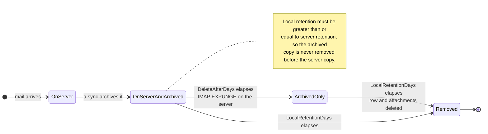

# 🗑️ Aufbewahrungsrichtlinien {#retention-policies}

[← Zurück zum Dokumentationsindex](index.md)

## Übersicht {#overview}

Mail Archiver bietet ein umfassendes Management von Aufbewahrungsrichtlinien, um Ihnen dabei zu helfen, die Speichernutzung zu kontrollieren und gleichzeitig Compliance-Anforderungen einzuhalten. Das System unterstützt zwei Arten von Aufbewahrungsrichtlinien:

1. **Server-Aufbewahrungsrichtlinie**: Steuert die automatische Löschung von E-Mails vom Mailserver
2. **Lokale Archiv-Aufbewahrungsrichtlinie**: Steuert die automatische Löschung von E-Mails aus dem lokalen Archiv

Dieser duale Ansatz gibt Ihnen eine feingliedrige Kontrolle über das Speichermanagement und stellt gleichzeitig sicher, dass die Datenkonsistenz und die Compliance-Anforderungen erfüllt werden.

## 🗂️ Wo eine Nachricht gespeichert ist {#where-a-message-lives}

Die beiden Richtlinien wirken auf zwei verschiedene Kopien derselben Nachricht, weshalb sie unabhängig voneinander konfiguriert werden:

Die Server-Aufbewahrung beschneidet das Postfach; die lokale Aufbewahrung beschneidet das Archiv. Das Löschen vom Server berührt die archivierte Kopie **nicht** — das ist der gesamte Zweck eines Archivs. Die Validierungsregel (lokale Aufbewahrung muss mindestens die Server-Aufbewahrung betragen) existiert, damit das Archiv immer länger lebt als das Postfach, aus dem es entnommen wurde.

## Hauptmerkmale {#key-features}

- **Automatische Bereinigung**: Automatische Löschung alter E-Mails während der Synchronisierung
- **Detaillierte Protokollierung**: Umfassender Audit-Trail aller Löschaktivitäten
- **Pro-Konto-Konfiguration**: Konfigurieren Sie Aufbewahrungsrichtlinien individuell für jedes E-Mail-Konto

## Server-Aufbewahrungsrichtlinie {#server-retention-policy}

### Zweck {#purpose}
Die Server-Aufbewahrungsrichtlinie löscht E-Mails automatisch nach einer festgelegten Anzahl von Tagen vom Mailserver.

### Konfiguration {#configuration}
- **Feld**: `Delete After Days`
- **Ort**: Email Accounts → Edit → Email Deletion section
- **Werte**: Anzahl der Tage (leer = deaktiviert)

### Funktionsweise {#how-it-works}
1. Während der Synchronisierung identifiziert das System E-Mals, die älter als der konfigurierte Aufbewahrungszeitraum sind
2. Identifizierte E-Mails werden für die Löschung auf dem Mailserver markiert
3. Die Löschung erfolgt mittels des IMAP EXPUNGE Befehls

### Anforderungen {#requirements}
> 🚨 **Wichtiger Hinweis für Aufbewahrungsrichtlinien**
> - Erfordert IMAP Expunge Support vom Mailserver, um E-Mails dauerhaft zu löschen
> - Bei Gmail-Konten muss Auto-Expunge in den Gmail-Einstellungen unter dem Tab "Weiterleitung und POP/IMAP" deaktiviert sein! (Siehe [Gmail Best Practices](GmailBestPractices.md) für weitere Details)

## Lokale Archiv-Aufbewahrungsrichtlinie {#local-archive-retention-policy}

### Zweck {#purpose}
Die lokale Archiv-Aufbewahrungsrichtlinie löscht E-Mails automatisch nach einer festgelegten Anzahl von Tagen aus dem lokalen Archiv.

### Konfiguration {#configuration}
- **Feld**: `Local Retention Days`
- **Ort**: Email Accounts → Edit → Email Deletion section
- **Werte**: Anzahl der Tage (leer = deaktiviert, muss ≥ Server-Aufbewahrung sein)

### Funktionsweise {#how-it-works}
1. Während der Synchronisierung identifiziert das System archivierte E-Mails, die älter als der konfigurierte Aufbewahrungszeitraum sind
2. Identifizierte E-Mails werden aus der lokalen Datenbank gelöscht
3. Zugehörige Anhänge werden ebenfalls entfernt
4. Ein zusammenfassender Log-Eintrag wird in den Access Logs erstellt

### Validierungsregeln {#validation-rules}
1. **Server-Aufbewahrung erforderlich**: Lokale Aufbewahrung kann nur konfiguriert werden, wenn auch eine Server-Aufbewahrung festgelegt ist
2. **Aufbewahrungshierarchie**: Die lokalen Aufbewahrungstage müssen größer als oder gleich den Server-Aufbewahrungstagen sein
3. **Sicherheit geht vor**: Dies verhindert, dass E-Mails aus dem lokalen Archiv gelöscht werden, bevor sie vom Mailserver gelöscht wurden

## Konfigurationsschritte {#configuration-steps}

### 1. E-Mail-Konto bearbeiten {#1-edit-email-account}

1. Navigieren Sie zu **Email Accounts** → **Edit Account**
2. Scrollen Sie zum Abschnitt **Email Deletion**
3. Legen Sie **Delete After Days** (Server-Aufbewahrung) fest
4. Legen Sie **Local Retention Days** (Lokale Archiv-Aufbewahrung) fest
5. Speichern Sie die Konfiguration

## Überwachung und Protokollierung {#monitoring-and-logging}

### Access Logs {#access-logs}

Alle Löschungen der Aufbewahrungsrichtlinie bezüglich des lokalen Archivs werden in den Access Logs mit detaillierten Informationen protokolliert:

## Best Practices {#best-practices}

### Compliance-Überlegungen {#compliance-considerations}

1. **Rechtliche Anforderungen**: 
   - Recherchieren Sie die Aufbewahrungsanforderungen für Ihre Branche
   - Dokumentieren Sie Aufbewahrungsrichtlinien
   - Regelmäßige Compliance-Audits

2. **Audit-Trails**: 
   - Pflegen Sie detaillierte Access Logs
   - Regelmäßige Log-Analyse
   - Exportieren Sie Protokolle für externe Audits

3. **Massenlöschung:** Filterbasierte Massenlöschung überspringt gesperrte E-Mails und meldet diese als übersprungen im Job-Status. Das Sperren einer Nachricht ist daher ein effektiver Schutz gegen versehentliche Massenlöschung.

4. **Dokumentation**: 
   - Pflegen Sie die Dokumentation der Aufbewahrungsrichtlinien
   - Regelmäßige Überprüfung der Richtlinien
   - Genehmigungen durch Stakeholder
