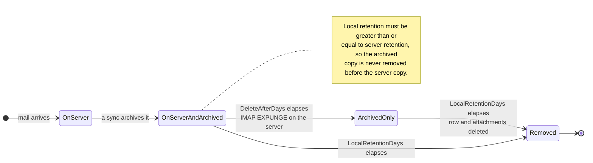

# 🗑️ Políticas de Retención {#retention-policies}

[← Volver al Índice de Documentación](index.md)

## Descripción general {#overview}

Mail Archiver proporciona una gestión integral de las políticas de Retención para ayudarle a controlar el uso del almacenamiento mientras mantiene los requisitos de cumplimiento. El sistema admite dos tipos de políticas de Retención:

1. **Política de Retención del Servidor**: Controla la eliminación automática de correos electrónicos del servidor de correo
2. **Política de Retención del Archivo Local**: Controla la eliminación automática de correos electrónicos del Archivo local

Este enfoque dual le brinda un control detallado sobre la gestión del almacenamiento, al tiempo que garantiza la consistencia de los datos y el cumplimiento de los requisitos de cumplimiento.

## 🗂️ Dónde reside un mensaje {#where-a-message-lives}

Las dos políticas actúan sobre dos copias diferentes del mismo mensaje, razón por la cual se configuran de forma independiente:

La Retención del servidor reduce el Buzón; la Retención local reduce el Archivo. Eliminar del servidor **no** afecta a la copia archivada; ese es precisamente el objetivo de un Archivo. La regla de validación (la Retención local debe ser al menos igual a la Retención del servidor) existe para que el Archivo siempre sobreviva al Buzón del que fue extraído.

## Características principales {#key-features}

- **Limpieza automática**: Eliminación automática de correos electrónicos antiguos durante los ciclos de Sincronización
- **Registro detallado**: Registro de auditoría exhaustivo de todas las actividades de eliminación
- **Configuración por Cuenta**: Configure las políticas de Retención individualmente para cada Cuenta de correo electrónico

## Política de Retención del Servidor {#server-retention-policy}

### Propósito {#purpose}
La política de Retención del servidor elimina automáticamente los correos electrónicos del servidor de correo después de un número específico de días.

### Configuración {#configuration}
- **Campo**: `Delete After Days`
- **Ubicación**: Email Accounts → Edit → sección Email Deletion
- **Valores**: Número de días (vacío = deshabilitado)

### Cómo funciona {#how-it-works}
1. Durante la Sincronización, el sistema identifica los correos electrónicos con una antigüedad superior al periodo de Retención configurado
2. Los correos electrónicos identificados se marcan para su eliminación en el servidor de correo
3. La eliminación se realiza utilizando el comando IMAP EXPUNGE

### Requisitos {#requirements}
> 🚨 **Nota importante para las políticas de Retención**
> - Requiere soporte IMAP Expunge del servidor de correo para eliminar permanentemente los correos electrónicos
> - Para las Cuentas de Gmail, ¡Auto-Expunge debe estar deshabilitado en la configuración de Gmail bajo la pestaña "Forwarding and POP/IMAP"! (Consulte [Gmail Best Practices](GmailBestPractices.md) para más detalles)

## Política de Retención del Archivo Local {#local-archive-retention-policy}

### Propósito {#purpose}
La política de Retención del Archivo local elimina automáticamente los correos electrónicos del Archivo local después de un número específico de días.

### Configuración {#configuration}
- **Campo**: `Local Retention Days`
- **Ubicación**: Email Accounts → Edit → sección Email Deletion
- **Valores**: Número de días (vacío = deshabilitado, debe ser ≥ Retención del servidor)

### Cómo funciona {#how-it-works}
1. Durante la Sincronización, el sistema identifica los correos electrónicos archivados con una antigüedad superior al periodo de Retención configurado
2. Los correos electrónicos identificados se eliminan de la base de datos local
3. Los Adjuntos asociados también se eliminan
4. Se crea una entrada de registro de resumen en Access Logs

### Reglas de validación {#validation-rules}
1. **Retención del servidor requerida**: La Retención local solo puede configurarse si también se establece la Retención del servidor
2. **Jerarquía de Retención**: Los días de Retención local deben ser mayores o iguales a los días de Retención del servidor
3. **La seguridad es lo primero**: Esto evita que los correos electrónicos se eliminen del Archivo local antes de que se eliminen del servidor de correo

## Pasos de configuración {#configuration-steps}

### 1. Editar Cuenta de correo electrónico {#1-edit-email-account}

1. Navegue a **Email Accounts** → **Edit Account**
2. Desplácese hasta la sección **Email Deletion**
3. Establezca **Delete After Days** (Retención del servidor)
4. Establezca **Local Retention Days** (Retención del Archivo local)
5. Guarde la configuración

## Monitoreo y Registro {#monitoring-and-logging}

### Access Logs {#access-logs}

Todas las eliminaciones de las políticas de Retención relacionadas con el Archivo local se registran en los Access Logs con información detallada:

## Mejores prácticas {#best-practices}

### Consideraciones de cumplimiento {#compliance-considerations}

1. **Requisitos legales**: 
   - Investigue los requisitos de Retención para su industria
   - Documente las políticas de Retención
   - Auditorías de cumplimiento periódicas

2. **Registros de auditoría**: 
   - Mantenga Access Logs detallados
   - Análisis de registros periódicos
   - Exporte los registros para auditorías externas

3. **Eliminación masiva:** La eliminación masiva basada en filtros omite los correos electrónicos bloqueados y los informa como omitidos en el estado del trabajo. Bloquear un mensaje es, por lo tanto, una protección efectiva contra la eliminación masiva accidental.

4. **Documentación**: 
   - Mantenga la documentación de las políticas de Retención
   - Revisiones periódicas de las políticas
   - Aprobaciones de las partes interesadas
