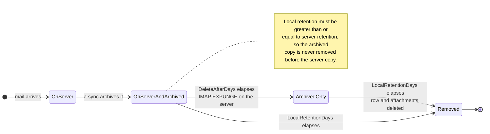

# 🗑️ Politiques de Conservation {#retention-policies}

[← Retour à l'index de la documentation](index.md)

## Aperçu {#overview}

Mail Archiver offre une gestion complète des politiques de Conservation pour vous aider à contrôler l'utilisation du stockage tout en respectant les exigences de conformité. Le système prend en charge deux types de politiques de Conservation :

1. **Politique de Conservation Serveur** : Contrôle la suppression automatique des e-mails du serveur de messagerie
2. **Politique de Conservation Archive Locale** : Contrôle la suppression automatique des e-mails de l'Archive locale

Cette double approche vous donne un contrôle précis sur la gestion du stockage tout en garantissant la cohérence des données et le respect des exigences de conformité.

## 🗂️ Où réside un message {#where-a-message-lives}

Les deux politiques agissent sur deux copies différentes du même message, c'est pourquoi elles sont configurées indépendamment :

La conservation serveur réduit la Boîte aux lettres ; la conservation locale réduit l'Archive. La suppression sur le serveur ne touche **pas** à la copie archivée — c'est tout l'intérêt d'une Archive. La règle de validation (la conservation locale doit être au moins égale à la conservation serveur) existe pour que l'Archive survive toujours à la Boîte aux lettres dont elle a été extraite.

## Caractéristiques clés {#key-features}

- **Nettoyage automatique** : Suppression automatique des anciens e-mails lors des cycles de Synchronisation
- **Journalisation détaillée** : Piste d'audit complète de toutes les activités de suppression
- **Configuration par Compte** : Configurez les politiques de Conservation individuellement pour chaque Compte de messagerie

## Politique de Conservation Serveur {#server-retention-policy}

### Objectif {#purpose}
La politique de Conservation serveur supprime automatiquement les e-mails du serveur de messagerie après un nombre de jours spécifié.

### Configuration {#configuration}
- **Champ** : `Delete After Days`
- **Emplacement** : Email Accounts → Edit → section Email Deletion
- **Valeurs** : Nombre de jours (vide = désactivé)

### Fonctionnement {#how-it-works}
1. Pendant la Synchronisation, le système identifie les e-mails plus anciens que la période de Conservation configurée
2. Les e-mails identifiés sont marqués pour suppression sur le serveur de messagerie
3. La suppression est effectuée à l'aide de la commande IMAP EXPUNGE

### Exigences {#requirements}
> 🚨 **Note importante pour les politiques de Conservation**
> - Nécessite la prise en charge d'IMAP Expunge par le serveur de messagerie pour supprimer définitivement les e-mails
> - Pour les comptes Gmail, l'Auto-Expunge doit être désactivé dans les paramètres Gmail sous l'onglet "Transfert et POP/IMAP" ! (Voir [Gmail Best Practices](GmailBestPractices.md) pour plus de détails)

## Politique de Conservation Archive Locale {#local-archive-retention-policy}

### Objectif {#purpose}
La politique de Conservation de l'Archive locale supprime automatiquement les e-mails de l'Archive locale après un nombre de jours spécifié.

### Configuration {#configuration}
- **Champ** : `Local Retention Days`
- **Emplacement** : Email Accounts → Edit → section Email Deletion
- **Valeurs** : Nombre de jours (vide = désactivé, doit être ≥ Conservation Serveur)

### Fonctionnement {#how-it-works}
1. Pendant la Synchronisation, le système identifie les e-mails archivés plus anciens que la période de Conservation configurée
2. Les e-mails identifiés sont supprimés de la base de données locale
3. Les Pièces jointes associées sont également supprimées
4. Une entrée de journal récapitulative est créée dans les Access Logs

### Règles de validation {#validation-rules}
1. **Conservation Serveur Requise** : La conservation locale ne peut être configurée que si la conservation serveur est également définie
2. **Hiérarchie de Conservation** : Les jours de conservation locale doivent être supérieurs ou égaux aux jours de conservation serveur
3. **La sécurité d'abord** : Cela empêche les e-mails d'être supprimés de l'Archive locale avant d'être supprimés du serveur de messagerie

## Étapes de configuration {#configuration-steps}

### 1. Modifier le Compte de messagerie {#1-edit-email-account}

1. Naviguez vers **Email Accounts** → **Edit Account**
2. Faites défiler jusqu'à la section **Email Deletion**
3. Définissez **Delete After Days** (conservation serveur)
4. Définissez **Local Retention Days** (conservation de l'Archive locale)
5. Enregistrez la configuration

## Surveillance et Journalisation {#monitoring-and-logging}

### Access Logs {#access-logs}

Toutes les suppressions de politiques de Conservation concernant l'Archive locale sont enregistrées dans les Access Logs avec des informations détaillées :

## Bonnes pratiques {#best-practices}

### Considérations de conformité {#compliance-considerations}

1. **Exigences légales** : 
   - Recherchez les exigences de Conservation pour votre secteur d'activité
   - Documentez les politiques de Conservation
   - Audits de conformité réguliers

2. **Pistes d'audit** : 
   - Maintenez des Access Logs détaillés
   - Analyse régulière des journaux
   - Exportez les journaux pour des audits externes

3. **Suppression en masse :** La suppression en masse basée sur des filtres ignore les e-mails verrouillés et les signale comme ignorés dans le statut du travail. Le verrouillage d'un message est donc une protection efficace contre une suppression massive accidentelle.

4. **Documentation** : 
   - Maintenez la documentation des politiques de Conservation
   - Revues régulières des politiques
   - Approbations des parties prenantes
</source>
