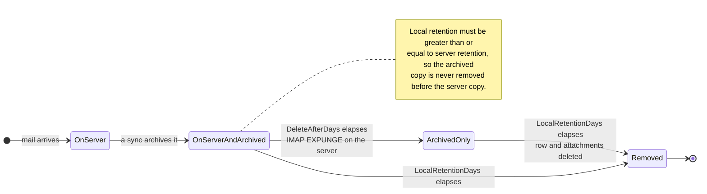

# 🗑️ Retention Policies {#retention-policies}

[← Vissza a Dokumentáció Indexhez](index.md)

## Overview {#overview}

A Mail Archiver átfogó megőrzési szabályzatkezelést (retention policy management) biztosít, amely segít a tárhelyhasználat szabályozásában, miközben fenntartja a megfelelési követelményeket (compliance requirements). A rendszer két típusú megőrzési szabályzatot támogat:

1. **Server Retention Policy**: Az e-mailek automatikus törlését szabályozza a mail szerverről
2. **Local Archive Retention Policy**: Az e-mailek automatikus törlését szabályozza a helyi archívumból

Ez a kettős megközelítés finomhangolt ellenőrzést biztosít a tárhelykezelés felett, miközben garantálja az adatok konzisztenciáját és a megfelelési követelmények teljesülését.

## 🗂️ Hol tárolódik az üzenet {#where-a-message-lives}

A két szabályzat ugyanazon az üzenetről két különböző másolaton действует, ezért őket egymástól függetlenül kell konfigurálni:

A szerver megőrzési szabályzat a postafalakot (mailbox) válogatja össze; a helyi megőrzési szabályzat az archívumot. A szerverről történő törlés **nem** érinti az archivált másolatot — ez az archívum lényeges célja. A validációs szabály (a helyi megőrzési időnek legalább akkora, mint a szerver megőrzési ideje) azért létezik, hogy az archívum mindig tovább él, mint a postafalak, amelyből származik.

## Key Features {#key-features}

- **Automatic Cleanup**: Az régi e-mailek automatikus törlése a szinkronizációs ciklusok során
- **Detailed Logging**: Minden törlési tevékenység részletes audit nyomvonala
- **Per-Account Configuration**: Megőrzési szabályzatok egyéni konfigurálása minden egyes e-mail fiókhoz

## Server Retention Policy {#server-retention-policy}

### Purpose {#purpose}
A szerver megőrzési szabályzat meghatározott napok után automatikusan törli az e-maileket a mail szerverről.

### Configuration {#configuration}
- **Field**: `Delete After Days`
- **Location**: Email Accounts → Edit → Email Deletion section
- **Values**: Napok száma (üres = letiltva)

### How It Works {#how-it-works}
1. A szinkronizálás során a rendszer azonosítja a konfigurált megőrzési időn felüli e-maileket
2. Azonosított e-maileket törlésre jelölik a mail szerveren
3. A törlés az IMAP EXPUNGE parancs használatával történik

### Requirements {#requirements}
> 🚨 **Fontos megjegyzés a megőrzési szabályzatokhoz**
> - A végleges törléshez IMAP Expunge támogatásra van szükség a mail szerverről
> - Gmail fiókok esetén az Auto-Expunge funkciót ki kell kapcsolni a Gmail beállításokban a "Forwarding and POP/IMAP" fül alatt! (További részletekért lásd a [Gmail Best Practices](GmailBestPractices.md) részt)

## Local Archive Retention Policy {#local-archive-retention-policy}

### Purpose {#purpose}
A helyi archívum megőrzési szabályzat meghatározott napok után automatikusan törli az e-maileket a helyi archívumból.

### Configuration {#configuration}
- **Field**: `Local Retention Days`
- **Location**: Email Accounts → Edit → Email Deletion section
- **Values**: Napok száma (üres = letiltva, kell hogy ≥ Server Retention legyen)

### How It Works {#how-it-works}
1. A szinkronizálás során a rendszer azonosítja a konfigurált megőrzési időn felüli archivált e-maileket
2. Azonosított e-maileket törli a helyi adatbázisból
3. A hozzájuk tartozó csatolmányokat is eltávolítja
4. Összesítő logbejegyzés készül az Access Logs fájlba

### Validation Rules {#validation-rules}
1. **Server Retention Required**: A helyi megőrzési idő csak akkor konfigurálható, ha a szerver megőrzési ideje is be van állítva
2. **Retention Hierarchy**: A helyi megőrzési napoknak nagyobbnak vagy egyenlőnek kell lenniük a szerver megőrzési napjainál
3. **Safety First**: Ez megakadályozza, hogy az e-mailek a helyi archívumból törlődjenek, mielőtt a mail szerverről törlődnének

## Configuration Steps {#configuration-steps}

### 1. Edit Email Account {#1-edit-email-account}

1. Navigáljon a **Email Accounts** → **Edit Account** menüpontba
2. Görgessen le a **Email Deletion** részhez
3. Állítsa be a **Delete After Days** (server retention) értéket
4. Állítsa be a **Local Retention Days** (local archive retention) értéket
5. Mentse el a konfigurációt

## Monitoring and Logging {#monitoring-and-logging}

### Access Logs {#access-logs}

A helyi archívumból kapcsolódó összes megőrzési szabályzat-alapú törlés részletes információkkal kerül rögzítésre az Access Logs fájlban:

## Best Practices {#best-practices}

### Compliance Considerations {#compliance-considerations}

1. **Legal Requirements**: 
   - Kutasson istražást a saját iparágára vonatkozó megőrzési követelményekről
   - Dokumentálja a megőrzési szabályzatokat
   - Rendszeres megfelelőségi auditok

2. **Audit Trails**: 
   - Vezessen részletes Access Logs naplót
   - Rendszeres loganalízis
   - Logok exportálása külső auditokhoz

3. **Bulk deletion:** A szűrőalapú tömeges törlés kihagyja a zárolt (locked) e-maileket, és "skipped" státuszszal jelzi őket a feladat állapotában. A üzenetek zárolása tehát hatékony védelem a véletlen tömeges törlés ellen.

4. **Documentation**: 
   - Vezessen megőrzési szabályzat dokumentációt
   - Rendszeres szabályzatfelülvizsgálatok
   - Stakeholder jóváhagyások
</source>
