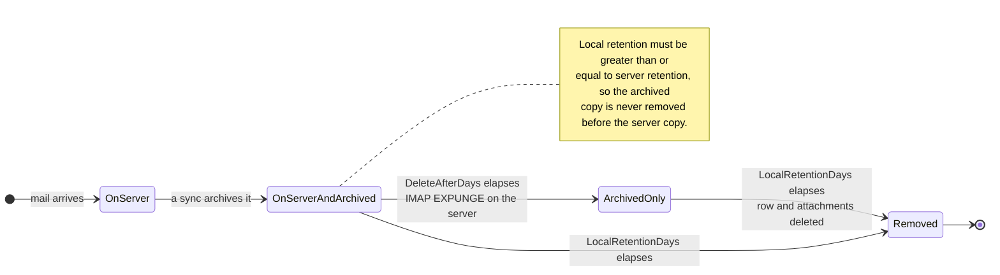

# 🗑️ Politiche di Conservazione {#retention-policies}

[← Torna all'Indice della Documentazione](index.md)

## Panoramica {#overview}

Mail Archiver fornisce una gestione completa delle politiche di Conservazione per aiutarti a controllare l'utilizzo dello storage pur mantenendo i requisiti di conformità. Il sistema supporta due tipi di politiche di Conservazione:

1. **Politica di Conservazione del Server**: Controlla l'eliminazione automatica delle email dal server di posta
2. **Politica di Conservazione dell'Archivio Locale**: Controlla l'eliminazione automatica delle email dall'Archivio locale

Questo doppio approccio ti offre un controllo granulare sulla gestione dello storage, garantendo al contempo la coerenza dei dati e il rispetto dei requisiti di conformità.

## 🗂️ Dove risiede un messaggio {#where-a-message-lives}

Le due politiche agiscono su due copie diverse dello stesso messaggio, motivo per cui sono configurate indipendentemente:

La Conservazione del server riduce la Casella di posta; la Conservazione locale riduce l'Archivio. L'eliminazione dal server **non** tocca la copia archiviata — questo è proprio lo scopo di un Archivio. La regola di validazione (la Conservazione locale deve essere almeno pari alla Conservazione del server) esiste affinché l'Archivio sopravviva sempre alla Casella di posta da cui è stato prelevato.

## Caratteristiche principali {#key-features}

- **Pulizia Automatica**: Eliminazione automatica delle vecchie email durante i cicli di Sincronizzazione
- **Logging Dettagliato**: Registro di controllo completo di tutte le attività di eliminazione
- **Configurazione per Account**: Configura le politiche di Conservazione individualmente per ogni Account email

## Politica di Conservazione del Server {#server-retention-policy}

### Scopo {#purpose}
La politica di Conservazione del server elimina automaticamente le email dal server di posta dopo un numero specificato di giorni.

### Configurazione {#configuration}
- **Campo**: `Delete After Days`
- **Posizione**: Email Accounts → Edit → sezione Email Deletion
- **Valori**: Numero di giorni (vuoto = disabilitato)

### Come funziona {#how-it-works}
1. Durante la Sincronizzazione, il sistema identifica le email più vecchie del periodo di Conservazione configurato
2. Le email identificate vengono contrassegnate per l'eliminazione sul server di posta
3. L'eliminazione viene eseguita utilizzando il comando IMAP EXPUNGE

### Requisiti {#requirements}
> 🚨 **Nota importante per le politiche di Conservazione**
> - Richiede il supporto IMAP Expunge dal server di posta per eliminare permanentemente le email
> - Per gli Account Gmail, l'Auto-Expunge deve essere disabilitato nelle impostazioni di Gmail sotto la scheda "Inoltro e POP/IMAP"! (Vedi [Gmail Best Practices](GmailBestPractices.md) per ulteriori dettagli)

## Politica di Conservazione dell'Archivio Locale {#local-archive-retention-policy}

### Scopo {#purpose}
La politica di Conservazione dell'Archivio locale elimina automaticamente le email dall'Archivio locale dopo un numero specificato di giorni.

### Configurazione {#configuration}
- **Campo**: `Local Retention Days`
- **Posizione**: Email Accounts → Edit → sezione Email Deletion
- **Valori**: Numero di giorni (vuoto = disabilitato, deve essere ≥ Conservazione del Server)

### Come funziona {#how-it-works}
1. Durante la Sincronizzazione, il sistema identifica le email archiviate più vecchie del periodo di Conservazione configurato
2. Le email identificate vengono eliminate dal database locale
3. Anche gli Allegati associati vengono rimossi
4. Viene creata una voce di log riassuntiva negli Access Logs

### Regole di validazione {#validation-rules}
1. **Conservazione del Server Richiesta**: La Conservazione locale può essere configurata solo se è impostata anche la Conservazione del server
2. **Gerarchia di Conservazione**: I giorni di Conservazione locale devono essere maggiori o uguali ai giorni di Conservazione del server
3. **La sicurezza prima di tutto**: Questo evita che le email vengano eliminate dall'Archivio locale prima di essere eliminate dal server di posta

## Passaggi di configurazione {#configuration-steps}

### 1. Modifica dell'Account Email {#1-edit-email-account}

1. Naviga su **Email Accounts** → **Edit Account**
2. Scorri fino alla sezione **Email Deletion**
3. Imposta **Delete After Days** (conservazione del server)
4. Imposta **Local Retention Days** (conservazione dell'archivio locale)
5. Salva la configurazione

## Monitoraggio e Logging {#monitoring-and-logging}

### Access Logs {#access-logs}

Tutte le eliminazioni delle politiche di Conservazione relative all'Archivio locale sono registrate negli Access Logs con informazioni dettagliate:

## Best Practices {#best-practices}

### Considerazioni sulla conformità {#compliance-considerations}

1. **Requisiti Legali**: 
   - Ricerca i requisiti di Conservazione per il tuo settore
   - Documenta le politiche di Conservazione
   - Audit di conformità regolari

2. **Audit Trail**: 
   - Mantieni Access Logs dettagliati
   - Analisi regolare dei log
   - Esporta i log per audit esterni

3. **Eliminazione massiva:** L'eliminazione massiva basata su filtri salta le email bloccate e le segnala come saltate nello stato del job. Il blocco di un messaggio è quindi una protezione efficace contro l'eliminazione di massa accidentale.

4. **Documentazione**: 
   - Mantieni la documentazione delle politiche di Conservazione
   - Revisioni regolari delle politiche
   - Approvazioni degli stakeholder
