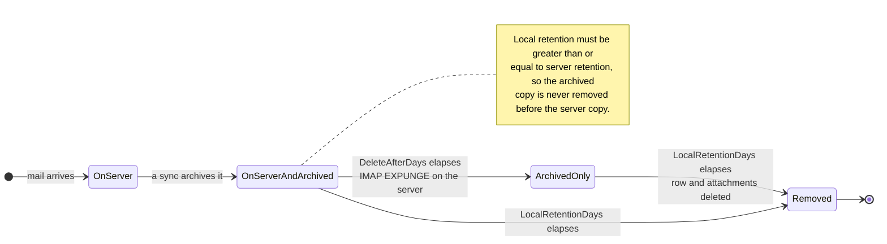

# 🗑️ 保存ポリシー {#retention-policies}

[← Documentation Index に戻る](index.md)

## 概要 {#overview}

Mail Archiver は、コンプライアンス要件を維持しながらストレージ使用量を制御するための、包括的な保存ポリシー管理機能を提供します。システムは以下の2種類の保存ポリシーをサポートしています：

1. **Server Retention Policy**: メールサーバーからのメールの自動削除を制御します
2. **Local Archive Retention Policy**: ローカルアーカイブからのメールの自動削除を制御します

この二段構えのアプローチにより、データの整合性とコンプライアンス要件を確保しつつ、ストレージ管理に対するきめ細かな制御が可能になります。

## 🗂️ メッセージの保存場所 {#where-a-message-lives}

これら2つのポリシーは、同じメッセージの2つの異なるコピーに対して作用するため、それぞれ独立して設定されます：

サーバーの保存ポリシーはメールボックスを整理し、ローカルの保存ポリシーはアーカイブを整理します。サーバーから削除しても、アーカイブされたコピーには**影響しません**。それがアーカイブの存在意義です。バリデーションルール（ローカルの保存期間はサーバーの保存期間以上であること）が存在するのは、アーカイブが常にその取得元となったメールボックスよりも長く存続するようにするためです。

## 主な機能 {#key-features}

- **自動クリーンアップ**: 同期サイクル中に古いメールを自動的に削除
- **詳細なロギング**: すべての削除アクティビティに関する包括的な監査証跡
- **アカウントごとの設定**: 各メールアカウントに対して個別に保存ポリシーを設定可能

## Server Retention Policy {#server-retention-policy}

### 目的 {#purpose}
Server retention policy は、指定された日数経過後にメールサーバーからメールを自動的に削除します。

### 設定 {#configuration}
- **Field**: `Delete After Days`
- **Location**: Email Accounts → Edit → Email Deletion section
- **Values**: 日数（空欄 = 無効）

### 仕組み {#how-it-works}
1. 同期中に、システムが設定された保存期間より古いメールを特定します
2. 特定されたメールは、メールサーバー上で削除対象としてマークされます
3. 削除は IMAP EXPUNGE コマンドを使用して実行されます

### 要件 {#requirements}
> 🚨 **保存ポリシーに関する重要な注意**
> - メールを完全に削除するには、メールサーバーが IMAP Expunge をサポートしている必要があります
> - Gmail アカウントの場合、Gmail 設定の「メールの転送と POP/IMAP」タブで Auto-Expunge を無効にする必要があります！（詳細は [Gmail Best Practices](GmailBestPractices.md) を参照してください）

## Local Archive Retention Policy {#local-archive-retention-policy}

### 目的 {#purpose}
Local archive retention policy は、指定された日数経過後にローカルアーカイブからメールを自動的に削除します。

### 設定 {#configuration}
- **Field**: `Local Retention Days`
- **Location**: Email Accounts → Edit → Email Deletion section
- **Values**: 日数（空欄 = 無効、Server Retention 以上である必要があります）

### 仕組み {#how-it-works}
1. 同期中に、システムが設定された保存期間より古いアーカイブ済みメールを特定します
2. 特定されたメールはローカルデータベースから削除されます
3. 関連する添付ファイルも削除されます
4. Access Logs にサマリーログエントリが作成されます

### バリデーションルール {#validation-rules}
1. **Server Retention Required**: サーバーの保存期間が設定されている場合にのみ、ローカルの保存期間を設定できます
2. **Retention Hierarchy**: ローカルの保存日数は、サーバーの保存日数以上である必要があります
3. **Safety First**: これにより、メールがメールサーバーから削除される前にローカルアーカイブから削除されるのを防ぎます

## 設定手順 {#configuration-steps}

### 1. Email Account の編集 {#1-edit-email-account}

1. **Email Accounts** → **Edit Account** に移動します
2. **Email Deletion** セクションまでスクロールします
3. **Delete After Days** (server retention) を設定します
4. **Local Retention Days** (local archive retention) を設定します
5. 設定を保存します

## モニタリングとロギング {#monitoring-and-logging}

### Access Logs {#access-logs}

ローカルアーカイブに関するすべての保存ポリシーによる削除は、詳細な情報とともに Access Logs に記録されます：

## ベストプラクティス {#best-practices}

### コンプライアンスに関する考慮事項 {#compliance-considerations}

1. **法的要件**: 
   - 業界の保存要件を調査する
   - 保存ポリシーを文書化する
   - 定期的なコンプライアンス監査を実施する

2. **監査証跡**: 
   - 詳細な Access Logs を維持する
   - 定期的なログ分析を行う
   - 外部監査のためにログをエクスポートする

3. **一括削除**: フィルターベースの一括削除では、ロックされたメールはスキップされ、ジョブステータスにスキップされたものとして報告されます。したがって、メッセージをロックすることは、誤った大量削除に対する効果的な保護手段となります。

4. **ドキュメンテーション**: 
   - 保存ポリシーのドキュメントを維持する
   - 定期的なポリシーレビューを行う
   - ステークホルダーの承認を得る
</source>
