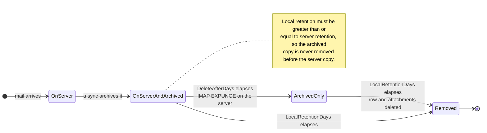

# 🗑️ Bewaringsbeleid {#retention-policies}

[← Terug naar Documentatie Index](index.md)

## Overzicht {#overview}

Mail Archiver biedt uitgebreid beheer van bewaaringsbeleid om u te helpen het opslaggebruik te controleren terwijl u aan de nalevingseisen voldoet. Het systeem ondersteunt twee soorten bewaaringsbeleid:

1. **Server Bewaringsbeleid**: Regelt de automatische verwijdering van e-mails van de mailserver
2. **Lokaal Archief Bewaringsbeleid**: Regelt de automatische verwijdering van e-mails uit het lokale Archief

Deze dubbele aanpak geeft u nauwkeurige controle over het opslagbeheer, terwijl u ervoor zorgt dat de gegevensconsistentie en de nalevingseisen worden gewaarborgd.

## 🗂️ Waar een bericht zich bevindt {#where-a-message-lives}

De twee beleidstypen werken op twee verschillende kopieën van hetzelfde bericht, wat de reden is dat ze onafhankelijk van elkaar worden geconfigureerd:

Serverbewaring trimt de Postbus; lokale bewaring trimt het Archief. Het verwijderen vanaf de server raakt de gearchiveerde kopie **niet** — dat is precies het doel van een Archief. De validatieregel (lokale bewaring moet minstens gelijk zijn aan de serverbewaring) bestaat zodat het Archief altijd langer meegaat dan de Postbus waaruit het is genomen.

## Belangrijkste kenmerken {#key-features}

- **Automatische opschoning**: Automatische verwijdering van oude e-mails tijdens synchronisatiecycli
- **Gedetailleerde logging**: Uitgebreid auditlogboek van alle verwijderingsactiviteiten
- **Per-Account configuratie**: Configureer bewaaringsbeleid individueel voor elk e-mailaccount

## Server Bewaringsbeleid {#server-retention-policy}

### Doel {#purpose}
Het serverbewaringsbeleid verwijdert automatisch e-mails van de mailserver na een opgegeven aantal dagen.

### Configuratie {#configuration}
- **Veld**: `Delete After Days`
- **Locatie**: Email Accounts → Edit → Email Deletion section
- **Waarden**: Aantal dagen (leeg = uitgeschakeld)

### Hoe het werkt {#how-it-works}
1. Tijdens de synchronisatie identificeert het systeem e-mails die ouder zijn dan de geconfigureerde bewaartermijn
2. Geïdentificeerde e-mails worden gemarkeerd voor verwijdering op de mailserver
3. Verwijdering wordt uitgevoerd met het IMAP EXPUNGE commando

### Vereisten {#requirements}
> 🚨 **Belangrijke opmerking voor bewaaringsbeleid**
> - Vereist IMAP Expunge ondersteuning van de mailserver om e-mails permanent te verwijderen
> - Voor Gmail-accounts moet Auto-Expunge zijn uitgeschakeld in de Gmail-instellingen onder het tabblad "Doorsturen en POP/IMAP"! (Zie [Gmail Best Practices](GmailBestPractices.md) voor meer details)

## Lokaal Archief Bewaringsbeleid {#local-archive-retention-policy}

### Doel {#purpose}
Het lokale archief bewaaringsbeleid verwijdert automatisch e-mails uit het lokale Archief na een opgegeven aantal dagen.

### Configuratie {#configuration}
- **Veld**: `Local Retention Days`
- **Locatie**: Email Accounts → Edit → Email Deletion section
- **Waarden**: Aantal dagen (leeg = uitgeschakeld, moet ≥ Server Bewaring zijn)

### Hoe het werkt {#how-it-works}
1. Tijdens de synchronisatie identificeert het systeem gearchiveerde e-mails die ouder zijn dan de geconfigureerde bewaartermijn
2. Geïdentificeerde e-mails worden verwijderd uit de lokale database
3. Bijbehorende Bijlagen worden ook verwijderd
4. Er wordt een samenvattende log-vermelding gemaakt in de Access Logs

### Validatieregels {#validation-rules}
1. **Server Bewaring vereist**: Lokale bewaring kan alleen worden geconfigureerd als er ook een serverbewaring is ingesteld
2. **Bewaringshiërarchie**: De lokale bewaring in dagen moet groter zijn dan of gelijk zijn aan de serverbewaring in dagen
3. **Veiligheid eerst**: Dit voorkomt dat e-mails uit het lokale Archief worden verwijderd voordat ze van de mailserver zijn verwijderd

## Configuratiestappen {#configuration-steps}

### 1. Bewerk e-mailaccount {#1-edit-email-account}

1. Navigeer naar **Email Accounts** → **Edit Account**
2. Scroll naar de sectie **Email Deletion**
3. Stel **Delete After Days** in (serverbewaring)
4. Stel **Local Retention Days** in (lokaal archief bewaaringsbeleid)
5. Sla de configuratie op

## Monitoring en Logging {#monitoring-and-logging}

### Access Logs {#access-logs}

Alle verwijderingen via het bewaaringsbeleid met betrekking tot het lokale Archief worden gelogd in de Access Logs met gedetailleerde informatie:

## Best Practices {#best-practices}

### Overwegingen voor naleving {#compliance-considerations}

1. **Wettelijke vereisten**: 
   - Onderzoek de bewaaringsvereisten voor uw sector
   - Documenteer bewaaringsbeleid
   - Regelmatige compliance audits

2. **Audit Trails**: 
   - Houd gedetailleerde Access Logs bij
   - Regelmatige loganalyse
   - Exporteer logs voor externe audits

3. **Bulkverwijdering:** Filtergebaseerde bulkverwijdering slaat vergrendelde e-mails over en rapporteert deze als overgeslagen in de jobstatus. Het vergrendelen van een bericht is daarom een effectieve bescherming tegen accidentele massaverwijdering.

4. **Documentatie**: 
   - Houd documentatie van het bewaaringsbeleid bij
   - Regelmatige evaluatie van het beleid
   - Goedkeuring door belanghebbenden
</source>
