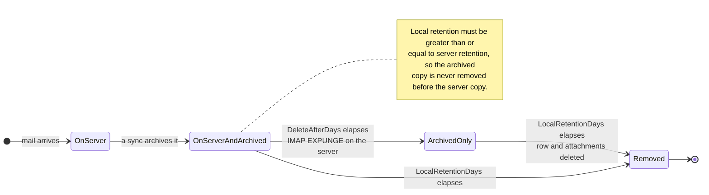

# 🗑️ Polityki Przechowywania {#retention-policies}

[← Back to Documentation Index](index.md)

## Przegląd {#overview}

Mail Archiver zapewnia kompleksowe zarządzanie politykami przechowywania, aby pomóc w kontrolowaniu wykorzystania pamięci przy jednoczesnym zachowaniu wymogów zgodności. System obsługuje dwa typy polityk przechowywania:

1. **Server Retention Policy**: Kontroluje automatyczne usuwanie wiadomości e-mail z serwera pocztowego
2. **Local Archive Retention Policy**: Kontroluje automatyczne usuwanie wiadomości e-mail z lokalnego Archiwum

To podwójne podejście zapewnia precyzyjną kontrolę nad zarządzaniem pamięcią, zapewniając jednocześnie spójność danych i spełnienie wymogów zgodności.

## 🗂️ Gdzie znajduje się wiadomość {#where-a-message-lives}

Dwie polityki działają na dwóch różnych kopiach tej samej wiadomości, dlatego są one konfigurowane niezależnie:

Przechowywanie na serwerze ogranicza Skrzynkę pocztową; lokalne przechowywanie ogranicza Archiwum. Usuwanie z serwera **nie** dotyczy skopiowanej wersji w Archiwum — to jest główny cel istnienia Archiwum. Reguła walidacji (lokalne przechowywanie musi być co najmniej równe przechowywaniu na serwerze) istnieje po to, aby Archiwum zawsze przetrwało dłużej niż Skrzynka pocztowa, z której zostało pobrane.

## Kluczowe funkcje {#key-features}

- **Automatyczne czyszczenie**: Automatyczne usuwanie starych wiadomości e-mail podczas cykli synchronizacji
- **Szczegółowe logowanie**: Kompleksowy ślad audytowy wszystkich działań związanych z usuwaniem
- **Konfiguracja na poziomie Konta**: Konfiguruj polityki przechowywania indywidualnie dla każdego Konta e-mail

## Server Retention Policy {#server-retention-policy}

### Cel {#purpose}
Polityka przechowywania na serwerze automatycznie usuwa wiadomości e-mail z serwera pocztowego po określonej liczbie dni.

### Konfiguracja {#configuration}
- **Pole**: `Delete After Days`
- **Lokalizacja**: Email Accounts → Edit → Email Deletion section
- **Wartości**: Liczba dni (puste = wyłączone)

### Jak to działa {#how-it-works}
1. Podczas synchronizacji system identyfikuje wiadomości e-mail starsze niż skonfigurowany okres przechowywania
2. Zidentyfikowane wiadomości e-mail są oznaczone do usunięcia na serwerze pocztowym
3. Usuwanie jest wykonywane przy użyciu polecenia IMAP EXPUNGE

### Wymagania {#requirements}
> 🚨 **Ważna uwaga dotycząca polityk przechowywania**
> - Wymaga wsparcia IMAP Expunge ze strony serwera pocztowego, aby trwale usunąć wiadomości e-mail
> - Dla Kont Gmail, funkcja Auto-Expunge musi być wyłączona w ustawieniach Gmail w zakładce "Forwarding and POP/IMAP"! (Więcej szczegółów w [Gmail Best Practices](GmailBestPractices.md))

## Local Archive Retention Policy {#local-archive-retention-policy}

### Cel {#purpose}
Lokalna polityka przechowywania automatycznie usuwa wiadomości e-mail z lokalnego Archiwum po określonej liczbie dni.

### Konfiguracja {#configuration}
- **Pole**: `Local Retention Days`
- **Lokalizacja**: Email Accounts → Edit → Email Deletion section
- **Wartości**: Liczba dni (puste = wyłączone, musi być ≥ Server Retention)

### Jak to działa {#how-it-works}
1. Podczas synchronizacji system identyfikuje zarchiwizowane wiadomości e-mail starsze niż skonfigurowany okres przechowywania
2. Zidentyfikowane wiadomości e-mail są usuwane z lokalnej bazy danych
3. Powiązane Załączniki są również usuwane
4. W Access Logs tworzony jest wpis podsumowujący

### Reguły walidacji {#validation-rules}
1. **Wymagane przechowywanie na serwerze**: Lokalne przechowywanie można skonfigurować tylko wtedy, gdy ustawione jest również przechowywanie na serwerze
2. **Hierarchia przechowywania**: Liczba dni lokalnego przechowywania musi być większa lub równa liczbie dni przechowywania na serwerze
3. **Bezpieczeństwo przede wszystkim**: Zapobiega to usuwaniu wiadomości e-mail z lokalnego Archiwum przed ich usunięciem z serwera pocztowego

## Kroki konfiguracji {#configuration-steps}

### 1. Edytuj Konto e-mail {#1-edit-email-account}

1. Przejdź do **Email Accounts** → **Edit Account**
2. Przewiń do sekcji **Email Deletion**
3. Ustaw **Delete After Days** (przechowywanie na serwerze)
4. Ustaw **Local Retention Days** (lokalne przechowywanie w Archiwum)
5. Zapisz konfigurację

## Monitorowanie i logowanie {#monitoring-and-logging}

### Access Logs {#access-logs}

Wszystkie usunięcia wynikające z polityk przechowywania dotyczące lokalnego Archiwum są rejestrowane w Access Logs z dokładnymi informacjami:

## Najlepsze praktyki {#best-practices}

### Rozważania dotyczące zgodności {#compliance-considerations}

1. **Wymagania prawne**: 
   - Zbadaj wymagania dotyczące przechowywania danych w Twojej branży
   - Udokumentuj polityki przechowywania
   - Regularne audyty zgodności

2. **Ślady audytowe**: 
   - Prowadź szczegółowe Access Logs
   - Regularna analiza logów
   - Eksportuj logi do zewnętrznych audytów

3. **Masowe usuwanie:** Masowe usuwanie oparte na filtrach pomija zablokowane wiadomości i zgłasza je jako pominięte w statusie zadania. Blokowanie wiadomości jest zatem skuteczną ochroną przed przypadkowym masowym usunięciem.

4. **Dokumentacja**: 
   - Prowadź dokumentację polityk przechowywania
   - Regularne przeglądy polityk
   - Zatwierdzenia przez interesariuszy
</source>
