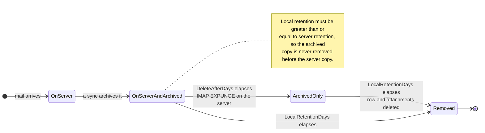

# 🗑️ Políticas de Retenção {#retention-policies}

[← Voltar para o Índice da Documentação](index.md)

## Visão Geral {#overview}

O Mail Archiver oferece gerenciamento abrangente de políticas de Retenção para ajudar você a controlar o uso do armazenamento, mantendo os requisitos de conformidade. O sistema suporta dois tipos de políticas de Retenção:

1. **Política de Retenção do Servidor**: Controla a exclusão automática de e-mails do servidor de e-mail
2. **Política de Retenção do Arquivo Local**: Controla a exclusão automática de e-mails do Arquivo local

Esta abordagem dupla oferece controle detalhado sobre o gerenciamento de armazenamento, garantindo ao mesmo tempo a consistência dos dados e o cumprimento dos requisitos de conformidade.

## 🗂️ Onde uma Mensagem Reside {#where-a-message-lives}

As duas políticas atuam em duas cópias diferentes da mesma mensagem, e é por isso que elas são configuradas de forma independente:

A Retenção do servidor limpa a Caixa de correio; a Retenção local limpa o Arquivo. Excluir do servidor **não** toca na cópia arquivada — esse é o objetivo principal de um Arquivo. A regra de validação (a Retenção local deve ser pelo menos igual à Retenção do servidor) existe para que o Arquivo sempre sobreviva à Caixa de correio da qual foi extraído.

## Principais Recursos {#key-features}

- **Limpeza Automática**: Exclusão automática de e-mails antigos durante os ciclos de Sincronização
- **Registro Detalhado**: Trilha de auditoria abrangente de todas as atividades de exclusão
- **Configuração por Conta**: Configure políticas de Retenção individualmente para cada Conta de e-mail

## Política de Retenção do Servidor {#server-retention-policy}

### Propósito {#purpose}
A política de Retenção do servidor exclui automaticamente e-mails do servidor de e-mail após um número especificado de dias.

### Configuração {#configuration}
- **Campo**: `Delete After Days`
- **Localização**: Email Accounts → Edit → seção Email Deletion
- **Valores**: Número de dias (vazio = desativado)

### Como Funciona {#how-it-works}
1. Durante a Sincronização, o sistema identifica e-mails mais antigos que o período de Retenção configurado
2. Os e-mails identificados são marcados para exclusão no servidor de e-mail
3. A exclusão é realizada usando o comando IMAP EXPUNGE

### Requisitos {#requirements}
> 🚨 **Nota importante para políticas de Retenção**
> - Requer suporte a IMAP Expunge do servidor de e-mail para excluir e-mails permanentemente
> - Para Contas do Gmail, o Auto-Expunge deve estar desativado nas configurações do Gmail na aba "Encaminhamento e POP/IMAP"! (Consulte [Gmail Best Practices](GmailBestPractices.md) para mais detalhes)

## Política de Retenção do Arquivo Local {#local-archive-retention-policy}

### Propósito {#purpose}
A política de Retenção do arquivo local exclui automaticamente e-mails do Arquivo local após um número especificado de dias.

### Configuração {#configuration}
- **Campo**: `Local Retention Days`
- **Localização**: Email Accounts → Edit → seção Email Deletion
- **Valores**: Número de dias (vazio = desativado, deve ser ≥ Retenção do Servidor)

### Como Funciona {#how-it-works}
1. Durante a Sincronização, o sistema identifica e-mails arquivados mais antigos que o período de Retenção configurado
2. Os e-mails identificados são excluídos do banco de dados local
3. Os Anexos associados também são removidos
4. Uma entrada de log de resumo é criada nos Access Logs

### Regras de Validação {#validation-rules}
1. **Retenção do Servidor Obrigatória**: A Retenção local só pode ser configurada se a Retenção do servidor também estiver definida
2. **Hierarquia de Retenção**: Os dias de Retenção local devem ser maiores ou iguais aos dias de Retenção do servidor
3. **Segurança em Primeiro Lugar**: Isso evita que e-mails sejam excluídos do Arquivo local antes de serem excluídos do servidor de e-mail

## Etapas de Configuração {#configuration-steps}

### 1. Editar Conta de E-mail {#1-edit-email-account}

1. Navegue até **Email Accounts** → **Edit Account**
2. Role até a seção **Email Deletion**
3. Defina **Delete After Days** (retenção do servidor)
4. Defina **Local Retention Days** (retenção do arquivo local)
5. Salve a configuração

## Monitoramento e Registro {#monitoring-and-logging}

### Access Logs {#access-logs}

Todas as exclusões de políticas de Retenção relativas ao Arquivo local são registradas nos Access Logs com informações detalhadas:

## Melhores Práticas {#best-practices}

### Considerações de Conformidade {#compliance-considerations}

1. **Requisitos Legais**: 
   - Pesquise os requisitos de Retenção para o seu setor
   - Documente as políticas de Retenção
   - Auditorias de conformidade regulares

2. **Trilhas de Auditoria**: 
   - Mantenha Access Logs detalhados
   - Análise regular de logs
   - Exporte logs para auditorias externas

3. **Exclusão em Massa:** A exclusão em massa baseada em filtros pula e-mails bloqueados e os reporta como pulados no status do trabalho. Bloquear uma mensagem é, portanto, uma proteção eficaz contra exclusão em massa acidental.

4. **Documentação**: 
   - Mantenha a documentação da política de Retenção
   - Revisões regulares de políticas
   - Aprovações de partes interessadas
</source>
