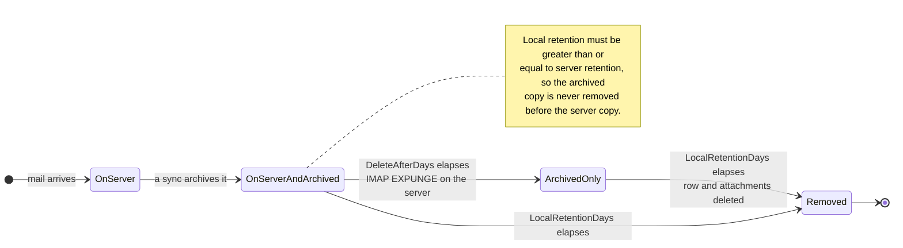

# 🗑️ Политики хранения {#retention-policies}

[← Назад к индексу документации](index.md)

## Обзор {#overview}

Mail Archiver предоставляет комплексное управление политиками хранения, чтобы помочь вам контролировать использование хранилища при соблюдении требований комплаенса. Система поддерживает два типа политик хранения:

1. **Server Retention Policy**: Управляет автоматическим удалением писем с почтового сервера
2. **Local Archive Retention Policy**: Управляет автоматическим удалением писем из локального архива

Этот двойной подход обеспечивает детальный контроль над управлением хранилищем, гарантируя при этом согласованность данных и соблюдение требований комплаенса.

## 🗂️ Где хранится сообщение {#where-a-message-lives}

Две политики действуют на две разные копии одного и того же сообщения, поэтому они настраиваются независимо:

Серверная политика сокращает почтовый ящик; локальная политика сокращает архив. Удаление с сервера **не** затрагивает архивную копию — в этом и заключается смысл архива. Правило валидации (локальное хранение должно быть не менее серверного) существует для того, чтобы архив всегда жил дольше, чем почтовый ящик, из которого он был взят.

## Ключевые особенности {#key-features}

- **Автоматическая очистка**: Автоматическое удаление старых писем во время циклов синхронизации
- **Детальное логирование**: Исчерпывающий аудиторский след всех операций удаления
- **Настройка для каждого аккаунта**: Индивидуальная настройка политик хранения для каждой учетной записи электронной почты

## Server Retention Policy {#server-retention-policy}

### Назначение {#purpose}
Политика серверного хранения автоматически удаляет письма с почтового сервера по истечении указанного количества дней.

### Конфигурация {#configuration}
- **Поле**: `Delete After Days`
- **Расположение**: Email Accounts → Edit → Email Deletion section
- **Значения**: Количество дней (пусто = отключено)

### Как это работает {#how-it-works}
1. Во время синхронизации система находит письма, срок хранения которых превышает установленный период
2. Найденные письма помечаются для удаления на почтовом сервере
3. Удаление выполняется с помощью команды IMAP EXPUNGE

### Требования {#requirements}
> 🚨 **Важное примечание для политик хранения**
> - Требуется поддержка IMAP Expunge со стороны почтового сервера для безвозвратного удаления писем
> - Для аккаунтов Gmail функция Auto-Expunge должна быть отключена в настройках Gmail на вкладке "Forwarding and POP/IMAP"! (Для получения более подробной информации см. [Gmail Best Practices](GmailBestPractices.md))

## Local Archive Retention Policy {#local-archive-retention-policy}

### Назначение {#purpose}
Политика локального хранения архива автоматически удаляет письма из локального архива по истечении указанного количества дней.

### Конфигурация {#configuration}
- **Поле**: `Local Retention Days`
- **Расположение**: Email Accounts → Edit → Email Deletion section
- **Значения**: Количество дней (пусто = отключено, должно быть ≥ Server Retention)

### Как это работает {#how-it-works}
1. Во время синхронизации система находит архивные письма, срок хранения которых превышает установленный период
2. Найденные письма удаляются из локальной базы данных
3. Связанные вложения также удаляются
4. В Access Logs создается запись в журнале сводки

### Правила валидации {#validation-rules}
1. **Требуется серверное хранение**: Локальное хранение может быть настроено только в том случае, если также установлено серверное хранение
2. **Иерархия хранения**: Количество дней локального хранения должно быть больше или равно количеству дней серверного хранения
3. **Безопасность прежде всего**: Это предотвращает удаление писем из локального архива до того, как они будут удалены с почтового сервера

## Шаги конфигурации {#configuration-steps}

### 1. Редактирование учетной записи электронной почты {#1-edit-email-account}

1. Перейдите в **Email Accounts** → **Edit Account**
2. Прокрутите до раздела **Email Deletion**
3. Установите **Delete After Days** (серверное хранение)
4. Установите **Local Retention Days** (локальное хранение архива)
5. Сохраните конфигурацию

## Мониторинг и логирование {#monitoring-and-logging}

### Access Logs {#access-logs}

Все удаления по политике хранения, касающиеся локального архива, фиксируются в Access Logs с подробной информацией:

## Лучшие практики {#best-practices}

### Вопросы комплаенса {#compliance-considerations}

1. **Юридические требования**: 
   - Изучите требования к хранению данных в вашей отрасли
   - Документируйте политики хранения
   - Регулярно проводите аудит на соответствие требованиям

2. **Аудиторский след**: 
   - Ведите подробные Access Logs
   - Регулярно анализируйте логи
   - Экспортируйте логи для внешних аудитов

3. **Массовое удаление:** Массовое удаление на основе фильтров пропускает заблокированные письма и сообщает о них как о пропущенных в статусе задания. Таким образом, блокировка сообщения является эффективной защитой от случайного массового удаления.

4. **Документация**: 
   - Поддерживайте документацию по политикам хранения в актуальном состоянии
   - Регулярно пересматривайте политики
   - Получайте одобрение заинтересованных сторон
