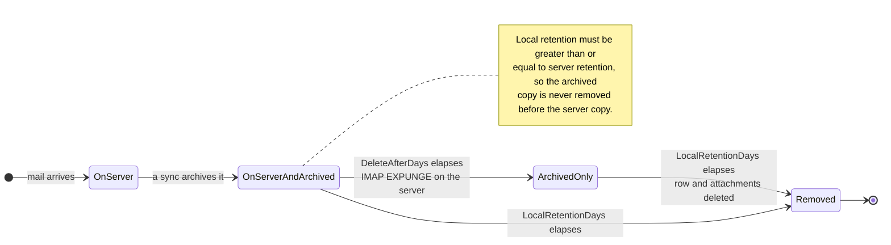

# 🗑️ Politike obdržavanja podatkov {#retention-policies}

[← Nazaj na indeks dokumentacije](index.md)

## Pregled {#overview}

Mail Archiver zagotavlja celovito upravljanje s politikami obdržavanja podatkov, da vam pomaga nadzorovati porabo prostora, hkrati pa upošteva zahteve glede skladnosti. Sistem podpira dve tipi politik obdržavanja:

1. **Serverna politika obdrževanja (Server Retention Policy)**: Nadzoruje samodejno brisanje e-pošte z e-poštnem strežniku
2. **Lokalna politika obdrževanja arhive (Local Archive Retention Policy)**: Nadzoruje samodejno brisanje e-pošte iz lokalne arhive

Ta dvojni pristop vam omogoča natančen nadzor nad upravljanjem prostora, hkrati pa zagotavlja doslednost podatkov in izpolnjevanje zahtev skladnosti.

## 🗂️ Kje se sporočilo nahaja {#where-a-message-lives}

Obி polasti delujata na dve različni kopiji istega sporočila, zato sta konfigurirani neodvisno:

Serverna politika obdrževanja zmanjšuje poštni predal; lokalna politika obdrževanja zmanjšuje arhivo. Brisanje s strežnika **ne vpliva** na arhivirano kopijo — to je celotna poanta arhive. Pravilo validacije (lokalno obdrževanje mora biti vsaj toliko kot serverno obdrževanje) obstaja zato, da arhiva vedno traja dlje kot poštni predal, iz katerega je bila pridobljena.

## Ključne funkcije {#key-features}

- **Samodejno čiščenje**: Samodejno brisanje starih e-poštnih sporočil med ciklami sinhronizacije
- **Podrobno beleženje**: Celovita revizijska sled vseh aktivnosti brisanja
- **Konfiguracija po računih**: Posledično konfigurirajte politike obdrževanja posamezno za vsak e-poštni račun

## Serverna politika obdrževanja {#server-retention-policy}

### Namen {#purpose}
Serverna politika obdrževanja samodejno briše e-poštna sporočila z e-poštnega strežnika po določenem številu dni.

### Konfiguracija {#configuration}
- **Polje**: `Delete After Days`
- **Lokacija**: Email Accounts → Edit → Email Deletion oddelek
- **Vrednosti**: Številka dni (prazno = onemogočeno)

### Kako deluje {#how-it-works}
1. Med sinhronizacijo sistem identificira e-poštna sporočila, ki so starejšja od konfiguriranega obdobja obdrževanja
2. Identificirana sporočila so označena za brisanje na e-poštnem strežniku
3. Brisanje se izvede z uporabo ukazov IMAP EXPUNGE

### Zahteve {#requirements}
> 🚨 **Pomembno opozorilo za politike obdrževanja**
> - Za permanentno brisanje e-poštnih sporočil zahteva podporo za IMAP Expunge na e-poštnem strežniku
> - Za račune Gmail mora biti v nastavitvah Gmaila pod zavihkom "Forwarding and POP/IMAP" onemogočeno Auto-Expunge! (Za več podrobnosti poglejte [Gmail Best Practices](GmailBestPractices.md))

## Lokalna politika obdrževanja arhive {#local-archive-retention-policy}

### Namen {#purpose}
Lokalna politika obdrževanja arhive samodejno briše e-poštna sporočila iz lokalne arhive po določenem številu dni.

### Konfiguracija {#configuration}
- **Polje**: `Local Retention Days`
- **Lokacija**: Email Accounts → Edit → Email Deletion oddelek
- **Vrednosti**: Številka dni (prazno = onemogočeno, mora biti ≥ Server Retention)

### Kako deluje {#how-it-works}
1. Med sinhronizacijo sistem identificira arhivirana e-poštna sporočila, ki so starejša od konfiguriranega obdobja obdrževanja
2. Identificirana sporočila so izbrisana iz lokalne baze podatkov
3. Povzete priloge so prav tako odstranjene
4. V Access Logs se ustvari povzetek v dnevnişki

### Pravila validacije {#validation-rules}
1. **Obvezno serverno obdrževanje**: Lokalno obdrževanje lahko konfigurirate le, če je tudi serverno obdrževanje nastavljeno
2. **Hierarhija obdrževanja**: Dni lokalnega obdrževanja morajo biti večji ali enaki dnevom servernega obdrževanja
3. **Prvo varnost**: To preprečuje brisanje e-poštnih sporočil iz lokalne arhive, preden so izbrisana z e-poštnega strežnika

## Koraki konfiguracije {#configuration-steps}

### 1. Uredite e-poštni račun {#1-edit-email-account}

1. Pojdite na **Email Accounts** → **Edit Account**
2. Obrazite do oddelka **Email Deletion**
3. Nastavite **Delete After Days** (server retention)
4. Nastavite **Local Retention Days** (local archive retention)
5. Shranite konfiguracijo

## Spremljanje in beleženje {#monitoring-and-logging}

### Access Logs {#access-logs}

Vsi izbrisi politike obdrževanja glede lokalne arhive so zabeleženi v Access Logs z podrobnimi informacijami:

## Best Practices {#best-practices}

### Upoštevanje skladnosti {#compliance-considerations}

1. **Pravne zahteve**: 
   - Raziskajte zahteve glede obdrževanja podatkov za vašo panogo
   - Dokumentirajte politike obdrževanja
   - Redni revizijski pregledi skladnosti

2. **Revizijske sledi**: 
   - Vodenje podrobnih Access Logs
   - Redna analiza dnevnikov
   - Izvoz dnevnikov za zunanje revizije

3. **族ezedeno brisanje:** Bulk deletion na podlagi filtrojev preskoči zaklenjena sporočila in jih prijavi kot preskočena v statusu opravil (job status). Zaklepanje sporočila je zato učinkovita zaščita pred nenamerno masovno brisanjem.

4. **Dokumentacija**: 
   - Vodenje dokumentacije o politikah obdrževanja
   - Redni pregledi politik
   - Potrditve zainteresvanih strank
</
