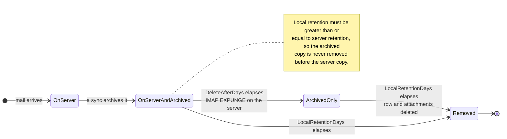

# 🗑️ 留存策略 {#retention-policies}

[← 返回文档索引](index.md)

## 概述 {#overview}

Mail Archiver 提供全面的留存策略管理，帮助您在控制存储使用量的同时满足合规性要求。系统支持两种类型的留存策略：

1. **服务器留存策略 (Server Retention Policy)**：控制从邮件服务器自动删除电子邮件
2. **本地存档留存策略 (Local Archive Retention Policy)**：控制从本地存档自动删除电子邮件

这种双重方法为您提供了精细的存储管理控制，同时确保满足数据一致性和合规性要求。

## 🗂️ 消息的存储位置 {#where-a-message-lives}

这两种策略作用于同一条消息的两个不同副本，这也是它们需要独立配置的原因：

服务器留存会修剪邮箱；本地留存会修剪存档。从服务器删除**不会**影响存档副本 —— 这正是存档存在的意义。验证规则（本地留存必须至少等于服务器留存）的存在是为了确保存档的寿命始终长于其来源邮箱。

## 核心功能 {#key-features}

- **自动清理**：在同步周期内自动删除旧邮件
- **详细日志**：所有删除活动的全面审计追踪
- **逐账户配置**：为每个电子邮件账户单独配置留存策略

## 服务器留存策略 {#server-retention-policy}

### 目的 {#purpose}
服务器留存策略会在指定天数后自动从邮件服务器删除电子邮件。

### 配置 {#configuration}
- **字段**：`Delete After Days`
- **位置**：Email Accounts → Edit → Email Deletion 部分
- **值**：天数（为空 = 禁用）

### 工作原理 {#how-it-works}
1. 在同步期间，系统会识别出早于配置的留存期的电子邮件
2. 被识别的电子邮件会被标记为在邮件服务器上待删除
3. 使用 IMAP EXPUNGE 命令执行删除操作

### 要求 {#requirements}
> 🚨 **留存策略的重要提示**
> - 需要邮件服务器支持 IMAP Expunge 才能永久删除电子邮件
> - 对于 Gmail 账户，必须在 Gmail 设置的“转发和 POP/IMAP”选项卡下禁用 Auto-Expunge！（详情请参阅 [Gmail 最佳实践](GmailBestPractices.md)）

## 本地存档留存策略 {#local-archive-retention-policy}

### 目的 {#purpose}
本地存档留存策略会在指定天数后自动从本地存档删除电子邮件。

### 配置 {#configuration}
- **字段**：`Local Retention Days`
- **位置**：Email Accounts → Edit → Email Deletion 部分
- **值**：天数（为空 = 禁用，必须 ≥ 服务器留存）

### 工作原理 {#how-it-works}
1. 在同步期间，系统会识别出早于配置的留存期的已存档电子邮件
2. 被识别的电子邮件会从本地数据库中删除
3. 关联的附件也会被移除
4. 在 Access Logs 中生成一条摘要日志条目

### 验证规则 {#validation-rules}
1. **必须设置服务器留存**：只有在设置了服务器留存的情况下，才能配置本地留存
2. **留存层级**：本地留存天数必须大于或等于服务器留存天数
3. **安全第一**：这可以防止电子邮件在从邮件服务器删除之前就从本地存档中被删除

## 配置步骤 {#configuration-steps}

### 1. 编辑电子邮件账户 {#1-edit-email-account}

1. 导航至 **Email Accounts** → **Edit Account**
2. 滚动至 **Email Deletion** 部分
3. 设置 **Delete After Days** (服务器留存)
4. 设置 **Local Retention Days** (本地存档留存)
5. 保存配置

## 监控与日志 {#monitoring-and-logging}

### Access Logs {#access-logs}

所有涉及本地存档的留存策略删除操作都会记录在 Access Logs 中，并包含详细信息：

## 最佳实践 {#best-practices}

### 合规性考虑 {#compliance-considerations}

1. **法律要求**：
   - 研究您所在行业的留存要求
   - 记录留存策略
   - 定期进行合规审计

2. **审计追踪**：
   - 维护详细的 Access Logs
   - 定期进行日志分析
   - 导出日志以供外部审计

3. **批量删除**：基于过滤器的批量删除会跳过被锁定的邮件，并在任务状态中将其报告为已跳过。因此，锁定消息是防止意外大规模删除的有效保护措施。

4. **文档**：
   - 维护留存策略文档
   - 定期进行策略审查
   - 获取利益相关者批准
