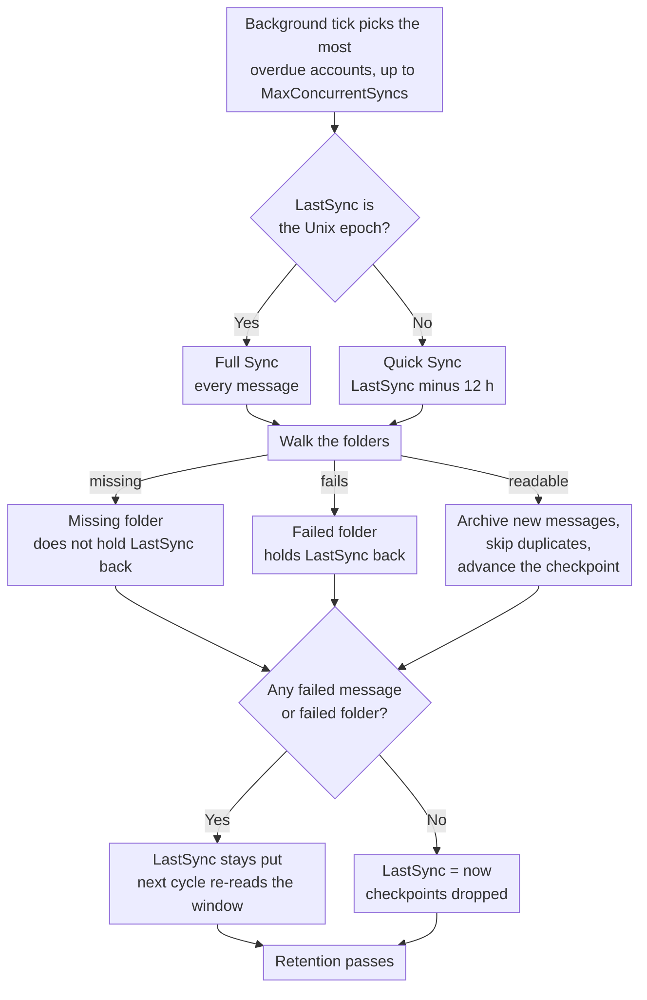

# 🔄 Mail Synchronisierung (Quick vs. Full Sync) {#mail-synchronization-quick-vs-full-sync}

[← Zurück zum Dokumentationsindex](index.md)

## 📋 Übersicht {#overview}

Mail Archiver synchronisiert jedes aktivierte Postfach automatisch im Hintergrund über den `MailSyncBackgroundService`. Der Dienst führt eine kurze Polling-Schleife (alle 60 s) aus, ermittelt, welche Konten an der Reihe sind, und führt die Synchronisierung durch – bis zu `MailSync:MaxConcurrentSyncs` Konten parallel innerhalb eines Zyklus – bevor jedes Konto entsprechend seinem eigenen Synchronisierungsintervall neu geplant wird. Intervalle können global über `appsettings.json` konfiguriert und pro Konto von der Erstellen/Bearbeiten-Seite aus überschrieben werden.

Es gibt zwei verschiedene Synchronisierungsmodi:

| Modus | Ausgelöst durch | Umfang |
|------|--------------|-------|
| **Quick Sync** (inkrementell) | Jeder Synchronisierungszyklus (pro Konto Intervall) | Nur neue/geänderte Nachrichten seit der letzten erfolgreichen Synchronisierung |
| **Full Sync** (Resync) | Neues Konto, manueller Button, `AlwaysForceFullSync` oder pro Konto / globales Full Sync Intervall | Jede Nachricht in jedem nicht ausgeschlossenen Ordner |

Beide Modi können sicher wiederholt werden – Mail Archiver erkennt Duplikate (durch `MessageId` oder durch From/To/Subject/SentDate, wenn der `MessageId` fehlt) und überspringt Nachrichten, die bereits archiviert sind.

---

## 🔁 Der Synchronisierungszyklus auf einen Blick {#the-sync-cycle-at-a-glance}



Die letzte Entscheidung ist die entscheidende. `LastSync` schreitet nur voran, wenn der Durchlauf
ohne fehlgeschlagene Nachrichten **und** ohne fehlgeschlagene Ordner
beendet wurde. Das ist der Grund, warum ein Postfach mit einem einzigen nicht lesbaren Ordner
immer wieder dasselbe Zeitfenster liest, anstatt einfach weiterzugehen — und warum ein Durchlauf, der vorzeitig endet (Timeout, Abbruch, Rate Limit), ein erneutes Lesen verursacht, anstatt E-Mails zu verlieren.

---

## ⚡ Quick Sync (Inkrementelle Synchronisierung) {#quick-sync-incremental-sync}

Quick Sync ist der normale Betriebsmodus, der automatisch in dem konfigurierten Intervall ausgeführt wird. Der globale Standardwert beträgt `MailSync:IntervalMinutes` Minuten (Standard 15); jedes Konto kann dies mit seinem eigenen `SyncIntervalMinutes`-Wert überschreiben, der auf der Erstellen/Bearbeiten-Seite festgelegt wird (leer lassen, um den globalen Standard zu verwenden).

### Funktionsweise {#how-it-works}

1. Für jedes aktivierte Konto (ausgenommen `IMPORT`-Provider-Konten) liest der Dienst den `LastSync`-Zeitstempel des Kontos.
2. Ein Datumsfilter wird aus `LastSync` erstellt:
   - **IMAP**: `SearchQuery.DeliveredAfter(LastSync − 12 hours)`
   - **M365 (Graph)**: `receivedDateTime ge (LastSync − 12 hours)`
3. Die 12-stündige Überschneidung ist beabsichtigt. Sie erfasst Nachrichten, die vom Provider nach dem Start der vorherigen Synchronisierung zugestellt wurden, aber einen etwas älteren Server-Zeitstempel haben, und sie toleriert geringfügige Zeitabweichungen zwischen dem Mailserver und dem Mail Archiver Host. Duplikate werden durch die Duplikatsprüfung herausgefiltert, sodass die Überschneidung niemals doppelte Einträge erzeugt.
4. Für jeden nicht ausgeschlossenen Ordner wird die gefilterte Nachrichtenliste in Batches abgerufen und archiviert. Vorhandene Nachrichten werden übersprungen.
5. Bei **erfolgreichem Abschluss** (keine fehlgeschlagenen Nachrichten, keine Ordner, die als Ganzes fehlgeschlagen sind, kein Rate-Limit erreicht) wird `LastSync` auf `DateTime.UtcNow` gesetzt und der nächste Zyklus startet ab diesem Punkt.
6. Wenn **eine Nachricht nicht verarbeitet werden konnte** oder **ein Ordner überhaupt nicht synchronisiert werden konnte** (siehe [Ordner, die als Ganzes fehlschlagen](#-folders-that-fail-as-a-whole)), wird `LastSync` **nicht** aktualisiert, sodass der nächste Zyklus denselben Zeitraum erneut versucht.
7. Wenn das Konto **rate-limited** ist (siehe [Rate Limit Handling](RateLimitHandling.md)), bleibt auch `LastSync` unverändert, und die Synchronisierung setzt nach dem Zurücksetzen des täglichen Kontingents an einem pro Ordner festgelegten Checkpoint fort.

### Wann es auftritt {#when-you-see-it}

- Automatisch alle paar Minuten für alle aktivierten Konten.
- Nachdem die initiale Synchronisierung eines neuen Kontos abgeschlossen wurde (der erste Zyklus ist eine Full Sync, siehe unten).
- Keine Benutzeraktion erforderlich.

## 🗄️ Full Sync (Resync) {#full-sync-resync}

Ein Full Sync ignoriert den Datumsfilter und lädt **jede** Nachricht aus jedem nicht ausgeschlossenen Ordner vom Server herunter, unabhängig vom Alter.

### Was einen Full Sync auslöst {#what-triggers-a-full-sync}

Ein Full Sync wird ausgelöst, sobald das `LastSync` eines Kontos auf den Unix-Epoch (`1970-01-01T00:00:00Z`) gesetzt wird. Dies geschieht in vier Situationen:

1. **Neues Konto** – Jedes neu erstellte IMAP- oder M365-Konto beginnt mit `LastSync = 1970-01-01`. Der erste geplante Synchronisierungszyklus für dieses Konto ist daher automatisch ein Full Sync, der den initialen Archiv-Import durchführt.
2. **Manueller Button "Full Resync"** – Auf der Seite *Account Details* setzt der Button **Full Resync** (`MailAccounts/Resync`) `LastSync` auf den Epoch zurück und startet die Synchronisierung sofort im Vordergrund der Anfrage.
3. **`MailSync:AlwaysForceFullSync = true`** – Wenn dieses Konfigurationsflag aktiviert ist, setzt der Hintergrunddienst `LastSync` zu **Beginn jedes Synchronisierungszyklus für jedes aktivierte Konto** auf den Epoch zurück. Dies macht effektiv jeden Zyklus zu einem Full Sync. Dies ist nur zur Fehlerbehebung gedacht und sollte nach der Behebung des Problems wieder deaktiviert werden, da es die Last auf den Mailserver und die Mail Archiver-Instanz drastisch erhöht.
4. **Pro-Konto oder globales Full Sync Intervall** – Wenn für ein Konto `FullSyncIntervalHours` gesetzt ist (Seite Erstellen/Bearbeiten) oder der globale Standard `MailSync:FullSyncIntervalHours` in `appsettings.json` konfiguriert ist, löst der Hintergrunddienst automatisch einen Full Sync aus, sobald dieses Intervall seit dem letzten Full Sync des Kontos (`LastFullSync`) abgelaufen ist. Der Wert pro Konto hat Vorrang; wenn keiner gesetzt ist, läuft kein automatischer Full Sync und es bleiben nur der manuelle Resync-Button (und `AlwaysForceFullSync` oben) bestehen. Nachdem der Full Sync abgeschlossen ist, wird `LastFullSync` auf `DateTime.UtcNow` aktualisiert, sodass der nächste Full Sync ab diesem Zeitpunkt geplant wird.

### Verhalten während eines Full Sync {#behavior-during-a-full-sync}

- Es wird kein `DeliveredAfter` / `receivedDateTime ge …` Filter angewendet. Der Server wird aufgefordert, alle Nachrichten im Ordner zurückzugeben.
- Wenn der Server weniger Ergebnisse zurückgibt, als der Ordner tatsächlich enthält (einige IMAP-Server begrenzen `SEARCH` Ergebnisse), erkennt Mail Archiver die Diskrepanz und greift auf das Abrufen aller `UniqueId`s per Sequenznummer zurück, damit keine Nachrichten stillschweigend verloren gehen.
- Nachrichten, die bereits im Archiv vorhanden sind, werden als Duplikate erkannt und übersprungen – die vorhandene archivierte Kopie wird **nicht** überschrieben. Wenn ein Duplikat in einem anderen Ordnernamen als zuvor gefunden wird, wird das gespeicherte `FolderName` Feld aktualisiert, um den aktuellen Standort widerzuspiegeln.
- Bei sehr großen Postfächern kann der Full Sync mehrere Stunden oder sogar Tage dauern. Wenn das Bandbreiten-Tracking aktiviert ist, pausiert die Synchronisierung höflich beim täglichen Kontingent und setzt die Synchronisierung am nächsten Tag von den pro Ordner gespeicherten Checkpoints aus fort (siehe [Rate Limit Handling](RateLimitHandling.md)).
- `LastSync` wird erst auf `DateTime.UtcNow` aktualisiert, nachdem ein Full Sync ohne fehlgeschlagene Nachrichten und ohne fehlgeschlagene Ordner abgeschlossen wurde, genau wie ein Quick Sync.

### Wann ein manueller Full Sync zu verwenden ist {#when-to-use-a-manual-full-sync}

Verwenden Sie den Button **Full Resync**, wenn:

- Sie die Liste der **ausgeschlossenen Ordner** des Kontos geändert haben und bestätigen möchten, dass das Archiv der aktuellen Auswahl entspricht.
- Sie vermuten, dass im Archiv Nachrichten fehlen (z. B. nach einer Servermigration, einem Anbieterausfall oder einem Zeitabweichungs-Vorfall).
- Sie das Postfach auf ein anderes Backend migriert haben und die Vollständigkeit verifizieren möchten.
- Sie Nachrichten neu erkennen möchten, die zwischen Ordnern auf dem Server verschoben wurden.
- Ordner, die zuvor für Mail Archiver unsichtbar waren, wieder sichtbar wurden — z. B. Outlook.com-Ordner, die durch Drittanbieter-Clients erstellt wurden und aus der IMAP-Ordnerliste herausgefiltert wurden, bis sie über die Web-UI umbenannt wurden (siehe [Personal Microsoft Account Setup → Troubleshooting](MSA_Outlook_Setup.md#-troubleshooting)). Ein Full Sync ist erforderlich, da ein Quick Sync die älteren Mails in diesen Ordnern nicht nachpflegen würde.

Verwenden Sie Full Sync **nicht**:

- Als regulären Betrieb – es belastet den Anbieter und Ihre Mail Archiver-Instanz unnötig.
- Um Nachrichteninhalte oder Metadaten zu "aktualisieren" – Duplikate werden übersprungen, daher werden vorhandene archivierte Kopien durch einen Full Sync nicht aktualisiert. Um eine archivierte Nachricht zu ersetzen, müssen Sie diese zuerst aus dem Archiv löschen und dann eine (Quick oder Full) Synchronisierung durchführen.
- Dauerhaft über `AlwaysForceFullSync=true` – lassen Sie dies in der Produktion deaktiviert. Es ist ein Diagnose-Schalter, kein Betriebsmodus.

## 🆚 Quick Sync vs. Full Sync im Überblick {#quick-sync-vs-full-sync-at-a-glance}

| Aspekt | Quick Sync | Full Sync |
|--------|-----------|-----------|
| Datumsfilter | `LastSync − 12 h` bis jetzt | Keine (alle Nachrichten) |
| Typisches Volumen | Wenige neue Nachrichten | Gesamtes Postfach |
| Dauer | Sekunden bis Minuten | Minuten bis Tage (abhängig von der Postfachgröße und den Limits des Anbieters) |
| Bandbreitenbelastung | Niedrig | Hoch |
| `LastSync` bei Erfolg aktualisiert | Ja | Ja |
| `LastSync` bei Fehler / Rate-Limit aktualisiert | Nein (Wiederholung im nächsten Zyklus) | Nein (Fortsetzung ab Checkpoint) |
| Umgang mit Duplikaten | Bereits archivierte Nachrichten überspringen | Bereits archivierte Nachrichten überspringen |
| Ausgelöst durch | Scheduler (pro Konto Intervall) | Neues Konto, manueller Button, `AlwaysForceFullSync` oder Full Sync Intervall |
| Empfohlen für | Täglicher Betrieb | Initialer Import und gelegentliche Überprüfung |

## ⚙️ Konfiguration {#configuration}

Das Synchronisierungsverhalten wird durch den Abschnitt `MailSync` von `appsettings.json` (oder die Umgebungsvariablen `MailSync__*` in Docker) gesteuert. Eine vollständige Parameterliste finden Sie in [Setup.md](Setup.md).

| Einstellung | Standard | Beschreibung |
|---------|---------|-------------|
| `MailSync:IntervalMinutes` | `15` | Globaler Standard für das Synchronisierungsintervall pro Konto, in Minuten. Jedes Konto kann dies auf der Erstellen/Bearbeiten-Seite überschreiben (leer lassen, um diesen Standard zu verwenden). |
| `MailSync:FullSyncIntervalHours` | _nicht gesetzt_ | Optionaler globaler Standard für automatische vollständige Resynchronisierungen, in Stunden. Wenn nicht gesetzt (Standard), wird keine automatische vollständige Synchronisierung ausgeführt, es sei denn, ein `FullSyncIntervalHours`-Wert pro Konto ist gesetzt. Werte pro Konto überschreiben dies. |
| `MailSync:TimeoutMinutes` | `0` (keine) | Synchronisierungs-Timeout pro Konto. Eine Synchronisierung, die länger läuft, stoppt an der nächsten Nachrichten-Grenze und wird beim nächsten Durchlauf fortgesetzt. `0` (der Standard oder jeder nicht-positive Wert) bedeutet kein Timeout. Siehe [Vorzeitiges Stoppen einer Synchronisierung](#-stopping-a-sync-early). |
| `MailSync:ConnectionTimeoutSeconds` | `300` | IMAP-Verbindungs-Timeout. |
| `MailSync:CommandTimeoutSeconds` | `600` | IMAP-Befehls-Timeout. |
| `MailSync:AlwaysForceFullSync` | `false` | Wenn `true`, ist jeder Zyklus eine vollständige Synchronisierung für alle Konten. **Nur zur Diagnose – im Produktivbetrieb deaktiviert lassen.** |
| `MailSync:IgnoreSelfSignedCert` | `false` | Akzeptiert selbstsignierte TLS-Zertifikate (unvertrauenswürdiges Root-Zertifikat, unvollständige Kette) und Hostnamen-Fehlpaarungen für IMAP-Verbindungen — z. B. Proton Bridge, deren Zertifikat auf `127.0.0.1` ausgestellt ist. Andere Kettenprobleme wie abgelaufene Zertifikate werden weiterhin abgelehnt. |
| `MailSync:MaxConcurrentSyncs` | `1` | Wie viele Kontosynchronisierungen gleichzeitig laufen dürfen. Slots werden aufgefüllt, sobald sie frei werden, siehe [Wie Konten geplant werden](#-how-accounts-are-scheduled). `1` hält Synchronisierungen sequenziell; erhöhen Sie diesen Wert für parallele Ausführung — beachten Sie die Ratenbegrenzungen der Anbieter und die lokale Ressourcennutzung. |
| `MailSync:InterAccountDelaySeconds` | `0` | Optionale Verzögerung in Sekunden, die am Ende jeder Konto-Synchronisierungsaufgabe angewendet wird. Nützlich, um Burst-Starts zu vermeiden, wenn `MaxConcurrentSyncs > 1`. `0` deaktiviert dies. |
| `MailSync:MaxIssuesPerKind` | `20` | Wie viele Probleme jeder Art ein Synchronisierungsauftrag für die Kontoseite speichert — fehlgeschlagene Ordner, fehlende Ordner und fehlgeschlagene Nachrichten werden separat budgetiert. Alles darüber hinaus wird gezählt, aber nicht gespeichert. `0` schaltet die Details aus und lässt nur die Zähler übrig. |
| `MailSync:GlobalExcludedFolders` | _leer_ | Ordner, die für jedes Konto von der Synchronisierung ausgeschlossen sind, additiv zur eigenen Liste des jeweiligen Kontos. Siehe [Ausgeschlossene Ordner](#-excluded-folders) unten. |
| `MailSync:ExcludeSubfolders` | `false` | Ob ein Ausschlusseintrag auch die Ordner unterhalb des benannten Ordners in beiden Listen abdeckt. Siehe [Ausgeschlossene Ordner](#-excluded-folders) unten. |

> 💡 Sowohl das normale Synchronisierungsintervall als auch das vollständige Synchronisierungsintervall können pro Konto auf der Seite **E-Mail-Konto erstellen/bearbeiten** überschrieben werden. Lassen Sie die Felder pro Konto leer, um auf die oben genannten globalen Standardwerte zurückzugreifen. Um ein Konto vollständig aus dem Scheduler zu entfernen, deaktivieren Sie es (schalten Sie *Aktiviert* auf der Kontodetails-Seite aus).

## 🚫 Ausgeschlossene Ordner {#excluded-folders}

Ordner können an zwei Stellen von der Synchronisierung ausgeschlossen werden, und diese beiden sind **additiv**: Ein Ordner wird übersprungen, wenn er mit **entweder** einer Liste übereinstimmt. Keine der Listen kann wieder einbeziehen, was die andere ausgeschlossen hat, sodass das Hinzufügen eines Eintrags an einer beliebigen Stelle Ordner nur jemals aus der Synchronisierung entfernen kann.

| Quelle | Umfang | Wo |
|--------|-------|-------|
| Konto-Ausschlussliste | Ein Konto | *Create/Edit Mail Account* Seite |
| `MailSync:GlobalExcludedFolders` | Jedes Konto der Installation | `appsettings.json` oder `MailSync__GlobalExcludedFolders__<n>` |

Die globale Liste ist **standardmäßig leer**, sodass sich eine Installation, die sie nie konfiguriert, genau wie zuvor verhält. Sie existiert für den Fall, dass viele Postfächer vom selben Server importiert werden und die Alternative darin bestünde, auf jedem einzelnen Konto eine identische Ausschlussliste zu pflegen.

Beide Listen verwenden dieselben Abgleichregeln, sodass sie nicht voneinander abweichen können:

1. Exakter Abgleich mit dem vollständigen Pfad des Ordners (`INBOX/Drafts`);
2. Exakter Abgleich mit dem eigenen Namen des Ordners (`Drafts`), was einen Eintrag erfasst, der als Kurzname eingegeben wurde, wenn der Server einen präfixierten Pfad meldet;
3. Pfad-Suffix-Abgleich, der Variationen des Trennzeichens erfasst — `Drafts` stimmt auch mit `INBOX.Drafts` und `INBOX/Drafts` überein — sowie serverseitig präfixierte Namen wie `[Provider]/Drafts`;
4. Alles unterhalb des Ordners, den ein Eintrag benennt, sodass `Archive` auch `Archive/Team` und `INBOX.Archive.Team` abdeckt, wann immer `MailSync:ExcludeSubfolders` aktiviert ist (es ist standardmäßig deaktiviert, was dem Verhalten entspricht, bevor die Option existierte). Setzen Sie es auf `true`, um einen Postfach-Baum auszuschließen, indem Sie dessen Wurzel benennen, anstatt jeden Ordner darin; mit der Standardeinstellung stimmt ein Eintrag nur mit dem einen Ordner überein, den er benennt.

Alle Vergleiche sind nicht fallsensitiv. Die Regel für das Suffix des vollständigen Pfads verankert am Pfadtrennzeichen, sodass `Archive` einen Ordner namens `ArchiveWeek` nicht mit einschließt. Der Namensvergleich ist nicht auf die gleiche Weise verankert: Ein Kurzname stimmt auch mit jedem Ordner überein, dessen eigener Name **mit ihm endet**, sodass `Archive` einen Ordner namens `OldArchive` mit einschließt. Um genau einen Ordner unter ähnlich benannten Ordnern auszuschließen, geben Sie dessen vollständigen Pfad ein.

Regel 4 verankert am Trennzeichen so wie Regel 3, sodass sie ganze Ordner erfasst und niemals einen Teil eines Namens: `Archive` deckt `Archive/Team` ab, während ein Mail-Ordner namens `Team Archive Review` in der Synchronisierung bleibt. Vorfahren werden nur nach dem Pfad verglichen, sodass der nicht verankerte Namensvergleich nicht an die Kindelemente eines Ordners weitergegeben wird. Ein `.` zählt überall als Trennzeichen, wo es erscheint, was bedeutet, dass auf einem Server, der mit `/` trennt, ein auf oberster Ebene buchstäblich als `Archive.ics` benannter Ordner so gelesen wird, als läge er unter `Archive`.

**Standardmäßig wird niemals ein Ordnername ausgeschlossen.** Welche Namen es wert sind, aufgelistet zu werden, hängt ganz vom Server und seiner Sprache ab — ein Postfach-Baum, der auch Kalender-, Kontakt-, Aufgaben- und Notizordner enthält, ist ein häufiger Grund für die Verwendung dieser Funktion, aber Mail Archiver setzt dies nicht voraus. Siehe [Setup.md](Setup.md) für ein Konfigurationsbeispiel.

Das Ändern einer der Listen entfernt nichts, was bereits im Archiv gesichert wurde. Führen Sie danach eine [Full Sync](#-full-sync-resync) aus, wenn Sie bestätigen möchten, dass das Archiv der aktuellen Auswahl entspricht.

Der Ausschluss gilt überall dort, wo die Ordnerliste durchlaufen wird, nicht nur für die Archivierung: Ein ausgeschlossener Ordner wird auch beim serverseitigen Löschvorgang übersprungen (siehe unten), sodass ein Eintrag den Ordner auch auf dem Server schützt.

## 🗑️ Serverseitiges Löschen während der Synchronisierung {#server-side-deletion-during-sync}

Wenn ein Konto `DeleteAfterDays` konfiguriert hat (> 0), löscht Mail Archiver nach jeder Synchronisierung Nachrichten, die älter als der konfigurierte Schwellenwert sind, vom **Mailserver**:

- **IMAP**: `SearchQuery.SentBefore(now − DeleteAfterDays)` pro Ordner, dann expunge.
- **M365 (Graph)**: `receivedDateTime lt (now − DeleteAfterDays)` pro Ordner, dann delete.

Die archivierten Kopien in Mail Archiver sind davon **nicht** betroffen – nur das serverseitige Postfach wird bereinigt. Ordner auf einer der Ausschlusslisten ([Excluded Folders](#-excluded-folders)) werden bei diesem Löschvorgang übersprungen und auf dem Server unberührt gelassen. Weitere Informationen zum lokalen Gegenstück zur Aufbewahrung, das steuert, wie lange archivierte Kopien aufbewahrt werden, finden Sie unter [Retention Policies](RetentionPolicies.md).

## 🛟 Wiederherstellung von Nachrichten, die der Server als fehlend meldet {#recovering-messages-the-server-reports-as-missing}

Einige Server verweigern eine Nachricht beim normalen UID-Abruf, liefern aber dennoch ein nutzbares MIME-Dokument für einen einfachen `BODY[]`-Abruf zurück. Dies wurde bei veralteten On-Premises Exchange beobachtet, wo der Abruf mit folgender Meldung fehlschlägt:

```
MailKit.MessageNotFoundException: The IMAP server did not return the requested message.
```

Ohne einen Fallback wird eine solche Nachricht als fehlgeschlagene E-Mail gezählt, und da `LastSync` nicht fortschrittlich ist, während ein Konto Fehler aufweist, liest das Konto bei jedem Durchlauf dieselben Nachrichten erneut und macht keinen Fortschritt.

**Was der Mail Archiver tut:** genau einen weiteren Abrufversuch für diese UID, und zwar nur für diesen spezifischen Fehler. Authentifizierungsprobleme, Verbindungsverlust, Throttling und Parse-Fehler sind nicht betroffen, und das bestehende Verhalten bei vorübergehenden Fehlversuchen (transient-retry) bleibt unverändert. Der Versuch ist schreibgeschützt: keine Nachricht wird als gelesen markiert, kein Flag wird geändert, nichts wird verschoben oder gelöscht. Es gilt nur dann als Erfolg, wenn tatsächlich Rohdaten ankommen **und** als MIME-Nachricht geparst werden wurden — alles andere bleibt eine fehlgeschlagene E-Mail. Wiederhergestellte Nachrichten nehmen dann den normalen Archivierungspfad, einschließlich der Deduplizierung, sodass ein wiederholter vollständiger Sync sie nicht doppelt archiviert.

**Platzhalter für Anbieterfehler:** Was der Server zurückgibt, ist oft nicht die ursprüngliche Nachricht, sondern ein Dokument, das der Anbieter an ihrer Stelle generiert hat, zum Beispiel:

```
Subject: Retrieval using the IMAP4 protocol failed for the following message: 270198
From: Microsoft Exchange Server 2010

The server couldn't retrieve the following message: ...
```

Dies wird exakt so, wie es empfangen wurde, archiviert und es wird niemals der Absender, Betreff oder Textkörper innerhalb des Dokuments in die Nachricht geschrieben. Der Mail Archiver kann keine Inhalte wiederherstellen, die der Anbieter selbst nicht in MIME umwandeln möchte; was er bewahrt, ist die beste Darstellung, die der Server exponieren kann, plus die Tatsache, dass ein Platzhalter angekommen ist. Jeder Vorgang wird auf `Warning`-Ebene mit Konto, Ordner, UID und Betreff protokolliert.

**Wenn der Fallback leer zurückkommt**, bleibt die Nachricht exakt wie zuvor eine fehlgeschlagene E-Mail, und der Versuch wird unter `Warning` protokolliert, anstatt stillschweigend zu passieren — eine nicht abgerufene Nachricht darf niemals als archiviert erscheinen. Sollte sich ein Server jemals konsistent so verhalten, ist der dokumentierte nächste Schritt, `BODY.PEEK[HEADER]` und `BODY.PEEK[TEXT]` separat abzurufen und sie zu einem MIME-Dokument zusammenzufügen. Dies ist eine tatsächlich andere Anfrage, während der aktuelle Fallback dieselbe Anfrage ist, die nur anders gelesen wird. Dies wurde bewusst nicht implementiert: Es würde einen zweiten Round-Trip pro Nachricht kosten und einen Zustand wie „Header eingetroffen, Text nicht eingetroffen“ definieren müssen, und bisher kein beobachteter Server benötigt dies.

Beide Zählungen erscheinen in der Abschlusszeile des Protokolls des Kontos:

```
Sync completed for account: Example. New: 0, Failed: 0, Deleted: 0, Recovered: 25, Provider placeholders: 25, Failed folders: 0
```

`Recovered` zählt Nachrichten, die der Fallback gerettet hat; `Provider placeholders` ist die Teilmenge dieser Nachrichten, die sich als vom Anbieter generierte Fehlerdokumente herausgestellt haben. `Failed: 0` ist neben ihnen der eigentliche Zweck des Features — das Konto bleibt nicht mehr hängen.

---

## 📁 Ordner, die als Ganzes fehlschlagen {#folders-that-fail-as-a-whole}

Eine Nachricht kann für sich allein fehlschlagen, und ein Ordner kann als Einheit fehlschlagen – der Server listet ihn auf, aber das Öffnen oder Durchsuchen führt zu einem Fehler. Einige Server melden Ordner über `LIST`/`LSUB` an, die dann auf `EXAMINE` mit `NO ... doesn't exist` antworten.

Diese werden separat gezählt, jeweils einer pro Ordner:

```
Sync completed for account: Example. New: 120, Failed: 0, Deleted: 0, Recovered: 0, Provider placeholders: 0, Failed folders: 2
```

`Failed folders: 2` bedeutet, dass zwei Ordner überhaupt nicht synchronisiert werden konnten. Das bedeutet **nicht**, dass eine bestimmte Nachricht fehlgeschlagen ist – wenn ein Ordner nicht geöffnet werden kann, ist nichts über die Nachrichten darin bekannt, daher wäre keine Anzahl fehlgeschlagener Nachrichten wahrheitsgemäß.

**Warum dies ein eigener Zähler ist.** Ein Fehler auf Ordnerebene wurde früher als fehlgeschlagene *Nachrichten* protokolliert, und zwar in der Anzahl der Nachrichten, die bis zu diesem Zeitpunkt in diesem Ordner verarbeitet worden waren. Diese Zahl war erfunden und überschrieb die tatsächlichen Fehler pro Nachricht des Ordners. Ein unzugänglicher Ordner konnte daher hunderte fehlgeschlagene Nachrichten melden, die in Wirklichkeit perfekt archiviert worden waren.

**Auswirkung auf `LastSync`, unverändert.** Ein Ordner, der als Ganzes fehlgeschlagen ist, verhindert weiterhin, dass `LastSync` voranschreitet, genau wie zuvor, als er als fehlgeschlagene Nachrichten gezählt wurde. Nur die Berichterstattung hat sich geändert, nicht das Verhalten: Das Konto versucht im nächsten Zyklus weiterhin dasselbe Zeitfenster. Dies ist beabsichtigt – eine inkrementelle Synchronisierung, die einen Ordner überspringt, den sie nie lesen konnte, würde niemals für die darin enthaltenen E-Mails zurückkehren.

Beide Zählungen sind auf `Information`-Ebene sichtbar, und die Warnung, die sie benennt, wird ausgegeben, wann immer `LastSync` zurückgehalten wird:

```
Not updating LastSync for account Example: 0 failed emails, 2 folders that could not be synced at all
```

### Verschwundene Ordner im Gegensatz zu defekten Ordnern {#folders-that-are-gone-as-opposed-to-broken}

Ein Ordner, den der Server auflistet und dann nicht öffnen möchte, ist nicht automatisch ein Fehler. Der häufigste Grund ist gar kein Fehler: RFC 3501 verbietet es einem Server, einen Namen aus der Abonnementliste zu entfernen, wenn das dahinterliegende Postfach gelöscht wurde. Daher wird ein Ordner, den jemand einmal in einem IMAP-Client abonniert hat, noch Jahre später von `LSUB` gemeldet. Die Ordnererkennung bildet die Vereinigung von `LIST` und `LSUB`, sodass diese Namen die Synchronisierung erreichen und `EXAMINE` dann mit `NO ... doesn't exist` antwortet.

Das ist eine Antwort, kein Fehler. Es gibt nichts zu wiederholen und nichts, für das man zurückkehren müsste, daher wird es separat gezählt und hält `LastSync` **nicht** zurück:

```
Sync completed for account: Example. New: 120, Failed: 0, ..., Failed folders: 0, Missing folders: 16
```

Es als Fehler zu zählen, würde das Konto dauerhaft stoppen, da ein Ordner, der nicht existiert, niemals wieder existieren wird. Genau das ist auf einem Postfach mit 16 veralteten Abonnements passiert: Das Konto konnte `LastSync` nicht mehr vorantreiben und konnte sich nicht selbst wiederherstellen.

Alles andere bleibt ein Fehler und hält das Konto weiterhin zurück – keine Berechtigung, eine unterbrochene Verbindung, Throttling, ein Serverfehler. Diese können beim nächsten Durchlauf erfolgreich sein.

`Missing folders: N` ist es wert, darauf zu reagieren, obwohl es harmlos ist: Es bedeutet, dass das Postfach Abonnements für Ordner enthält, die nicht mehr existieren. Das Bereinigen dieser Abonnements ist eine `UNSUBSCRIBE` pro Name, die mit jedem IMAP-Client durchgeführt werden kann, und die Synchronisierung macht dies absichtlich **nicht** – ein Archivierungsprogramm darf das Postfach, das es liest, nicht modifizieren.

Nur IMAP. Microsoft Graph listet Ordner über die API auf, wobei ein gelöschter Ordner einfach nicht zurückgegeben wird, sodass diese Situation dort nicht auftreten kann.

Gilt für beide Anbieter, IMAP und M365 (Graph).

---

## 🗓️ Wie Konten geplant werden {#how-accounts-are-scheduled}

Ein Hintergrund-Tick läuft einmal pro Minute. Er lädt die aktivierten Konten, ermittelt, welche fällig sind, und startet so viele davon, wie freie Synchronisierungs-Slots vorhanden sind: insgesamt `MailSync:MaxConcurrentSyncs` davon.
Er wartet **nicht** auf die gestarteten Synchronisierungen. Alles, was nicht hineinpasst, bleibt für den nächsten Tick übrig, der die Entscheidung von Grund auf neu trifft.

Der nächste Durchlauf eines Kontos wird geplant, wenn dessen Synchronisierung **abgeschlossen** ist, ab diesem Moment plus seinem Intervall.
Ein Konto, dessen Synchronisierung länger als sein Intervall dauert, ist daher sofort nach Abschluss wieder fällig, aber niemals doppelt gleichzeitig: Ein bereits laufendes Konto wird übersprungen, nicht in eine Warteschlange gestellt.

Wenn mehr Konten fällig sind, als Slots vorhanden sind, wird das **am stärksten überfällige Konto zuerst** behandelt. Bei Gleichstand entscheidet die account id, sodass ein Rückstand reproduzierbar abgearbeitet wird.

Eine beendete Synchronisierung weckt den Scheduler sofort, sodass die Schleife ihre Minute Leerlauf nicht verbringt, wenn ein Slot bereits frei geworden ist: Ein Rückstand wird direkt nacheinander abgearbeitet, selbst mit `MaxConcurrentSyncs: 1`, genau wie es die alte Batch-Schleife tat, während die Minute nur die längste Lücke zwischen zwei Prüfungen der Kontenliste bleibt.

Bei mehr als einem Slot sollten Sie in Erwägung ziehen, `MailSync:TimeoutMinutes` einzustellen, was standardmäßig `0` (kein Timeout) entspricht. Eine Synchronisierung belegt ihren Slot so lange, wie sie läuft; ein einzelnes Konto, das dauerhaft den Fortschritt einstellt, reduziert also die für alles andere verfügbaren Slots. Ein Timeout beendet einen solchen Durchlauf als eine Pause, die ihre Checkpoints beibehält, und der Slot ist beim nächsten Tick wieder frei.

> ℹ️ Zuvor sammelte der Tick jedes fällige Konto und wartete auf alle, bevor er erneut nachsah. Ein großes Postfach hielt daher jedes andere Konto so lange auf, wie es lief: Die Slots wurden zwar frei, aber es wurde nichts neu bewertet, bis das letzte zurückkehrte. So synchronisierte eine Installation mit `MaxConcurrentSyncs: 10` und einem sechsstündigen Postfach effektiv alles in einem sechsstündigen Intervall. Konten, die schnell fertig werden, halten sich nun an ihr eigenes Intervall, unabhängig davon, was sonst noch läuft.

Beim Herunterfahren wartet der Dienst bis zu 30 Sekunden auf noch laufende Synchronisierungen, anstatt den Prozess unter einer offenen IMAP-Sitzung abzubrechen. Sie werden nicht abgebrochen; siehe [Stopping a Sync Early](#-stopping-a-sync-early) für Informationen darüber, was eine Synchronisierung stoppt.

## ⏹️ Vorzeitiges Stoppen einer Synchronisierung {#stopping-a-sync-early}

Eine laufende Synchronisierung bricht aus genau zwei Gründen ab, bevor sie jeden Ordner durchlaufen hat: Jemand bricht den Job auf der **Jobs**-Seite ab, oder die `MailSync:TimeoutMinutes` des Kontos läuft ab. Beides wird an drei Punkten überprüft: vor jedem Ordner, vor jedem Batch und vor jeder einzelnen Nachricht, sodass niemand auf den Abschluss eines großen Ordners warten muss.

Das Timeout gilt **nur für geplante Synchronisierungen**. Eine über die Benutzeroberfläche gestartete Synchronisierung, die Aktion "Sync now" oder eine vollständige Resynchronisierung läuft ohne Timeout, sodass eine lange manuelle Synchronisierung niemals abgebrochen wird.

Die beiden beenden den Job unterschiedlich, und dieser Unterschied ist wichtig:

| | Jobstatus | `LastSync` | Checkpoints | Retention-Durchläufe |
|---|---|---|---|---|
| Von der UI abgebrochen | `Failed`, mit "Job was cancelled" | nicht fortgeschritten | beibehalten | übersprungen |
| Sync-Timeout abgelaufen | `Timed Out` | nicht fortgeschritten | beibehalten | übersprungen |

Ein Timeout ist ein **Pause, kein Fehler**. Die Synchronisierung stoppt an der aktuellen Stelle, behält das, was sie bereits archiviert hat, lässt `LastSync` unberührt und überspringt die serverseitigen und lokalen Retention-Durchläufe, da deren Ausführung den Zweck der Begrenzung der Laufzeit vereiteln würde. Der nächste geplante Durchlauf setzt am Checkpoint fort.

### Checkpoints {#checkpoints}

Der Fortschritt wird pro Konto und Ordner in `mail_archiver.SyncCheckpoints` aufgezeichnet: die UID der letzten in diesem Ordner archivierten Nachricht, zusammen mit der UIDVALIDITY des Ordners zu diesem Zeitpunkt. Jede Installation schreibt sie; früher waren sie an `BandwidthTracking:Enabled` gebunden, was bedeutete, dass eine unterbrochene Synchronisierung nur dort fortgesetzt werden konnte, wo diese nicht verwandte Funktion zufällig aktiviert war. Die Checkpoints werden wieder gelöscht, sobald ein Konto ohne Fehler abgeschlossen wird.

Ein fortgesetzter Ordner führt **exakt dieselbe Suche** aus, die er auch ohne Checkpoint durchgeführt hätte. Nur die UIDs am oder unterhalb des Wasserzeichens werden danach aus dem Ergebnis entfernt, sodass sich das Suchfenster nie verschiebt und keine Nachricht daraus herausfallen kann.

Das Wasserzeichen hört auf zu steigen, sobald eine Nachricht in diesem Ordner fehlschlägt. Nachrichten werden in aufsteigender UID-Reihenfolge durchlaufen, daher würde ein Wasserzeichen oberhalb einer fehlgeschlagenen UID dem nächsten Durchlauf mitteilen, dass die fehlgeschlagene Nachricht bereits archiviert ist, und sie würde nie erneut versucht werden, was genau das ist, was das zurückgehaltene `LastSync` erzwingen soll. Alles oberhalb des Fehlers wird daher beim nächsten Mal erneut gelesen; dies kostet ein erneutes Lesen, und die Deduplizierung absorbiert dies.

Der Checkpoint wird ignoriert und der Ordner vollständig gelesen, wann immer nicht bewiesen werden kann, dass er anwendbar ist: noch keine UID aufgezeichnet, keine UIDVALIDITY aufgezeichnet oder eine UIDVALIDITY, die nicht mehr zum Ordner passt. Der letzte Fall bedeutet, dass der Server das Postfach neu nummeriert hat, sodass die gespeicherte UID eine andere Nachricht benennt. Das erneute Lesen eines Ordners kostet Zeit und wird durch die Deduplizierung absorbiert; das Überspringen würde dazu führen, dass E-Mails lautlos verloren gehen, daher wird in jedem Zweifelsfall der gesamte Ordner gelesen.

Der Graph API-Anbieter schreibt keine UID-Checkpoints, da die Graph API kein Äquivalent zu den IMAP-UIDs hat. Eine durch ein Timeout oder Bandbreitenbeschränkung begrenzte M365-Synchronisierung "setzt fort" nur in dem Sinne, dass `LastSync` nicht fortgeschritten wird, sodass der nächste Durchlauf das gesamte Fenster erneut liest und die Deduplizierung die Überschneidung absorbiert.

> ℹ️ Vorher speicherte der Checkpoint den **Date-Header** der letzten archivierten Nachricht und speiste ihn in die Ordnersuche ein, die der Server mit INTERNALDATE beantwortet – eine andere Uhr, die bei migrierten E-Mails um Jahre abweichen kann, während Nachrichten in UID-Reihenfolge statt in Datumsreihenfolge verarbeitet werden. Beide Unstimmigkeiten könnten das Suchfenster an E-Mails vorbeischieben, die noch nie archiviert wurden. Derselbe Pfad wird verwendet, wenn eine Synchronisierung aufgrund einer Bandbreitenbeschränkung pausiert, sodass die Fortsetzung durch diese Änderung ebenfalls behoben wird.

### Große Postfächer und das Timeout {#large-mailboxes-and-the-timeout}

Eine erste vollständige Synchronisierung eines Postfachs mit 150.000 Nachrichten dauert Stunden, und ein kürzeres Timeout würde sie jedes Mal stoppen. Sie setzt an ihrem Checkpoint fort, anstatt von vorne zu beginnen, aber das Konto wird keinen abgeschlossenen Zustand erreichen und daher `LastSync` nicht fortführen, bis ein Durchlauf vollständig abgeschlossen ist. Überprüfen Sie den Wert für Ihre Postfächer und setzen Sie ihn auf `0`, wenn Sie lieber gar kein Timeout möchten.

---

## 👀 Beobachtung der Synchronisierung {#observing-the-sync}

### Die Konto-Seite beantwortet die Frage „Was hat der letzte Durchlauf getan?“ {#the-account-page-answers-what-did-the-last-run-do}

Jedes Mail-Konto enthält eine Karte **Last Sync Run**, die den zuletzt abgeschlossenen Durchlauf anzeigt: wann er endete, wie lange er dauerte, wie viele Nachrichten er verarbeitet hat und wie viele davon neu waren. Diese Information überlebt die 24-stündige Aufbewahrung von Jobs, sodass ein Postfach, das den ganzen Tag über ruhig war, immer noch eine Antwort liefert – nur ein Neustart löscht sie, und die Karte weist darauf hin, anstatt vorzugeben, dass das Konto in Ordnung ist.

Wenn etwas schiefgelaufen ist, listet die Karte dies auf, gruppiert und nach Art budgetiert:

- **Ordner, die nicht gelesen werden konnten** — der Ordner ist als Einheit fehlgeschlagen. Hält `LastSync` zurück.
- **Ordner, die der Server nicht hat** — gemeldet durch Discovery, verweigert beim Öffnen. Meistens überbleibende Abonnements zu gelöschten Ordnern; hält `LastSync` nicht zurück. Siehe [Folders that are gone](#folders-that-are-gone-as-opposed-to-broken).
- **Nachrichten, die nicht archiviert werden konnten** — mit Ordner, Betreff, UID und der eigenen Formulierung des Servers.

Jede Gruppe ist auf `MailSync:MaxIssuesPerKind` begrenzt und meldet, was nicht hineinpasste, als „und N weitere“, damit eine Flut einer Art nicht die anderen begraben kann. Wenn `LastSync` zurückgehalten wurde, zeigt die Karte dies ebenfalls in einem Satz an, da dies genau die Frage ist, die ein veralteter Zeitstempel aufwirft.

Die Kontoliste markiert Konten, deren letzter Durchlauf Probleme gemeldet hat, direkt neben dem Zeitstempel. Dies geschieht bewusst nur bei diesen: Ein Häkchen in jeder Zeile wäre Rauschen und würde den Zweck der Markierung vereiteln.

- **Account Details Seite**: Zeigt den aktuellen `LastSync` Zeitstempel und den aktiven Sync-Job (Ordner, verarbeitete Anzahl, neue Anzahl, fehlgeschlagene Anzahl). Die Schaltfläche **Full Resync** befindet sich hier.
- **Logs**: Der Synchronisierungsfortschritt wird auf `Information`-Ebene protokolliert. In Docker:
  ```bash
  docker compose logs -f mailarchive-app | grep -i sync
  ```
  Siehe [Docker Compose Logs Guide](DockerComposeLogs.md) für Tipps zur Log-Filterung.
- **Rate limiting**: Wenn eine Synchronisierung aufgrund von Bandbreitenbeschränkungen pausiert wird, zeigt das Konto den Status „Rate-Limited“ an und setzt sich nach dem Reset-Fenster automatisch fort. Siehe [Rate Limit Handling](RateLimitHandling.md).
- **Timeouts**: Eine durch `MailSync:TimeoutMinutes` gestoppte Synchronisierung zeigt „Timed Out“ an und setzt am nächsten Durchlauf an ihrem Checkpoint fort. Siehe [Stopping a Sync Early](#-stopping-a-sync-early).

---
