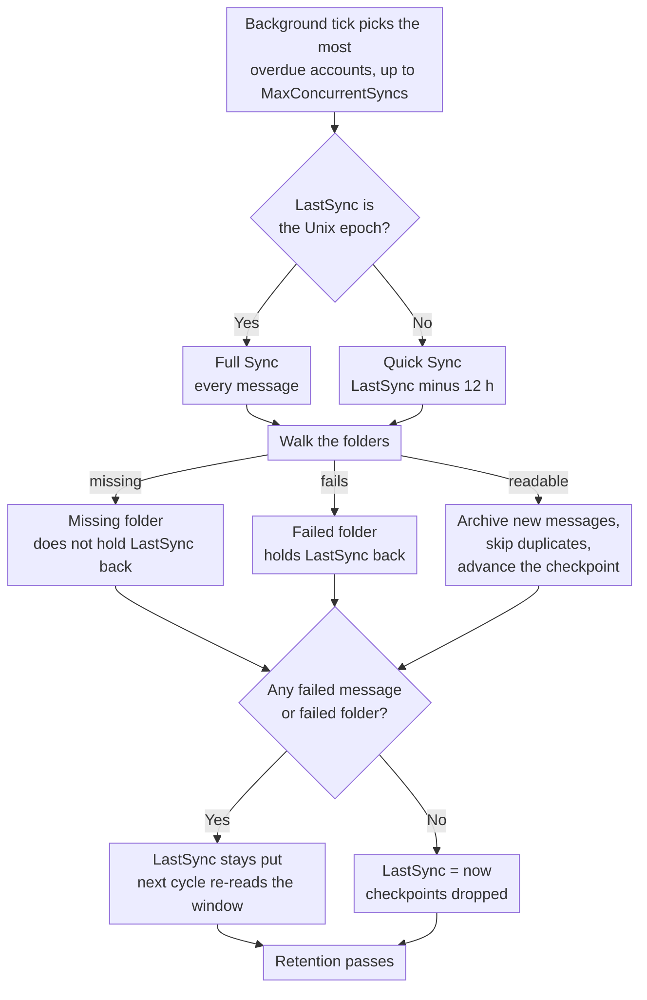

# 🔄 Sincronización de Mail (Quick vs. Full Sync) {#mail-synchronization-quick-vs-full-sync}

[← Volver al Índice de Documentación](index.md)

## 📋 Resumen {#overview}

Mail Archiver sincroniza automáticamente cada Buzón habilitado en segundo plano a través de `MailSyncBackgroundService`. El servicio ejecuta un bucle de sondeo corto (cada 60 s), determina qué Cuentas deben sincronizarse y las sincroniza — hasta `MailSync:MaxConcurrentSyncs` Cuentas en paralelo dentro de un ciclo — antes de reprogramar cada Cuenta de acuerdo con su propio intervalo de sincronización. Los intervalos pueden configurarse globalmente a través de `appsettings.json` y sobrescribirse por Cuenta desde la página de Crear/Editar.

Existen dos modos de sincronización distintos:

| Modo | Activado por | Alcance |
|------|--------------|-------|
| **Quick Sync** (incremental) | Cada ciclo de sincronización (intervalo por Cuenta) | Solo mensajes nuevos/cambiados desde la última Sincronización exitosa |
| **Full Sync** (resync) | Nueva Cuenta, botón manual, `AlwaysForceFullSync`, o intervalo de Full Sync global / por Cuenta | Cada mensaje en cada Carpeta no excluida |

Ambos modos son seguros de ejecutar repetidamente – Mail Archiver detecta duplicados (por `MessageId`, o por From/To/Subject/SentDate cuando el `MessageId` falta) y omite los mensajes que ya están archivados.

---

## 🔁 El ciclo de Sincronización de un vistazo {#the-sync-cycle-at-a-glance}



La última decisión es la que importa. `LastSync` avanza solo cuando la ejecución
finaliza sin mensajes fallidos **y** sin carpetas fallidas. Es por eso que un
Buzón con una única Carpeta ilegible sigue releyendo la misma ventana en lugar
de pasar de ella silenciosamente — y por qué una ejecución que termina antes de tiempo (timeout, cancel, rate limit) cuesta una relectura en lugar de perder correo.

---

## ⚡ Quick Sync (Sincronización incremental) {#quick-sync-incremental-sync}

Quick sync es el modo de funcionamiento normal que se ejecuta automáticamente en el intervalo configurado. El valor predeterminado global es de `MailSync:IntervalMinutes` minutos (predeterminado 15); cada Cuenta puede anular esto con su propio valor `SyncIntervalMinutes` establecido en la página de Crear/Editar (deje vacío para usar el valor predeterminado global).

### Cómo funciona {#how-it-works}

1. Para cada Cuenta habilitada (excluyendo las cuentas de proveedor `IMPORT`), el servicio lee la marca de tiempo `LastSync` de la Cuenta.
2. Se construye un filtro de fecha a partir de `LastSync`:
   - **IMAP**: `SearchQuery.DeliveredAfter(LastSync − 12 hours)`
   - **M365 (Graph)**: `receivedDateTime ge (LastSync − 12 hours)`
3. El solapamiento de 12 horas es intencional. Captura mensajes que fueron entregados por el proveedor después de que comenzara la Sincronización anterior pero con una marca de tiempo del servidor ligeramente más antigua, y tolera pequeñas desviaciones de reloj entre el servidor de correo y el host del Mail Archiver. Los duplicados se filtran mediante la comprobación de duplicados, por lo que el solapamiento nunca crea entradas dobles.
4. Para cada Carpeta no excluida, la lista de mensajes filtrados se obtiene en lotes y se archiva. Los mensajes existentes se omiten.
5. Tras una **finalización exitosa** (sin mensajes fallidos, sin Carpetas que fallaron en su totalidad, sin alcanzar el límite de velocidad), `LastSync` se establece en `DateTime.UtcNow` y el siguiente ciclo comienza desde ese punto.
6. Si **cualquier mensaje falló** al procesarse, o si **alguna Carpeta no pudo sincronizarse en absoluto** (ver [Folders That Fail as a Whole](#-folders-that-fail-as-a-whole)), `LastSync` **no** se actualiza, por lo que el siguiente ciclo reintenta la misma ventana.
7. Si la Cuenta tiene un **límite de velocidad** (ver [Rate Limit Handling](RateLimitHandling.md)), `LastSync` también se deja intacto y la Sincronización se reanuda desde un punto de control por Carpeta una vez que se restablece la cuota diaria.

### Cuándo lo verá {#when-you-see-it}

- Automáticamente, cada pocos minutos, para todas las Cuentas habilitadas.
- Después de que se haya completado la Sincronización inicial de una nueva Cuenta (el primer ciclo es una Full Sync, ver más abajo).
- No requiere ninguna acción del usuario.

## 🗄️ Sincronización completa (Resync) {#full-sync-resync}

Una Sincronización completa ignora el filtro de fecha y descarga **cada** mensaje de cada Carpeta no excluida desde el servidor, independientemente de su antigüedad.

### Qué activa una Sincronización completa {#what-triggers-a-full-sync}

Una Sincronización completa se activa siempre que el `LastSync` de una Cuenta se establece en el epoch de Unix (`1970-01-01T00:00:00Z`). Esto sucede en cuatro situaciones:

1. **Cuenta nueva** – Cada Cuenta IMAP o M365 recién creada comienza con `LastSync = 1970-01-01`. Por lo tanto, el primer ciclo de sincronización programado para esa Cuenta es automáticamente una Sincronización completa, que realiza la importación inicial al Archivo.
2. **Botón manual "Full Resync"** – En la página de *Account Details*, el botón **Full Resync** (`MailAccounts/Resync`) restablece `LastSync` al epoch e inicia la sincronización inmediatamente en primer plano.
3. **`MailSync:AlwaysForceFullSync = true`** – Cuando este flag de configuración está habilitado, el servicio en segundo plano restablece `LastSync` al epoch para **cada Cuenta habilitada al comienzo de cada ciclo de sincronización**. Esto convierte efectivamente cada ciclo en una Sincronización completa. Esto está destinado únicamente para la resolución de problemas y debe desactivarse una vez resuelto el problema, ya que aumenta drásticamente la carga en el servidor de correo y en la instancia de Mail Archiver.
4. **Intervalo de Sincronización completa global o por Cuenta** – Cuando una Cuenta tiene `FullSyncIntervalHours` configurado (página Create/Edit), o el valor predeterminado global `MailSync:FullSyncIntervalHours` está configurado en `appsettings.json`, el servicio en segundo plano activa automáticamente una Sincronización completa una vez que ha transcurrido ese intervalo desde la última sincronización completa de la Cuenta (`LastFullSync`). El valor por Cuenta tiene prioridad; cuando no se establece ninguno, no se ejecuta ninguna sincronización completa automática y solo permanecen el botón de resync manual (y `AlwaysForceFullSync` arriba). Después de que la sincronización completa finaliza, `LastFullSync` se actualiza a `DateTime.UtcNow` para que la siguiente sincronización completa se programe desde ese punto.

### Comportamiento durante una Sincronización completa {#behavior-during-a-full-sync}

- No se aplica ningún filtro `DeliveredAfter` / `receivedDateTime ge …`. Se solicita al servidor que devuelva todos los mensajes en la Carpeta.
- Si el servidor devuelve menos resultados de los que la Carpeta contiene realmente (algunos servidores IMAP limitan los resultados `SEARCH`), Mail Archiver detecta la discrepancia y recurre a la obtención de todos los `UniqueId` por número de secuencia, para que no se pierdan mensajes silenciosamente.
- Los mensajes que ya están en el Archivo se detectan como duplicados y se omiten; la copia archivada existente **no** se sobrescribe. Si se encuentra un duplicado en un nombre de Carpeta diferente al anterior, el campo `FolderName` almacenado se actualiza para reflejar la ubicación actual.
- Para Buzones muy grandes, la Sincronización completa puede tardar varias horas o incluso días. Cuando el seguimiento de ancho de banda está habilitado, la sincronización se pausa de forma controlada al alcanzar la cuota diaria y se reanuda desde los puntos de control por Carpeta al día siguiente (ver [Rate Limit Handling](RateLimitHandling.md)).
- `LastSync` se actualiza a `DateTime.UtcNow` solo después de que una Sincronización completa finaliza sin mensajes fallidos y sin Carpetas fallidas, exactamente igual que una Sincronización rápida.

### Cuándo usar una Sincronización completa manual {#when-to-use-a-manual-full-sync}

Use el botón **Full Resync** cuando:

- Haya cambiado la lista de **carpetas excluidas** de la Cuenta y desee confirmar que el Archivo coincide con la selección actual.
- Sospeche que al Archivo le faltan mensajes (por ejemplo, tras una migración de servidor, una interrupción del proveedor o un incidente de desajuste de reloj).
- Haya migrado el Buzón a un backend diferente y desee verificar la integridad.
- Desee volver a detectar mensajes que se movieron entre Carpetas en el servidor.
- Carpetas que antes eran invisibles para Mail Archiver vuelvan a ser visibles — por ejemplo, Carpetas de Outlook.com creadas a través de clientes de terceros que fueron filtradas de la lista de Carpetas IMAP hasta que fueron renombradas a través de la interfaz web (ver [Personal Microsoft Account Setup → Troubleshooting](MSA_Outlook_Setup.md#-troubleshooting)). Se necesita una Sincronización completa porque una Sincronización rápida no completaría los correos más antiguos en esas Carpetas.

**No** use la Sincronización completa:

- Como una operación regular: genera una carga innecesaria en el proveedor y en su instancia de Mail Archiver.
- Para "actualizar" el cuerpo de los mensajes o los metadatos: los duplicados se omiten, por lo que las copias archivadas existentes no se actualizan mediante una Sincronización completa. Para reemplazar un mensaje archivado, debe eliminarlo del Archivo primero y luego ejecutar una sincronización (rápida o completa).
- De forma permanente mediante `AlwaysForceFullSync=true`: mantenga esto desactivado en producción. Es un interruptor de diagnóstico, no un modo de operación.

## 🆚 Quick Sync vs. Full Sync de un vistazo {#quick-sync-vs-full-sync-at-a-glance}

| Aspecto | Quick Sync | Full Sync |
|--------|-----------|-----------|
| Filtro de fecha | `LastSync − 12 h` hasta ahora | Ninguno (todos los mensajes) |
| Volumen típico | Unos pocos mensajes nuevos | Buzón completo |
| Duración | Segundos a minutos | Minutos a días (dependiendo del tamaño del Buzón y los límites del proveedor) |
| Impacto en el ancho de banda | Bajo | Alto |
| `LastSync` actualizado con éxito | Sí | Sí |
| `LastSync` actualizado en caso de error / límite de velocidad | No (reintentar en el siguiente ciclo) | No (reanudar desde el punto de control) |
| Manejo de duplicados | Omitir mensajes ya en Archivo | Omitir mensajes ya en Archivo |
| Activado por | Programador (intervalo por Cuenta) | Nueva Cuenta, botón manual, `AlwaysForceFullSync` o intervalo de Full Sync |
| Recomendado para | Operación diaria | Importación inicial y verificación ocasional |

---

## ⚙️ Configuración {#configuration}

El comportamiento de la Sincronización se controla mediante la sección `MailSync` de `appsettings.json` (o las variables de entorno `MailSync__*` en Docker). Consulte [Setup.md](Setup.md) para obtener la lista completa de parámetros.

| Ajuste | Predeterminado | Descripción |
|---------|---------|-------------|
| `MailSync:IntervalMinutes` | `15` | Valor predeterminado global para el intervalo de sincronización por Cuenta, en minutos. Cada Cuenta puede sobrescribir esto en la página de Crear/Editar (deje vacío para usar este valor predeterminado). |
| `MailSync:FullSyncIntervalHours` | _unset_ | Valor predeterminado global opcional para resincronizaciones completas automáticas, en horas. Cuando no está establecido (el valor predeterminado), no se ejecuta ninguna sincronización completa automática a menos que se establezca un valor de `FullSyncIntervalHours` por Cuenta. Los valores por Cuenta sobrescriben esto. |
| `MailSync:TimeoutMinutes` | `0` (ninguno) | Tiempo de espera de sincronización por Cuenta. Una sincronización que se ejecute durante más tiempo se detiene en el siguiente límite de mensaje y se reanuda en la siguiente ejecución. `0` (el valor predeterminado, o cualquier valor no positivo) significa que no hay tiempo de espera. Consulte [Stopping a Sync Early](#-stopping-a-sync-early). |
| `MailSync:ConnectionTimeoutSeconds` | `300` | Tiempo de espera de conexión IMAP. |
| `MailSync:CommandTimeoutSeconds` | `600` | Tiempo de espera de comando IMAP. |
| `MailSync:AlwaysForceFullSync` | `false` | Cuando `true`, cada ciclo es una Sincronización completa para todas las Cuentas. **Solo para diagnóstico – manténgalo desactivado en producción.** |
| `MailSync:IgnoreSelfSignedCert` | `false` | Aceptar certificados TLS autofirmados (raíz no confiable, cadena incompleta) y discrepancias de nombre de host para conexiones IMAP — por ejemplo, Proton Bridge, cuyo certificado se emite a `127.0.0.1`. Otros problemas de cadena, como certificados caducados, siguen siendo rechazados. |
| `MailSync:MaxConcurrentSyncs` | `1` | Cuántas sincronizaciones de Cuenta pueden ejecutarse al mismo tiempo. Los espacios se rellenan a medida que quedan libres, consulte [How accounts are scheduled](#-how-accounts-are-scheduled). `1` mantiene las sincronizaciones secuenciales; aumente para paralelizar — tenga en cuenta los límites de velocidad del proveedor y el uso de recursos locales. |
| `MailSync:InterAccountDelaySeconds` | `0` | Retraso de escalonamiento opcional en segundos aplicado al final de cada tarea de sincronización de Cuenta. Útil para evitar arranques masivos cuando `MaxConcurrentSyncs > 1`. `0` lo desactiva. |
| `MailSync:MaxIssuesPerKind` | `20` | Cuántos problemas de cada tipo recuerda un trabajo de sincronización para la página de la Cuenta — las Carpetas fallidas, las Carpetas faltantes y los mensajes fallidos se presupuestan por separado. Cualquier cosa más allá de eso se cuenta, pero no se guarda. `0` desactiva el detalle y deja solo los contadores. |
| `MailSync:GlobalExcludedFolders` | _empty_ | Carpetas excluidas de la Sincronización para cada Cuenta, aditivo a la propia lista de cada Cuenta. Consulte [Excluded Folders](#-excluded-folders) a continuación. |
| `MailSync:ExcludeSubfolders` | `false` | Si una entrada de exclusión también cubre las Carpetas debajo de la que nombra, en ambas listas. Consulte [Excluded Folders](#-excluded-folders) a continuación. |

> 💡 Tanto el intervalo de sincronización normal como el intervalo de sincronización completa pueden sobrescribirse por Cuenta en la página **Create/Edit Mail Account**. Deje los campos por Cuenta vacíos para recurrir a los valores predeterminados globales anteriores. Para eliminar una Cuenta del programador por completo, desactívela (desactive el interruptor *Enabled* en la página Account Details).

---

## 🚫 Carpetas excluidas {#excluded-folders}

Las Carpetas pueden excluirse de la Sincronización desde dos lugares, y ambos son **aditivos**: una Carpeta se omite cuando coincide con **cualquiera** de las dos listas. Ninguna puede volver a incluir lo que la otra excluyó, por lo que añadir una entrada en cualquier lugar solo puede servir para eliminar Carpetas de la sincronización.

| Fuente | Alcance | Dónde |
|--------|-------|-------|
| Lista de exclusión de Cuenta | Una Cuenta | Página *Create/Edit Mail Account* |
| `MailSync:GlobalExcludedFolders` | Cada Cuenta de la instalación | `appsettings.json` o `MailSync__GlobalExcludedFolders__<n>` |

La lista global está **vacía por defecto**, por lo que una instalación que nunca la configure se comporta exactamente como antes. Existe para el caso en que se importan muchos Buzones desde el mismo servidor y la alternativa es mantener una lista de exclusión idéntica en cada Cuenta individual.

Ambas listas utilizan las mismas reglas de coincidencia, por lo que no pueden desincronizarse:

1. coincidencia exacta contra la ruta completa de la Carpeta (`INBOX/Drafts`);
2. coincidencia exacta contra el propio nombre de la Carpeta (`Drafts`), lo que captura una entrada escrita como el nombre corto cuando el servidor informa una ruta con prefijo;
3. coincidencia de sufijo de ruta, que captura variaciones de separadores — `Drafts` también coincide con `INBOX.Drafts` y `INBOX/Drafts` — y nombres con prefijo del servidor como `[Provider]/Drafts`;
4. todo lo que esté debajo de la Carpeta que nombre una entrada, por lo que `Archive` también cubre `Archive/Team` y `INBOX.Archive.Team`, siempre que `MailSync:ExcludeSubfolders` esté habilitado (está desactivado por defecto, coincidiendo con el comportamiento anterior a que existiera la opción). Establézcalo en `true` para excluir un árbol de Buzones nombrando su raíz en lugar de cada Carpeta en él; con el valor por defecto, una entrada coincide solo con la Carpeta que nombra.

Todas las comparaciones no distinguen entre mayúsculas y minúsculas. La regla de sufijo de ruta completa se ancla en el separador de ruta, por lo que `Archive` no incluye una Carpeta llamada `ArchiveWeek`. La comparación de nombres no se ancla de la misma manera: una entrada corta también coincide con cualquier Carpeta cuyo propio nombre **termine con** ella, por lo que `Archive` incluye una Carpeta llamada `OldArchive`. Para excluir exactamente una Carpeta entre otras con nombres similares, introduzca su ruta completa.

La Regla 4 se ancla en el separador de la misma manera que la regla 3, por lo que toma Carpetas completas y nunca parte de un nombre: `Archive` cubre `Archive/Team`, mientras que una Carpeta de correo llamada `Team Archive Review` permanece en la sincronización. Los ancestros se comparan solo por ruta, por lo que la comparación de nombres no anclada no se transmite a los hijos de una Carpeta. Un `.` cuenta como un separador dondequiera que aparezca, lo que significa que en un servidor que delimita con `/`, una Carpeta de nivel superior llamada literalmente `Archive.ics` se lee como si estuviera debajo de `Archive`.

**Ningún nombre de Carpeta se excluye por defecto.** Qué nombres vale la pena enumerar depende enteramente del servidor y su idioma — un árbol de Buzones que también contiene Carpetas de calendario, contactos, tareas y notas es una razón común para usar esto, pero Mail Archiver no lo asume. Consulte [Setup.md](Setup.md) para un ejemplo de configuración.

Cambiar cualquiera de las listas no elimina nada que ya haya sido archivado. Ejecute una [Full Sync](#-full-sync-resync) después si desea confirmar que el Archivo coincide con la selección actual.

La exclusión se aplica en todos los lugares donde se recorre la lista de Carpetas, no solo al archivado: una Carpeta excluida también es omitida por el paso de eliminación en el lado del servidor (ver más abajo), por lo que una entrada protege la Carpeta en el servidor también.

## 🗑️ Eliminación en el lado del servidor durante la Sincronización {#server-side-deletion-during-sync}

Si una Cuenta tiene `DeleteAfterDays` configurado (> 0), Mail Archiver elimina los mensajes más antiguos que el umbral configurado del **servidor de correo** después de cada sincronización:

- **IMAP**: `SearchQuery.SentBefore(now − DeleteAfterDays)` por Carpeta, luego expunge.
- **M365 (Graph)**: `receivedDateTime lt (now − DeleteAfterDays)` por Carpeta, luego delete.

Las copias archivadas en Mail Archiver **no** se ven afectadas por esto – solo se recorta el Buzón en el lado del servidor. Las Carpetas en cualquiera de las listas de exclusión ([Excluded Folders](#-excluded-folders)) se omiten en este paso de eliminación y se dejan intactas en el servidor. Consulte [Retention Policies](RetentionPolicies.md) para ver la contraparte de Retención local que controla cuánto tiempo se conservan las copias archivadas.

---

## 🛟 Recuperación de mensajes que el servidor reporta como faltantes {#recovering-messages-the-server-reports-as-missing}

Algunos servidores rechazan un mensaje a través de la obtención normal de UID y, aun así, devuelven un documento MIME utilizable para una obtención simple de `BODY[]`. Esto se ha observado en Exchange on-premises heredado, donde la obtención falla con:

```
MailKit.MessageNotFoundException: The IMAP server did not return the requested message.
```

Sin un mecanismo de respaldo, un mensaje como este se cuenta como un correo electrónico fallido y, debido a que `LastSync` no avanza mientras una Cuenta tiene fallos, la Cuenta vuelve a leer los mismos mensajes en cada ejecución y nunca progresa.

**Lo que hace Mail Archiver:** exactamente un intento de obtención adicional para ese UID, y solo para este error específico. Los problemas de autenticación, la pérdida de conexión, la limitación de velocidad (throttling) y los errores de análisis no se ven afectados, y el comportamiento de reintento transitorio existente no cambia. El intento es de solo lectura: ningún mensaje se marca como leído, ningún flag se cambia, nada se mueve o se elimina. Cuenta como un éxito solo si los datos brutos llegaron realmente **y** se analizaron como un mensaje MIME; cualquier cosa inferior sigue siendo un correo electrónico fallido. Los mensajes recuperados siguen entonces la ruta de Archivo normal, incluyendo la detección de duplicados, por lo que una Sincronización completa repetida no los archiva dos veces.

**Marcadores de posición de error del proveedor:** lo que el servidor devuelve a menudo no es el mensaje original, sino un documento que el proveedor generó en su lugar, por ejemplo:

```
Subject: Retrieval using the IMAP4 protocol failed for the following message: 270198
From: Microsoft Exchange Server 2010

The server couldn't retrieve the following message: ...
```

Esto se archiva exactamente como se recibió y nunca se reescribe en el remitente, asunto o cuerpo citado dentro de él. Mail Archiver no puede recuperar contenido que el propio proveedor se niega a convertir a MIME; lo que preserva es la mejor representación que el servidor es capaz de exponer, además del hecho de que un marcador de posición es lo que llegó. Cada uno se registra al nivel `Warning` con Cuenta, Carpeta, UID y asunto.

**Cuando el respaldo vuelve vacío**, el mensaje permanece como un correo electrónico fallido exactamente como antes, y el intento se registra en `Warning` en lugar de pasar silenciosamente; un mensaje no recuperado nunca debe poder parecer archivado. Si un servidor llegara a comportarse de esa manera de forma constante, el siguiente paso documentado es obtener `BODY.PEEK[HEADER]` y `BODY.PEEK[TEXT]` por separado y ensamblarlos en un único documento MIME. Esa es una solicitud genuinamente diferente, donde el respaldo actual es la misma solicitud leída de forma distinta. No se ha implementado deliberadamente: cuesta un segundo viaje de ida y vuelta por mensaje y añade un estado de "el encabezado llegó, el texto no" que definir, y ningún servidor visto hasta ahora lo necesita.

Ambos recuentos aparecen en la línea del registro de finalización de la Cuenta:

```
Sync completed for account: Example. New: 0, Failed: 0, Deleted: 0, Recovered: 25, Provider placeholders: 25, Failed folders: 0
```

`Recovered` cuenta los mensajes que el respaldo rescató; `Provider placeholders` es el subconjunto de aquellos que resultaron ser documentos de error generados por el proveedor. `Failed: 0` junto a ellos es el punto clave de la función: la Cuenta ya no se queda estancada.

---

## 📁 Carpetas que fallan en su totalidad {#folders-that-fail-as-a-whole}

Un mensaje puede fallar por sí solo, y una carpeta puede fallar como unidad — el servidor la enumera, pero al abrirla o buscar en ella se produce un error. Algunos servidores anuncian carpetas a través de `LIST`/`LSUB` que luego responden `NO ... doesn't exist` en `EXAMINE`.

Estos se cuentan por separado, uno por carpeta:

```
Sync completed for account: Example. New: 120, Failed: 0, Deleted: 0, Recovered: 0, Provider placeholders: 0, Failed folders: 2
```

`Failed folders: 2` significa que dos carpetas no pudieron sincronizarse en absoluto. **No** significa que un mensaje en particular haya fallado — cuando una carpeta no se puede abrir, no se sabe nada de los mensajes en ella, por lo que ningún número de mensajes fallidos sería verídico.

**Por qué este es su propio contador.** Un fallo a nivel de carpeta solía registrarse como mensajes fallidos, tantos como se hubieran procesado en esa carpeta hasta ese momento. Ese número era inventado, y sobrescribía los fallos reales por mensaje de la carpeta. Una carpeta inaccesible podía, por lo tanto, reportar cientos de mensajes fallidos que, de hecho, se habían archivado perfectamente.

**Efecto en `LastSync`, sin cambios.** Una carpeta que falló en su totalidad sigue impidiendo que `LastSync` avance, exactamente como ocurría cuando se contaba como mensajes fallidos. Solo ha cambiado el reporte, no el comportamiento: la Cuenta sigue reintentando la misma ventana en el siguiente ciclo. Esto es deliberado — una Sincronización incremental que superara una carpeta que nunca logró leer nunca volvería a buscar el correo en ella.

Ambos conteos son visibles al nivel de `Information`, y la advertencia que los nombra se emite siempre que `LastSync` se detiene:

```
Not updating LastSync for account Example: 0 failed emails, 2 folders that could not be synced at all
```

### Carpetas que han desaparecido, en lugar de estar dañadas {#folders-that-are-gone-as-opposed-to-broken}

Una carpeta que el servidor enumera y luego se niega a abrir no es automáticamente un fallo. La razón más común no es un error en absoluto: RFC 3501 prohíbe que un servidor elimine un nombre de la lista de suscripción cuando el Buzón detrás de él es eliminado, por lo que una carpeta a la que alguien se suscribió en un cliente IMAP sigue siendo reportada por `LSUB` años después. El descubrimiento de carpetas toma la unión de `LIST` y `LSUB`, por lo que esos nombres alcanzan la sincronización, y `EXAMINE` responde `NO ... doesn't exist`.

Esa es una respuesta, no un error. No hay nada que reintentar y nada que volver a buscar, por lo que se cuenta por separado y **no** detiene `LastSync`:

```
Sync completed for account: Example. New: 120, Failed: 0, ..., Failed folders: 0, Missing folders: 16
```

Contarlo como un fallo detendría la Cuenta permanentemente, porque una carpeta que no existe nunca vuelve a existir. Eso es exactamente lo que sucedió en un Buzón con 16 suscripciones obsoletas: la Cuenta dejó de avanzar `LastSync` y no pudo recuperarse por sí sola.

Todo lo demás sigue siendo un fallo y sigue deteniendo la Cuenta — falta de Permiso, una conexión caída, limitación de velocidad (throttling), un error del servidor. Esos pueden tener éxito en la siguiente ejecución.

`Missing folders: N` vale la pena actuar sobre él aunque sea inofensivo: significa que el Buzón contiene suscripciones a carpetas que ya no existen. Limpiarlas es un `UNSUBSCRIBE` por nombre, hecho con cualquier cliente IMAP, y la sincronización deliberadamente **no** lo hace — un archivador no debe modificar el Buzón que lee.

Solo IMAP. Microsoft Graph enumera carpetas a través de la API, donde una carpeta eliminada simplemente no se devuelve, por lo que la situación no puede ocurrir allí.

Se aplica a ambos proveedores, IMAP y M365 (Graph).

## 🗓️ Cómo se programan las cuentas {#how-accounts-are-scheduled}

Un tick en segundo plano se ejecuta una vez por minuto. Carga las cuentas habilitadas, calcula cuáles deben ejecutarse y comienza tantas como ranuras de sincronización libres haya: `MailSync:MaxConcurrentSyncs` en total.
**No** espera a las sincronizaciones que inicia. Cualquier cosa que no quepa se deja para el siguiente tick, el cual vuelve a decidir desde cero.

La próxima ejecución de cada Cuenta se programa cuando su sincronización **finaliza**, a partir de ese momento más su intervalo.
Una Cuenta cuya sincronización tarda más que su intervalo, por lo tanto, vuelve a estar pendiente tan pronto como termine, pero nunca dos veces a la vez: una Cuenta que ya se está ejecutando se omite, no se pone en cola.

Cuando hay más cuentas pendientes que ranuras disponibles, **la más atrasada va primero**. Los empates se resuelven por el id de la Cuenta para que un retraso se procese de forma reproducible.

Una sincronización que finaliza despierta al programador inmediatamente, de modo que el bucle no pierde su minuto de tiempo de inactividad cuando una ranura ya se ha liberado: un retraso se procesa de forma consecutiva incluso con `MaxConcurrentSyncs: 1`, exactamente como lo hacía el antiguo bucle por lotes, mientras que el minuto sigue siendo solo el intervalo más largo entre dos revisiones de la lista de cuentas.

Con más de una ranura, considere configurar `MailSync:TimeoutMinutes`, que es `0` (sin tiempo de espera) por defecto. Una sincronización mantiene su ranura mientras se ejecuta, por lo que una sola Cuenta que deje de progresar reduce permanentemente las ranuras disponibles para todo lo demás. Un tiempo de espera finaliza dicha ejecución como una pausa que mantiene sus puntos de control, y la ranura queda libre de nuevo en el siguiente tick.

> ℹ️ Antes de esto, el tick recopilaba cada Cuenta pendiente y esperaba a todas ellas antes de volver a buscar. Por lo tanto, un Buzón grande retenía a todas las demás Cuentas mientras se ejecutaba: las ranuras se liberaban, pero nada se reevaluaba hasta que la última terminaba, por lo que una instalación con `MaxConcurrentSyncs: 10` y un Buzón de seis horas sincronizaba efectivamente todo en un intervalo de seis horas. Las Cuentas que terminan rápido ahora se ajustan a su propio intervalo independientemente de lo que más se esté ejecutando.

Al apagar, el servicio espera hasta 30 segundos a las sincronizaciones que aún estén en curso en lugar de interrumpir el proceso debajo de una sesión IMAP abierta. No se cancelan; consulte [Stopping a Sync Early](#-stopping-a-sync-early) para saber qué es lo que sí detiene una sincronización.

## ⏹️ Detener una Sincronización Anticipadamente {#stopping-a-sync-early}

Una Sincronización en ejecución se detiene antes de haber procesado cada Carpeta exactamente por dos razones: alguien cancela el trabajo en la página de **Jobs**, o el `MailSync:TimeoutMinutes` de la Cuenta expira. Ambos se comprueban en tres puntos: antes de cada Carpeta, antes de cada lote y antes de cada mensaje individual, por lo que ninguno tiene que esperar a que termine una Carpeta grande.

El tiempo de espera se aplica **solo a las sincronizaciones programadas**. Una sincronización iniciada desde la interfaz de usuario, la acción "Sync now" o una resincronización completa, se ejecuta sin tiempo de espera, por lo que una sincronización manual larga nunca se interrumpe.

Los dos finalizan el trabajo de forma diferente, y la diferencia es importante:

| | Estado del trabajo | `LastSync` | Checkpoints | Pasos de Retención |
|---|---|---|---|---|
| Cancelado desde la interfaz de usuario | `Failed`, con "Job was cancelled" | no avanzado | conservados | omitidos |
| Expiración del tiempo de espera de sincronización | `Timed Out` | no avanzado | conservados | omitidos |

Un tiempo de espera es una **pausa, no un fallo**. La sincronización se detiene donde está, conserva lo que ha archivado, deja `LastSync` intacto y omite los pasos de Retención tanto en el servidor como locales, porque ejecutarlos anularía el propósito de limitar el tiempo de ejecución. La siguiente ejecución programada se reanuda desde el checkpoint.

### Checkpoints {#checkpoints}

El progreso se registra por Cuenta y Carpeta en `mail_archiver.SyncCheckpoints`: el UID del último mensaje archivado en esa Carpeta, junto con el UIDVALIDITY de la Carpeta en ese momento. Cada instalación los escribe; antes estaban vinculados a `BandwidthTracking:Enabled`, lo que significaba que una sincronización interrumpida solo podía reanudarse donde esa función no relacionada estuviera activada por casualidad. Los checkpoints se eliminan de nuevo tan pronto como una Cuenta se completa sin fallos.

Una Carpeta reanudada ejecuta **exactamente la misma búsqueda** que habría ejecutado sin un checkpoint. Solo los UIDs en el nivel del watermark o por debajo se descartan del resultado posteriormente, por lo que la ventana de búsqueda nunca se mueve y ningún mensaje puede quedar fuera de ella.

El watermark deja de avanzar tan pronto como un mensaje en esa Carpeta falla. Los mensajes se recorren en orden ascendente de UID, por lo que un watermark por encima de un UID fallido le indicaría a la siguiente ejecución que el mensaje fallido ya está archivado y nunca se volvería a intentar, que es exactamente lo que el `LastSync` retenido existe para forzar. Por lo tanto, todo lo que esté por encima del fallo se vuelve a leer la próxima vez; esto conlleva una relectura y la comprobación de duplicados la absorbe.

El checkpoint se ignora, y la Carpeta se lee por completo, siempre que no se pueda demostrar que se aplica: no hay ningún UID registrado todavía, no hay UIDVALIDITY registrado, o un UIDVALIDITY que ya no coincide con la Carpeta. El último caso significa que el servidor renumeró el Buzón, por lo que el UID almacenado nombra a un mensaje diferente. Releer una Carpeta cuesta tiempo y es absorbido por la comprobación de duplicados; omitir uno causaría la pérdida silenciosa de correo, por lo que cada caso dudoso se lee por completo.

El proveedor de Graph API no escribe checkpoints de UID, porque Graph API no tiene un equivalente a los UIDs de IMAP. Una sincronización de M365 con tiempo de espera agotado o limitada por el ancho de banda se "reanuda" solo en el sentido de que `LastSync` no se avanza, por lo que la siguiente ejecución vuelve a leer toda la ventana y la comprobación de duplicados absorbe el solapamiento.

> ℹ️ Antes de esto, el checkpoint almacenaba el **Date header** del último mensaje archivado y lo introducía en la búsqueda de la Carpeta, la cual el servidor responde mediante INTERNALDATE, un reloj diferente que puede tener años de desfase en el correo migrado, mientras que los mensajes se procesan en orden de UID en lugar de orden de fecha. Ambos desajustes podrían desplazar la ventana de búsqueda más allá de correos que nunca habían sido archivados. Se utiliza el mismo camino cuando una sincronización se pausa por un límite de ancho de banda, por lo que la reanudación también se corrige con este cambio.

### Buzones grandes y el tiempo de espera {#large-mailboxes-and-the-timeout}

Una primera sincronización completa de un Buzón con 150.000 mensajes dura horas, y un tiempo de espera más corto que eso la detendría cada vez. Se reanuda desde su checkpoint en lugar de empezar de nuevo, pero la Cuenta no alcanzará un estado completado y, por lo tanto, no avanzará `LastSync`, hasta que una ejecución llegue hasta el final. Revise el valor para sus Buzones y ajústelo a `0` si prefiere que no haya ningún tiempo de espera.

---

## 👀 Observando la Sincronización {#observing-the-sync}

### La página de la Cuenta responde "¿qué hizo la última ejecución?" {#the-account-page-answers-what-did-the-last-run-do}

Cada cuenta de correo lleva una tarjeta de **Última ejecución de Sincronización** que muestra la ejecución que terminó más recientemente: cuándo terminó, cuánto tiempo tardó, cuántos mensajes procesó y cuántos eran nuevos. Esta información sobrevive a la Retención de trabajos de 24 horas, por lo que un Buzón que ha estado inactivo todo el día todavía tiene una respuesta; solo un reinicio la borra, y la tarjeta lo indica en lugar de fingir que la Cuenta está bien.

Cuando algo salió mal, la tarjeta lo enumera, agrupado y presupuestado por tipo:

- **Carpetas que no se pudieron leer** — la Carpeta falló como unidad. Retiene `LastSync`.
- **Carpetas que el servidor no tiene** — reportadas por el descubrimiento, denegadas al abrir. Generalmente son suscripciones sobrantes a Carpetas eliminadas; no retiene `LastSync`. Ver [Folders that are gone](#folders-that-are-gone-as-opposed-to-broken).
- **Mensajes que no se pudieron archivar** — con Carpeta, asunto, UID y las propias palabras del servidor.

Cada grupo está limitado por `MailSync:MaxIssuesPerKind` e informa lo que no cupo como "y N más", para que una inundación de un tipo no pueda enterrar a los demás. Cuando se retuvo `LastSync`, la tarjeta también lo indica, en una sola frase, porque esa es la pregunta que realmente plantea una marca de tiempo desactualizada.

La lista de Cuentas marca las Cuentas cuya última ejecución reportó problemas, junto a la marca de tiempo. Deliberadamente solo esas: una marca en cada fila sería ruido y anularía el propósito del marcador.

- **Página de Detalles de la Cuenta**: Muestra la marca de tiempo actual de `LastSync` y el trabajo de sincronización activo (Carpeta, recuento procesado, recuento de nuevos, recuento de fallidos). El botón **Full Resync** se encuentra aquí.
- **Logs**: El progreso de la Sincronización se registra a nivel de `Information`. En Docker:
  ```bash
  docker compose logs -f mailarchive-app | grep -i sync
  ```
  Consulte la [Docker Compose Logs Guide](DockerComposeLogs.md) para obtener consejos sobre el filtrado de logs.
- **Rate limiting**: Cuando una sincronización se pausa debido a los límites de ancho de banda, la Cuenta muestra el estado "Rate-Limited" y se reanuda automáticamente después de la ventana de reinicio. Ver [Rate Limit Handling](RateLimitHandling.md).
- **Timeouts**: Una sincronización detenida por `MailSync:TimeoutMinutes` muestra "Timed Out" y se reanuda desde su punto de control en la siguiente ejecución. Ver [Stopping a Sync Early](#-stopping-a-sync-early).

---
