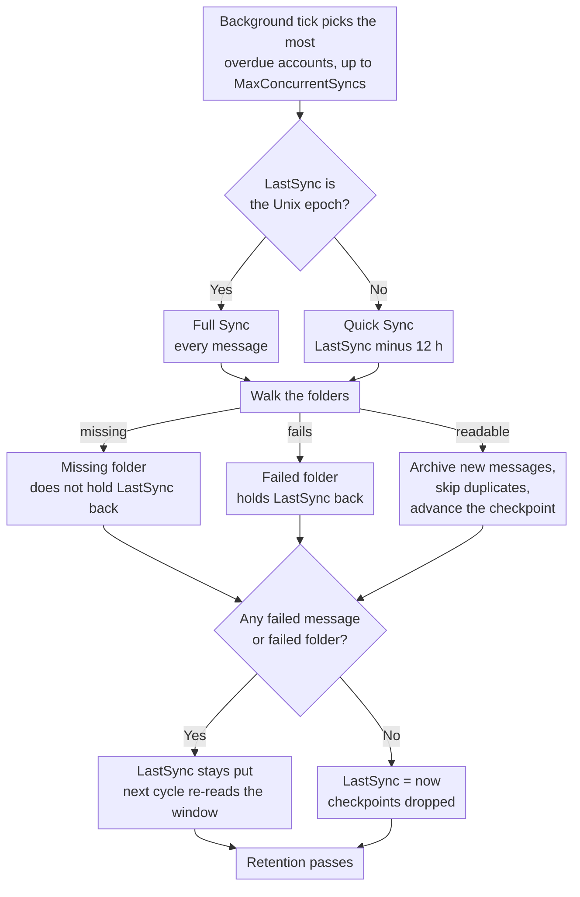

# 🔄 Synchronisation de la messagerie (Quick vs. Full Sync) {#mail-synchronization-quick-vs-full-sync}

[← Retour à l'index de la documentation](index.md)

## 📋 Aperçu {#overview}

Mail Archiver synchronise automatiquement chaque Boîte aux lettres activée en arrière-plan via le `MailSyncBackgroundService`. Le service exécute une boucle de scrutation courte (toutes les 60 s), détermine quels Comptes sont arrivés à échéance, et les synchronise — jusqu'à `MailSync:MaxConcurrentSyncs` Comptes en parallèle au sein d'un même cycle — avant de replanifier chaque Compte selon son propre intervalle de synchronisation. Les intervalles peuvent être configurés globalement via `appsettings.json` et surchargés par Compte depuis la page de Création/Édition.

Il existe deux modes de synchronisation distincts :

| Mode | Déclenché par | Portée |
|------|--------------|-------|
| **Quick Sync** (incrémentiel) | Chaque cycle de synchronisation (intervalle par Compte) | Uniquement les nouveaux messages/messages modifiés depuis la dernière synchronisation réussie |
| **Full Sync** (resynchronisation) | Nouveau Compte, bouton manuel, `AlwaysForceFullSync`, ou intervalle de Full Sync par Compte / global | Chaque message dans chaque Dossier non exclu |

Les deux modes peuvent être exécutés de manière répétée en toute sécurité – Mail Archiver détecte les doublons (par `MessageId`, ou par From/To/Subject/SentDate lorsque le `MessageId` est manquant) et ignore les messages qui sont déjà archivés.

---

## 🔁 Le cycle de Synchronisation en un coup d'œil {#the-sync-cycle-at-a-glance}



La dernière décision est celle qui compte. `LastSync` n'avance que lorsque l'exécution
se termine sans messages échoués **et** sans dossiers échoués. C'est pourquoi une
Boîte aux lettres avec un seul dossier illisible continue de relire la même fenêtre au lieu
de passer discrètement à la suivante — et pourquoi une exécution qui s'arrête prématurément (timeout, cancel, rate limit) coûte une relecture plutôt que de perdre des e-mails.

---

## ⚡ Quick Sync (Synchronisation incrémentielle) {#quick-sync-incremental-sync}

La synchronisation rapide est le mode de fonctionnement normal qui s'exécute automatiquement à l'intervalle configuré. La valeur par défaut globale est de `MailSync:IntervalMinutes` minutes (par défaut 15) ; chaque Compte peut outrepasser cela avec sa propre valeur `SyncIntervalMinutes` définie sur la page Créer/Modifier (laissez vide pour utiliser la valeur par défaut globale).

### Comment cela fonctionne {#how-it-works}

1. Pour chaque Compte activé (à l'exclusion des comptes de fournisseur `IMPORT`), le service lit l'horodatage `LastSync` du Compte.
2. Un filtre de date est construit à partir de `LastSync` :
   - **IMAP** : `SearchQuery.DeliveredAfter(LastSync − 12 hours)`
   - **M365 (Graph)** : `receivedDateTime ge (LastSync − 12 hours)`
3. Le chevauchement de 12 heures est intentionnel. Il permet de capturer les messages qui ont été livrés par le fournisseur après le début de la synchronisation précédente mais avec un horodatage serveur légèrement plus ancien, et il tolère un léger décalage d'horloge entre le serveur de messagerie et l'hôte du Mail Archiver. Les doublons sont filtrés par la vérification des doublons, donc le chevauchement ne crée jamais de doubles entrées.
4. Pour chaque Dossier non exclu, la liste des messages filtrés est récupérée par lots et archivée. Les messages existants sont ignorés.
5. En cas de **réussite de l'opération** (aucun message en échec, aucun Dossier n'ayant échoué dans son ensemble, aucune limite de débit atteinte), `LastSync` est défini sur `DateTime.UtcNow` et le cycle suivant démarre à partir de ce point.
6. Si **un message échoue** lors du traitement, ou si **un Dossier ne peut pas être synchronisé du tout** (voir [Folders That Fail as a Whole](#-folders-that-fail-as-a-whole)), `LastSync` n'est **pas** mis à jour, de sorte que le cycle suivant tente de nouveau la même fenêtre.
7. Si le Compte est soumis à une **limite de débit** (voir [Rate Limit Handling](RateLimitHandling.md)), `LastSync` est également laissé intact et la synchronisation reprend à partir d'un point de contrôle par Dossier une fois que le quota quotidien est réinitialisé.

### Quand vous le voyez {#when-you-see-it}

- Automatiquement, toutes les quelques minutes, pour tous les Comptes activés.
- Après l'achèvement de la synchronisation initiale d'un nouveau Compte (le premier cycle est une Synchronisation complète, voir ci-dessous).
- Aucune action de l'utilisateur n'est requise.

## 🗄️ Synchronisation complète (Resync) {#full-sync-resync}

Une Synchronisation complète ignore le filtre de date et télécharge **chaque** message de chaque Dossier non exclu depuis le serveur, quel que soit son âge.

### Ce qui déclenche une Synchronisation complète {#what-triggers-a-full-sync}

Une Synchronisation complète est déclenchée chaque fois que le `LastSync` d'un Compte est défini sur l'époque Unix (`1970-01-01T00:00:00Z`). Cela se produit dans quatre situations :

1. **Nouveau Compte** – Chaque Compte IMAP ou M365 nouvellement créé commence avec `LastSync = 1970-01-01`. Le premier cycle de synchronisation prévu pour ce Compte est donc automatiquement une Synchronisation complète, qui effectue l'importation initiale de l'Archive.
2. **Bouton manuel "Full Resync"** – Sur la page *Account Details*, le bouton **Full Resync** (`MailAccounts/Resync`) réinitialise `LastSync` à l'époque et lance la synchronisation immédiatement au premier plan de la requête.
3. **`MailSync:AlwaysForceFullSync = true`** – Lorsque ce drapeau de configuration est activé, le service d'arrière-plan réinitialise `LastSync` à l'époque pour **chaque Compte activé au début de chaque cycle de synchronisation**. Cela transforme effectivement chaque cycle en une Synchronisation complète. Ceci est destiné uniquement au dépannage et doit être désactivé une fois le problème résolu, car cela augmente considérablement la charge sur le serveur de messagerie et l'instance Mail Archiver.
4. **Intervalle de Synchronisation complète par Compte ou global** – Lorsqu'un Compte a `FullSyncIntervalHours` défini (page Create/Edit), ou que la valeur par défaut globale `MailSync:FullSyncIntervalHours` est configurée dans `appsettings.json`, le service d'arrière-plan déclenche automatiquement une Synchronisation complète une fois que cet intervalle s'est écoulé depuis la dernière synchronisation complète du Compte (`LastFullSync`). La valeur par Compte est prioritaire ; lorsqu'aucune n'est définie, aucune synchronisation complète automatique ne s'exécute et seuls le bouton de resynchronisation manuelle (et `AlwaysForceFullSync` ci-dessus) restent disponibles. Une fois la synchronisation complète terminée, `LastFullSync` est mis à jour vers `DateTime.UtcNow` afin que la prochaine synchronisation complète soit programmée à partir de ce point.

### Comportement pendant une Synchronisation complète {#behavior-during-a-full-sync}

- Aucun filtre `DeliveredAfter` / `receivedDateTime ge …` n'est appliqué. Le serveur est sollicité pour renvoyer tous les messages du Dossier.
- Si le serveur renvoie moins de résultats que ce que le Dossier contient réellement (certains serveurs IMAP limitent les résultats `SEARCH`), Mail Archiver détecte la divergence et se rabat sur la récupération de tous les `UniqueId` par numéro de séquence, afin qu'aucun message ne soit silencieusement ignoré.
- Les messages qui sont déjà dans l'Archive sont détectés comme des doublons et ignorés – la copie archivée existante n'est **pas** écrasée. Si un doublon est trouvé dans un nom de Dossier différent de celui d'avant, le champ `FolderName` stocké est mis à jour pour refléter l'emplacement actuel.
- Pour les Boîtes aux lettres très volumineuses, la Synchronisation complète peut prendre plusieurs heures, voire plusieurs jours. Lorsque le suivi de la bande passante est activé, la synchronisation s'interrompt proprement à la limite du quota quotidien et reprend à partir des points de contrôle par Dossier le jour suivant (voir [Rate Limit Handling](RateLimitHandling.md)).
- `LastSync` est mis à jour vers `DateTime.UtcNow` uniquement après qu'une Synchronisation complète s'est terminée sans messages échoués et sans Dossiers échoués, exactement comme une Synchronisation rapide.

### Quand utiliser une Synchronisation complète manuelle {#when-to-use-a-manual-full-sync}

Utilisez le bouton **Full Resync** lorsque :

- Vous avez modifié la liste des **dossiers exclus** du Compte et souhaitez confirmer que l'Archive correspond à la sélection actuelle.
- Vous soupçonnez que l'Archive contient des messages manquants (par exemple, après une migration de serveur, une interruption de service du fournisseur ou un incident de décalage d'horloge).
- Vous avez migré la Boîte aux lettres vers un backend différent et souhaitez vérifier l'exhaustivité.
- Vous souhaitez redétecter des messages qui ont été déplacés entre des Dossiers sur le serveur.
- Des Dossiers qui étaient auparavant invisibles pour Mail Archiver sont redevenus visibles — par exemple, des Dossiers Outlook.com créés via des clients tiers qui étaient filtrés de la liste des Dossiers IMAP jusqu'à ce qu'ils soient renommés via l'interface web (voir [Personal Microsoft Account Setup → Troubleshooting](MSA_Outlook_Setup.md#-troubleshooting)). Une Synchronisation complète est nécessaire car une Synchronisation rapide ne récupérerait pas les anciens courriels dans ces Dossiers.

N'utilisez **pas** la Synchronisation complète :

- Comme opération régulière – cela impose une charge inutile au fournisseur et à votre instance Mail Archiver.
- Pour "rafraîchir" le corps des messages ou les métadonnées – les doublons sont ignorés, donc les copies archivées existantes ne sont pas mises à jour par une Synchronisation complète. Pour remplacer un message archivé, vous devez d'abord le supprimer de l'Archive, puis lancer une synchronisation (rapide ou complète).
- De manière permanente via `AlwaysForceFullSync=true` – laissez cette option désactivée en production. Il s'agit d'un commutateur de diagnostic, pas d'un mode de fonctionnement.

---

## 🆚 Quick Sync vs. Full Sync en un coup d'œil {#quick-sync-vs-full-sync-at-a-glance}

| Aspect | Quick Sync | Full Sync |
|--------|-----------|-----------|
| Filtre de date | `LastSync − 12 h` jusqu'à maintenant | Aucun (tous les messages) |
| Volume typique | Quelques nouveaux messages | Boîte aux lettres entière |
| Durée | Secondes à minutes | Minutes à jours (selon la taille de la Boîte aux lettres et les limites du fournisseur) |
| Impact sur la bande passante | Faible | Élevé |
| `LastSync` mis à jour en cas de succès | Oui | Oui |
| `LastSync` mis à jour en cas d'échec / limite de débit | Non (réessai au prochain cycle) | Non (reprise à partir du point de contrôle) |
| Gestion des doublons | Ignorer les messages déjà archivés | Ignorer les messages déjà archivés |
| Déclenché par | Planificateur (intervalle par Compte) | Nouveau Compte, bouton manuel, `AlwaysForceFullSync`, ou intervalle de Full Sync |
| Recommandé pour | Utilisation quotidienne | Importation initiale et vérification occasionnelle |

---

## ⚙️ Configuration {#configuration}

Le comportement de la Synchronisation est contrôlé par la section `MailSync` de `appsettings.json` (ou les variables d'environnement `MailSync__*` dans Docker). Consultez [Setup.md](Setup.md) pour la liste complète des paramètres.

| Paramètre | Valeur par défaut | Description |
|---------|---------|-------------|
| `MailSync:IntervalMinutes` | `15` | Valeur par défaut globale pour l'intervalle de synchronisation par Compte, en minutes. Chaque Compte peut outrepasser cela sur la page Créer/Modifier (laisser vide pour utiliser cette valeur par défaut). |
| `MailSync:FullSyncIntervalHours` | _non défini_ | Valeur par défaut globale optionnelle pour les resynchronisations complètes automatiques, en heures. Lorsqu'elle n'est pas définie (par défaut), aucune synchronisation complète automatique ne s'exécute à moins qu'une valeur `FullSyncIntervalHours` par Compte ne soit définie. Les valeurs par Compte prévalent sur celle-ci. |
| `MailSync:TimeoutMinutes` | `0` (aucune) | Délai d'expiration de la synchronisation par Compte. Une synchronisation qui dure trop longtemps s'arrête à la limite du message suivant et reprend lors de l'exécution suivante. `0` (la valeur par défaut, ou toute valeur non positive) signifie qu'il n'y a pas de délai d'expiration. Voir [Stopping a Sync Early](#-stopping-a-sync-early). |
| `MailSync:ConnectionTimeoutSeconds` | `300` | Délai d'expiration de la connexion IMAP. |
| `MailSync:CommandTimeoutSeconds` | `600` | Délai d'expiration de la commande IMAP. |
| `MailSync:AlwaysForceFullSync` | `false` | Lorsque `true`, chaque cycle est une Synchronisation complète pour tous les comptes. **Diagnostic uniquement – à laisser désactivé en production.** |
| `MailSync:IgnoreSelfSignedCert` | `false` | Accepter les certificats TLS auto-signés (racine non fiable, chaîne incomplète) et les discordances de nom d'hôte pour les connexions IMAP — par exemple Proton Bridge, dont le certificat est délivré à `127.0.0.1`. Les autres problèmes de chaîne, tels que les certificats expirés, sont toujours rejetés. |
| `MailSync:MaxConcurrentSyncs` | `1` | Nombre de synchronisations de comptes pouvant s'exécuter simultanément. Les créneaux sont réapprovisionnés lorsqu'ils se libèrent, voir [How accounts are scheduled](#-how-accounts-are-scheduled). `1` maintient les synchronisations séquentielles ; augmentez pour paralléliser — attention aux limites de débit du fournisseur et à l'utilisation des ressources locales. |
| `MailSync:InterAccountDelaySeconds` | `0` | Délai de décalage optionnel en secondes appliqué à la fin de chaque tâche de synchronisation de compte. Utile pour éviter les démarrages en rafale lorsque `MaxConcurrentSyncs > 1`. `0` le désactive. |
| `MailSync:MaxIssuesPerKind` | `20` | Nombre de problèmes de chaque type qu'une tâche de synchronisation mémorise pour la page du compte — les Dossiers en échec, les Dossiers manquants et les messages en échec sont budgétisés séparément. Tout ce qui dépasse est comptabilisé, mais pas conservé. `0` désactive le détail et ne laisse que les compteurs. |
| `MailSync:GlobalExcludedFolders` | _vide_ | Dossiers exclus de la Synchronisation pour chaque Compte, s'ajoutant à la propre liste de chaque Compte. Voir [Excluded Folders](#-excluded-folders) ci-dessous. |
| `MailSync:ExcludeSubfolders` | `false` | Si une entrée d'exclusion couvre également les Dossiers situés sous celui qu'elle nomme, dans les deux listes. Voir [Excluded Folders](#-excluded-folders) ci-dessous. |

> 💡 L'intervalle de synchronisation normal et l'intervalle de synchronisation complète peuvent tous deux être modifiés par Compte sur la page **Create/Edit Mail Account**. Laissez les champs par Compte vides pour revenir aux valeurs par défaut globales ci-dessus. Pour retirer complètement un Compte de l'ordonnanceur, désactivez-le (basculez *Enabled* sur off sur la page Account Details).

---

## 🚫 Dossiers exclus {#excluded-folders}

Les dossiers peuvent être exclus de la synchronisation à partir de deux endroits, et les deux sont **additifs** : un dossier est ignoré lorsqu'il correspond à **l'une ou l'autre** des listes. Aucune ne peut réinclure ce que l'autre a exclu, donc l'ajout d'une entrée n'importe où ne peut que retirer des dossiers de la synchronisation.

| Source | Portée | Emplacement |
|--------|-------|-------|
| Liste d'exclusion du Compte | Un seul Compte | page *Create/Edit Mail Account* |
| `MailSync:GlobalExcludedFolders` | Chaque Compte de l'installation | `appsettings.json` ou `MailSync__GlobalExcludedFolders__<n>` |

La liste globale est **vide par défaut**, donc une installation qui ne la configure jamais se comporte exactement comme avant. Elle existe pour le cas où de nombreuses Boîtes aux lettres sont importées depuis le même serveur et que l'alternative consiste à maintenir une liste d'exclusion identique sur chaque Compte individuel.

Les deux listes utilisent les mêmes règles de correspondance, elles ne peuvent donc pas diverger :

1. correspondance exacte avec le chemin complet du Dossier (`INBOX/Drafts`) ;
2. correspondance exacte avec le nom propre du Dossier (`Drafts`), ce qui permet de capturer une entrée saisie sous forme de nom court lorsque le serveur rapporte un chemin avec préfixe ;
3. correspondance de suffixe de chemin, qui capture les variations de séparateur — `Drafts` correspond également à `INBOX.Drafts` et `INBOX/Drafts` — et les noms avec préfixe serveur tels que `[Provider]/Drafts` ;
4. tout ce qui se trouve sous le Dossier nommé par une entrée, ainsi `Archive` couvre également `Archive/Team` et `INBOX.Archive.Team`, dès lors que `MailSync:ExcludeSubfolders` est activé (il est désactivé par défaut, correspondant au comportement avant l'existence de l'option). Réglez-le sur `true` pour exclure un arbre de Boîte aux lettres en nommant sa racine au lieu de chaque Dossier qu'il contient ; avec la valeur par défaut, une entrée ne correspond qu'au seul Dossier qu'elle nomme.

Toutes les comparaisons sont insensibles à la casse. La règle du suffixe de chemin complet s'ancre sur le séparateur de chemin, donc `Archive` n'entraîne pas avec lui un Dossier nommé `ArchiveWeek`. La comparaison de nom n'est pas ancrée de la même manière : une entrée courte correspond également à tout Dossier dont le nom propre **se termine par** celle-ci, ainsi `Archive` entraîne avec lui un Dossier nommé `OldArchive`. Pour exclure exactement un Dossier parmi d'autres portant des noms similaires, saisissez son chemin complet.

La règle 4 s'ancre sur le séparateur de la même manière que la règle 3, elle prend donc des Dossiers entiers et jamais une partie d'un nom : `Archive` couvre `Archive/Team`, tandis qu'un dossier de messagerie appelé `Team Archive Review` reste dans la synchronisation. Les ancêtres sont comparés uniquement par chemin, la comparaison de nom non ancrée n'est donc pas transmise aux enfants d'un Dossier. Un `.` compte comme un séparateur partout où il apparaît, ce qui signifie que sur un serveur délimitant avec `/`, un Dossier de premier niveau littéralement nommé `Archive.ics` est lu comme se trouvant sous `Archive`.

**Aucun nom de Dossier n'est jamais exclu par défaut.** Les noms qui valent la peine d'être listés dépendent entièrement du serveur et de sa langue — un arbre de Boîte aux lettres qui contient également des Dossiers de calendrier, de contacts, de tâches et de notes est une raison courante d'utiliser cela, mais Mail Archiver ne le présuppose pas. Consultez [Setup.md](Setup.md) pour un exemple de configuration.

La modification de l'une ou l'autre des listes ne supprime rien de ce qui est déjà archivé. Lancez une [Full Sync](#-full-sync-resync) par la suite si vous souhaitez confirmer que l'Archive correspond à la sélection actuelle.

L'exclusion s'applique partout où la liste des Dossiers est parcourue, pas seulement à l'archivage : un Dossier exclu est également ignoré par la passe de suppression côté serveur (voir ci-dessous), ainsi une entrée protège le Dossier sur le serveur également.

---

## 🗑️ Suppression côté serveur pendant la Synchronisation {#server-side-deletion-during-sync}

Si un Compte a `DeleteAfterDays` configuré (> 0), Mail Archiver supprime les messages plus anciens que le seuil configuré du **serveur de messagerie** après chaque synchronisation :

- **IMAP** : `SearchQuery.SentBefore(now − DeleteAfterDays)` par Dossier, puis expunge.
- **M365 (Graph)** : `receivedDateTime lt (now − DeleteAfterDays)` par Dossier, puis delete.

Les copies archivées dans Mail Archiver ne sont **pas** affectées par cela – seule la Boîte aux lettres côté serveur est élaguée. Les Dossiers figurant sur l'une ou l'autre des listes d'exclusion ([Excluded Folders](#-excluded-folders)) sont ignorés par ce passage de suppression et laissés intacts sur le serveur. Voir [Retention Policies](RetentionPolicies.md) pour l'équivalent de Conservation locale qui contrôle la durée de conservation des copies archivées.

---

## 🛟 Récupération des messages signalés comme manquants par le serveur {#recovering-messages-the-server-reports-as-missing}

Certains serveurs refusent un message via la récupération normale par UID mais renvoient tout de même un document MIME utilisable pour une récupération simple `BODY[]`. Cela a été observé sur les anciens serveurs Exchange sur site, où la récupération échoue avec :

```
MailKit.MessageNotFoundException: The IMAP server did not return the requested message.
```

Sans solution de repli, un tel message est comptabilisé comme un e-mail en échec, et comme `LastSync` n'est pas incrémenté tant qu'un Compte présente des échecs, le Compte relit les mêmes messages à chaque exécution et ne progresse jamais.

**Ce que fait Mail Archiver :** exactement une tentative de récupération supplémentaire pour cet UID, et uniquement pour cette erreur spécifique. Les problèmes d'authentification, les pertes de connexion, le throttling et les erreurs d'analyse ne sont pas affectés, et le comportement de tentative de reconnexion transitoire existant reste inchangé. La tentative est en lecture seule : aucun message n'est marqué comme lu, aucun flag n'est modifié, rien n'est déplacé ou supprimé. Elle n'est comptabilisée comme un succès que si les données brutes sont réellement arrivées **et** ont été analysées comme un message MIME — tout ce qui est inférieur reste un e-mail en échec. Les messages récupérés suivent ensuite le chemin d'archivage normal, incluant la détection de doublons, afin qu'une synchronisation complète répétée ne les archive pas deux fois.

**Espaces réservés pour les erreurs de fournisseur :** ce que le serveur renvoie n'est souvent pas le message original mais un document que le fournisseur a généré à sa place, par exemple :

```
Subject: Retrieval using the IMAP4 protocol failed for the following message: 270198
From: Microsoft Exchange Server 2010

The server couldn't retrieve the following message: ...
```

Ceci est archivé exactement tel que reçu et n'est jamais réécrit dans l'expéditeur, l'objet ou le corps cité à l'intérieur. Mail Archiver ne peut pas récupérer le contenu que le fournisseur lui-même refuse de convertir en MIME ; ce qu'il préserve est la meilleure représentation que le serveur est capable d'exposer, plus le fait qu'un espace réservé est ce qui est arrivé. Chacun est consigné au niveau `Warning` avec le Compte, le Dossier, l'UID et l'objet.

**Lorsque la solution de repli revient vide**, le message reste un e-mail en échec exactement comme avant, et la tentative est consignée au niveau `Warning` plutôt que de passer discrètement — un message non récupéré ne doit jamais pouvoir paraître archivé. Si un serveur devait se comporter ainsi de manière constante, l'étape suivante documentée consiste à récupérer `BODY.PEEK[HEADER]` et `BODY.PEEK[TEXT]` séparément et à les assembler en un seul document MIME. Il s'agit d'une requête véritablement différente, alors que la solution de repli actuelle est la même requête lue différemment. Elle n'est délibérément pas implémentée : elle coûte un second aller-retour par message et ajoute un état "l'en-tête est arrivé, pas le texte" à définir, et aucun serveur observé jusqu'à présent n'en a besoin.

Les deux décomptes apparaissent dans la ligne du journal d'achèvement du Compte :

```
Sync completed for account: Example. New: 0, Failed: 0, Deleted: 0, Recovered: 25, Provider placeholders: 25, Failed folders: 0
```

`Recovered` compte les messages que la solution de repli a sauvés ; `Provider placeholders` est le sous-ensemble de ceux qui se sont révélés être des documents d'erreur générés par le fournisseur. `Failed: 0` à côté d'eux est le but de la fonctionnalité — le Compte n'est plus bloqué.

---

## 📁 Dossiers qui échouent dans leur ensemble {#folders-that-fail-as-a-whole}

Un message peut échouer individuellement, et un dossier peut échouer en tant qu'unité — le serveur le liste, mais son ouverture ou sa recherche génère une erreur. Certains serveurs annoncent les dossiers via `LIST`/`LSUB` qui répondent ensuite `NO ... doesn't exist` sur `EXAMINE`.

Ceux-ci sont comptés séparément, un par dossier :

```
Sync completed for account: Example. New: 120, Failed: 0, Deleted: 0, Recovered: 0, Provider placeholders: 0, Failed folders: 2
```

`Failed folders: 2` signifie que deux dossiers n'ont pas pu être synchronisés du tout. Cela ne signifie **pas** qu'un message particulier a échoué — lorsqu'un dossier ne peut pas être ouvert, rien n'est connu des messages qu'il contient, donc aucun nombre de messages échoués ne serait exact.

**Pourquoi il s'agit d'un compteur distinct.** Un échec au niveau du dossier était auparavant enregistré comme des *messages* échoués, autant que de messages avaient été traités dans ce dossier jusqu'à ce point. Ce nombre était inventé, et il écrasait les réels échecs par message du dossier. Un dossier inaccessible pouvait donc rapporter des centaines de messages échoués qui étaient en fait parfaitement archivés.

**Effet sur `LastSync`, inchangé.** Un dossier qui a échoué dans son ensemble empêche toujours `LastSync` d'avancer, exactement comme lorsqu'il était compté comme des messages échoués. Seul le rapport a changé, pas le comportement : le Compte tente toujours de nouveau la même fenêtre lors du cycle suivant. C'est délibéré — une synchronisation incrémentielle qui aurait dépassé un dossier qu'elle n'a jamais réussi à lire ne reviendrait jamais chercher les e-mails qu'il contient.

Les deux décomptes sont visibles au niveau `Information`, et l'avertissement qui les nomme est émis chaque fois que `LastSync` est retenu :

```
Not updating LastSync for account Example: 0 failed emails, 2 folders that could not be synced at all
```

### Dossiers disparus, par opposition aux dossiers corrompus {#folders-that-are-gone-as-opposed-to-broken}

Un dossier que le serveur liste puis refuse d'ouvrir n'est pas automatiquement un échec. La raison la plus courante n'est pas du tout une erreur : la RFC 3501 interdit à un serveur de supprimer un nom de la liste d'abonnement lorsque la Boîte aux lettres derrière celui-ci est supprimée, ainsi un dossier auquel quelqu'un s'est un jour abonné dans un client IMAP est toujours rapporté par `LSUB` des années plus tard. La découverte des dossiers prend l'union de `LIST` et `LSUB`, donc ces noms atteignent la synchronisation, et `EXAMINE` répond alors `NO ... doesn't exist`.

Il s'agit d'une réponse, pas d'une erreur. Il n'y a rien à réessayer et rien à venir chercher, il est donc compté séparément et ne retient **pas** `LastSync` :

```
Sync completed for account: Example. New: 120, Failed: 0, ..., Failed folders: 0, Missing folders: 16
```

Le compter comme un échec arrêterait le Compte de manière permanente, car un dossier qui n'existe pas ne recommencera jamais à exister. C'est exactement ce qui s'est passé sur une Boîte aux lettres avec 16 abonnements obsolètes : le Compte a cessé d'avancer `LastSync` et n'a pas pu se rétablir de lui-même.

Tout le reste reste un échec et continue de retenir le Compte — absence d'Autorisation, connexion interrompue, limitation de débit (throttling), erreur serveur. Ceux-ci peuvent réussir lors de l'exécution suivante.

`Missing folders: N` vaut la peine d'être traité même si c'est inoffensif : cela signifie que la Boîte aux lettres contient des abonnements à des dossiers qui n'existent plus. Les supprimer est une `UNSUBSCRIBE` par nom, effectuée avec n'importe quel client IMAP, et la synchronisation ne le fait délibérément **pas** — un outil d'Archive ne doit pas modifier la Boîte aux lettres qu'il lit.

IMAP uniquement. Microsoft Graph énumère les dossiers via l'API, où un dossier supprimé n'est simplement pas retourné, la situation ne peut donc pas se produire là-bas.

S'applique aux deux fournisseurs, IMAP et M365 (Graph).

---

## 🗓️ Comment les comptes sont planifiés {#how-accounts-are-scheduled}

Un tick en arrière-plan s'exécute une fois par minute. Il charge les comptes activés, détermine lesquels sont arrivés à échéance et en lance autant qu'il y a de créneaux de synchronisation disponibles : `MailSync:MaxConcurrentSyncs` au total.
Il n'attend **pas** la fin des synchronisations qu'il lance. Tout ce qui ne rentre pas est laissé pour le prochain tick, qui décide à nouveau de zéro.

La prochaine exécution de chaque compte est planifiée lorsque sa synchronisation se **termine**, à partir de ce moment plus son intervalle.
Un compte dont la synchronisation prend plus de temps que son intervalle est donc de nouveau dû dès qu'il a terminé, mais jamais deux fois en même temps : un compte déjà en cours d'exécution est ignoré, pas mis en file d'attente.

Lorsque plus de comptes sont dus qu'il n'y a de créneaux, **le plus en retard passe en premier**. En cas d'égalité, le compte id sert de critère de départage afin qu'un retard soit traité de manière reproductible.

Une synchronisation qui se termine réveille immédiatement l'ordonnanceur, de sorte que la boucle ne reste pas inactive pendant sa minute d'attente lorsqu'un créneau se libère : un retard est traité consécutivement même avec `MaxConcurrentSyncs: 1`, exactement comme le faisait l'ancienne boucle par lots, tandis que la minute ne représente plus que l'écart maximal entre deux consultations de la liste des comptes.

Avec plus d'un créneau, envisagez de configurer `MailSync:TimeoutMinutes`, qui est `0` (pas de timeout) par défaut. Une synchronisation conserve son créneau aussi longtemps qu'elle s'exécute, donc un seul compte qui cesse de progresser réduit de façon permanente les créneaux disponibles pour tout le reste. Un timeout met fin à une telle exécution sous forme de pause qui conserve ses points de contrôle, et le créneau est de nouveau libre lors du prochain tick.

> ℹ️ Avant cela, le tick collectait chaque compte dû et attendait que tous soient terminés avant de regarder à nouveau. Une seule grande Boîte aux lettres bloquait donc tous les autres comptes aussi longtemps qu'elle tournait : les créneaux se libéraient, mais rien n'était réévalué jusqu'au retour du dernier, donc une installation avec `MaxConcurrentSyncs: 10` et une Boîte aux lettres de six heures synchronisait effectivement tout sur un intervalle de six heures. Les comptes qui se terminent rapidement respectent désormais leur propre intervalle, quel que soit le reste des processus en cours.

Lors de l'arrêt, le service attend jusqu'à 30 secondes pour les synchronisations encore en cours plutôt que de démanteler le processus sous une session IMAP ouverte. Elles ne sont pas annulées ; consultez [Stopping a Sync Early](#-stopping-a-sync-early) pour savoir ce qui arrête une synchronisation.

---

## ⏹️ Arrêter une Synchronisation prématurément {#stopping-a-sync-early}

Une synchronisation en cours s'arrête avant d'avoir traité chaque dossier pour exactement deux raisons : quelqu'un
annule la tâche sur la page **Jobs**, ou le `MailSync:TimeoutMinutes` du Compte expire. Les deux sont
vérifiés à trois points : avant chaque dossier, avant chaque lot, et avant chaque message individuel,
ainsi aucun des deux n'a à attendre la fin d'un dossier volumineux.

Le délai d'expiration s'applique **uniquement aux synchronisations programmées**. Une synchronisation lancée depuis l'interface utilisateur, l'action "Sync now"
ou une resynchronisation complète, s'exécute sans délai d'expiration, ainsi une longue synchronisation manuelle n'est jamais interrompue.

Les deux terminent la tâche différemment, et cette différence est importante :

| | État de la tâche | `LastSync` | Checkpoints | Passes de Conservation |
|---|---|---|---|---|
| Annulé depuis l'interface utilisateur | `Failed`, avec "Job was cancelled" | non avancé | conservés | ignorés |
| Délai d'expiration de synchronisation expiré | `Timed Out` | non avancé | conservés | ignorés |

Un délai d'expiration est une **pause, pas un échec**. La synchronisation s'arrête là où elle en est, conserve ce qu'elle a mis en Archive,
laisse `LastSync` intact et ignore les passes de Conservation côté serveur et locale, car les exécuter
irait à l'encontre de l'objectif de limiter le temps d'exécution. La prochaine exécution programmée reprend à partir du checkpoint.

### Checkpoints {#checkpoints}

La progression est enregistrée par Compte et par dossier dans `mail_archiver.SyncCheckpoints` : l'UID du dernier
message mis en Archive dans ce dossier, ainsi que l'UIDVALIDITY du dossier à ce moment précis. Chaque
installation les écrit ; ils étaient auparavant liés à `BandwidthTracking:Enabled`, ce qui signifiait qu'une
synchronisation interrompue ne pouvait reprendre que là où cette fonctionnalité non liée se trouvait activée. Les
checkpoints sont supprimés dès qu'un Compte se termine sans échec.

Un dossier repris exécute **exactement la même recherche** qu'il aurait exécutée sans checkpoint. Seuls les
UID au niveau ou en dessous du point de repère (watermark) sont écartés du résultat par la suite, ainsi la fenêtre de recherche ne bouge jamais et aucun message ne peut en sortir.

Le point de repère cesse d'avancer dès qu'un message dans ce dossier échoue. Les messages sont parcourus dans l'ordre croissant des UID, donc un point de repère au-dessus d'un UID en échec indiquerait à l'exécution suivante que le message en échec est déjà mis en Archive et il ne serait jamais retesté, ce qui est précisément ce que le `LastSync` retenu est censé forcer. Tout ce qui se trouve au-dessus de l'échec est donc relu la prochaine fois ; cela coûte une relecture et la vérification des doublons l'absorbe.

Le checkpoint est ignoré, et le dossier est lu en entier, chaque fois qu'il ne peut être prouvé qu'il s'applique :
aucun UID enregistré, aucune UIDVALIDITY enregistrée, ou une UIDVALIDITY qui ne correspond plus au dossier.
Le dernier cas signifie que le serveur a renuméroté la Boîte aux lettres, donc l'UID stocké désigne un message différent.
Relire un dossier coûte du temps et est absorbé par la vérification des doublons ; en ignorer un entraînerait la perte silencieuse de courriels, donc chaque cas douteux est lu en entier.

Le fournisseur Graph API n'écrit pas de checkpoints d'UID, car Graph API n'a pas d'équivalent aux
UID d'IMAP. Une synchronisation M365 ayant subi un délai d'expiration ou une limitation de bande passante ne "reprend" que dans le sens où `LastSync` n'est pas
avancé, donc l'exécution suivante relit toute la fenêtre et la vérification des doublons absorbe le chevauchement.

> ℹ️ Avant cela, le checkpoint stockait l'**en-tête Date** du dernier message mis en Archive et l'utilisait
> pour la recherche de dossier, ce que le serveur répond par INTERNALDATE, une horloge différente qui peut avoir
> des années d'écart sur les courriels migrés, alors que les messages sont traités dans l'ordre des UID plutôt que dans l'ordre des dates.
> Ces deux décalages pourraient déplacer la fenêtre de recherche au-delà de courriels qui n'avaient jamais été mis en Archive. Le même chemin
> est utilisé lorsqu'une synchronisation fait une pause sur une limite de bande passante, de sorte que la reprise est également corrigée par ce changement.

### Grandes Boîtes aux lettres et délai d'expiration {#large-mailboxes-and-the-timeout}

Une première synchronisation complète d'une Boîte aux lettres contenant 150 000 messages dure des heures, et un délai d'expiration plus court
que cela l'arrêterait à chaque fois. Elle reprend à partir de son checkpoint plutôt que de recommencer, mais le
Compte n'atteindra pas un état terminé, et ne fera donc pas progresser `LastSync`, tant qu'une exécution n'est pas allée jusqu'au bout. Examinez la valeur pour vos Boîtes aux lettres, et réglez-la sur `0` si vous préférez n'avoir aucun délai d'expiration du tout.

---

## 👀 Observer la Synchronisation {#observing-the-sync}

### La page du Compte répond à la question « qu'a fait la dernière exécution » {#the-account-page-answers-what-did-the-last-run-do}

Chaque Compte de messagerie comporte une carte **Dernière exécution de Synchronisation** indiquant l'exécution terminée le plus récemment : quand elle s'est terminée, combien de temps elle a duré, combien de messages elle a traités et combien étaient nouveaux. Elle survit à la Conservation de l'exécution de tâche de 24 heures, donc une Boîte aux lettres qui est restée inactive toute la journée possède toujours une réponse — seul un redémarrage l'efface, et la carte l'indique plutôt que de prétendre que le Compte va bien.

Lorsqu'un problème survient, la carte le répertorie, regroupé et budgétisé par type :

- **Dossiers qui n'ont pas pu être lus** — le Dossier a échoué en tant qu'unité. Retient `LastSync`.
- **Dossiers que le serveur ne possède pas** — signalés par la découverte, refusés à l'ouverture. Généralement des abonnements résiduels à des Dossiers supprimés ; ne retient pas `LastSync`. Voir [Folders that are gone](#folders-that-are-gone-as-opposed-to-broken).
- **Messages qui n'ont pas pu être archivés** — avec le Dossier, l'objet, l'UID et la propre formulation du serveur.

Chaque groupe est limité par `MailSync:MaxIssuesPerKind` et rapporte ce qui n'a pas pu être inclus par la mention « et N autres », afin qu'un flux d'un seul type ne puisse pas enterrer les autres. Lorsque `LastSync` a été retenu, la carte l'indique également, en une phrase, car c'est précisément la question qu'un horodatage obsolète soulève.

La liste des Comptes marque les Comptes dont la dernière exécution a signalé des problèmes, à côté de l'horodatage. Délibérément uniquement ceux-là : une coche sur chaque ligne serait du bruit et annulerait l'utilité du marqueur.

- **Page Détails du Compte** : Affiche l'horodatage `LastSync` actuel et la tâche de synchronisation active (Dossier, nombre traité, nombre de nouveaux, nombre d'échecs). Le bouton **Full Resync** se trouve ici.
- **Logs** : La progression de la Synchronisation est enregistrée au niveau `Information`. Dans Docker :
  ```bash
  docker compose logs -f mailarchive-app | grep -i sync
  ```
  Voir [Docker Compose Logs Guide](DockerComposeLogs.md) pour des conseils sur le filtrage des logs.
- **Limitation de débit** : Lorsqu'une synchronisation est mise en pause en raison de limites de bande passante, le Compte affiche le statut "Rate-Limited" et reprend automatiquement après la fenêtre de réinitialisation. Voir [Rate Limit Handling](RateLimitHandling.md).
- **Timeouts** : Une synchronisation arrêtée par `MailSync:TimeoutMinutes` affiche "Timed Out" et reprend à son point de contrôle lors de la prochaine exécution. Voir [Stopping a Sync Early](#-stopping-a-sync-early).

---
