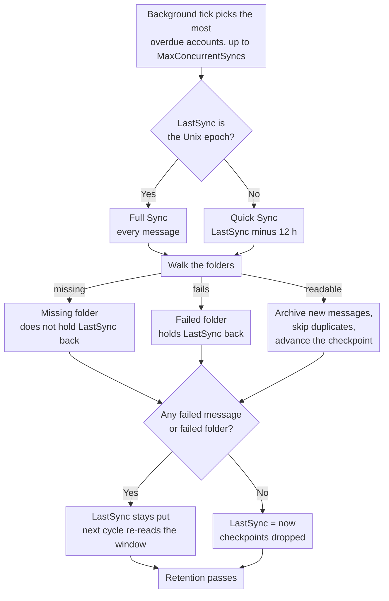

# 🔄 Mail Synchronization (Quick vs. Full Sync) {#mail-synchronization-quick-vs-full-sync}

[← Vissza a Dokumentáció Indexhez](index.md)

## 📋 Áttekintés {#overview}

A Mail Archiver minden engedélyezett postafiókot automatikusan a háttérben szinkronizál a `MailSyncBackgroundService` keresztül. A szolgáltatás egy rövid lekérdezési ciklust futtat (60 s minden egyes alkalommal), meghatározza, mely fiókok esedékest, majd szinkronizálja őket – egyetlen cikluson belül akár `MailSync:MaxConcurrentSyncs` fiókot párhuzamosan – mielőtt minden egyes fiókot újra beütemezné a saját szinkronizationi intervalluma szerint. Az intervallumok globálisan, a `appsettings.json` segítségével konfigurálhatók, és fiók szinten is felülírhatók a Create/Edit oldalon.

Két különálló szinkronizációs mód létezik:

| Mód | Indító | Hatókör |
|------|--------------|-------|
| **Quick Sync** (incrementális) | Minden szinkronizációs ciklus (fiókonkénti intervallum) | Csak az utolsó sikeres szinkronizálás óta megjelent/változott üzenetek |
| **Full Sync** (újraszinkronizálás) | Új fiók, manuális gomb, `AlwaysForceFullSync`, vagy fiókonkénti / globális Full Sync intervallum | Minden üzenet minden nem kizárított mappában |

Mindkét mód biztonságosan futtatható ismételt körोंben – a Mail Archiver felismeri a duplikált üzeneteket (`MessageId` alapján, vagy From/To/Subject/SentDate alapján, ha a `MessageId` hiányzik), és kihagyja azokat az üzeneteket, amelyek már archiválva vannak.

---

## 🔁 A szinkronizációs ciklus áttekintése {#the-sync-cycle-at-a-glance}



A végső döntés a meghatározó. `LastSync` csak akkor halad előre, ha a futás
sikeresen lezárult **és** nem voltak hibás üzenetek, **és** nem voltak hibás mappák. Ezért egy olyan postafiók, amely tartalmaz egy olvashatatlan mappát, folyamatosan újra olvasta ugyanazt az ablakot ahelyett, hogy csendben tovább lépne rajta — és ezért egy korán lezárult futás (timeout, leállítás, rate limit) újraolvasást igényel a levelek elvesztése helyett.

---

## ⚡ Gyors szinkronizálás (Inkrementális szinkronizálás) {#quick-sync-incremental-sync}

A gyors szinkronizálás a normál működési mód, amely a beállított intervallumban fut automatikusan. A globális alapértelmezett érték `MailSync:IntervalMinutes` perc (alapértelmezett 15); minden fiók felülírhatja ezt a saját `SyncIntervalMinutes` értékével, amelyet a Létrehozás/Szerkesztés oldalon lehet megadni (ha üresen hagyja, a globális alapértelmezett érték használatos).

### Hogyan működik {#how-it-works}

1. Minden engedélyezett fiók esetében (kivéve a `IMPORT` szolgáltatói fiókokat) a szolgáltatás leolvassa a fiók `LastSync` időbélyegét.
2. A dátumszűrő a következő alapján készül: `LastSync`:
   - **IMAP**: `SearchQuery.DeliveredAfter(LastSync − 12 hours)`
   - **M365 (Graph)**: `receivedDateTime ge (LastSync − 12 hours)`
3. A 12 órás átfedés szándékos. Ez azok a leveleket is elkapja, amelyeket a szolgáltató a korábbi szinkronizálás elindítása után deliveryált, de kisserőlt időbélyeggel rendelkezik, valamint tolerálja az időeltérést a mail szerver és a Mail Archiver host között. A duplikációkat a duplikáció-ellenőrzés szűri ki, így az átfedés soha nem hoz létre duplikált bejegyzéseket.
4. Minden nem kizárított mappánál a szűrt üzenetlista csoportokban kerül lekérétele és archiválása. A meglévő üzeneteket kihagyja.
5. **Sikeres befejezés** esetén (nincs elhasadt üzenet, nincs egész mappában elhasadt folyamat, nincs elérhetőség-korlátozás), a `LastSync` értéke `DateTime.UtcNow`-ra kerül beállítva, és a következő ciklus onnan indul.
6. Ha **egyetlen üzenet feldolgozása is megelக்adt**, vagy **egy mappa sem szinkronizálható** (lásd: [Folders That Fail as a Whole](#-folders-that-fail-as-a-whole)), a `LastSync` értéke **nem** frissül, így a következő ciklus megpróbálja ugyanazt az időintervallumot.
7. Ha a fiók **rate-limit** állapotba került (lásd: [Rate Limit Handling](RateLimitHandling.md)), a `LastSync` értéke is érintetlen marad, és a szinkronizálás a napi kvóta újtatódtásakor mappánkénti ellenőrzőpontról (checkpoint) folytatódik.

### Mikor látja? {#when-you-see-it}

- Automatikusan, néhány percenként, minden engedélyezett fiók esetében.
- Egy új fiók első szinkronizálása befejeződött után (az első ciklus Full Sync, lásd alább).
- Nincs szükség felhasználói műveletre.

## 🗄️ Teljes szinkronizálás (Resync) {#full-sync-resync}

A Teljes szinkronizálás figyelmen kívül hagyja a dátumszűrőt, és a szerverről minden egyes nem kizárt mappában található **minden** üzenetet letölti, az időponttól függetlenül.

### Mi váltja ki a Teljes szinkronizálást {#what-triggers-a-full-sync}

A Teljes szinkronizálás akkor indul el, ha egy fiók `LastSync` értékét a Unix epoch-ra (`1970-01-01T00:00:00Z`) állítják. Ez négy helyzetben fordul elő:

1. **Új fiók** – Minden újonnan létrehozott IMAP vagy M365 fiók `LastSync = 1970-01-01` értékkel indul. Ez nedenle az adott fiók első ütemezett szinkronization ciklusa automatikusan Teljes szinkronizálás, amely elvégzi az elsődleges archív importálást.
2. **Manuális "Full Resync" gomb** – A *Account Details* oldalon a **Full Resync** gomb (`MailAccounts/Resync`) a `LastSync` értéket az epoch-ra állítja, és azonnal elindítja a szinkronizálást a kérés foregroundjában.
3. **`MailSync:AlwaysForceFullSync = true`** – Ha ez a konfigurációs flag engedélyezve van, a háttérszolgáltatás **minden egyes engedélyezett fiók esetében minden szinkronizálási ciklus elején** visszaállítja a `LastSync` értéket az epoch-ra. Ez gyakorlatilag minden ciklust Teljes szinkronizálássá alakít. Ez csak hibaelégítés céljából szolgál, és a probléma megoldása után vissza kell kapcsolni, mivel drasztikusan növeli a levelezőszerver és a Mail Archiver példány terhelését.
4. **Fiókonkénti vagy globális Teljes szinkronizálási intervallum** – Ha egy fiókhoz `FullSyncIntervalHours` érték van beállítva (Create/Edit oldal), vagy a globális alapértelmezett `MailSync:FullSyncIntervalHours` konfigurálva van a `appsettings.json`-ben, a háttérszolgáltatás automatikusan elindít egy Teljes szinkronizálást, miután az intervallum eltelt az облі fiók utolsó teljes szinkronizálása (`LastFullSync`) óta. A fiókonkénti érték elsőbbséget élvez; ha egyik sem van beállítva, nem fut automatikus teljes szinkronizálás, és csak a manuális resync gomb (és a fent említett `AlwaysForceFullSync`) marad aktív. Miután a teljes szinkronizálás befejeződött, a `LastFullSync` értéket `DateTime.UtcNow`-ra frissítik, így a következő teljes szinkronizálás attól a ponton indul.

### Viselkedés a Teljes szinkronizálás alatt {#behavior-during-a-full-sync}

- Nincs alkalmazva `DeliveredAfter` / `receivedDateTime ge …` szűrő. A szervert arra kérik, hogy minden üzenetet visszaadjon a mappában.
- Ha a szerver kevesebb eredményt ad vissza, mint amennyit a mappa valójában tartalmaz (néhány IMAP szerver korlátozza a `SEARCH` eredményeket), a Mail Archiver érzékeli a különbséget, és a szinkronizálás a szekvencia szám alapján történő összes `UniqueId` lekérésére vált át, így semmilyen üzenet nem tűnik el csendben.
- Azok az üzenetek, amelyek már az archívumban vannak, duplikátumként jelennek meg és kihagyódnak – a meglévő archivált másolatot **nem** írja felül. Ha egy duplikátum egy korábban ismertnél más mappanév alatt található, a tárolt `FolderName` mező frissül, hogy tükrözze az aktuális helyet.
- Nagyméretű postafiókok esetén a Teljes szinkronizálás több óráig vagy akár napokig is eltarthat. Ha a sávszélesség-követés engedélyezve van, a szinkronizálás rendesen szünetel a napi kvótánál, és a következő napon mappánkénti ellenőrzőpontokról folytatódik (lásd: [Rate Limit Handling](RateLimitHandling.md)).
- A `LastSync` értéket csak akkor frissítik `DateTime.UtcNow` értékre, ha a Teljes szinkronizálás sikeresen befejeződik hibás üzenetek és hibás mappák nélkül, pontosan úgy, mint egy Quick Sync.

### Mikor használjunk manuális Teljes szinkronizálást {#when-to-use-a-manual-full-sync}

Használja a **Full Resync** gombot, ha:

- Megváltoztatta a fiók **kizárt mappák** (excluded folders) listáját, és szeretné megerősíteni, hogy az archívum megfelel a jelenlegi kiválasztásnak.
- Gyanítja, hogy az archívumból hiányoznak üzenetek (pl. szerverátültetés, szolgáltatókimaradás vagy óra-elcsúszás esetében).
- Átmigratálta a postafiókot egy másik backendre, és ellenőrizni szeretné a teljes kapsamosságot.
- Újraérzékelni szeretné azokat az üzeneteket, amelyeket a szerveren mappák között mozgatTAK el.
- A korábban a Mail Archiver számára láthatatlan mappák újra láthatóvá váltak — pl. Outlook.com mappák, amelyeket harmadik féltől származó kliensek hoztak létre, és amelyek az IMAP mappa-listázásából szűrődtek ki, amíg a webes felületen keresztül át nem neveztek őket (lásd: [Personal Microsoft Account Setup → Troubleshooting](MSA_Outlook_Setup.md#-troubleshooting)). Teljes szinkronizálásra van szükség, mert egy Quick Sync nem pótolná az에는 mappákban lévő régebbi leveleket.

**Ne** használja a Teljes szinkronizálást:

- Állandó műveletként – felesleges terhelést okoz a szolgáltatónak és a Mail Archiver példányának.
- Az üzenet-testek vagy metaadatok "frissítésére" – a duplikált üzenetek kihagyódnak, így a meglévő archivált másolatokat a Teljes szinkronizálás nem frissíti. Egy archivált üzenet felváltásához először törölni kell azt az archívumból, majd le kell futtatni egy (Quick vagy Full) szinkronizálást.
- Állandóan a `AlwaysForceFullSync=true` segítségével – ne hagyja ezt bekapcsolva a terméküzemben. Ez egy diagnosztikai kapcsoló, nem pedig működési mód.

## 🆚 Gyors szinkronizálás vs. Teljes szinkronizálás áttekintésében {#quick-sync-vs-full-sync-at-a-glance}

| Aspekt | Gyors szinkronizálás | Teljes szinkronizálás |
|--------|-----------|-----------|
| Dátú szűrő | `LastSync − 12 h`-tól mostantól | Nincs (összes üzenet) |
| Tipikus volumen | Néhány új üzenet | Teljes postafiók |
| Időtartam | Másodpercektől percekig | Percektől napokig (a postafiók mérete és a szolgáltató korlátai függvényében) |
| Sávszélesség hatás | Alacsony | Magas |
| `LastSync` frissítés sikeres esetén | Igen | Igen |
| `LastSync` frissítés hiba / sebességkorlátozás esetén | Nem (újrapróbálkozás a következő ciklusban) | Nem (folytatás ellenőrzőpontról) |
| Duplikáció kezelése | Már archivált üzenetek kihagyása | Már archivált üzenetek kihagyása |
| Indító | Időzítő (számlónkénti intervallum) | Új fiók, manuális gomb, `AlwaysForceFullSync` vagy Teljes szinkronizálás intervallum |
| Ajánlott | Napi működéshez | Kezdő importáláshoz és alkalmi ellenőrzéshez |

## ⚙️ Konfiguráció {#configuration}

A szinkronizációs viselkedést a `appsettings.json` `MailSync` szekciója szabályozza (vagy a Docker környezeti változók `MailSync__*`). A teljes paraméterlistaért lásd a [Setup.md](Setup.md) dokumentációt.

| Beállítás | Alapértelmezett | Leírás |
|---------|---------|-------------|
| `MailSync:IntervalMinutes` | `15` | Globális alapértelmezett az egyes fiókokonkénti szinkronizációs intervallumhoz, percekben kifejezve. Minden fiók felülírhatja ezt a Létrehozás/Szerkesztés oldalon (hagyja üresen a megadott alapértelmezett használatához). |
| `MailSync:FullSyncIntervalHours` | _nincs megadva_ | Opcionális globális alapértelmezett az automatikus teljes újraszinkronizálásokhoz, órákban kifejezve. Ha nincs megadva (az alapértelmezett), nincs automatikus teljes szinkronizálás, hacsak nincs beállítva egy fiókonkénti `FullSyncIntervalHours` érték. A fiókonkénti értékek felülírják ezt. |
| `MailSync:TimeoutMinutes` | `0` (nincs) | Fiókonkénti szinkronizációs timeout. Egy szinkronizálás, amely tovább tart, mint amennyit megengedett, megáll a következő üzenet határonál, és a következő futtatáskor folytatódik. A `0` (az alapértelmezett, vagy bármely nem pozitív érték) azt jelenti, hogy nincs timeout. Lásd: [Stopping a Sync Early](#-stopping-a-sync-early). |
| `MailSync:ConnectionTimeoutSeconds` | `300` | IMAP kapcsolat timeout. |
| `MailSync:CommandTimeoutSeconds` | `600` | IMAP parancs timeout. |
| `MailSync:AlwaysForceFullSync` | `false` | Amikor `true`, minden ciklus egy Teljes Szinkronizálás minden fiók számára. **Csak diagnosztikára – ne hagyja bekapcsolva produkcióban.** |
| `MailSync:IgnoreSelfSignedCert` | `false` | Elfogadja a saját aláíróval ellátott TLS tanúsítványokat (nem megbízható root, hiányos lánc) és a hostname eltéréseket az IMAP kapcsolatoknál — pl. Proton Bridge, amelynek a tanúsítványa a `127.0.0.1` névre szól. A lánc egyéb problémái, mint például a lejárt tanúsítványok, továbbra is elutasításra kerülnek. |
| `MailSync:MaxConcurrentSyncs` | `1` | Hány fiók szinkronizálása futhat egyszerre. A slotok újratöltődnek, amint felszabadulnak, lásd: [How accounts are scheduled](#-how-accounts-are-scheduled). A `1` soros szinkronizálást biztosít; növelheti a párhuzamos futtatáshoz — ügyeljen a szolgáltató sebességkorlátokra és a helyi erőforrás-használatra. |
| `MailSync:InterAccountDelaySeconds` | `0` | Opcionális, másodpercekben megadott késleltetés (stagger delay), amely minden fiók szinkronizálási feladat végén alkalmazásra kerül. Hasznos a hirtelen indítások (burst-starts) elkerülésére, amikor `MaxConcurrentSyncs > 1`. A `0` kikapcsolja azt. |
| `MailSync:MaxIssuesPerKind` | `20` | Hány darab és milyen típusú problémát emlékszik meg a szinkronizálási feladat a fiók oldalhoz — a sikertelen mappák, hiányzó mappák és sikertelen üzenetek külön költségvetésben szerepelnek. Minden, ami ezen túl van, csak számlálásra kerül, nem tárolásra. A `0` kikapcsolja a részletezést, és csak a számlálókat hagyja meg. |
| `MailSync:GlobalExcludedFolders` | _üres_ | A szinkronizálásból kizárt mappák minden fiók számára, kiegészítve a saját listájukhoz. Lásd: [Excluded Folders](#-excluded-folders) lentebb. |
| `MailSync:ExcludeSubfolders` | `false` | Ez-e a kizárási bejegyzés a megnevezett mappa alatti mappákat is lefedi mindkét listában. Lásd: [Excluded Folders](#-excluded-folders) lentebb. |

> 💡 Mind a normál szinkronizálási intervallumot, mind a teljes szinkronizálási intervallumot felülírhat egyes fiókonként a **Create/Edit Mail Account** oldalon. A fiókonkénti mezők üresen hagyásával a fenti globális alapértelmezettekhez térhet vissza. Egy fiók teljes körű eltávolításához a schedulerből, kapcsolja ki a fiókot (kapcsolja ki az *Enabled* kapcsolót az Account Details oldalon).

---

## 🚫 Kijelölt mappák {#excluded-folders}

A mappák két helyről is kizárhatók a szinkronizálásból, a két lista pedig **adódik**: egy mappát akkor hagy ki a rendszer, ha az **egyik** listával egyezik. egyik lista sem tud újratartalmazni olyat, amit a másik már kizár了, így egy bejegyzés hozzáadása bárhol csak törölheti a mappákat a szinkronból.

| Forrás | Hatókör | Hol |
|--------|-------|-------|
| Fiók kizárási lista | Egy fiók | *Create/Edit Mail Account* oldal |
| `MailSync:GlobalExcludedFolders` | A telepítés minden fiókja | `appsettings.json` vagy `MailSync__GlobalExcludedFolders__<n>` |

A globális lista **alapértelmezés szerint üres**, így egy olyan telepítés, amely soha nem konfigurálja azt, pontosan úgy viselkedik, mint korábban. Ez azért létezik, hogy amikor sok postafiók érkezik ugyanazon a szerverről, ne kelljen minden egyes fiókhoz azonos kizárási listát fenntartani.

Mindkét lista ugyanazokat a egyezési szabályokat használja, így nem võib eltérni egymástól:

1. pontos egyezés a mappa teljes útvonalával (`INBOX/Drafts`);
2. pontos egyezés a mappa saját nevével (`Drafts`), ami érzékeny a rövid névként beírt bejegyzésekre akkor is, ha a szerver prefixált útvonalat jelenti;
3. útvonal-suffix egyezés, amely a különб segítő variációkat is elkapja — `Drafts` egyenlően is illeszkedik a `INBOX.Drafts` és `INBOX/Drafts` esetére — valamint a szerver által prefixált neveket, mint például a `[Provider]/Drafts`;
4. minden, ami egy bejegyzés által megnevezett mappa alatt található, tehát a `Archive` a `Archive/Team` és a `INBOX.Archive.Team` esetét is lefedel, amennyiben a `MailSync:ExcludeSubfolders` engedélyezve van (ez alapértelmezés szerint ki van kapcsolva, megfelelve a korábbi viselkedésnek, mielőtt ez az opció létezett). Állítsa `true` értékre, hogy egy postafiók-fát a gyökér neve helyett a gyökér megnevezésével zárjon ki; a gyári beállítással egy bejegyzés csak azt a mappát jelöl le, amelyet maga megnevez.

Minden összehasonítás tördelésnél nem érzékeny. A teljes útvonal suffix szabály a útvonal-elosztóhoz kötődik, így a `Archive` nem viszi magával a `ArchiveWeek` nevű mappát. A név-összehasonítás nem ilyen módon kötődik: egy rövid bejegyzés bármelyik mappával is egyezik, amelynek a neve **végződik** azzal, így a `Archive` egy `OldArchive` nevű mappát is magával visz. Ahhoz, hogy pontosan egy mappát zárjon ki hasonló nevű mappák közül, adja meg a teljes útvonalát.

A 4. szabály úgy kötődik az elosztóhoz, mint a 3. szabály, tehát egész mappákat vesz el, és soha nem egy név részét: a `Archive` lefed a `Archive/Team` esetét, míg egy `Team Archive Review` nevű postafiók a szinkronban marad. Az ősi mappák (ancestors) csak útvonal alapján hasonlítanak össze, így a nem kötött név-összehasonítás nem továbbul a mappák gyermekelemeire. Egy `.` bárhol megjelenik, elosztóként számít, ami azt jelenti, hogy egy olyan szerveren, amely `/` karakterrel választja el az elemeket, egy szó szerint `Archive.ics` nevű felső szintű mappa úgy jelenik meg, mint amely a `Archive` alatt található.

**Alapértelmezés szerint egyetlen mappa neve sem kerül kizárásra.** Az, hogy mely neveket érdemes listázni, teljesen függ a szervertől és annak nyelvétől — egy postafiók-fa, amely tartalmaz kalendárium, kapcsolat, feladat és jegyzet mappákat is, gyakori ok az erre a használatra, de a Mail Archiver nem feltételezi azt. Tekintsen a [Setup.md](Setup.md) dokumentációra a konfigurációs példáért.

A listák bármely egyikének módosítása nem távolít el semmit, ami már archiválva van. Utána futtason egy [Full Sync](#-full-sync-resync) folyamatot, ha ellenőrizni szeretné, hogy az archiválás megfelel a jelenlegi kiválasztásnak.

A kizárás minden olyan helyen érvényes, ahol a mappalista végigjár, nem csak az archiválásnál: egy kizárt mappát a szerver oldali törlési folyamat is kihagy (lásd alább), így egy bejegyzés a szerveren lévő mappát is védi.

## 🗑️ Szerveroldali törlés a szinkronizálás során {#server-side-deletion-during-sync}

Ha egy fiókban `DeleteAfterDays` van beállítva (> 0), a Mail Archiver minden szinkronizálás után törli a konfigurált küszöbérték feletti, régebbi üzeneteket a **mail szerverről**:

- **IMAP**: `SearchQuery.SentBefore(now − DeleteAfterDays)` mappánként, majd expunge.
- **M365 (Graph)**: `receivedDateTime lt (now − DeleteAfterDays)` mappánként, majd delete.

A Mail Archiverben tárolt archivált példányokra ez **nem** gyakorol hatást – csak a szerveroldali postafiók tartalma csökken. Az egyik kizárási listán szereplő mappák ([Excluded Folders](#-excluded-folders)) kerülnek elkerülésre ezen a törlési folyamaton, és érintetlen maradnak a szerveren. Lásd a [Retention Policies](RetentionPolicies.md) részt a helyi megőrzési szabályokról, amelyek azt szabályozzák, hogy az archivált példányokat meddig kell megőrizni.

---

## 🛟 Azokra az üzenetek visszaerése, amelyeket a szerver hiányolóként jelentet {#recovering-messages-the-server-reports-as-missing}

Néhány szerver elutasít egy üzenetet a normál UID fetch folyamat során, de még egy használható MIME dokumentumot ad vissza egy plain `BODY[]` fetch esetén. Ezt régi, on-premises Exchange környezetben tapasztaltuk, ahol a fetch a következő hibával sikeredik félre:

```
MailKit.MessageNotFoundException: The IMAP server did not return the requested message.
```

Mentes mechanizmus (fallback) nélkül az ilyen üzenet sikertelen e-mailnek számítodik, és mivel a `LastSync` nem halad előre, amíg egy fiók hibákkal küzd, a fiók minden futtatáskor ugyanazokat az üzeneteket olvassa újra, így soha nem tesz haladást.

**Amit a Mail Archiver tesz:** pontosan egy további lekérési kísérletet a megadott UID-re, és csak erre a konkrét hibára vonatkozóan. Az hitelesítési problémák, a kapcsolat elvesztése, a korlátozás (throttling) és a parzolási hibák nem érintettek, a meglévő átmeneti újrapróbálási (transient-retry) viselkedés pedig változatlan marad. A kísérlet csak olvasható (read-only): nincs üzenet, amely beolvasott lenne, nincs jelzés (flag), amely megváltozna, semmi sem kerül mozdítva vagy törölve. Csak akkor számít sikeresnek, ha az alapértelmezett adatok ténylegesen megérkeztek **és** MIME üzenetként ki voltak parzolva — bármi más továbbra is sikertelen e-mailnek minősül. A visszaerelt üzenetek ezután a normál archiválási útvonalon haladnak tovább, beleértve az ismétlés-ellenőrzést (duplicate detection), így egy ismételt teljes szinkronizálás nem archiválja őket kétszer.

**Provider error helyőrzők:** a szerver által visszaadott adat gyakran nem az eredeti üzenet, hanem egy dokumentum, amelyet a szolgáltató generált a helyére, például:

```
Subject: Retrieval using the IMAP4 protocol failed for the following message: 270198
From: Microsoft Exchange Server 2010

The server couldn't retrieve the following message: ...
```

Ez pontosan úgy kerül archiválásra, ahogy megérkezett, és soha nem írják át a benne idézett feladó, tárgy vagy test részét. A Mail Archiver nem képes visszaerélni olyan tartalmat, amelyet maga a szolgáltató megtagad a MIME formátumban való konverziót; amit megőröl, az a legjobb képzés, amelyet a szerver képes biztosítani, továbbá az a tény, hogy egy helyőrző érkezett meg. Mindegyik logolva kerül a `Warning` szinten, fiók, mappa, UID és tárgy megadásával.

**Ha a fallback üres vissza \]**, az üzenet továbbra is sikertelen e-mailnek marad, pontosan mint korábban, és a kísérletet a `Warning` szinten logolják a csendes továbbadás helyett — egy nem lekérjesztett üzenet soha nem tűnhet archiváltnak. Amenny if egy szerver ilyen módon viselkedne folyamatosan, a dokumentált következő lépés az, hogy külön lekérjék a `BODY.PEEK[HEADER]` és a `BODY.PEEK[TEXT]` elemeket, majd összeállítsák őket egyetlen MIME dokumentumból. Ez egy valóban más kérés, míg a jelenlegi fallback ugyanaz a kérés, csak más módon olvasható. Ez szándékosan nem került megvalósításra: egy második round trip költséggel jár minden egyes üzenetnél, és egy újabb állapotot („header arrived, text did not”) igényelne a definiáláshoz, és eddig tapasztalt szerver nem igényelt ilyet.

Mindkét számláló megjelenik a fiók befejezési log sorában:

```
Sync completed for account: Example. New: 0, Failed: 0, Deleted: 0, Recovered: 25, Provider placeholders: 25, Failed folders: 0
```

A `Recovered` azokat az üzeneteket számolja, amelyeket a fallback megmentett; a `Provider placeholders` azok részhalmazza, amelyek szolgáltató által generált hibadokumentumoknak bizonyultak. A `Failed: 0` mellettük jelzi a funkció lényegét — a fiók már nem áll meg benne.

## 📁 Csomagolásból eltérő mappák (egészen egységként) {#folders-that-fail-as-a-whole}

Egy üzenet önállóan is hibázhat, és egy mappa is hibázhat egységként — a szerver felsorolja, de a megnyitása vagy a keresése hibát okoz. Egyes szerverek `LIST`/`LSUB` keresztül hirdetnek mappákat, amelyek ezután `NO ... doesn't exist`-öt válaszolnak `EXAMINE`-on.

Ezeket külön számolják, egy mappát egyetlen értékkel:

```
Sync completed for account: Example. New: 120, Failed: 0, Deleted: 0, Recovered: 0, Provider placeholders: 0, Failed folders: 2
```

`Failed folders: 2` azt jelenti, hogy két mappa egyáltalán nem szinkronizálható. Ez **nem** azt jelenti, hogy egy konkrét üzenet hibázott — amikor egy mappát nem lehet megnyitni, az 안에 lévő üzenetekről semmi sem ismert, így a hibás üzenetek száma nem lenne hiteles.

**Miért saját számlálója van ennek.** A mappa szintű hiba korábban a hibás *üzenetek* számaként volt rögzítve, annyi, amennyi mappában feldolgozták addig. Ez a szám kitalált volt, és felülírta a mappa valódi, üzenetenkénti hibáit. Így egy hozzáférhetetlen mappa akár több száz hibás üzenetet is jelenthetett, amelyek valójában tökéletesen archiválva voltak.

**Hatás a `LastSync`-ra, változatlan.** Egy mappa, amely egészen hibázott, továbbra is megakadályozza a `LastSync` haladását, pontosan úgy, ahogy akkor is történt, amikor hibás üzenetként volt számlálva. Csak a jelentés változott meg, nem a viselkedés: a fiók továbbra is ugyanarra az intervallumra próbálja meg újra a következő ciklusban. Ez szándékozatosság — egy olyanzási szinkronizáció, amely továbbment egy mappán, amelyet soha nem sikerült beoladnia, soha nem tér vissza a benne lévő levelekért.

Mindkét számláló látható a `Information` szintjén, és a figyelmeztetés, amely nevét megadja, mindenkor megjelenik, amikor a `LastSync` visszatartódik:

```
Not updating LastSync for account Example: 0 failed emails, 2 folders that could not be synced at all
```

### Mappák, amelyek eltűntek, a bukott mappákkal szemben {#folders-that-are-gone-as-opposed-to-broken}

Egy mappa, amelyet a szerver felsorol, majd megtagad a megnyitását, nem jelent automatikusan hibát. A leggyakoribb ok egyáltalán nem hiba: az RFC 3501 tiltja a szerver számára, hogy egy nevet eltávolítson a feliratkozási listáról, amikor a mögötte lévő postafiók törlődik, így egy mappa, amelyhez valaki valaha feliratkozott egy IMAP kliensben, évek később is `LSUB` által jelentésre kerül. A mappák felfedezése a `LIST` és a `LSUB` egyesítését jelenti, így ezek a nevek elérkeznek a szinkronizáláshoz, majd a `EXAMINE` válaszol a `NO ... doesn't exist`-ra.

Ez egy válasz, nem egy hiba. Nincs mit újra megkísérelni, és nincs miért visszatérni, ezért külön számolják, és **nem** tartja vissza a `LastSync`-et:

```
Sync completed for account: Example. New: 120, Failed: 0, ..., Failed folders: 0, Missing folders: 16
```

Ha hibaként számolná el, az megállítaná a fiókot végleg, mivel egy olyan mappa, amely nem létezik, soha nem fog újra létezni. Ez pontosan az volt, ami egy 16 elavult feliratkozással rendelkező postafióknál történt: a fiók megállította a `LastSync` előrehaladását, és nem tudott önmagát helyreállítani.

Minden egyéb hiba továbbra is hibának számít, és továbbra is tartja vissza a fiókot — nincs jogosultság, megszakadt kapcsolat, korlátozás (throttling), szerverhiba. Ezek a következő futtatáskor sikeresek lehetnek.

A `Missing folders: N` még is érdemes kezelni, bár ártatlan: ez azt jelenti, hogy a postafiók olyan mappák feliratkozásokat tartalmaz, amelyek már nem léteznek. A törlésük egy `UNSUBSCRIBE` minden név esetén, bármely IMAP klienssel elvégezhető, a szinkronizálás pedig szándékosan **nem** végzi meg azt — az archiváló nem módosíthatja a tevékenység alatt olvasott postafiókot.

Csak IMAP esetén. A Microsoft Graph az API keresztül sorolja fel a mappákat, ahol egy törölt mappa egyszerűen nem kerül visszatérési értékként, így ez a helyzet ott nem fordulhat elő.

Mindkét szolgáltatóra vonatkozik, IMAP és M365 (Graph).

## 🗓️ Hogyan kerülnek ütemezésre a fiókok {#how-accounts-are-scheduled}

Egy háttérfolyamat (tick) percenként egyszer fut le. Betölti a engedélyezett fiókokat, kiszámítja, melyek esedékestek, és annyi folyamatot indít el, amennyi szabad szinkronizációs slot áll rendelkezésre: összesen `MailSync:MaxConcurrentSyncs` darab.
A folyamat **nem** vár a megindított szinkronizációk befejeződésére. Minden, ami nem fér el, a következő tickre kerül, amely újra elrendez mindenről alapértelmezés szerint.

Minden fiók következő futtatási ideje akkor kerül meghatározásra, amikor az aktuális szinkronizáció **befejeződik**, az abban a pillanatban, plusz az intervallum.
Így egy fiók, amelynek szinkronizációja tovább tart, mint az intervalluma, azonnal újra esedékes a befejeződés után, de soha nem fut egyszerre kétszer: a már futó fiókot kihagyja, nem pedig a sorba teszi.

Ha több fiók esedékes, mint a rendelkezésre álló slot, a **leginkább elmaradt először fut**. Egyenlőség esetén az account id alapján dönt, így a felhalmozódott feladatok reproduzierhető módon dolgozhatók fel.

Egy befejező szinkron azonnal felébreszti az ükemezőt (scheduler), így a ciklus nem tölti az idejét az egyik perces várakozási idő alatt, ha már szabadult fel egy slot: a felhalmozódott feladatok egymás után dolgozhatók fel még `MaxConcurrentSyncs: 1` esetén is, pontosan úgy, ahogy a régi batch loop, miközben a perces intervallum csak a két fióklista ellenőrzése közötti legnagyobb szünetet jelenti.

Ha több mint egy slot áll rendelkezésre, érdemes beállítani a `MailSync:TimeoutMinutes` értéket, amely alapértelmezés szerint `0` (nincs timeout). Egy szinkron addig foglalja el a slotját, amíg fut, így egyetlen olyan fiók, amely végleg leáll a folyamatból, végérvényesen csökkenti a többi fiók számára elérhető slotok számát. Egy timeout leállítja az ilyen futást úgy, mint egy szünetet, amely megőrzi a checkpointjeit, a slot pedig a következő ticknél újra szabad lesz.

> ℹ️ Ezt megelőzően a tick minden esedékes fiókot összegyűjtött, és minden egyesük befejeződésére várt, mielőtt újra ránézne a listára. Így egyetlen nagy levelezőfiók bármennyit is tartott, minden más fiókot tartott vissza a futási ideje alatt: a slotok felszabadultak, de semmit nem értékeltek újra addig, amíg az utolsó is vissza nem tért, így egy olyan telepítés, amely `MaxConcurrentSyncs: 10` és tartalmaz egy hatórás levelezőfiókot, gyakorlatilag hatórónként szinkronizált mindent. A gyorsan befejező fiókok most már a saját intervallumuk szerint futnak, függetlenül attól, hogy mi fut éppen mellettük.

Leálláskor a szolgáltatás akár 30 másodpercig is vár a folyamatban lévő szinkronizációkra, ahelyett, hogy egy nyitott IMAP session alatt állt volna le a folyamatot. Ezeket nem mondja meg, lásd a [Stopping a Sync Early](#-stopping-a-sync-early) dokumentációt, hogy mi állíthatja meg a szinkronizációt.

---

## ⏹️ Szinkronizálás korai leállítása {#stopping-a-sync-early}

Egy futó szinkronizálás pontosan két okból áll meg, mielőtt minden mappát végigellenőrizné: vagy valaki lemondja a feladatot a **Jobs** oldalon, vagy a fiók `MailSync:TimeoutMinutes` időtartama lejárt. Mindkét esetet három ponton ellenőriznek: minden mappa előtt, minden batch előtt, valamint minden egyes üzenet előtt, így egyik sem kell várnia egy nagy mappa befejeződésére.

A timeout (időtúllépés) **csak a tervezett szinkronizálásokra vonatkozik**. A felületről elindított szinkronizálás, a "Sync now" művelet vagy a teljes újraszinkronizálás (full resync) timeout nélkül fut, így egy hosszú manuális szinkronizálás sosem szakad meg idő előtt.

A kettő eltérően fejezi be a feladatot, és ez a különbség fontos:

| | Job status | `LastSync` | Checkpoints | Retention passes |
|---|---|---|---|---|
| Cancelled from the UI | `Failed`, "Job was cancelled" üzenettel | nem halad előre | megmarad | kihagyva |
| Sync timeout elapsed | `Timed Out` | nem halad előre | megmarad | kihagyva |

A timeout egy **szünet, nem pedig hiba**. A szinkronizálás ott áll meg, ahol van, megtartja a már archivált elemeket, `LastSync`-et érintetlenül hagy, és kihagyja a szerver oldali és a helyi retention passokat, mivel ezek futtatása megsemmisítené a futási idő korlátozásának célját. A következő tervezett futás a checkpointtől folytatja a folyamatot.

### Checkpoints {#checkpoints}

A haladás fiókonként és mappánként van rögzítve a `mail_archiver.SyncCheckpoints`-ben: az adott mappában utoljára archivált üzenet UID-je, a mappa pillanatnyi UIDVALIDITY értékével együtt. Minden telepítés írja azokat; korábban a `BandwidthTracking:Enabled`-hoz kötődtek, ami azt jelentette, hogy egy megszakadt szinkronizálás csak ott tudott folytatni, ahol az érintetlen funkció véletlenül be volt kapcsolva. A checkpointeket újra törlik, amint egy fiók sikeresen befejeződik.

Egy újraindított mappa **pontosan ugyanazt a keresést** futtatja le, amelyet checkpoint nélkül is futtatott volna. Csak a vízszintnél vagy alatti UID-k esik ki az eredményből, így a keresési ablak sosem mozog el, és semmilyen üzenet nem maradhaton kívül róla.

A vízszint (watermark) akkor áll le a haladásban, amint egy üzenet ebben a mappában hibát okoz. Az üzeneteket emelkedő UID sorrendben vizsgálják, így egy hibás UID feletti vízszint azt mondaná a következő futásnak, hogy a hibás üzenet már archiválva van, és soha nem kell újra megpróbálni, ami pontosan az, amit a visszatartott `LastSync` kényszerít ki. Ezért a hiba feletti összes elemet újra el kell olvasni legközelebb; ez újraolvasást igényel, a duplikáció ellenőrzése pedig elnyeli azt.

A checkpointet figyelmen kívül veszik, és a mappát teljes egészében elolvassák, amennyiben nem bizonyítható, hogy alkalmazható: nincs rögzített UID, nincs rögzített UIDVALIDITY, vagy olyan UIDVALIDITY, amely már nem egyezik a mappával. Az utóbbi eset azt jelenti, hogy a szerver újraszámolta a postafiókot, így a tárolt UID egy másik üzenetre vonatkozik. A mappa újraolvasása időbe kerül, de a duplikáció ellenőrzése elnyeli; ha kihagyjuk, üzenetek tűnhetnek el csendben, ezért minden bizonytalan esetben teljes körűen elolvassák a mappát.

A Graph API szolgáltató nem ír UID checkpointeket, mert a Graph API-nak nincs megfelelője az IMAP UID-eknek. Egy időtúllépés vagy sávszélesség-korlátozás miatti M365 szinkronizálás csak annyira "folytatja" a folyamatot, hogy a `LastSync` nem halad előre, így a következő futás újra elolvassa az egész ablakot, a duplikáció ellenőrzése pedig elnyeli az átfedést.

> ℹ️ Ezt megelőzően a checkpoint az utolsó archivált üzenet **Date header** tárolta, és ezt adta át a mappa keresésének, amelyre a szerver az INTERNALDATE választot ad, ami egy másik óra, amely migráált leveleknél akár évekkel is eltérhet, miközben az üzeneteket UID sorrendben, nem pedig dátum sorrendben dolgozzák fel. Mindkét eltérés eltolthatja a keresési ablakot olyan levelek mellett, amelyek soha nem voltak archiválva. Ugyanezt az utat használják, amikor a szinkronizálás sávszélesség-limit miatt szünetel, így ez a változás a folytatást is fixálja.

### Nagy postafiókok és a timeout {#large-mailboxes-and-the-timeout}

Egy 150 000 üzenetes postafiók első teljes szinkronizálása órákig tart, és egy ennél rövidebb timeout minden alkalommal leállítaná azt. A checkpointjétől folytatja a folyamatot ahelyett, hogy elölről kezdte volna, de a fiók nem ér el befejezett állapotot, és így nem halad előre a `LastSync` értékben, amíg egy futás nem megy végig a teljes folyamaton. Ellenőrizze a értékeket a postafiókjaival, és állítsa be a `0` értékre, ha egyáltalán nem szeretne timeoutot.

---

## 👀 A szinkronizálás megfigyelése {#observing-the-sync}

### A fiókoldal megválaszolja a kérdést: „mit csinált az utolsó futás?” {#the-account-page-answers-what-did-the-last-run-do}

Minden e-mail fiók egy **Last Sync Run** kártyát tartalmaz, amely a legutóbb befejeződött futást mutatja: mikor fejeződött be, mennyi ideig tartott, hány üzenetet feldolgozott és hány volt új. Ez túlél a 24 órás feladatmegtartási időn, így egy mailbox, amely egész nap csendben volt, még mindig rendelkezik választ — csak egy újraindítás törli azt, és a kártya ezt jelzi, ahelyett, hogy azt állítaná, a fiók rendben van.

Ha valami hiba történt, a kártya felsorolja azt, csoportosítva és típusonként korlátozva:

- **Folders that could not be read** — a mappa egységként megbukott. Ez `LastSync`-át tartja vissza.
- **Folders the server does not have** — a felfedezés során jelentett, a megnyitáskor megtagadott. Általában törölt mappák maradvány előfizetései; ez nem tartja vissza a `LastSync`-et. Lásd: [Folders that are gone](#folders-that-are-gone-as-opposed-to-broken).
- **Messages that could not be archived** — mappával, tárgyalattal, UID-vel és a szerver saját megfogalmazásával.

Minden csoportot `MailSync:MaxIssuesPerKind` korlátoz, és azt jelzi, hogy ami nem fért bele, azt „és N további” módon tünteti fel, így egy típusból érkező tömeg nem temetheti el a többi hibát. Amikor a `LastSync`-at visszatartották, a kártya azt is egyetlen mondatban jelzi, mivel ez az a kérdés, amit egy elavult időbélyeg valóban felvet.

A fióklista a timestamp mellett jelzi azokat a fiókokat, amelyek utolsó futása problémákat jelentett. Szándékosan csak ezeket: minden sor mellett egy jelzés zaj sarebbe, és megsemmisítené a jelző célját.

- **Account Details page**: Megmutatja a jelenlegi `LastSync` timestampet és az aktív szinkronizálási feladatot (mappa, feldolgozott szám, új szám, sikertelen szám). A **Full Resync** gomb itt található.
- **Logs**: A szinkronizálási folyamat a `Information` szinten kerül naplózásra. Dockerben:
  ```bash
  docker compose logs -f mailarchive-app | grep -i sync
  ```
  A logszűrési tippekért lásd a [Docker Compose Logs Guide](DockerComposeLogs.md) dokumentációt.
- **Rate limiting**: Amikor a szinkronizálás a sávszélesség-korlátok miatt szünetel, a fiók „Rate-Limited” állapotot mutat, és az visszaállási ablak után automatikusan folytatódik. Lásd: [Rate Limit Handling](RateLimitHandling.md).
- **Timeouts**: Egy `MailSync:TimeoutMinutes` által leállított szinkronizálás „Timed Out” állapotot mutat, és a következő futáskor a mentési pontról (checkpoint) folytatódik. Lásd: [Stopping a Sync Early](#-stopping-a-sync-early).

---
