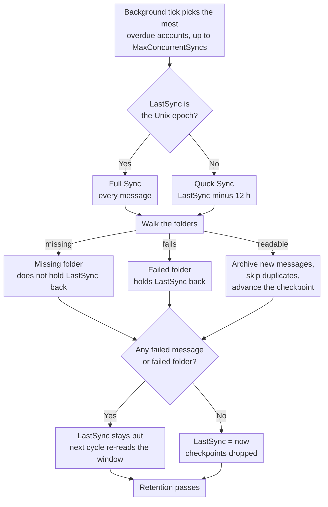

# 🔄 Sincronizzazione Mail (Quick vs. Full Sync) {#mail-synchronization-quick-vs-full-sync}

[← Torna all'Indice della Documentazione](index.md)

## 📋 Panoramica {#overview}

Mail Archiver sincronizza automaticamente ogni Casella di posta abilitata in background attraverso il `MailSyncBackgroundService`. Il servizio esegue un breve ciclo di polling (ogni 60 s), determina quali Account devono essere elaborati e li sincronizza — fino a `MailSync:MaxConcurrentSyncs` Account in parallelo all'interno di un ciclo — prima di riprogrammare ogni Account in base al proprio intervallo di Sincronizzazione. Gli intervalli possono essere configurati globalmente tramite `appsettings.json` e sovrascritti per singolo Account dalla pagina Create/Edit.

Esistono due modalità di Sincronizzazione distinte:

| Modalità | Attivata da | Ambito |
|------|--------------|-------|
| **Quick Sync** (incrementale) | Ogni ciclo di Sincronizzazione (intervallo per Account) | Solo messaggi nuovi/modificati dall'ultima Sincronizzazione riuscita |
| **Full Sync** (resync) | Nuovo Account, pulsante manuale, `AlwaysForceFullSync`, o intervallo Full Sync globale / per Account | Ogni messaggio in ogni Cartella non esclusa |

Entrambe le modalità sono sicure da eseguire ripetutamente – Mail Archiver rileva i duplicati (tramite `MessageId`, o tramite From/To/Subject/SentDate quando il `MessageId` è mancante) e salta i messaggi che sono già archiviati.

---

## 🔁 Il ciclo di Sincronizzazione in breve {#the-sync-cycle-at-a-glance}



L'ultima decisione è quella che conta. `LastSync` avanza solo quando l'esecuzione
si conclude senza messaggi falliti **e** senza cartelle fallite. Ecco perché una
Casella di posta con una singola cartella illeggibile continua a rileggere la stessa finestra invece
di procedere silenziosamente — e perché un'esecuzione che termina in anticipo (timeout, cancel, rate
limit) comporta una rilettura piuttosto che la perdita di posta.

---

## ⚡ Quick Sync (Sincronizzazione Incrementale) {#quick-sync-incremental-sync}

La Quick sync è la modalità operativa normale che viene eseguita automaticamente all'intervallo configurato. Il valore predefinito globale è `MailSync:IntervalMinutes` minuti (predefinito 15); ogni Account può sovrascrivere questo valore con il proprio `SyncIntervalMinutes` impostato nella pagina Create/Edit (lasciare vuoto per utilizzare il valore predefinito globale).

### Come funziona {#how-it-works}

1. Per ogni Account abilitato (esclusi gli Account del provider `IMPORT`), il servizio legge il timestamp `LastSync` dell'Account.
2. Un filtro di data viene costruito da `LastSync`:
   - **IMAP**: `SearchQuery.DeliveredAfter(LastSync − 12 hours)`
   - **M365 (Graph)**: `receivedDateTime ge (LastSync − 12 hours)`
3. La sovrapposizione di 12 ore è intenzionale. Serve a intercettare i messaggi che sono stati consegnati dal provider dopo l'inizio della sincronizzazione precedente ma con un timestamp del server leggermente più vecchio, e tollera lievi discrepanze di orologio tra il server di posta e l'host di Mail Archiver. I duplicati vengono filtrati dal controllo dei duplicati, quindi la sovrapposizione non crea mai voci doppie.
4. Per ogni Cartella non esclusa, l'elenco dei messaggi filtrati viene recuperato in lotti e archiviato. I messaggi esistenti vengono saltati.
5. Al **completamento con successo** (nessun messaggio fallito, nessuna Cartella fallita nel suo insieme, nessun superamento del limite di frequenza), `LastSync` viene impostato a `DateTime.UtcNow` e il ciclo successivo parte da quel punto.
6. Se **un qualsiasi messaggio ha fallito** l'elaborazione, o se **una qualsiasi Cartella non è stata affatto sincronizzata** (vedere [Folders That Fail as a Whole](#-folders-that-fail-as-a-whole)), `LastSync` **non** viene aggiornato, quindi il ciclo successivo riprova lo stesso intervallo.
7. Se l'Account è soggetto a **limiti di frequenza** (vedere [Rate Limit Handling](RateLimitHandling.md)), anche `LastSync` viene lasciato invariato e la Sincronizzazione riprende da un checkpoint per Cartella una volta che la quota giornaliera viene ripristinata.

### Quando si verifica {#when-you-see-it}

- Automaticamente, ogni pochi minuti, per tutti gli Account abilitati.
- Dopo che la Sincronizzazione iniziale di un nuovo Account è stata completata (il primo ciclo è una Full Sync, vedi sotto).
- Nessuna azione dell'utente richiesta.

## 🗄️ Sincronizzazione Completa (Resync) {#full-sync-resync}

Una Sincronizzazione Completa ignora il filtro della data e scarica **ogni** messaggio in ogni Cartella non esclusa dal server, indipendentemente dall'età.

### Cosa attiva una Sincronizzazione Completa {#what-triggers-a-full-sync}

Una Sincronizzazione Completa viene attivata ogni volta che il `LastSync` di un Account è impostato sull'epoca Unix (`1970-01-01T00:00:00Z`). Ciò avviene in quattro situazioni:

1. **Nuovo Account** – Ogni Account IMAP o M365 di nuova creazione inizia con `LastSync = 1970-01-01`. Il primo ciclo di Sincronizzazione pianificato per quell'Account è quindi automaticamente una Sincronizzazione Completa, che esegue l'importazione iniziale nell'Archivio.
2. **Pulsante manuale "Full Resync"** – Nella pagina *Account Details*, il pulsante **Full Resync** (`MailAccounts/Resync`) resetta `LastSync` all'epoca e avvia la Sincronizzazione immediatamente in primo piano rispetto alla richiesta.
3. **`MailSync:AlwaysForceFullSync = true`** – Quando questo flag di configurazione è abilitato, il servizio in background resetta `LastSync` all'epoca per **ogni Account abilitato all'inizio di ogni ciclo di Sincronizzazione**. Questo trasforma effettivamente ogni ciclo in una Sincronizzazione Completa. Ciò è previsto solo per la risoluzione dei problemi e dovrebbe essere disabilitato una volta risolto il problema, poiché aumenta drasticamente il carico sul server di posta e sull'istanza di Mail Archiver.
4. **Intervallo di Sincronizzazione Completa per Account o globale** – Quando un Account ha `FullSyncIntervalHours` impostato (pagina Create/Edit), o il valore predefinito globale `MailSync:FullSyncIntervalHours` è configurato in `appsettings.json`, il servizio in background attiva automaticamente una Sincronizzazione Completa una volta trascorso tale intervallo dall'ultima Sincronizzazione Completa dell'Account (`LastFullSync`). Il valore per Account ha la precedenza; quando nessuno dei due è impostato, non viene eseguita alcuna Sincronizzazione Completa automatica e rimangono solo il pulsante di resync manuale (e `AlwaysForceFullSync` sopra). Dopo il completamento della Sincronizzazione Completa, `LastFullSync` viene aggiornato a `DateTime.UtcNow` in modo che la successiva Sincronizzazione Completa sia pianificata da quel punto.

### Comportamento durante una Sincronizzazione Completa {#behavior-during-a-full-sync}

- Non viene applicato alcun filtro `DeliveredAfter` / `receivedDateTime ge …`. Al server viene richiesto di restituire tutti i messaggi nella Cartella.
- Se il server restituisce meno risultati di quelli effettivamente contenuti nella Cartella (alcuni server IMAP limitano i risultati `SEARCH`), Mail Archiver rileva la discrepanza e passa al recupero di tutti i `UniqueId` tramite numero di sequenza, in modo che nessun messaggio venga perso silenziosamente.
- I messaggi già presenti nell'Archivio vengono rilevati come duplicati e saltati – la copia archiviata esistente **non** viene sovrascritta. Se un duplicato viene trovato in un nome di Cartella diverso rispetto a prima, il campo `FolderName` memorizzato viene aggiornato per riflettere la posizione attuale.
- Per Caselle di posta molto grandi, la Sincronizzazione Completa può richiedere diverse ore o persino giorni. Quando il tracciamento della larghezza di banda è abilitato, la Sincronizzazione si interrompe con grazia al raggiungimento della quota giornaliera e riprende dai checkpoint per Cartella il giorno successivo (vedere [Rate Limit Handling](RateLimitHandling.md)).
- `LastSync` viene aggiornato a `DateTime.UtcNow` solo dopo che una Sincronizzazione Completa si è conclusa senza messaggi falliti e senza Cartelle fallite, esattamente come una Sincronizzazione Rapida.

### Quando utilizzare una Sincronizzazione Completa manuale {#when-to-use-a-manual-full-sync}

Utilizzare il pulsante **Full Resync** quando:

- Hai modificato l'elenco delle **cartelle escluse** dell'Account e desideri confermare che l'Archivio corrisponda alla selezione attuale.
- Sospetti che l'Archivio manchi di messaggi (ad es. dopo una migrazione del server, un'interruzione del fornitore o un incidente di clock-skew).
- Hai migrato la Casella di posta a un backend differente e desideri verificarne la completezza.
- Desideri rilevare nuovamente i messaggi che sono stati spostati tra le Cartelle sul server.
- Cartelle che erano precedentemente invisibili a Mail Archiver sono tornate visibili — ad es. Cartelle di Outlook.com create tramite client di terze parti che sono state filtrate dall'elenco delle Cartelle IMAP fino a quando non sono state rinominate tramite l'interfaccia web (vedere [Personal Microsoft Account Setup → Troubleshooting](MSA_Outlook_Setup.md#-troubleshooting)). È necessaria una Sincronizzazione Completa perché una Sincronizzazione Rapida non andrebbe a riempire le email più vecchie in quelle Cartelle.

**Non** utilizzare la Sincronizzazione Completa:

- Come operazione regolare – comporta un carico non necessario sul fornitore e sulla tua istanza di Mail Archiver.
- Per "aggiornare" i corpi dei messaggi o i metadati – i duplicati vengono saltati, quindi le copie archiviate esistenti non vengono aggiornate da una Sincronizzazione Completa. Per sostituire un messaggio archiviato, devi prima eliminarlo dall'Archivio, quindi eseguire una Sincronizzazione (Rapida o Completa).
- Permanentemente tramite `AlwaysForceFullSync=true` – lascia questa opzione disattivata in produzione. È un interruttore diagnostico, non una modalità operativa.

---

## 🆚 Quick Sync vs. Full Sync a colpo d'occhio {#quick-sync-vs-full-sync-at-a-glance}

| Aspetto | Quick Sync | Full Sync |
|--------|-----------|-----------|
| Filtro data | da `LastSync − 12 h` a ora | Nessuno (tutti i messaggi) |
| Volume tipico | Pochi nuovi messaggi | Intera Casella di posta |
| Durata | Secondi o minuti | Minuti o giorni (a seconda della dimensione della Casella di posta e dei limiti del provider) |
| Impatto sulla larghezza di banda | Basso | Alto |
| `LastSync` aggiornato in caso di successo | Sì | Sì |
| `LastSync` aggiornato in caso di errore / rate-limit | No (riprova al ciclo successivo) | No (riprendi dal checkpoint) |
| Gestione duplicati | Salta i messaggi già archiviati in Archivio | Salta i messaggi già archiviati in Archivio |
| Attivato da | Scheduler (intervallo per-Account) | Nuovo Account, pulsante manuale, `AlwaysForceFullSync` o intervallo Full Sync |
| Consigliato per | Operatività quotidiana | Importazione iniziale e verifica occasionale |

## ⚙️ Configurazione {#configuration}

Il comportamento della Sincronizzazione è controllato dalla sezione `MailSync` di `appsettings.json` (o dalle variabili d'ambiente `MailSync__*` in Docker). Vedere [Setup.md](Setup.md) per l'elenco completo dei parametri.

| Impostazione | Predefinito | Descrizione |
|---------|---------|-------------|
| `MailSync:IntervalMinutes` | `15` | Valore predefinito globale per l'intervallo di Sincronizzazione per Account, in minuti. Ogni Account può sovrascrivere questo valore nella pagina Crea/Modifica (lasciare vuoto per utilizzare questo valore predefinito). |
| `MailSync:FullSyncIntervalHours` | _non impostato_ | Valore predefinito globale opzionale per i riavvii completi automatici, in ore. Quando non impostato (il predefinito), non viene eseguita alcuna Sincronizzazione completa automatica a meno che non venga impostato un valore `FullSyncIntervalHours` per Account. I valori per Account sovrascrivono questo valore. |
| `MailSync:TimeoutMinutes` | `0` (nessuno) | Timeout di Sincronizzazione per Account. Una Sincronizzazione che dura più del previsto si interrompe al successivo confine di messaggio e riprende all'esecuzione successiva. `0` (il predefinito, o qualsiasi valore non positivo) significa nessun timeout. Vedere [Stopping a Sync Early](#-stopping-a-sync-early). |
| `MailSync:ConnectionTimeoutSeconds` | `300` | Timeout della connessione IMAP. |
| `MailSync:CommandTimeoutSeconds` | `600` | Timeout del comando IMAP. |
| `MailSync:AlwaysForceFullSync` | `false` | Quando `true`, ogni ciclo è una Sincronizzazione completa per tutti gli Account. **Solo per diagnostica – mantenere disattivato in produzione.** |
| `MailSync:IgnoreSelfSignedCert` | `false` | Accetta certificati TLS auto-firmati (root non attendibile, catena incompleta) e discrepanze dell'hostname per le connessioni IMAP — ad esempio Proton Bridge, il cui certificato è rilasciato a `127.0.0.1`. Altri problemi di catena, come i certificati scaduti, vengono comunque rifiutati. |
| `MailSync:MaxConcurrentSyncs` | `1` | Quante Sincronizzazioni di Account possono essere eseguite contemporaneamente. Gli slot vengono riempiti man mano che si liberano, vedere [How accounts are scheduled](#-how-accounts-are-scheduled). `1` mantiene le Sincronizzazioni sequenziali; aumentare per parallelizzarle — fare attenzione ai limiti di frequenza del provider e all'uso delle risorse locali. |
| `MailSync:InterAccountDelaySeconds` | `0` | Ritardo di scaglionamento opzionale in secondi applicato alla fine di ogni task di Sincronizzazione dell'Account. Utile per evitare avvii a raffica quando `MaxConcurrentSyncs > 1`. `0` lo disabilita. |
| `MailSync:MaxIssuesPerKind` | `20` | Quanti problemi di ogni tipo un job di Sincronizzazione ricorda per la pagina dell'Account — Cartelle fallite, Cartelle mancanti e messaggi falliti sono conteggiati separatamente. Qualsiasi cosa oltre questo limite viene contata, ma non conservata. `0` disattiva il dettaglio e lascia solo i contatori. |
| `MailSync:GlobalExcludedFolders` | _vuoto_ | Cartelle escluse dalla Sincronizzazione per ogni Account, additive alla lista specifica di ogni Account. Vedere [Excluded Folders](#-excluded-folders) qui sotto. |
| `MailSync:ExcludeSubfolders` | `false` | Se una voce di esclusione copre anche le Cartelle sotto quella che nomina, in entrambe le liste. Vedere [Excluded Folders](#-excluded-folders) qui sotto. |

> 💡 Sia l'intervallo di Sincronizzazione normale che l'intervallo di Sincronizzazione completa possono essere sovrascritti per Account nella pagina **Create/Edit Mail Account**. Lasciare vuoti i campi per Account per utilizzare i valori predefiniti globali sopra indicati. Per rimuovere completamente un Account dallo scheduler, disabilitarlo (disattivare l'interruttore *Enabled* nella pagina Account Details).

---

## 🚫 Cartelle escluse {#excluded-folders}

Le Cartelle possono essere escluse dalla Sincronizzazione da due punti diversi, e i due sono **additivi**: una cartella viene saltata quando corrisponde a **una qualsiasi delle due** liste. Nessuna delle due può reincludere ciò che l'altra ha escluso, quindi l'aggiunta di una voce in qualsiasi punto può solo rimuovere Cartelle dalla sincronizzazione.

| Sorgente | Ambito | Dove |
|--------|-------|-------|
| Lista di esclusione dell'Account | Un singolo Account | pagina *Create/Edit Mail Account* |
| `MailSync:GlobalExcludedFolders` | Ogni Account dell'installazione | `appsettings.json` o `MailSync__GlobalExcludedFolders__<n>` |

La lista globale è **vuota per impostazione predefinita**, quindi un'installazione che non la configura mai si comporta esattamente come prima. Esiste per il caso in cui molte Caselle di posta vengano importate dallo stesso server e l'alternativa sia mantenere una lista di esclusione identica su ogni singolo Account.

Entrambe le liste utilizzano le stesse regole di corrispondenza, quindi non possono divergere:

1. corrispondenza esatta rispetto al percorso completo della cartella (`INBOX/Drafts`);
2. corrispondenza esatta rispetto al nome della cartella stessa (`Drafts`), che intercetta una voce digitata come nome breve quando il server riporta un percorso con prefisso;
3. corrispondenza del suffisso del percorso, che intercetta le variazioni dei separatori — `Drafts` corrisponde anche a `INBOX.Drafts` e `INBOX/Drafts` — e i nomi con prefisso del server come `[Provider]/Drafts`;
4. tutto ciò che si trova sotto la cartella indicata da una voce, quindi `Archive` copre anche `Archive/Team` e `INBOX.Archive.Team`, ogni volta che `MailSync:ExcludeSubfolders` è abilitato (è disabilitato per impostazione predefinita, rispecchiando il comportamento precedente all'esistenza dell'opzione). Impostalo a `true` per escludere un albero di una Casella di posta indicando la sua radice invece di ogni singola cartella al suo interno; con l'impostazione predefinita, una voce corrisponde solo alla singola cartella che indica.

Tutti i confronti non fanno distinzione tra maiuscole e minuscole. La regola del suffisso del percorso completo si ancora sul separatore di percorso, quindi `Archive` non include una cartella denominata `ArchiveWeek`. Il confronto del nome non è ancorato allo stesso modo: una voce breve corrisponde anche a qualsiasi cartella il cui nome **termina con** essa, quindi `Archive` include una cartella denominata `OldArchive`. Per escludere esattamente una cartella tra quelle con nomi simili, inserisci il suo percorso completo.

La regola 4 si ancora sul separatore come la regola 3, quindi include intere cartelle e mai parte di un nome: `Archive` copre `Archive/Team`, mentre una cartella di posta chiamata `Team Archive Review` rimane nella sincronizzazione. Gli antenati vengono confrontati solo tramite percorso, quindi il confronto del nome non ancorato non viene trasmesso alle sottocartelle. Un `.` conta come separatore ovunque appaia, il che significa che su un server che delimita con `/`, una cartella di primo livello denominata letteralmente `Archive.ics` viene letta come situata sotto `Archive`.

**Nessun nome di cartella è mai escluso per impostazione predefinita.** Quali nomi valga la pena elencare dipende interamente dal server e dalla sua lingua — un albero di una Casella di posta che contiene anche cartelle per calendario, contatti, attività e note è un motivo comune per utilizzare questa funzione, ma Mail Archiver non lo assume come certo. Consulta [Setup.md](Setup.md) per un esempio di configurazione.

La modifica di una qualsiasi delle liste non rimuove nulla che sia già stato archiviato. Esegui un [Full Sync](#-full-sync-resync) in seguito se desideri confermare che l'Archivio corrisponda alla selezione attuale.

L'esclusione si applica ovunque la lista delle cartelle venga scansionata, non solo all'archiviazione: una cartella esclusa viene saltata anche durante la fase di eliminazione lato server (vedi sotto), quindi una voce protegge la cartella anche sul server.

---

## 🗑️ Eliminazione lato server durante la Sincronizzazione {#server-side-deletion-during-sync}

Se un Account ha `DeleteAfterDays` configurato (> 0), Mail Archiver elimina i messaggi più vecchi della soglia configurata dal **mail server** dopo ogni sincronizzazione:

- **IMAP**: `SearchQuery.SentBefore(now − DeleteAfterDays)` per Cartella, quindi expunge.
- **M365 (Graph)**: `receivedDateTime lt (now − DeleteAfterDays)` per Cartella, quindi delete.

Le copie archiviate in Mail Archiver **non** sono influenzate da questo processo – viene ridotta solo la Casella di posta lato server. Le Cartelle presenti in una qualsiasi lista di esclusione ([Excluded Folders](#-excluded-folders)) vengono saltate da questa fase di eliminazione e lasciate invariate sul server. Vedere [Retention Policies](RetentionPolicies.md) per il corrispettivo locale di Conservazione che controlla per quanto tempo vengono mantenute le copie archiviate.

---

## 🛟 Recupero dei messaggi che il server segnala come mancanti {#recovering-messages-the-server-reports-as-missing}

Alcuni server rifiutano un messaggio tramite il normale fetch UID e restituiscono comunque un documento MIME utilizzabile per un fetch semplice `BODY[]`. Questo è stato osservato su Exchange on-premises legacy, dove il fetch fallisce con:

```
MailKit.MessageNotFoundException: The IMAP server did not return the requested message.
```

Senza un meccanismo di fallback, un tale messaggio viene conteggiato come email fallita e, poiché `LastSync` non è avanzato mentre un account presenta errori, l'account rilegge gli stessi messaggi ad ogni esecuzione e non fa mai progressi.

**Cosa fa Mail Archiver:** esattamente un ulteriore tentativo di fetch per quel UID, e solo per questo errore specifico. I problemi di autenticazione, la perdita di connessione, il throttling e gli errori di parsing non sono interessati, e l'attuale comportamento di transient-retry rimane invariato. Il tentativo è in sola lettura: nessun messaggio viene contrassegnato come letto, nessun flag viene modificato, nulla viene spostato o eliminato. Viene conteggiato come successo solo se i dati grezzi sono effettivamente arrivati **e** sono stati analizzati come messaggio MIME — qualsiasi cosa di inferiore rimane un'email fallita. I messaggi recuperati seguono quindi il normale percorso di archiviazione, inclusa la rilevazione dei duplicati, quindi una sincronizzazione completa ripetuta non li archivia due volte.

**Segnaposto degli errori del provider:** ciò che il server restituisce spesso non è il messaggio originale ma un documento che il provider ha generato al suo posto, ad esempio:

```
Subject: Retrieval using the IMAP4 protocol failed for the following message: 270198
From: Microsoft Exchange Server 2010

The server couldn't retrieve the following message: ...
```

Questo viene archiviato esattamente come ricevuto e non viene mai riscritto nel mittente, nell'oggetto o nel corpo citato al suo interno. Mail Archiver non può recuperare contenuti che il provider stesso rifiuta di convertire in MIME; ciò che preserva è la migliore rappresentazione che il server è in grado di esporre, oltre al fatto che un segnaposto è ciò che è arrivato. Ciascuno viene registrato al livello `Warning` con account, cartella, UID e oggetto.

**Quando il fallback ritorna vuoto**, il messaggio rimane un'email fallita esattamente come prima, e il tentativo viene registrato a `Warning` invece di passare silenziosamente — un messaggio non recuperato non deve mai poter sembrare archiviato. Qualora un server dovesse comportarsi in modo tale in modo consistente, il passo successivo documentato è recuperare `BODY.PEEK[HEADER]` e `BODY.PEEK[TEXT]` separatamente e assemblarli in un unico documento MIME. Questa è una richiesta genuinamente diversa, dove l'attuale fallback è la stessa richiesta letta in modo differente. Non è stata deliberatamente implementata: costa un secondo round trip per messaggio e aggiunge uno stato "header arrivato, testo no" da definire, e nessun server visto finora ne ha bisogno.

Entrambi i conteggi appaiono nella riga del registro di completamento dell'account:

```
Sync completed for account: Example. New: 0, Failed: 0, Deleted: 0, Recovered: 25, Provider placeholders: 25, Failed folders: 0
```

`Recovered` conta i messaggi che il fallback ha salvato; `Provider placeholders` è il sottoinsieme di quelli che si sono rivelati documenti di errore generati dal provider. `Failed: 0` insieme a loro è il punto fondamentale della funzionalità — l'account non è più bloccato.

---

## 📁 Cartelle che falliscono nel loro insieme {#folders-that-fail-as-a-whole}

Un messaggio può fallire singolarmente e una cartella può fallire come unità — il server la elenca, ma l'apertura o la ricerca della stessa genera un errore. Alcuni server pubblicizzano le cartelle tramite `LIST`/`LSUB` che poi rispondono `NO ... doesn't exist` su `EXAMINE`.

Questi vengono conteggiati separatamente, uno per cartella:

```
Sync completed for account: Example. New: 120, Failed: 0, Deleted: 0, Recovered: 0, Provider placeholders: 0, Failed folders: 2
```

`Failed folders: 2` significa che due cartelle non hanno potuto essere sottoposte a Sincronizzazione. Ciò **non** significa che un messaggio particolare sia fallito — quando una cartella non può essere aperta, non si sa nulla dei messaggi in essa contenuti, quindi nessun numero di messaggi falliti sarebbe veritiero.

**Perché questo è un contatore separato.** Un fallimento a livello di cartella veniva precedentemente registrato come messaggi falliti, pari al numero di messaggi elaborati in quella cartella fino a quel momento. Quel numero era inventato e sovrascriveva i reali fallimenti per messaggio della cartella. Una cartella inaccessibile poteva quindi riportare centinaia di messaggi falliti che in realtà erano stati archiviati perfettamente.

**Effetto su `LastSync`, invariato.** Una cartella che è fallita nel suo insieme impedisce comunque a `LastSync` di avanzare, esattamente come accadeva quando veniva conteggiata come messaggi falliti. È cambiato solo il reporting, non il comportamento: l'Account tenta ancora lo stesso intervallo nel ciclo successivo. Questo è intenzionale — una Sincronizzazione incrementale che ha superato una cartella che non è mai riuscita a leggere non tornerebbe mai indietro per la posta in essa contenuta.

Entrambi i conteggi sono visibili al livello `Information`, e l'avviso che li nomina viene emesso ogni volta che `LastSync` viene bloccato:

```
Not updating LastSync for account Example: 0 failed emails, 2 folders that could not be synced at all
```

### Cartelle scomparse, a differenza di quelle corrotte {#folders-that-are-gone-as-opposed-to-broken}

Una cartella che il server elenca e poi rifiuta di aprire non è automaticamente un fallimento. La ragione più comune non è affatto un guasto: RFC 3501 proibisce a un server di rimuovere un nome dalla lista delle sottoscrizioni quando la Casella di posta sottostante viene eliminata, quindi una cartella a cui qualcuno si è iscritto un tempo in un client IMAP viene ancora riportata da `LSUB` anni dopo. La scoperta delle cartelle prende l'unione di `LIST` e `LSUB`, quindi quei nomi raggiungono la Sincronizzazione, e `EXAMINE` risponde quindi `NO ... doesn't exist`.

Questa è una risposta, non un errore. Non c'è nulla da riprovare e nulla per cui tornare, quindi viene conteggiata separatamente e **non** blocca `LastSync`:

```
Sync completed for account: Example. New: 120, Failed: 0, ..., Failed folders: 0, Missing folders: 16
```

Contarla come un fallimento fermerebbe l'Account permanentemente, perché una cartella che non esiste non inizierà mai più a esistere. È esattamente ciò che è accaduto su una Casella di posta con 16 sottoscrizioni obsolete: l'Account ha smesso di avanzare `LastSync` e non è stato in grado di recuperare autonomamente.

Tutto il resto rimane un fallimento e continua a bloccare l'Account — mancanza di Autorizzazione, una connessione interrotta, throttling, un errore del server. Questi possono avere successo all'esecuzione successiva.

`Missing folders: N` vale la pena di essere affrontato anche se è innocuo: significa che la Casella di posta contiene sottoscrizioni a cartelle che non esistono più. Pulirle è un `UNSUBSCRIBE` per nome, eseguito con qualsiasi client IMAP, e la Sincronizzazione deliberatamente **non** lo fa — un archiviatore non deve modificare la Casella di posta che legge.

Solo IMAP. Microsoft Graph elenca le cartelle tramite l'API, dove una cartella eliminata non viene semplicemente restituita, quindi la situazione non può presentarsi lì.

Si applica a entrambi i provider, IMAP e M365 (Graph).

## 🗓️ Come vengono pianificati gli Account {#how-accounts-are-scheduled}

Un tick in background viene eseguito una volta al minuto. Carica gli Account abilitati, determina quali sono scaduti e avvia quanti più possibile in base agli slot di Sincronizzazione liberi: `MailSync:MaxConcurrentSyncs` in totale.
**Non** attende le Sincronizzazioni che avvia. Tutto ciò che non rientra viene lasciato per il tick successivo, che riconsidererà la situazione da zero.

La prossima esecuzione di ogni Account viene pianificata quando la sua Sincronizzazione **termina**, da quel momento più il suo intervallo.
Un Account la cui Sincronizzazione richiede più tempo del suo intervallo sarà quindi di nuovo scaduto non appena terminata, ma mai due volte contemporaneamente: un Account già in esecuzione viene saltato, non messo in coda.

Quando ci sono più Account scaduti rispetto agli slot disponibili, **il più in ritardo viene eseguito per primo**. In caso di parità, si decide in base all'account id, in modo che un arretrato venga elaborato in modo riproducibile.

Una Sincronizzazione che termina risveglia immediatamente lo scheduler, in modo che il loop non rimanga inattivo per il suo minuto di tempo quando uno slot si è già liberato: un arretrato viene elaborato consecutivamente anche con `MaxConcurrentSyncs: 1`, esattamente come faceva il vecchio loop batch, mentre il minuto rimane solo il gap più lungo tra due controlli della lista degli Account.

Con più di uno slot, si consiglia di impostare `MailSync:TimeoutMinutes`, che è `0` (nessun timeout) per impostazione predefinita. Una Sincronizzazione mantiene il suo slot per tutta la durata dell'esecuzione, quindi un singolo Account che smette permanentemente di progredire riduce gli slot disponibili per tutto il resto. Un timeout termina tale esecuzione come una pausa che mantiene i suoi checkpoint, e lo slot torna libero al tick successivo.

> ℹ️ Prima di questa modifica, il tick raccoglieva ogni Account scaduto e attendeva che tutti avessero terminato prima di controllare di nuovo. Una singola Casella di posta di grandi dimensioni, pertanto, bloccava ogni altro Account per tutta la durata della sua esecuzione: gli slot si liberavano, ma nulla veniva rivalutato finché l'ultimo non tornava, quindi un'installazione con `MaxConcurrentSyncs: 10` e una Casella di posta da sei ore sincronizzava effettivamente tutto con un intervallo di sei ore. Gli Account che terminano rapidamente ora rispettano il proprio intervallo indipendentemente da ciò che altro è in esecuzione.

Allo shutdown, il servizio attende fino a 30 secondi per le Sincronizzazioni ancora in corso invece di interrompere il processo sotto una sessione IMAP aperta. Non vengono annullate; consultare [Stopping a Sync Early](#-stopping-a-sync-early) per sapere cosa interrompe effettivamente una Sincronizzazione.

## ⏹️ Interruzione anticipata di una Sincronizzazione {#stopping-a-sync-early}

Una Sincronizzazione in corso si interrompe prima di aver elaborato ogni Cartella esattamente per due motivi: qualcuno annulla il lavoro nella pagina **Jobs**, oppure il `MailSync:TimeoutMinutes` dell'Account scade. Entrambi i casi vengono controllati in tre punti: prima di ogni Cartella, prima di ogni batch e prima di ogni singolo messaggio, in modo che nessuno debba attendere il completamento di una Cartella di grandi dimensioni.

Il timeout si applica **solo alle sincronizzazioni pianificate**. Una sincronizzazione avviata dall'interfaccia utente, dall'azione "Sync now" o una risincronizzazione completa, viene eseguita senza timeout, quindi una lunga sincronizzazione manuale non viene mai interrotta.

I due modi terminano il lavoro in modo differente, e la differenza è importante:

| | Stato del lavoro | `LastSync` | Checkpoint | Passaggi di Conservazione |
|---|---|---|---|---|
| Annullato dall'interfaccia utente | `Failed`, con "Job was cancelled" | non avanzato | mantenuti | saltati |
| Scadenza timeout Sincronizzazione | `Timed Out` | non avanzato | mantenuti | saltati |

Un timeout è una **pausa, non un errore**. La sincronizzazione si ferma dove si trova, mantiene quanto è stato inserito nell'Archivio, lascia `LastSync` invariato e salta i passaggi di Conservazione lato server e locali, perché eseguirli vanificherebbe lo scopo di limitare il tempo di esecuzione. La successiva esecuzione pianificata riprende dal checkpoint.

### Checkpoint {#checkpoints}

Il progresso viene registrato per Account e Cartella in `mail_archiver.SyncCheckpoints`: l'UID dell'ultimo messaggio archiviato in quella Cartella, insieme alla UIDVALIDITY della Cartella in quel momento. Ogni installazione li scrive; un tempo erano legati a `BandwidthTracking:Enabled`, il che significava che una sincronizzazione interrotta poteva riprendere solo dove quella funzione non correlata era stata attivata. I checkpoint vengono eliminati non appena un Account completa il lavoro senza errori.

Una Cartella ripresa esegue **esattamente la stessa ricerca** che avrebbe eseguito senza un checkpoint. Solo gli UID al livello o al di sotto del watermark vengono rimossi dal risultato successivamente, quindi la finestra di ricerca non si sposta mai e nessun messaggio può uscirne.

Il watermark smette di avanzare non appena un messaggio in quella Cartella fallisce. I messaggi vengono elaborati in ordine UID crescente, quindi un watermark superiore a un UID fallito indicherebbe alla sessione successiva che il messaggio fallito è già stato archiviato e non verrebbe mai riprovato, che è esattamente ciò che il `LastSync` trattenuto serve a forzare. Tutto ciò che si trova sopra l'errore viene quindi riletto la volta successiva; ciò comporta una nuova lettura e il controllo dei duplicati lo assorbe.

Il checkpoint viene ignorato e la Cartella viene letta interamente quando non è possibile dimostrarne l'applicabilità: nessun UID registrato, nessuna UIDVALIDITY registrata, o una UIDVALIDITY che non corrisponde più alla Cartella. L'ultimo caso significa che il server ha rinumerato la Casella di posta, quindi l'UID memorizzato indica un messaggio diverso. Rileggere una Cartella richiede tempo e viene assorbito dal controllo dei duplicati; saltarne uno comporterebbe la perdita silenziosa di posta, quindi ogni caso dubbi viene letto interamente.

Il provider Graph API non scrive checkpoint UID, perché Graph API non ha un equivalente degli UID di IMAP. Una sincronizzazione M365 in timeout o limitata dalla larghezza di banda "riprende" solo nel senso che `LastSync` non viene avanzato, quindi la sessione successiva rilegge l'intera finestra e il controllo dei duplicati assorbe la sovrapposizione.

> ℹ️ Prima di questo, il checkpoint memorizzava l'**intestazione Date** dell'ultimo messaggio archiviato e la forniva alla ricerca della Cartella, che il server rispondeva tramite INTERNALDATE, un orologio diverso che può avere anni di scarto sulla posta migrata, mentre i messaggi vengono elaborati in ordine UID piuttosto che in ordine cronologico. Entrambe le discrepanze potrebbero spostare la finestra di ricerca oltre posta che non era mai stata archiviata. Lo stesso percorso viene utilizzato quando una sincronizzazione si mette in pausa a causa di un limite di larghezza di banda, quindi anche la ripresa è corretta grazie a questa modifica.

### Caselle di posta grandi e il timeout {#large-mailboxes-and-the-timeout}

Una prima sincronizzazione completa di una Casella di posta con 150.000 messaggi richiede ore, e un timeout più breve di questo la interromperebbe ogni volta. Essa riprende dal suo checkpoint invece di ricominciare da capo, ma l'Account non raggiungerà uno stato completato e, pertanto, non farà avanzare `LastSync`, finché un'esecuzione non arriverà fino alla fine. Controlla il valore per le tue Caselle di posta e impostalo a `0` se preferisci non avere alcun timeout.

---

## 👀 Osservare la Sincronizzazione {#observing-the-sync}

### La pagina dell'Account risponde a "cosa ha fatto l'ultima esecuzione" {#the-account-page-answers-what-did-the-last-run-do}

Ogni mail account presenta una scheda **Last Sync Run** che mostra l'esecuzione terminata più recentemente: quando è finita, quanto tempo ha impiegato, quanti messaggi ha elaborato e quanti erano nuovi. Sopravvive alla Conservazione dei job di 24 ore, quindi una Casella di posta che è rimasta inattiva per tutto il giorno ha comunque una risposta — solo un riavvio la cancella, e la scheda lo specifica invece di fingere che l'Account sia a posto.

Quando qualcosa è andato storto, la scheda lo elenca, raggruppato e quantificato per tipologia:

- **Folders che non è stato possibile leggere** — la Cartella ha fallito come unità. Trattiene `LastSync`.
- **Folders che il server non possiede** — segnalate dalla discovery, negate all'apertura. Solitamente sono sottoscrizioni residue a Cartelle eliminate; non trattiene `LastSync`. Vedi [Folders that are gone](#folders-that-are-gone-as-opposed-to-broken).
- **Messaggi che non è stato possibile archiviare** — con Cartella, oggetto, UID e la terminologia del server stesso.

Ogni gruppo è limitato da `MailSync:MaxIssuesPerKind` e riporta ciò che non rientra come "e altri N", in modo che un'ondata di un solo tipo non possa sommergere gli altri. Quando `LastSync` è stato trattenuto, la scheda lo indica anch'esso, in una sola frase, perché è proprio la domanda che un timestamp obsoleto pone.

L'elenco degli Account contrassegna gli Account la cui ultima esecuzione ha riportato problemi, accanto al timestamp. Deliberatamente solo quelli: un segno su ogni riga sarebbe rumore e vanificherebbe lo scopo del marcatore.

- **Pagina Account Details**: Mostra l'attuale timestamp `LastSync` e il job di sincronizzazione attivo (Cartella, conteggio elaborati, conteggio nuovi, conteggio falliti). Il pulsante **Full Resync** si trova qui.
- **Logs**: Il progresso della Sincronizzazione è registrato a livello `Information`. In Docker:
  ```bash
  docker compose logs -f mailarchive-app | grep -i sync
  ```
  Vedi [Docker Compose Logs Guide](DockerComposeLogs.md) per consigli sul filtraggio dei log.
- **Rate limiting**: Quando una sincronizzazione viene messa in pausa a causa dei limiti di larghezza di banda, l'Account mostra lo stato "Rate-Limited" e riprende automaticamente dopo la finestra di reset. Vedi [Rate Limit Handling](RateLimitHandling.md).
- **Timeouts**: Una sincronizzazione interrotta da `MailSync:TimeoutMinutes` mostra "Timed Out" e riprende dal suo checkpoint alla successiva esecuzione. Vedi [Stopping a Sync Early](#-stopping-a-sync-early).

---
