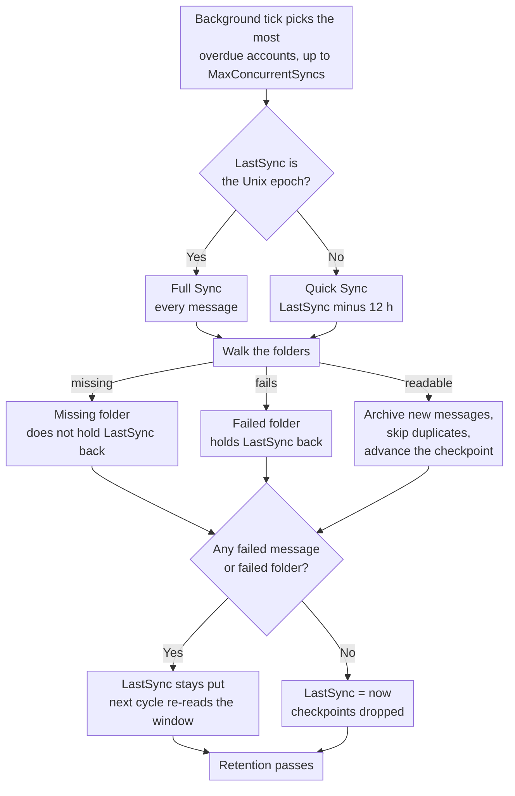

# 🔄 Mail Synchronization (Quick vs. Full Sync) {#mail-synchronization-quick-vs-full-sync}

[← Documentation Indexに戻る](index.md)

## 📋 Overview {#overview}

Mail Archiverは、`MailSyncBackgroundService`を通じて、有効化されているすべてのメールボックスをバックグラウンドで自動的に同期します。このサービスは短いポーリングループ（60秒ごと）を実行して、同期が必要なアカウントを特定し、それらを同期します。1サイクル内で最大`MailSync:MaxConcurrentSyncs`アカウントまで並列で同期を行い、その後、各アカウントをそれぞれの同期間隔に従って再スケジュールします。間隔は`appsettings.json`を通じてグローバルに設定でき、作成/編集ページからアカウントごとに上書きすることも可能です。

同期モードには、以下の2つの異なるモードがあります：

| モード | トリガー | スコープ |
|------|--------------|-------|
| **Quick Sync** (増分同期) | すべての同期サイクル（アカウントごとの間隔） | 前回の同期成功以降の、新規または変更されたメッセージのみ |
| **Full Sync** (再同期) | 新規アカウント、手動ボタン、`AlwaysForceFullSync`、またはアカウントごと/グローバルのFull Sync間隔 | 除外されていないすべてのフォルダ内のすべてのメッセージ |

どちらのモードも繰り返し実行しても安全です。Mail Archiverは重複を検出し（`MessageId`、または`MessageId`が欠落している場合はFrom/To/Subject/SentDateによって）、すでにアーカイブされているメッセージはスキップします。

---

## 🔁 🔄 同期サイクルのおさらい {#the-sync-cycle-at-a-glance}



最後に決定されたものが重要となります。`LastSync` は、実行がメッセージの失敗**および**フォルダーの失敗なしに終了した場合にのみ進みます。そのため、読み取り不可能なフォルダーが1つあるだけで、メールボックスは静かにスキップすることなく、同じウィンドウを繰り返し読み込み続けてしまいます。また、途中で終了した実行（タイムアウト、キャンセル、レート制限）は、メールを失うのではなく、再読み込みのコストが発生します。

---

## ⚡ Quick Sync (Incremental Sync) {#quick-sync-incremental-sync}

Quick sync は、設定された間隔で自動的に実行される通常の動作モードです。グローバルなデフォルト値は `MailSync:IntervalMinutes` 分（デフォルトは 15）です。各アカウントは、作成/編集ページで設定された独自の `SyncIntervalMinutes` 値によってこれを上書きできます（空欄の場合はグローバルのデフォルト値が使用されます）。

### 仕組み {#how-it-works}

1. 有効化されている各アカウント（`IMPORT` プロバイダーのアカウントを除く）に対して、サービスはアカウントの `LastSync` タイムスタンプを読み取ります。
2. `LastSync` から日付フィルターが構築されます：
   - **IMAP**: `SearchQuery.DeliveredAfter(LastSync − 12 hours)`
   - **M365 (Graph)**: `receivedDateTime ge (LastSync − 12 hours)`
3. 12時間のオーバーラップは意図的なものです。これにより、前回の同期開始後にプロバイダーによって配信されたものの、サーバーのタイムスタンプがわずかに古いメッセージを捕捉でき、またメールサーバーと Mail Archiver ホスト間の軽微な時計のずれを許容できます。重複は重複チェックによってフィルタリングされるため、オーバーラップによって二重のエントリが作成されることはありません。
4. 除外されていない各フォルダーに対して、フィルタリングされたメッセージリストがバッチ単位で取得され、アーカイブされます。既存のメッセージはスキップされます。
5. **正常に完了した場合**（失敗したメッセージがなく、フォルダー全体が失敗することも、レート制限に達することもなかった場合）、`LastSync` は `DateTime.UtcNow` に設定され、次のサイクルはその時点から開始されます。
6. **いずれかのメッセージの処理に失敗**した場合、または**いずれかのフォルダーが同期できなかった**場合（[Folders That Fail as a Whole](#-folders-that-fail-as-a-whole) を参照）、`LastSync` は更新**されません**。そのため、次のサイクルでは同じ時間枠の再試行が行われます。
7. アカウントが**レート制限に達した場合**（[Rate Limit Handling](RateLimitHandling.md) を参照）、`LastSync` もそのままにされ、日次クォータがリセットされた後にフォルダーごとのチェックポイントから同期が再開されます。

### 発生するタイミング {#when-you-see-it}

- すべての有効なアカウントに対して、数分おきに自動的に実行されます。
- 新しいアカウントの初回同期が完了した後（最初のサイクルは Full Sync です。下記参照）。
- ユーザーの操作は不要です。

## 期待️ Full Sync (Resync) {#full-sync-resync}

Full Sync は日付フィルタを無視し、除外されていないすべてのフォルダから、経過日数を問わずサーバー内の**すべての**メッセージをダウンロードします。

### Full Sync がトリガーされる条件 {#what-triggers-a-full-sync}

アカウントの `LastSync` が Unix エポック (`1970-01-01T00:00:00Z`) に設定されている場合、Full Sync がトリガーされます。これには以下の4つの状況があります。

1. **新規アカウント** – 新しく作成されたすべての IMAP または M365 アカウントは `LastSync = 1970-01-01` から始まります。したがって、そのアカウントの最初のスケジュールされた同期サイクルは自動的に Full Sync となり、初期のアーカイブインポートを実行します。
2. **手動の「Full Resync」ボタン** – *Account Details* ページにある **Full Resync** ボタン (`MailAccounts/Resync`) は、`LastSync` をエポックにリセットし、リクエストのフォアグラウンドですぐに同期を開始します。
3. **`MailSync:AlwaysForceFullSync = true`** – この設定フラグが有効な場合、バックグラウンドサービスは、**すべての同期サイクルの開始時に、有効なすべてのアカウントに対して** `LastSync` をエポックにリセットします。これにより、実質的にすべてのサイクルが Full Sync になります。これはトラブルシューティング目的であり、問題が解決したら必ずオフに戻してください。メールサーバーおよび Mail Archiver インスタンスへの負荷が大幅に増加するためです。
4. **アカウントごと、またはグローバルの Full Sync 間隔** – アカウントに `FullSyncIntervalHours` が設定されている場合（Create/Edit ページ）、または `appsettings.json` にグローバルのデフォルト `MailSync:FullSyncIntervalHours` が設定されている場合、バックグラウンドサービスは、アカウントの最後の Full Sync (`LastFullSync`) からその間隔が経過した時点で自動的に Full Sync をトリガーします。アカウントごとの値が優先されます。どちらも設定されていない場合は、自動的な Full Sync は実行されず、手動の resync ボタン（および上記の `AlwaysForceFullSync`）のみが有効になります。Full Sync が完了すると、次の Full Sync がその時点からスケジュールされるように、`LastFullSync` が `DateTime.UtcNow` に更新されます。

### Full Sync 中の動作 {#behavior-during-a-full-sync}

- `DeliveredAfter` / `receivedDateTime ge …` フィルタは適用されません。サーバーに対して、フォルダ内のすべてのメッセージを返すよう要求します。
- サーバーがフォルダ内の実際のメッセージ数よりも少ない結果を返した場合（一部の IMAP サーバーは `SEARCH` の結果を制限しています）、Mail Archiver はその不一致を検出し、メッセージが静かにドロップされないように、シーケンス番号によるすべての `UniqueId` の取得にフォールバックします。
- すでにアーカイブにあるメッセージは重複として検出され、スキップされます。既存のアーカイブコピーは**上書きされません**。以前とは異なるフォルダ名で重複が見つかった場合、保存されている `FolderName` フィールドは現在の場所を反映するように更新されます。
- 非常に大きなメールボックスの場合、Full Sync には数時間、あるいは数日かかることがあります。帯域幅トラッキングが有効な場合、同期は日次クォータで適切に一時停止し、翌日にフォルダごとのチェックポイントから再開されます（[Rate Limit Handling](RateLimitHandling.md) を参照）。
- Quick Sync と同様に、Full Sync が失敗したメッセージや失敗したフォルダなしに完了した後にのみ、`LastSync` が `DateTime.UtcNow` に更新されます。

### 手動の Full Sync を使用すべき場面 {#when-to-use-a-manual-full-sync}

以下の場合は **Full Resync** ボタンを使用してください：

- アカウントの **excluded folders** リストを変更し、アーカイブが現在の選択と一致していることを確認したい場合。
- アーカイブにメッセージが不足していると疑われる場合（例：サーバー移行後、プロバイダーの停止、またはクロック・スキューが発生した場合）。
- メールボックスを別のバックエンドに移行し、完全性を検証したい場合。
- サーバー上のフォルダ間で移動されたメッセージを再検出したい場合。
- 以前は Mail Archiver から見えなかったフォルダが再び見えるようになった場合 — 例：Web UI を介してリネームされるまで IMAP フォルダリストからフィルタリングされていた、サードパーティ製クライアント経由で作成された Outlook.com フォルダ（[Personal Microsoft Account Setup → Troubleshooting](MSA_Outlook_Setup.md#-troubleshooting) を参照）。Quick Sync ではそれらのフォルダ内の古いメールをバックフィルできないため、Full Sync が必要です。

以下の場合は Full Sync を**使用しないでください**：

- 通常の運用として – プロバイダーおよび Mail Archiver インスタンスに不要な負荷をかけます。
- メッセージの本文やメタデータを「更新」するため – 重複はスキップされるため、Full Sync によって既存のアーカイブコピーは更新されません。アーカイブされたメッセージを置き換えるには、まずアーカイブから削除してから、（Quick または Full）同期を実行する必要があります。
- `AlwaysForceFullSync=true` を介した恒久的な使用 – 本番環境ではこれをオフのままにしてください。これは診断用スイッチであり、動作モードではありません。

## 🆚 Quick Sync と Full Sync の比較 {#quick-sync-vs-full-sync-at-a-glance}

| 項目 | Quick Sync | Full Sync |
|--------|-----------|-----------|
| 日付フィルタ | `LastSync − 12 h` から現在まで | なし (すべてのメッセージ) |
| 通常のボリューム | 数通の新着メッセージ | メールボックス全体 |
| 所要時間 | 数秒から数分 | 数分から数日 (メールボックスのサイズやプロバイダーの制限に依存) |
| 帯域幅への影響 | 低 | 高 |
| 成功時に更新される `LastSync` | はい | はい |
| 失敗 / レート制限時に更新される `LastSync` | いいえ (次回のサイクルでリトライ) | いいえ (チェックポイントから再開) |
| 重複の処理 | すでにアーカイブ済みのメッセージはスキップ | すでにアーカイブ済みのメッセージはスキップ |
| トリガー | スケジューラ (アカウントごとの間隔) | 新規アカウント、手動ボタン、`AlwaysForceFullSync`、または Full Sync 間隔 |
| 推奨される用途 | 日常的な運用 | 初回のインポートおよび時折の検証 |

## ⚙️ 設定 {#configuration}

同期の動作は、`appsettings.json`の`MailSync`セクション（またはDockerの場合は環境変数`MailSync__*`）によって制御されます。パラメータの全リストについては [Setup.md](Setup.md) を参照してください。

| 設定 | デフォルト | 説明 |
|---------|---------|-------------|
| `MailSync:IntervalMinutes` | `15` | アカウントごとの同期間隔（分単位）のグローバルデフォルト。各アカウントの作成/編集ページでこれを上書きできます（デフォルトを使用する場合は空欄のままにします）。 |
| `MailSync:FullSyncIntervalHours` | _unset_ | 自動フル再同期のオプションのグローバルデフォルト（時間単位）。未設定の場合（デフォルト）、アカウントごとの `FullSyncIntervalHours` 値が設定されていない限り、自動フル同期は実行されません。アカウントごとの値がこれを上書きします。 |
| `MailSync:TimeoutMinutes` | `0` (none) | アカウントごとの同期タイムアウト。実行時間が長くなった同期は、次のメッセージ境界で停止し、次回の実行時に再開されます。`0`（デフォルト、または0以下の値）はタイムアウトなしを意味します。[Stopping a Sync Early](#-stopping-a-sync-early) を参照してください。 |
| `MailSync:ConnectionTimeoutSeconds` | `300` | IMAP接続タイムアウト。 |
| `MailSync:CommandTimeoutSeconds` | `600` | IMAPコマンドタイムアウト。 |
| `MailSync:AlwaysForceFullSync` | `false` | `true` の場合、すべてのサイクルが全アカウントの Full Sync になります。**診断用です。本番環境ではオフのままにしてください。** |
| `MailSync:IgnoreSelfSignedCert` | `false` | IMAP接続において、自己署名TLS証明書（信頼できないルート、不完全なチェーン）およびホスト名の不一致を許可します — 例：証明書が `127.0.0.1` に対して発行されている Proton Bridge など。期限切れの証明書などのその他のチェーンの問題は引き続き拒否されます。 |
| `MailSync:MaxConcurrentSyncs` | `1` | 同時に実行できるアカウント同期の数。スロットは空き次第補充されます。[How accounts are scheduled](#-how-accounts-are-scheduled) を参照してください。`1` は同期を順次実行します。並列化するにはこの値を増やしてください — プロバイダーのレート制限とローカルのリソース使用量に注意してください。 |
| `MailSync:InterAccountDelaySeconds` | `0` | 各アカウントの同期タスクの終了時に適用される、オプションのディレイ（秒単位）。`MaxConcurrentSyncs > 1` 時のバースト開始を避けるのに役立ちます。`0` で無効化できます。 |
| `MailSync:MaxIssuesPerKind` | `20` | アカウントページに表示するために、同期ジョブが各種類の問題をいくつ記憶するか — 失敗したフォルダ、不足しているフォルダ、失敗したメッセージは個別に予算化されます。それを超えるものはカウントのみされ、保持されません。`0` は詳細をオフにし、カウンターのみを残します。 |
| `MailSync:GlobalExcludedFolders` | _empty_ | すべてのアカウントで同期から除外されるフォルダ。各アカウント独自のリストに追加されます。以下の [Excluded Folders](#-excluded-folders) を参照してください。 |
| `MailSync:ExcludeSubfolders` | `false` | 除外エントリが、両方のリストにおいて、指定されたフォルダの下位フォルダもカバーするかどうか。以下の [Excluded Folders](#-excluded-folders) を参照してください。 |

> 💡 通常の同期間隔とフル同期間隔の両方を、**Create/Edit Mail Account** ページでアカウントごとに上書きできます。アカウントごとのフィールドを空にすると、上記のグローバルデフォルトが適用されます。アカウントをスケジューラーから完全に削除するには、無効化してください（Account Details ページの *Enabled* トグルをオフにします）。

## 🚫 除外されたフォルダ {#excluded-folders}

フォルダは2つの場所から同期から除外することができ、これら2つは**加算的**です。フォルダが**いずれか**のリストに一致する場合、そのフォルダはスキップされます。一方が除外したものをもう一方が再含め込むことはできないため、どこかにエントリを追加しても、同期からフォルダが削除されることはあっても、追加されることはありません。

| ソース | スコープ | 場所 |
|--------|-------|-------|
| アカウント除外リスト | 単一のアカウント | *Create/Edit Mail Account* ページ |
| `MailSync:GlobalExcludedFolders` | インストール内のすべてのアカウント | `appsettings.json` または `MailSync__GlobalExcludedFolders__<n>` |

グローバルリストは**デフォルトで空**であるため、これを一度も設定していないインストール環境は、以前と全く同じように動作します。このリストは、多くのメールボックスが同じサーバーからインポートされる場合に、個々のアカウントごとに同一の除外リストを維持するという手間を避けるために存在します。

両方のリストは同じマッチングルールを使用しているため、設定が乖離することはありません。

1. フォルダのフルパス（`INBOX/Drafts`）に対する完全一致。
2. フォルダ自身の名前（`Drafts`）に対する完全一致。これは、サーバーがプレフィックス付きのパスを報告している場合に、短い名前で入力されたエントリを捕捉します。
3. パスサフィックス（接尾辞）一致。これはセパレータのバリエーション（`Drafts` は `INBOX.Drafts` や `INBOX/Drafts` にも一致します）や、`[Provider]/Drafts` のようなサーバープレフィックス付きの名前を捕捉します。
4. エントリが指定したフォルダ以下のすべて。したがって、`MailSync:ExcludeSubfolders` が有効な場合（デフォルトではオフであり、オプションが存在する前の動作と一致します）、`Archive` は `Archive/Team` や `INBOX.Archive.Team` もカバーします。これを `true` に設定すると、個々のフォルダではなくルートを指定することでメールボックスツリー全体を除外できます。デフォルトでは、エントリは指定されたそのフォルダのみに一致します。

すべての比較は、大文字と小文字を区別しません。フルパスのサフィックスルールはパスセパレータをアンカーとするため、`Archive` は `ArchiveWeek` という名前のフォルダを巻き込むことはありません。名前の比較は同じようにはアンカーされません。短いエントリは、自身の名前がそのエントリで**終わる**フォルダにも一致するため、`Archive` は `OldArchive` という名前のフォルダを巻き込みます。名前が似ているフォルダの中から特定の1つだけを除外したい場合は、そのフルパスを入力してください。

ルール4はルール3と同様にセパレータをアンカーとするため、フォルダ全体を対象とし、名前の一部を対象にすることはありません。したがって、`Archive` は `Archive/Team` をカバーしますが、`Team Archive Review` という名前のメールフォルダは同期に残ります。先祖フォルダはパスのみで比較されるため、アンカーされていない名前の比較がフォルダの子要素に引き継がれることはありません。`.` はどこに現れてもセパレータとしてカウントされます。これは、`/` で区切られているサーバーでは、文字通り `Archive.ics` という名前のトップレベルフォルダが `Archive` の下にあるものとして読み取られることを意味します。

**デフォルトで除外されるフォルダ名はありません。** どの名前をリストに載せるべきかは、サーバーとその言語に完全に依存します。カレンダー、連絡先、タスク、メモのフォルダも含むメールボックスツリーは、これを使用する一般的な理由ですが、Mail Archiver はそれを前提としていません。設定例については [Setup.md](Setup.md) を参照してください。

どちらのリストを変更しても、すでにアーカイブされたものが削除されることはありません。アーカイブが現在の選択と一致していることを確認したい場合は、その後に [Full Sync](#-full-sync-resync) を実行してください。

除外は、フォルダリストが走査されるすべての場所（アーカイブだけでなく）に適用されます。除外されたフォルダは、サーバー側の削除パス（下記参照）でもスキップされるため、エントリはサーバー上のフォルダも保護します。

## 🗑️ 同期中のサーバー側での削除 {#server-side-deletion-during-sync}

アカウントに `DeleteAfterDays` が設定されている場合（> 0）、Mail Archiver は各同期の後に、設定されたしきい値より古いメッセージを **メールサーバー** から削除します：

- **IMAP**: フォルダごとに `SearchQuery.SentBefore(now − DeleteAfterDays)` を実行し、その後 expunge します。
- **M365 (Graph)**: フォルダごとに `receivedDateTime lt (now − DeleteAfterDays)` を実行し、その後 delete します。

Mail Archiver 内のアーカイブされたコピーは、これによる影響を **受けません**。サーバー側のメールボックスのみが整理されます。いずれかの除外リスト ([Excluded Folders](#-excluded-folders)) に含まれるフォルダは、この削除プロセスからスキップされ、サーバー上ではそのまま保持されます。アーカイブされたコピーの保持期間を制御するローカルの保持設定については、[Retention Policies](RetentionPolicies.md) を参照してください。

## 🛟 サーバーが欠落していると報告するメッセージのリカバリ {#recovering-messages-the-server-reports-as-missing}

一部のサーバーは、通常の UID fetch を通じてメッセージを拒否しますが、プレーンな `BODY[]` fetch に対しては使用可能な MIME ドキュメントを返します。これは、以下のような fetch エラーが発生するレガシーなオンプレミスの Exchange で観察されています。

```
MailKit.MessageNotFoundException: The IMAP server did not return the requested message.
```

このようなフォールバックがない場合、そのメッセージは失敗したメールとしてカウントされます。また、アカウントに失敗がある間は `LastSync` が進まないため、アカウントは実行のたびに同じメッセージを再読み込みし、一向に進展しません。

**Mail Archiver の動作:** その UID に対して、この特定のエラーに対してのみ、正確に 1 回の追加 fetch を試行します。認証の問題、接続の喪失、スロットリング、およびパースエラーは影響を受けず、既存の一時的なリトライ（transient-retry）の動作は変更されません。この試行は読み取り専用です。メッセージは既読としてマークされず、フラグも変更されず、移動も削除もされません。生データが実際に届き、**かつ** MIME メッセージとしてパースされた場合にのみ、成功としてカウントされます。それ未満の場合は、失敗したメールのままとなります。リカバリされたメッセージは、重複検知を含む通常のアーカイブパスを辿るため、フル同期を繰り返しても二重にアーカイブされることはありません。

**プロバイダーのエラープレースホルダー:** サーバーが返すものは、元のメッセージではなく、プロバイダーが代わりに生成したドキュメントであることがよくあります。例：

```
Subject: Retrieval using the IMAP4 protocol failed for the following message: 270198
From: Microsoft Exchange Server 2010

The server couldn't retrieve the following message: ...
```

これは受信した通りにアーカイブされ、その中に引用された送信者、件名、または本文に書き換えられることはありません。Mail Archiver は、プロバイダー自体が MIME への変換を拒否したコンテンツをリカバリすることはできません。Mail Archiver が保持するのは、サーバーが公開できる最善の表現と、「プレースホルダーが届いた」という事実です。それぞれは、アカウント、フォルダ、UID、および件名とともに `Warning` レベルでログに記録されます。

**フォールバックの結果が空であった場合**、メッセージは以前と同様に失敗したメールのままとなり、試行は静かに処理されるのではなく `Warning` にログに記録されます。取得できなかったメッセージが、アーカイブされたように見えることは決してあってはなりません。もしサーバーが常にそのような動作をする場合は、ドキュメント化されている次のステップとして、`BODY.PEEK[HEADER]` と `BODY.PEEK[TEXT]` を個別に fetch し、それらを 1 つの MIME ドキュメントに組み立てることが挙げられます。これは、現在のフォールバック（異なる読み方をする同じリクエスト）とは、本質的に異なるリクエストです。これは意図的に実装されていません。メッセージごとに 2 回のラウンドトリップが必要になり、「ヘッダーは届いたがテキストは届かなかった」という状態を定義する必要が生じるためです。また、これまでに確認されたサーバーでそれが必要になるケースはありませんでした。

両方のカウントは、アカウントの完了ログ行に表示されます。

```
Sync completed for account: Example. New: 0, Failed: 0, Deleted: 0, Recovered: 25, Provider placeholders: 25, Failed folders: 0
```

`Recovered` はフォールバックによって救出されたメッセージをカウントします。`Provider placeholders` は、それらのうちプロバイダーによって生成されたエラードキュメントであったサブセットです。これらと並んで表示される `Failed: 0` こそがこの機能の要点です。アカウントが停滞しなくなるのです。

## 📁 フォルダ全体の同期失敗 {#folders-that-fail-as-a-whole}

メッセージ単体での失敗もあれば、フォルダ単位での失敗もあります。後者の場合、サーバーはフォルダをリストアップしますが、そのフォルダを開いたり検索したりしようとするとエラーが発生します。一部のサーバーは `LIST`/`LSUB` を通じてフォルダを通知し、その後 `EXAMINE` 上で `NO ... doesn't exist` に回答します。

これらは個別にカウントされ、フォルダごとに1つとして扱われます：

```
Sync completed for account: Example. New: 120, Failed: 0, Deleted: 0, Recovered: 0, Provider placeholders: 0, Failed folders: 2
```

`Failed folders: 2` は、2つのフォルダが全く同期できなかったことを意味します。これは特定のメッセージが失敗したことを意味する**わけではありません**。フォルダが開けない場合、その中のメッセージについては何も分からず、失敗したメッセージの数を特定することは不可能です。

**なぜ独自のカウンターとなっているのか。** 以前は、フォルダレベルの失敗は、その時点でそのフォルダ内で処理されていた「失敗したメッセージ数」として記録されていました。しかし、その数値は捏造されたものであり、フォルダ内の実際のメッセージごとの失敗を上書きしてしまっていました。そのため、アクセスできないフォルダが1つあるだけで、実際には完璧にアーカイブされている数百ものメッセージが失敗したと報告されることがありました。

**`LastSync` への影響、変更なし。** フォルダ全体が失敗した場合でも、以前メッセージの失敗としてカウントされていた時と同様に、`LastSync` の進行は妨げられます。変更されたのは報告方法だけであり、動作は変わっていません。アカウントは次のサイクルでも同じウィンドウをリトライします。これは意図的な仕様です。もし、一度も読み取ることができなかったフォルダを通り過ぎて増分同期が進んでしまうと、その中のメールを二度と取得できなくなるからです。

両方のカウントは `Information` レベルで確認でき、`LastSync` が保留されるたびに、それを示す警告が発行されます：

```
Not updating LastSync for account Example: 0 failed emails, 2 folders that could not be synced at all
```

### 「破損」ではなく「消失」したフォルダ {#folders-that-are-gone-as-opposed-to-broken}

サーバーがリストアップしたものの、開くことを拒否するフォルダは、必ずしも自動的に「失敗」とはみなされません。最も一般的な理由は、故障ではなく、RFC 3501 に基づく仕様です。RFC 3501 では、メールボックスが削除された際にサーバーが購読リストから名前を削除することを禁じているため、IMAPクライアントでかつて購読したフォルダが、数年経っても `LSUB` によって報告されることがあります。フォルダの検出は `LIST` と `LSUB` の和集合をとるため、それらの名前は同期に到達し、その後 `EXAMINE` が `NO ... doesn't exist` に回答します。

これは回答であり、エラーではありません。リトライすべきことも、後で戻ってきて取得すべきものもないため、別途カウントされ、`LastSync` を妨げることは**ありません**：

```
Sync completed for account: Example. New: 120, Failed: 0, ..., Failed folders: 0, Missing folders: 16
```

これを失敗としてカウントしてしまうと、存在しないフォルダが再び存在することはないため、アカウントの同期が永久に停止してしまいます。実際に、16個の古い購読情報が残っていたメールボックスで、アカウントの `LastSync` の進行が止まり、自動復旧できなくなるという事象が発生しました。

それ以外のもの（権限不足、接続断、スロットリング、サーバーエラーなど）は引き続き「失敗」として扱われ、アカウントの進行を妨げます。これらは次回の実行時に成功する可能性があります。

`Missing folders: N` は、無害ではありますが対処する価値があります。これは、メールボックスに存在しないフォルダへの購読情報が残っていることを意味します。これらをクリアするには、IMAPクライアントを使用して名前ごとに `UNSUBSCRIBE` を行う必要があります。同期プロセスでは、読み取り対象のメールボックスを修正してはならないため、意図的にこれを行わないようにしています。

IMAP の場合のみです。Microsoft Graph は API を通じてフォルダを列挙し、削除されたフォルダは単に返されないため、このような状況は発生しません。

IMAP と M365 (Graph) の両方のプロバイダーに適用されます。

## 🗓️ アカウントのスケジューリング方法 {#how-accounts-are-scheduled}

バックグラウンドのティック（tick）は1分に一度実行されます。有効なアカウントをロードし、実行時期が来ているものを特定し、空いている同期スロットの数（合計で `MailSync:MaxConcurrentSyncs` 個）だけ同期を開始します。
開始した同期の完了を**待機することはありません**。入り切らなかったものは次のティックまで保留され、次のティックで改めて判断されます。

各アカウントの次回の実行は、同期が**完了した**時点から、その時点にインターバルを加えた時刻にスケジューリングされます。
したがって、同期にインターバル以上の時間がかかるアカウントは、完了後すぐに再び実行対象となりますが、二重に実行されることはありません。実行中のアカウントはスキップされ、キューには入れられません。

スロット数よりも実行時期が来ているアカウントが多い場合、**最も遅延しているものが優先されます**。同等の場合はアカウント ID によって決定されるため、バックログが再現可能な形で処理されます。

同期が完了すると、即座にスケジューラーが起動されます。これにより、スロットが空いた際にループが1分間のアイドル時間を無駄にすることはありません。バックログは `MaxConcurrentSyncs: 1` の場合でも、以前のバッチループと同様に連続して処理されます。なお、この「1分」はアカウントリストを確認する間隔の最大値として機能します。

複数のスロットがある場合は、デフォルトで `0`（タイムアウトなし）である `MailSync:TimeoutMinutes` の設定を検討してください。同期は実行されている間、そのスロットを占有し続けます。そのため、進捗が完全に停止した単一のアカウントがあると、他のすべてのアカウントで利用可能なスロットが恒久的に減少してしまいます。タイムアウトは、チェックポイントを保持したまま実行を一時停止として終了させ、次のティックでスロットを再び解放します。

> ℹ️ 以前の仕様では、ティックは実行時期が来ているすべてのアカウントを収集し、それらすべてが完了するまで再確認を待ちました。そのため、一つの大きなメールボックスが実行されている間、他のすべてのアカウントが待機状態になっていました。スロットは解放されていましたが、最後の同期が完了するまで再評価が行われなかったため、`MaxConcurrentSyncs: 10` を使用している環境で6時間のメールボックスがある場合、実質的にすべての同期が6時間間隔で行われることになっていました。現在は、同期が早く終わるアカウントは、他の実行状況に関わらず自身のインターバルに従って動作します。

シャットダウン時、サービスは開いている IMAP セッションの下でプロセスを強制終了するのではなく、実行中の同期に対して最大30秒間待機します。これらはキャンセルされません。何が同期を停止させるかについては、[Stopping a Sync Early](#-stopping-a-sync-early) を参照してください。

---

## ⏹️ 同期の早期停止 {#stopping-a-sync-early}

実行中の同期が、すべてのフォルダを処理し終える前に停止する理由は、正確に2つあります。**Jobs** ページで誰かがジョブをキャンセルしたか、あるいはアカウントの `MailSync:TimeoutMinutes` が経過したかです。これらは、各フォルダの前、各バッチの前、および各メッセージの前の3つの時点でチェックされるため、大きなフォルダの完了を待つ必要はありません。

タイムアウトは**スケジュールされた同期にのみ**適用されます。UIからの同期、「Sync now」アクション、またはフル再同期によって開始された同期は、タイムアウトなしで実行されるため、手動による長い同期が途中で打ち切られることはありません。

これら2つはジョブの終了方法が異なり、その違いは重要です。

| | ジョブステータス | `LastSync` | チェックポイント | リテンションパス |
|---|---|---|---|---|
| UIからキャンセル | `Failed`、"Job was cancelled" と共に | 進めない | 維持 | スキップ |
| 同期タイムアウト経過 | `Timed Out` | 進めない | 維持 | スキップ |

タイムアウトは**失敗ではなく、一時停止**です。同期は現在の場所で停止し、アーカイブ済みのものは保持し、`LastSync` には手を触れず、サーバー側およびローカルのリテンションパスをスキップします。これらを実行すると、実行時間を制限するという目的が果たせなくなるためです。次回のスケジュール実行は、チェックポイントから再開されます。

### チェックポイント {#checkpoints}

進捗はアカウントおよびフォルダごとに `mail_archiver.SyncCheckpoints` に記録されます。すなわち、そのフォルダで最後にアーカイブされたメッセージのUIDと、その時点でのフォルダの UIDVALIDITY です。すべてのインストール環境でこれらが書き込まれます。以前はこれらは `BandwidthTracking:Enabled` に紐付いていましたが、そのため中断された同期は、その無関係な機能がたまたまオンになっていた場所からしか再開できませんでした。チェックポイントは、アカウントがエラーなしで完了するとすぐに破棄されます。

再開されたフォルダは、チェックポイントがなかった場合に実行されるのと**全く同じ検索**を実行します。その後、ウォーターマーク（境界値）と同じかそれ以下のUIDのみが結果から除外されるため、検索ウィンドウが移動することなく、メッセージが漏れることもありません。

そのフォルダ内のメッセージでエラーが発生すると、ウォーターマークの進行は停止します。メッセージはUIDの昇順で処理されるため、失敗したUIDより上のウォーターマークがあると、次回の実行時にその失敗したメッセージがすでにアーカイブ済みであると判断され、再試行されなくなってしまいます。保留されている `LastSync` が存在する目的は、まさにこれを強制することにあります。したがって、失敗した箇所より上のものはすべて次回再び読み込まれます。これには再読み込みのコストがかかりますが、重複チェックによって吸収されます。

チェックポイントが適用できることが証明できない場合は、チェックポイントは無視され、フォルダは完全に読み込まれます。適用できないケースとは、UIDがまだ記録されていない、UIDVALIDITYが記録されていない、またはUIDVALIDITYがフォルダと一致しなくなった場合です。最後のケースは、サーバーがメールボックスの番号を振り直したことを意味し、保存されたUIDが別のメッセージを指している状態です。フォルダの再読み込みには時間がかかりますが、重複チェックによって吸収されます。スキップしてしまうとメールが静かに失われる可能性があるため、疑わしいケースはすべて完全に読み込まれます。

Graph APIプロバイダーはUIDチェックポイントを書き込みません。なぜなら、Graph APIにはIMAPのUIDに相当するものがないからです。タイムアウトまたは帯域幅制限によって停止したM365の同期は、`LastSync` が進まないという意味においてのみ「再開」されます。そのため、次回の実行ではウィンドウ全体が再読み込みされ、重複チェックによって重複部分が吸収されます。

> ℹ️ これ以前は、チェックポイントは最後にアーカイブされたメッセージの **Date header** を保存し、それをフォルダ検索に渡していました。サーバーはこれに対して INTERNALDATE で回答しますが、これは移行されたメールでは数年の差が生じる可能性がある異なるクロックであり、メッセージは日付順ではなくUID順で処理されます。これら両方の不一致により、検索ウィンドウが一度もアーカイブされていないメールを通り過ぎてしまう可能性がありました。同期が帯域幅制限で一時停止する場合も同じ経路が使用されるため、再開の仕組みもこの変更によって修正されました。

### 大規模なメールボックスとタイムアウト {#large-mailboxes-and-the-timeout}

150,000件のメッセージを持つメールボックスの最初のフル同期は数時間かかり、それより短いタイムアウトを設定すると毎回停止してしまいます。同期は最初からやり直すのではなくチェックポイントから再開されますが、1回の実行ですべてを完了するまで、アカウントは完了状態に達せず、したがって `LastSync` も進みません。お使いのメールボックスに合わせて値を検討し、タイムアウトを一切させたくない場合は `0` に設定してください。

## 👀 同期の確認 {#observing-the-sync}

### アカウントページは「前回の実行で何が行われたか」に答えます {#the-account-page-answers-what-did-the-last-run-do}

すべてのメールアカウントには、最も最近終了した実行内容を示す **Last Sync Run** カードが表示されます。これには、終了時刻、所要時間、処理されたメッセージ数、および新規メッセージ数が含まれます。この情報は24時間のジョブ保持期間を超えて保持されるため、一日中動きがなかったメールボックスでも、前回の結果を確認できます。この情報は再起動によってのみクリアされますが、カードにはその旨が明記されるため、アカウントが正常であるかのように偽ることはありません。

問題が発生した場合、カードには種類ごとにグループ化され、制限内でリストアップされます：

- **Folders that could not be read** — フォルダ単位で読み込みに失敗しました。`LastSync` の妨げになります。
- **Folders the server does not have** — ディスカバリによって報告された、またはオープン時に拒否されたフォルダです。通常、削除されたフォルダへの残存サブスクリプションが原因であり、`LastSync` の妨げにはなりません。詳細は [Folders that are gone](#folders-that-are-gone-as-opposed-to-broken) を参照してください。
- **Messages that could not be archived** — フォルダ、件名、UID、およびサーバー独自のメッセージとともに表示されます。

各グループは `MailSync:MaxIssuesPerKind` で上限が設定されており、収まりきらなかったものは「and N more」として報告されます。これにより、一種のエラーが大量に発生しても、他のエラーが埋もれることはありません。`LastSync` が保留された場合も、カードにその旨が1文で表示されます。これは、タイムスタンプが古い場合に実際に生じる疑問に答えるためです。

アカウントリストでは、前回の実行で問題が報告されたアカウントのタイムスタンプの横にマークが表示されます。意図的にこれのみを表示しています。すべての行にチェックを入れるとノイズとなり、マーカーの意味がなくなってしまうためです。

- **Account Details page**: 現在の `LastSync` タイムスタンプと、実行中の同期ジョブ（フォルダ、処理数、新規数、失敗数）を表示します。**Full Resync** ボタンはここにあります。
- **Logs**: 同期の進捗は `Information` レベルでログに記録されます。Docker の場合：
  ```bash
  docker compose logs -f mailarchive-app | grep -i sync
  ```
  ログのフィルタリングに関するヒントについては、[Docker Compose Logs Guide](DockerComposeLogs.md) を参照してください。
- **Rate limiting**: 帯域幅制限により同期が一時停止した場合、アカウントには "Rate-Limited" ステータスが表示され、リセットウィンドウの後に自動的に再開されます。詳細は [Rate Limit Handling](RateLimitHandling.md) を参照してください。
- **Timeouts**: `MailSync:TimeoutMinutes` によって停止した同期は "Timed Out" と表示され、次回の実行時にチェックポイントから再開されます。詳細は [Stopping a Sync Early](#-stopping-a-sync-early) を参照してください。

---
