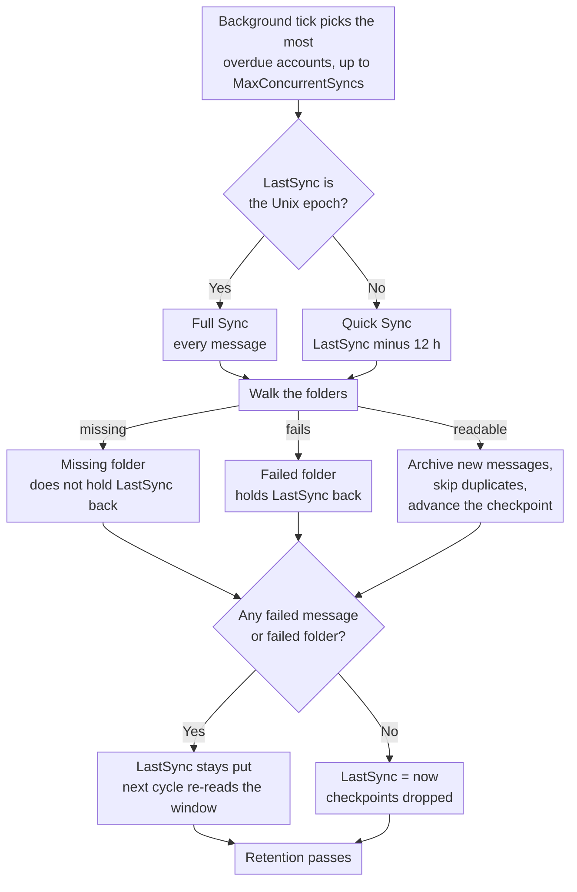

# 🔄 Mail Synchronisatie (Quick vs. Full Sync) {#mail-synchronization-quick-vs-full-sync}

[← Terug naar de Documentatie Index](index.md)

## 📋 Overzicht {#overview}

Mail Archiver synchroniseert automatisch elke ingeschakelde Postbus op de achtergrond via de `MailSyncBackgroundService`. De service voert een korte polling-loop uit (elke 60 s), bepaalt welke Accounts aan de beurt zijn, en synchroniseert deze — tot `MailSync:MaxConcurrentSyncs` Accounts tegelijkertijd binnen één cyclus — voordat elk Account opnieuw wordt ingepland volgens het eigen synchronisatie-interval. Intervallen kunnen globaal worden geconfigureerd via `appsettings.json` en kunnen per Account worden overschreven vanaf de Create/Edit pagina.

Er zijn twee verschillende synchronisatiemodi:

| Modus | Getriggerd door | Reikwijdte |
|------|--------------|-------|
| **Quick Sync** (incrementeel) | Elke synchronisatiecyclus (per-account interval) | Alleen nieuwe/gewijzigde berichten sinds de laatste succesvolle synchronisatie |
| **Full Sync** (resync) | Nieuw Account, handmatige knop, `AlwaysForceFullSync`, of per-account / globaal Full Sync interval | Elk bericht in elke niet-uitgesloten Map |

Beide modi zijn veilig om herhaaldelijk uit te voeren – Mail Archiver detecteert duplicaten (via `MessageId`, of via From/To/Subject/SentDate wanneer de `MessageId` ontbreekt) en slaat berichten over die al zijn gearchiveerd.

---

## 🔁 De synchronisatiecyclus in één oogopslag {#the-sync-cycle-at-a-glance}



De laatste beslissing is de beslissing die telt. `LastSync` gaat pas verder wanneer de run
is afgerond zonder mislukte berichten **en** zonder mislukte mappen. Dat is waarom een
Postbus met een enkele onleesbare map steeds opnieuw hetzelfde venster blijft lezen in plaats
ervan er rustig voorbij te gaan — en waarom een run die voortijdig eindigt (timeout, annuleren, rate limit) een herlezing kost in plaats van het verlies van mail.

---

## ⚡ Quick Sync (Incrementele Synchronisatie) {#quick-sync-incremental-sync}

Quick sync is de normale operationele modus die automatisch wordt uitgevoerd met het geconfigureerde interval. De globale standaard is `MailSync:IntervalMinutes` minuten (standaard 15); elk account kan dit overschrijven met zijn eigen `SyncIntervalMinutes` waarde die is ingesteld op de Create/Edit pagina (laat dit leeg om de globale standaard te gebruiken).

### Hoe het werkt {#how-it-works}

1. Voor elk ingeschakeld account (uitgezonderd `IMPORT` provider accounts) leest de service de `LastSync` tijdstempel van het account.
2. Een datumfilter wordt opgebouwd vanuit `LastSync`:
   - **IMAP**: `SearchQuery.DeliveredAfter(LastSync − 12 hours)`
   - **M365 (Graph)**: `receivedDateTime ge (LastSync − 12 hours)`
3. De overlap van 12 uur is opzettelijk. Het vangt berichten op die door de provider zijn afgeleverd nadat de vorige synchronisatie is gestart, maar met een iets oudere servertijdstempel, en het is bestand tegen kleine klokafwijkingen tussen de mailserver en de Mail Archiver host. Duplicaten worden weggefilterd door de duplicate check, dus de overlap creëert nooit dubbele vermeldingen.
4. Voor elke niet-uitgesloten map wordt de gefilterde berichtenlijst in batches opgehaald en gearchiveerd. Bestaande berichten worden overgeslagen.
5. Bij **succesvolle voltooiing** (geen mislukte berichten, geen mappen die als geheel zijn mislukt, geen rate-limit bereikt), wordt `LastSync` ingesteld op `DateTime.UtcNow` en begint de volgende cyclus vanaf dat punt.
6. Als **een bericht niet kon worden verwerkt**, of als **een map helemaal niet kon worden gesynchroniseerd** (zie [Folders That Fail as a Whole](#-folders-that-fail-as-a-whole)), wordt `LastSync` **niet** bijgewerkt, zodat de volgende cyclus opnieuw probeert hetzelfde venster te verwerken.
7. Als het account wordt onderworpen aan een **rate-limit** (zie [Rate Limit Handling](RateLimitHandling.md)), blijft `LastSync` ook ongewijzigd en wordt de synchronisatie hervat vanaf een per-map checkpoint zodra het dagelijkse quotum wordt gereset.

### Wanneer u dit ziet {#when-you-see-it}

- Automatisch, elke paar minuten, voor alle ingeschakelde accounts.
- Nadat de initiële synchronisatie van een nieuw account is voltooid (de eerste cyclus is een Full Sync, zie hieronder).
- Geen gebruikersactie vereist.

## 🗄️ Volledige Synchronisatie (Resync) {#full-sync-resync}

Een Volledige Synchronisatie negeert de datumfilter en downloadt **elk** bericht in elke niet-uitgesloten map van de server, ongeacht de ouderdom.

### Wat een Volledige Synchronisatie triggert {#what-triggers-a-full-sync}

Een Volledige Synchronisatie wordt getriggerd wanneer de `LastSync` van een Account wordt ingesteld op de Unix epoch (`1970-01-01T00:00:00Z`). Dit gebeurt in vier situaties:

1. **Nieuw Account** – Elk nieuw aangemaakt IMAP- of M365-Account begint met `LastSync = 1970-01-01`. De eerste geplande synchronisatiecyclus voor dat Account is daarom automatisch een Volledige Synchronisatie, die de initiële Archief-import uitvoert.
2. **Handmatige "Full Resync" knop** – Op de *Account Details* pagina reset de **Full Resync** knop (`MailAccounts/Resync`) `LastSync` naar de epoch en start de synchronisatie onmiddellijk op de voorgrond van de aanvraag.
3. **`MailSync:AlwaysForceFullSync = true`** – Wanneer deze configuratievlag is ingeschakeld, reset de achtergrondservice `LastSync` naar de epoch voor **elk ingeschakeld Account aan het begin van elke synchronisatiecyclus**. Dit maakt effectief elke cyclus een Volledige Synchronisatie. Dit is uitsluitend bedoeld voor probleemoplossing en moet worden uitgeschakeld zodra het probleem is opgelost, omdat het de belasting op de mailserver en de Mail Archiver-instantie drastisch verhoogt.
4. **Per-account of globale Volledige Synchronisatie interval** – Wanneer een Account `FullSyncIntervalHours` heeft ingesteld (Create/Edit pagina), of de globale standaard `MailSync:FullSyncIntervalHours` is geconfigureerd in `appsettings.json`, triggert de achtergrondservice automatisch een Volledige Synchronisatie zodra dat interval is verstreken sinds de laatste volledige synchronisatie van het Account (`LastFullSync`). De waarde per Account heeft voorrang; wanneer er geen van beide is ingesteld, wordt er geen automatische volledige synchronisatie uitgevoerd en blijven alleen de handmatige resync-knop (en `AlwaysForceFullSync` hierboven) beschikbaar. Nadat de volledige synchronisatie is voltooid, wordt `LastFullSync` bijgewerkt naar `DateTime.UtcNow`, zodat de volgende volledige synchronisatie vanaf dat punt wordt gepland.

### Gedrag tijdens een Volledige Synchronisatie {#behavior-during-a-full-sync}

- Er wordt geen `DeliveredAfter` / `receivedDateTime ge …` filter toegepast. De server wordt gevraagd om alle berichten in de map terug te geven.
- Als de server minder resultaten teruggeeft dan de map daadwerkelijk bevat (sommige IMAP-servers beperken het aantal `SEARCH` resultaten), detecteert Mail Archiver de discrepantie en valt terug op het ophalen van alle `UniqueId`s via het volgnummer, zodat er geen berichten stilzwijgend worden gedropt.
- Berichten die al in het Archief staan, worden gedetecteerd als duplicaten en overgeslagen – de bestaande gearchiveerde kopie wordt **niet** overschreven. Als een duplicaat wordt gevonden in een andere mapnaam dan voorheen, wordt het opgeslagen `FolderName` veld bijgewerkt om de huidige locatie weer te geven.
- Voor zeer grote Postbussen kan de Volledige Synchronisatie enkele uren of zelfs dagen duren. Wanneer bandwidth tracking is ingeschakeld, pauzeert de synchronisatie netjes bij het dagelijkse quotum en wordt deze de volgende dag hervat vanaf de per-map checkpoints (zie [Rate Limit Handling](RateLimitHandling.md)).
- `LastSync` wordt pas bijgewerkt naar `DateTime.UtcNow` nadat een Volledige Synchronisatie is voltooid zonder mislukte berichten en zonder mislukte mappen, precies zoals een Quick Sync.

### Wanneer een handmatige Volledige Synchronisatie te gebruiken {#when-to-use-a-manual-full-sync}

Gebruik de **Full Resync** knop wanneer:

- Je de lijst met **uitgesloten mappen** van het Account hebt gewijzigd en wilt bevestigen dat het Archief overeenkomt met de huidige selectie.
- Je vermoedt dat het Archief berichten mist (bijv. na een servermigratie, een storing bij de provider of een incident met de klokinstellingen).
- Je de Postbus hebt gemigreerd naar een andere backend en de volledigheid wilt verifiëren.
- Je berichten wilt opnieuw detecteren die tussen mappen op de server zijn verplaatst.
- Mappen die voorheen onzichtbaar waren voor Mail Archiver, zijn weer zichtbaar geworden — bijv. Outlook.com mappen die zijn aangemaakt via externe clients en die uit de IMAP-maplijst werden gefilterd totdat ze via de web UI werden hernoemd (zie [Personal Microsoft Account Setup → Troubleshooting](MSA_Outlook_Setup.md#-troubleshooting)). Een Volledige Synchronisatie is nodig omdat een Quick Sync de oudere mails in die mappen niet zou bijvullen.

Gebruik Volledige Synchronisatie **niet**:

- Als een reguliere operatie – het legt onnodige belasting op de provider en je Mail Archiver-instantie.
- Om berichtinhoud of metadata te "verversen" – duplicaten worden overgeslagen, dus bestaande gearchiveerde kopieën worden niet bijgewerkt door een Volledige Synchronisatie. Om een gearchiveerd bericht te vervangen, moet je het eerst uit het Archief verwijderen en vervolgens een (Quick of Full) synchronisatie uitvoeren.
- Permanent via `AlwaysForceFullSync=true` – laat dit uitgeschakeld in productie. Het is een diagnostische schakelaar, geen modus van werken.

## 🆚 Quick Sync vs. Full Sync in één oogopslag {#quick-sync-vs-full-sync-at-a-glance}

| Aspect | Quick Sync | Full Sync |
|--------|-----------|-----------|
| Date filter | `LastSync − 12 h` tot nu | Geen (alle berichten) |
| Typisch volume | Enkele nieuwe berichten | Volledige Postbus |
| Duur | Seconden tot minuten | Minuten tot dagen (afhankelijk van de grootte van de Postbus en limieten van de provider) |
| Impact op bandbreedte | Laag | Hoog |
| `LastSync` bij succes bijgewerkt | Ja | Ja |
| `LastSync` bij fout / rate-limit bijgewerkt | Nee (opnieuw proberen volgende cyclus) | Nee (hervatten vanaf checkpoint) |
| Omgaan met duplicaten | Overslaan reeds gearchiveerde berichten | Overslaan reeds gearchiveerde berichten |
| Getriggerd door | Scheduler (per-account interval) | Nieuw Account, handmatige knop, `AlwaysForceFullSync`, of Full Sync interval |
| Aanbevolen voor | Dagelijks gebruik | Initiële import en incidentele verificatie |

## ⚙️ Configuratie {#configuration}

Het synchronisatiegedrag wordt beheerd door de `MailSync`-sectie van `appsettings.json` (of omgevingsvariabelen `MailSync__*` in Docker). Raadpleeg [Setup.md](Setup.md) voor de volledige parametertabel.

| Instelling | Standaard | Beschrijving |
|---------|---------|-------------|
| `MailSync:IntervalMinutes` | `15` | Globale standaard voor het synchronisatie-interval per Account, in minuten. Elk Account kan dit overschrijven op de Create/Edit-pagina (laat het leeg om deze standaardwaarde te gebruiken). |
| `MailSync:FullSyncIntervalHours` | _niet ingesteld_ | Optionele globale standaard voor automatische volledige resynchronisaties, in uren. Wanneer niet ingesteld (de standaard), wordt er geen automatische volledige synchronisatie uitgevoerd, tenzij een `FullSyncIntervalHours`-waarde per Account is ingesteld. Waarden per Account overschrijven dit. |
| `MailSync:TimeoutMinutes` | `0` (geen) | Synchronisatie-timeout per Account. Een synchronisatie die langer duurt, stopt bij de volgende berichtgrens en wordt hervat bij de volgende run. `0` (de standaard, of elke niet-positieve waarde) betekent geen timeout. Zie [Stopping a Sync Early](#-stopping-a-sync-early). |
| `MailSync:ConnectionTimeoutSeconds` | `300` | IMAP-verbindings-timeout. |
| `MailSync:CommandTimeoutSeconds` | `600` | IMAP-commando-timeout. |
| `MailSync:AlwaysForceFullSync` | `false` | Wanneer `true`, is elke cyclus een volledige synchronisatie voor alle Accounts. **Alleen voor diagnostiek – uitgeschakeld houden in productie.** |
| `MailSync:IgnoreSelfSignedCert` | `false` | Accepteer zelfondertekende TLS-certificaten (onbetrouwbare root, onvolledige keten) en hostname-mismatches voor IMAP-verbindingen — bijv. Proton Bridge, waarvan het certificaat is uitgegeven aan `127.0.0.1`. Andere ketenproblemen zoals verlopen certificaten worden nog steeds geweigerd. |
| `MailSync:MaxConcurrentSyncs` | `1` | Hoeveel Account-synchronisaties tegelijkertijd mogen draaien. Slots worden bijgevuld zodra ze vrijkomen, zie [How accounts are scheduled](#-how-accounts-are-scheduled). `1` houdt synchronisaties sequentieel; verhoog dit om ze te parallelliseren — houd rekening met de rate limits van de provider en het lokale resourcegebruik. |
| `MailSync:InterAccountDelaySeconds` | `0` | Optionele vertragingsinterval in seconden dat wordt toegepast aan het einde van elke Account-synchronisatietaak. Nuttig om burst-starts te voorkomen wanneer `MaxConcurrentSyncs > 1`. `0` schakelt dit uit. |
| `MailSync:MaxIssuesPerKind` | `20` | Hoeveel problemen van elk type een synchronisatiejob onthoudt voor de Account-pagina — mislukte mappen, ontbrekende mappen en mislukte berichten worden apart begroot. Alles daarbuiten wordt geteld, maar niet bewaard. `0` schakelt de details uit en laat alleen de tellers over. |
| `MailSync:GlobalExcludedFolders` | _leeg_ | Mappen die worden uitgesloten van synchronisatie voor elk Account, optellend bij de eigen lijst van elk Account. Zie [Excluded Folders](#-excluded-folders) hieronder. |
| `MailSync:ExcludeSubfolders` | `false` | Of een uitsluitingsvermelding ook de mappen onder de genoemde map omvat, in beide lijsten. Zie [Excluded Folders](#-excluded-folders) hieronder. |

> 💡 Zowel het normale synchronisatie-interval als het volledige synchronisatie-interval kunnen per Account worden overschreven op de **Create/Edit Mail Account** pagina. Laat de velden per Account leeg om terug te vallen op de bovenstaande globale standaardwaarden. Om een Account volledig uit de scheduler te verwijderen, schakel je deze uit (zet de schakelaar *Enabled* uit op de Account Details pagina).

---

## 🚫 Uitgesloten mappen {#excluded-folders}

Mappen kunnen op twee plaatsen worden uitgesloten van synchronisatie, en deze twee zijn **additief**: een map wordt overgeslagen als deze overeenkomt met **één van beide** lijsten. Geen van beide kan iets opnieuw opnemen dat de ander heeft uitgesloten, dus het toevoegen van een vermelding waar dan ook kan mappen alleen maar verwijderen uit de synchronisatie.

| Bron | Reikwijdte | Waar |
|--------|-------|-------|
| Account uitsluitingslijst | Eén account | *Create/Edit Mail Account* pagina |
| `MailSync:GlobalExcludedFolders` | Elk account van de installatie | `appsettings.json` of `MailSync__GlobalExcludedFolders__<n>` |

De globale lijst is **standaard leeg**, dus een installatie die deze nooit configureert, gedraagt zich precies zoals voorheen. Deze bestaat voor het geval dat veel postbussen worden geïmporteerd van dezelfde server en het alternatief is om een identieke uitsluitingslijst bij elk afzonderlijk account bij te houden.

Beide lijsten gebruiken dezelfde overeenstemmingsregels, zodat ze niet van elkaar kunnen afwijken:

1. exacte overeenkomst met het volledige pad van de map (`INBOX/Drafts`);
2. exacte overeenkomst met de eigen naam van de map (`Drafts`), wat een vermelding opvangt die als korte naam is getypt wanneer de server een pad met prefix rapporteert;
3. pad-suffix overeenkomst, die variaties in scheidingstekens opvangt — `Drafts` komt ook overeen met `INBOX.Drafts` en `INBOX/Drafts` — en door de server geprefixeerde namen zoals `[Provider]/Drafts`;
4. alles onder de map die een vermelding noemt, dus `Archive` dekt ook `Archive/Team` en `INBOX.Archive.Team` af, wanneer `MailSync:ExcludeSubfolders` is ingeschakeld (dit staat standaard uit, wat overeenkomt met het gedrag voordat de optie bestond). Stel het in op `true` om een postbusboom uit te sluiten door de wortel te noemen in plaats van elke map erin; met de standaardinstelling komt een vermelding alleen overeen met de ene map die wordt genoemd.

Alle vergelijkingen zijn niet hoofdlettergevoelig. De regel voor het suffix van het volledige pad verankert op de padscheider, dus `Archive` neemt een map met de naam `ArchiveWeek` niet mee. De naamvergelijking is niet op dezelfde manier verankerd: een korte vermelding komt ook overeen met elke map waarvan de eigen naam **eindigt op** die vermelding, dus `Archive` neemt een map met de naam `OldArchive` mee. Om precies één map uit te sluiten tussen mappen met vergelijkbare namen, voert u het volledige pad in.

Regel 4 verankert op de scheider zoals regel 3 dat doet, dus het neemt hele mappen en nooit een deel van een naam: `Archive` dekt `Archive/Team` af, terwijl een mailmap genaamd `Team Archive Review` in de synchronisatie blijft. Voorouders worden alleen op pad vergeleken, dus de niet-verankerde naamvergelijking wordt niet doorgegeven aan de onderliggende mappen. Een `.` telt als een scheider waar deze ook voorkomt, wat betekent dat op een server die scheidt met `/`, een map op het hoogste niveau die letterlijk `Archive.ics` heet, wordt gelezen als zijnde onder `Archive`.

**Geen enkele mapnaam wordt standaard uitgesloten.** Welke namen het waard zijn om op te sommen hangt volledig af van de server en de taal ervan — een postbusboom die ook kalender-, contact-, taak- en notitie-mappen bevat, is een veelvoorkomende reden om dit te gebruiken, maar Mail Archiver gaat daar niet automatisch vanuit. Zie [Setup.md](Setup.md) voor een configuratievoorbeeld.

Het wijzigen van een van beide lijsten verwijdert niets wat al is gearchiveerd. Voer daarna een [Full Sync](#-full-sync-resync) uit als u wilt bevestigen dat het Archief overeenkomt met de huidige selectie.

Uitsluiting is van toepassing overal waar de mappenlijst wordt doorlopen, niet alleen bij het archiveren: een uitgesloten map wordt ook overgeslagen door de verwijderingsronde aan de serverzijde (zie hieronder), dus een vermelding beschermt de map ook op de server.

---

## 🗑️ Server-Side Deletion Tijdens Synchronisatie {#server-side-deletion-during-sync}

Als een account `DeleteAfterDays` heeft geconfigureerd (> 0), verwijdert Mail Archiver na elke synchronisatie berichten die ouder zijn dan de geconfigureerde drempelwaarde van de **mailserver**:

- **IMAP**: `SearchQuery.SentBefore(now − DeleteAfterDays)` per map, daarna expunge.
- **M365 (Graph)**: `receivedDateTime lt (now − DeleteAfterDays)` per map, daarna delete.

De gearchiveerde kopieën in Mail Archiver worden hier **niet** door beïnvloed – alleen de postbus aan de serverzijde wordt bijgeschaafd. Mappen op een van de uitsluitingslijsten ([Excluded Folders](#-excluded-folders)) worden overgeslagen door deze verwijderingsronde en blijven ongewijzigd op de server staan. Zie [Retention Policies](RetentionPolicies.md) voor het lokale tegenhanger voor Bewaring die bepaalt hoe lang gearchiveerde kopieën worden bewaard.

---

## 🛟 Berichten herstellen die de server als ontbrekend rapporteert {#recovering-messages-the-server-reports-as-missing}

Sommige servers weigeren een bericht via de normale UID fetch, maar geven nog steeds een bruikbaar MIME-document terug bij een gewone `BODY[]` fetch. Dit is waargenomen bij legacy on-premises Exchange, waar de fetch mislukt met:

```
MailKit.MessageNotFoundException: The IMAP server did not return the requested message.
```

Zonder een fallback wordt een dergelijk bericht geteld als een mislukte e-mail, en omdat `LastSync` niet geavanceerd is terwijl een account fouten bevat, leest het account bij elke run dezelfde berichten opnieuw en wordt er nooit vooruitgang geboekt.

**Wat Mail Archiver doet:** precies één extra fetch-poging voor die UID, en alleen voor deze specifieke fout. Authenticatieproblemen, verbindingsverlies, throttling en parse-fouten worden niet beïnvloed, en het bestaande transient-retry gedrag blijft ongewijzigd. De poging is read-only: geen bericht wordt gemarkeerd als gelezen, geen flag wordt gewijzigd, niets wordt verplaatst of verwijderd. Het telt alleen als een succes als er daadwerkelijk ruwe data is aangekomen **en** deze is geparst als een MIME-bericht — alles minder dan dat blijft een mislukte e-mail. Herstelde berichten volgen vervolgens het normale archiveringspad, inclusief duplicate detectie, zodat een herhaalde volledige synchronisatie ze niet twee keer archiveert.

**Provider error placeholders:** wat de server teruggeeft is vaak niet het originele bericht, maar een document dat de provider in de plaats ervan heeft gegenereerd, bijvoorbeeld:

```
Subject: Retrieval using the IMAP4 protocol failed for the following message: 270198
From: Microsoft Exchange Server 2010

The server couldn't retrieve the following message: ...
```

Dit wordt precies zoals ontvangen gearchiveerd en wordt nooit herschreven naar de verzender, het onderwerp of de body die erin geciteerd worden. Mail Archiver kan geen inhoud herstellen die de provider zelf weigert om te converteren naar MIME; wat het behoudt is de beste representatie die de server kan tonen, plus het feit dat een placeholder is aangekomen. Elk bericht wordt gelogd op `Warning` niveau met account, map, UID en onderwerp.

**Wanneer de fallback leeg terugkomt**, blijft het bericht een mislukte e-mail, precies zoals voorheen, en wordt de poging gelogd op `Warning` in plaats van stilzwijgend door te gaan — een niet-opgehaald bericht mag nooit lijken op een gearchiveerd bericht. Mocht een server ooit consistent zo handelen, dan is de gedocumenteerde volgende stap om `BODY.PEEK[HEADER]` en `BODY.PEEK[TEXT]` afzonderlijk op te halen en deze samen te voegen tot één MIME-document. Dat is een werkelijk andere aanvraag, terwijl de huidige fallback dezelfde aanvraag is die anders wordt gelezen. Dit is opzettelijk niet geïmplementeerd: het kost een tweede round trip per bericht en voegt een "header aangekomen, tekst niet aangekomen" status toe die gedefinieerd moet worden, en geen enkele server die tot nu toe is gezien, heeft dit nodig.

Beide tellingen verschijnen in de completion log-regel van het account:

```
Sync completed for account: Example. New: 0, Failed: 0, Deleted: 0, Recovered: 25, Provider placeholders: 25, Failed folders: 0
```

`Recovered` telt berichten die de fallback heeft gered; `Provider placeholders` is de subset van die berichten die provider-gegenereerde foutdocumenten bleken te zijn. `Failed: 0` naast hen is het doel van deze functie — het account zit niet langer vast.

## 📁 Mappen die als geheel falen {#folders-that-fail-as-a-whole}

Een bericht kan op zichzelf falen, en een map kan als een eenheid falen — de server vermeldt de map, maar het openen of doorzoeken ervan veroorzaakt een fout. Sommige servers adverteren mappen via `LIST`/`LSUB` die vervolgens `NO ... doesn't exist` beantwoorden op `EXAMINE`.

Deze worden apart geteld, één per map:

```
Sync completed for account: Example. New: 120, Failed: 0, Deleted: 0, Recovered: 0, Provider placeholders: 0, Failed folders: 2
```

`Failed folders: 2` betekent dat twee mappen helemaal niet gesynchroniseerd konden worden. Dit betekent **niet** dat een specifiek bericht is mislukt — wanneer een map niet geopend kan worden, is er niets bekend over de berichten erin, dus zou geen enkel aantal mislukte berichten de waarheid spreken.

**Waarom dit een eigen teller is.** Een fout op mappeniveau werd voorheen geregistreerd als mislukte *berichten*, evenveel als er tot dat moment in die map waren verwerkt. Dat aantal was verzonnen en overschreef de werkelijke fouten per bericht in de map. Eén ontoegankelijke map kon daarom honderden mislukte berichten rapporteren die in feite perfect in het Archief waren geplaatst.

**Effect op `LastSync`, ongewijzigd.** Een map die als geheel is mislukt, voorkomt nog steeds dat `LastSync` vordert, precies zoals dat gebeurde toen deze werd geteld als mislukte berichten. Alleen de rapportage is veranderd, niet het gedrag: het Account probeert hetzelfde venster opnieuw tijdens de volgende cyclus. Dit is opzettelijk — een incrementele synchronisatie die voorbij een map gaat die nooit gelezen kon worden, zou nooit terugkomen voor de e-mail die erin zit.

Beide tellingen zijn zichtbaar op `Information`-niveau, en de waarschuwing die ze benoemt wordt uitgegeven wanneer `LastSync` wordt tegengehouden:

```
Not updating LastSync for account Example: 0 failed emails, 2 folders that could not be synced at all
```

### Mappen die verdwenen zijn, in tegenstelling tot defecte mappen {#folders-that-are-gone-as-opposed-to-broken}

Een map die de server vermeldt en vervolgens weigert te openen, is niet automatisch een fout. De meest voorkomende reden is helemaal geen fout: RFC 3501 verbiedt een server om een naam uit de abonnementslijst te verwijderen wanneer de Postbus erachter is verwijderd, waardoor een map waar iemand ooit op heeft geabonneerd in een IMAP-client jaren later nog steeds wordt gerapporteerd door `LSUB`. Het ontdekken van mappen neemt de unie van `LIST` en `LSUB`, zodat die namen de synchronisatie bereiken, en `EXAMINE` vervolgens `NO ... doesn't exist` beantwoordt.

Dat is een antwoord, geen fout. Er is niets om opnieuw te proberen en niets om voor terug te komen, dus het wordt apart geteld en houdt `LastSync` **niet** tegen:

```
Sync completed for account: Example. New: 120, Failed: 0, ..., Failed folders: 0, Missing folders: 16
```

Het tellen als een fout zou het Account permanent stoppen, omdat een map die niet bestaat nooit weer zal gaan bestaan. Dat is precies wat er gebeurde op een Postbus met 16 verouderde abonnementen: het Account stopte met het voortgang van `LastSync` en kon niet zelfstandig herstellen.

Al het andere blijft een fout en blijft het Account tegenhouden — geen Machtiging, een verbroken verbinding, throttling, een serverfout. Deze kunnen bij de volgende uitvoering slagen.

`Missing folders: N` is het waard om actie op te ondernemen, ook al is het onschadelijk: het betekent dat de Postbus abonnementen bevat op mappen die niet meer bestaan. Het wissen ervan is een `UNSUBSCRIBE` per naam, uitgevoerd met een willekeurige IMAP-client, en de synchronisatie doet dit opzettelijk **niet** — een archiver mag de Postbus die hij leest niet wijzigen.

Alleen IMAP. Microsoft Graph enumereert mappen via de API, waarbij een verwijderde map simpelweg niet wordt geretourneerd, dus de situatie kan daar niet voorkomen.

Geldt voor beide providers, IMAP en M365 (Graph).

---

## 🗓️ Hoe accounts worden ingepland {#how-accounts-are-scheduled}

Een achtergrondtick wordt één keer per minuut uitgevoerd. Deze laadt de ingeschakelde accounts, berekent welke aan de beurt zijn en start er zoveel als er vrije synchronisatie-slots beschikbaar zijn: in totaal `MailSync:MaxConcurrentSyncs`.
Er wordt **niet** gewacht op de gestarte synchronisaties. Alles wat niet past, wordt overgelaten aan de volgende tick, die opnieuw vanaf nul beslist.

De volgende uitvoering van een account wordt ingepland wanneer de synchronisatie **klaar is**, vanaf dat moment plus het interval.
Een account waarvan de synchronisatie langer duurt dan het interval, is daarom opnieuw aan de beurt zodra deze is voltooid, maar nooit twee keer tegelijk: een account dat al draait, wordt overgeslagen en niet in de wachtrij geplaatst.

Wanneer er meer accounts aan de beurt zijn dan er slots beschikbaar zijn, gaat de **meest overstelde eerst**. Bij een gelijkspel wordt er beslist op basis van account id, zodat een achterstand reproduceerbaar wordt weggewerkt.

Een voltooide synchronisatie wekt de scheduler onmiddellijk, zodat de loop niet zijn minuut aan inactiviteit uitzit wanneer een slot al vrij is gekomen: een achterstand wordt direct achter elkaar weggewerkt, zelfs met `MaxConcurrentSyncs: 1`, precies zoals de oude batch loop deed, terwijl de minuut alleen de langste pauze blijft tussen twee momenten waarop naar de accountlijst wordt gekeken.

Bij meer dan één slot kunt u overwegen om `MailSync:TimeoutMinutes` in te stellen, wat standaard `0` (geen timeout) is. Een synchronisatie houdt zijn slot vast zolang deze draait, dus een enkel account dat permanent stopt met vorderen, vermindert het aantal beschikbare slots voor de rest. Een timeout beëindigt een dergelijke uitvoering als een pauze die de checkpoints behoudt, waarna het slot bij de volgende tick weer vrij is.

> ℹ️ Voorheen verzamelde de tick elk account dat aan de beurt was en wachtte op alle accounts voordat er opnieuw werd gekeken. Eén grote Postbus hield daarom elk ander account tegen zolang deze draaide: de slots kwamen wel vrij, maar er werd niets opnieuw geëvalueerd totdat de laatste was voltooid, waardoor een installatie met `MaxConcurrentSyncs: 10` en één Postbus van zes uur effectief alles met een interval van zes uur synchroniseerde. Accounts die snel klaar zijn, houden zich nu aan hun eigen interval, ongeacht wat er verder draait.

Bij het afsluiten wacht de service tot 30 seconden op synchronisaties die nog in uitvoering zijn, in plaats van het proces af te breken onder een open IMAP-sessie. Ze worden niet geannuleerd; zie [Stopping a Sync Early](#-stopping-a-sync-early) voor wat een synchronisatie wel stopt.

## ⏹️ Een synchronisatie voortijdig stoppen {#stopping-a-sync-early}

Een lopende synchronisatie stopt voordat deze elke Map heeft verwerkt om precies twee redenen: iemand
annuleert de taak op de **Jobs** pagina, of de `MailSync:TimeoutMinutes` van het Account verloopt. Beide worden
gecontroleerd op drie punten: voor elke Map, voor elke batch, en voor elk individueel bericht,
zodat niemand hoeft te wachten tot een grote Map is voltooid.

De timeout geldt **alleen voor geplande synchronisaties**. Een synchronisatie die wordt gestart vanuit de UI, de "Sync now" actie
of een volledige resynchronisatie, draait zonder timeout, zodat een lange handmatige synchronisatie nooit voortijdig wordt afgebroken.

De twee beëindigen de taak op verschillende wijzen, en het verschil is van belang:

| | Job status | `LastSync` | Checkpoints | Bewaring passes |
|---|---|---|---|---|
| Geannuleerd vanuit de UI | `Failed`, met "Job was cancelled" | niet geavanceerd | behouden | overgeslagen |
| Sync timeout verlopen | `Timed Out` | niet geavanceerd | behouden | overgeslagen |

Een timeout is een **pauze, geen fout**. De synchronisatie stopt waar hij is, behoudt wat hij heeft gearchiveerd,
laat `LastSync` ongemoeid en slaat de server- en lokale Bewaring passes over, omdat het uitvoeren
daarvan het doel van het beperken van de runtime teniet zou doen. De volgende geplande run hervat de actie vanaf het checkpoint.

### Checkpoints {#checkpoints}

Voortgang wordt per Account en Map geregistreerd in `mail_archiver.SyncCheckpoints`: de UID van het laatste
gearchiveerde bericht in die Map, samen met de UIDVALIDITY van de Map op dat moment. Elke
installatie schrijft ze; voorheen waren ze gekoppeld aan `BandwidthTracking:Enabled`, wat betekende dat een
onderbroken synchronisatie alleen kon hervatten waar die ongerelateerde functie toevallig aan stond. De
checkpoints worden weer verwijderd zodra een Account zonder fouten is voltooid.

Een hervat Map voert **exact dezelfde zoekopdracht** uit die hij ook zonder checkpoint zou hebben uitgevoerd. Alleen de
UID's op of onder de watermerk worden daarna uit het resultaat gefilterd, zodat het zoekvenster nooit
verschuift en er geen bericht uit kan vallen.

Het watermerk stopt met het voortschrijden zodra een bericht in die Map faalt. Berichten worden verwerkt in oplopende UID-volgorde,
zodat een watermerk boven een gefaald UID de volgende run zou vertellen dat het gefaalde
bericht al is gearchiveerd en het nooit opnieuw geprobeerd zal worden, wat precies is waar de vastgehouden
`LastSync` voor bestaat. Alles boven de fout wordt daarom de volgende keer opnieuw gelezen; dat
kost een herlezing en de deduplicatie absorbeert dit.

Het checkpoint wordt genegeerd en de Map volledig ingelezen wanneer niet kan worden bewezen dat het van toepassing is:
geen UID geregistreerd, geen UIDVALIDITY geregistreerd, of een UIDVALIDITY die niet meer overeenkomt met de Map.
Het laatste geval betekent dat de server de Postbus heeft gehernummerd, waardoor de opgeslagen UID een ander bericht aanduidt.
Het opnieuw inlezen van een Map kost tijd en wordt geabsorbeerd door de deduplicatie; het overslaan ervan zou stilletjes mail verliezen, dus in elk twijfelachtig geval wordt de Map volledig ingelezen.

De Graph API provider schrijft geen UID checkpoints, omdat de Graph API geen equivalent heeft van
de UID's van IMAP. Een timeout of door bandbreedte beperkte M365 synchronisatie "hervat" alleen in de zin dat `LastSync` niet
wordt geavanceerd, waardoor de volgende run het hele venster opnieuw leest en de deduplicatie de overlap absorbeert.

> ℹ️ Voorheen sloeg het checkpoint de **Date header** op van het laatste gearchiveerde bericht en voedde deze
> aan de Map-zoekopdracht, wat de server beantwoordt met INTERNALDATE, een andere klok die bij gemigreerde mail
> jaren kan afwijken, terwijl berichten worden verwerkt in UID-volgorde in plaats van datumvolgorde.
> Beide mismatches zouden het zoekvenster voorbij mail kunnen verplaatsen die nooit was gearchiveerd. Dezelfde weg
> wordt gebruikt wanneer een synchronisatie pauzeert vanwege een bandbreedtebeperking, zodat die hervatting ook door deze wijziging is opgelost.

### Grote Postbussen en de timeout {#large-mailboxes-and-the-timeout}

Een eerste volledige synchronisatie van een Postbus met 150.000 berichten duurt uren, en een timeout die korter is dan
dat zou de synchronisatie elke keer stoppen. Hij hervat vanaf zijn checkpoint in plaats van opnieuw te beginnen, maar het
Account zal geen voltooide status bereiken, en zal daarom `LastSync` niet voortschrijden, totdat één run
helemaal is doorlopen. Bekijk de waarde voor uw Postbussen en stel deze in op `0` als u liever helemaal geen timeout wilt.

---

## 👀 De Synchronisatie Observeren {#observing-the-sync}

### De accountpagina beantwoordt de vraag "wat deed de laatste run" {#the-account-page-answers-what-did-the-last-run-do}

Elk mailaccount bevat een **Last Sync Run**-kaart die de run toont die het meest recent is afgerond: wanneer deze eindigde, hoe lang het duurde, hoeveel berichten er zijn verwerkt en hoeveel daarvan nieuw waren. Deze informatie blijft behouden na de 24-uurs job retention, dus een Postbus die de hele dag stil is geweest, heeft nog steeds een antwoord — alleen een herstart wist dit, en de kaart geeft dat aan in plaats van te doen alsof het Account in orde is.

Wanneer er iets misging, worden de fouten op de kaart vermeld, gegroepeerd en gecategoriseerd per type:

- **Folders die niet gelezen konden worden** — de folder is als eenheid mislukt. Houdt `LastSync` tegen.
- **Folders die de server niet heeft** — gerapporteerd door discovery, geweigerd bij openen. Meestal overgebleven abonnementen op verwijderde folders; houdt `LastSync` niet tegen. Zie [Folders that are gone](#folders-that-are-gone-as-opposed-to-broken).
- **Berichten die niet gearchiveerd konden worden** — inclusief folder, onderwerp, UID en de eigen bewoording van de server.

Elke groep is beperkt tot `MailSync:MaxIssuesPerKind` en rapporteert wat er niet in paste als "en N meer", zodat een vloedgolf van één type de andere niet kan begraven. Wanneer `LastSync` werd tegengehouden, vermeldt de kaart dit ook in één zin, omdat dat precies de vraag is die een verouderde tijdstempel oproept.

De accountlijst markeert accounts waarvan de laatste run problemen rapporteerde, naast de tijdstempel. Doelbewust alleen deze: een vinkje op elke rij zou ruis zijn en het doel van de markering tenietdoen.

- **Account Details pagina**: Toont de huidige `LastSync` tijdstempel en de actieve sync job (folder, verwerkt aantal, nieuw aantal, mislukt aantal). De **Full Resync** knop bevindt zich hier.
- **Logs**: Sync-voortgang wordt gelogd op `Information` niveau. In Docker:
  ```bash
  docker compose logs -f mailarchive-app | grep -i sync
  ```
  Zie [Docker Compose Logs Guide](DockerComposeLogs.md) voor tips over het filteren van logs.
- **Rate limiting**: Wanneer een sync wordt gepauzeerd vanwege bandbreedtebeperkingen, toont het account de status "Rate-Limited" en wordt de synchronisatie automatisch hervat na het resetvenster. Zie [Rate Limit Handling](RateLimitHandling.md).
- **Timeouts**: Een sync die is gestopt door `MailSync:TimeoutMinutes` toont "Timed Out" en hervat vanaf het checkpoint bij de volgende run. Zie [Stopping a Sync Early](#-stopping-a-sync-early).

---
