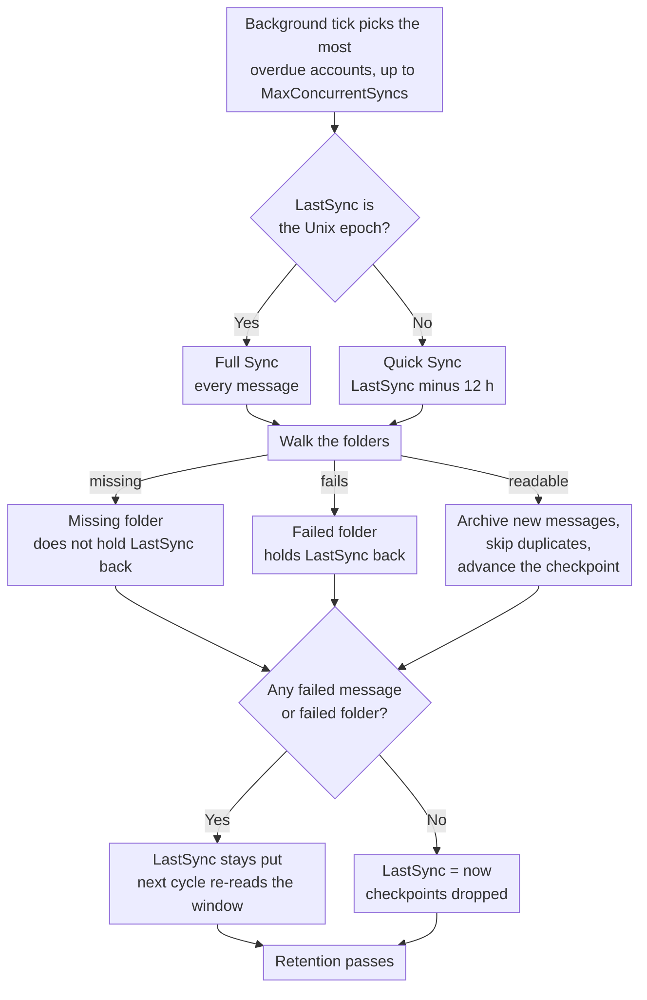

# 🔄 Synchronizacja poczty (Szybka vs. Pełna synchronizacja) {#mail-synchronization-quick-vs-full-sync}

[← Powrót do Indeksu Dokumentacji](index.md)

## 📋 Przegląd {#overview}

Mail Archiver automatycznie synchronizuje każdą włączoną Skrzynkę pocztową w tle za pośrednictwem `MailSyncBackgroundService`. Usługa uruchamia krótką pętlę odpytywania (co 60 s), określa, które Konta wymagają synchronizacji, i synchronizuje je — do `MailSync:MaxConcurrentSyncs` Kont równolegle w ramach jednego cyklu — przed ponownym zaplanowaniem każdego Konta zgodnie z jego własnym interwałem synchronizacji. Interwały można skonfigurować globalnie za pomocą `appsettings.json` i nadpisać dla każdego Konta na stronie Tworzenia/Edycji.

Istnieją dwa odrębne tryby synchronizacji:

| Tryb | Wyzwalany przez | Zakres |
|------|--------------|-------|
| **Quick Sync** (przyrostowa) | Każdy cykl synchronizacji (interwał na każde Konto) | Tylko nowe/zmienione wiadomości od ostatniej udanej synchronizacji |
| **Full Sync** (ponowna synchronizacja) | Nowe Konto, przycisk ręczny, `AlwaysForceFullSync` lub interwał Full Sync dla Konta / globalny | Każda wiadomość w każdym nieobjętym wykluczeniem Folderze |

Oba tryby można bezpiecznie uruchamiać wielokrotnie – Mail Archiver wykrywa duplikaty (na podstawie `MessageId` lub na podstawie From/To/Subject/SentDate, gdy brakuje `MessageId`) i pomija wiadomości, które są już w Archiwum.

---

## 🔁 Cykl Synchronizacji w pigułce {#the-sync-cycle-at-a-glance}



Ostatnia decyzja jest tą, która ma znaczenie. `LastSync` postępuje tylko wtedy, gdy przebieg
zakończył się bez błędnych wiadomości **i** bez błędnych folderów. Dlatego
skrzynka pocztowa z jednym nieczytelnym folderem stale ponownie odczytuje to samo okno,
zamiast po cichu przejść dalej — i dlatego przebieg, który kończy się przedwcześnie (timeout, cancel, rate limit),
powoduje ponowne odczytanie zamiast utraty poczty.

---

## ⚡ Quick Sync (Incremental Sync) {#quick-sync-incremental-sync}

Quick sync to normalny tryb pracy, który uruchamia się automatycznie w skonfigurowanym interwale. Globalna wartość domyślna to `MailSync:IntervalMinutes` minut (domyślnie 15); każde Konto może ją nadpisać własną wartością `SyncIntervalMinutes` ustawioną na stronie Tworzenia/Edycji (zostaw puste, aby użyć globalnej wartości domyślnej).

### Jak to działa {#how-it-works}

1. Dla każdego włączonego Konta (z wyłączeniem kont dostawców `IMPORT`), usługa odczytuje znacznik czasu `LastSync` Konta.
2. Filtr daty jest budowany na podstawie `LastSync`:
   - **IMAP**: `SearchQuery.DeliveredAfter(LastSync − 12 hours)`
   - **M365 (Graph)**: `receivedDateTime ge (LastSync − 12 hours)`
3. 12-godzinne nachodzenie na siebie zakresów jest zamierzone. Pozwala to na przechwycenie wiadomości, które zostały dostarczone przez dostawcę po rozpoczęciu poprzedniej synchronizacji, ale posiadają nieco starszy znacznik czasu serwera, oraz toleruje niewielkie przesunięcia zegara między serwerem pocztowym a hostem Mail Archiver. Duplikaty są usuwane przez sprawdzanie duplikatów, więc nachodzenie na siebie zakresów nigdy nie tworzy podwójnych wpisów.
4. Dla każdego nieobjętego wyłączeniem Folderu, przefiltrowana lista wiadomości jest pobierana partiami i archiwizowana. Istniejące wiadomości są pomijane.
5. Po **pomyślnym zakończeniu** (brak nieudanych wiadomości, brak Folderów, które zawiodły jako całość, brak przekroczenia limitu prędkości), `LastSync` zostaje ustawione na `DateTime.UtcNow`, a kolejny cykl rozpoczyna się od tego punktu.
6. Jeśli **jakakolwiek wiadomość nie powiodła się** podczas przetwarzania lub **żaden Folder nie mógł zostać zsynchronizowany w ogóle** (patrz [Folders That Fail as a Whole](#-folders-that-fail-as-a-whole)), `LastSync` **nie** zostaje zaktualizowane, więc kolejny cykl ponownie próbuje przetworzyć ten sam zakres.
7. Jeśli Konto napotka **limit prędkości** (patrz [Rate Limit Handling](RateLimitHandling.md)), `LastSync` również pozostaje bez zmian, a Synchronizacja wznawia się od punktu kontrolnego dla danego Folderu po zresetowaniu dziennej kwoty.

### Kiedy to zobaczysz {#when-you-see-it}

- Automatycznie, co kilka minut, dla wszystkich włączonych Kont.
- Po zakończeniu początkowej synchronizacji nowego Konta (pierwszy cykl to Full Sync, patrz poniżej).
- Nie wymaga żadnej akcji użytkownika.

## 🗄️ Pełna Synchronizacja (Resync) {#full-sync-resync}

Pełna Synchronizacja ignoruje filtr daty i pobiera **każdą** wiadomość z każdego nieobjętego wykluczeniem folderu z serwera, niezależnie od jej wieku.

### Co wyzwala Pełną Synchronizację {#what-triggers-a-full-sync}

Pełna Synchronizacja jest wyzwalana zawsze, gdy `LastSync` konta zostanie ustawione na epokę Unix (`1970-01-01T00:00:00Z`). Dzieje się to w czterech sytuacjach:

1. **Nowe konto** – Każde nowo utworzone konto IMAP lub M365 zaczyna od `LastSync = 1970-01-01`. Pierwszy zaplanowany cykl synchronizacji dla tego konta jest zatem automatycznie Pełną Synchronizacją, która wykonuje początkowy import do Archiwum.
2. **Ręczny przycisk „Full Resync”** – Na stronie *Account Details* przycisk **Full Resync** (`MailAccounts/Resync`) resetuje `LastSync` do epoki i natychmiast rozpoczyna synchronizację w trybie priorytetowym (foreground) zapytania.
3. **`MailSync:AlwaysForceFullSync = true`** – Gdy ta flaga konfiguracji jest włączona, usługa działająca w tle resetuje `LastSync` do epoki dla **każdego włączonego konta na początku każdego cyklu synchronizacji**. W efekcie każdy cykl staje się Pełną Synchronizacją. Jest to przeznaczone wyłącznie do rozwiązywania problemów i powinno zostać wyłączone po usunięciu usterki, ponieważ drastycznie zwiększa obciążenie serwera pocztowego oraz instancji Mail Archiver.
4. **Interwał Pełnej Synchronizacji na konto lub globalny** – Gdy dla konta ustawiono `FullSyncIntervalHours` (strona Create/Edit), lub gdy globalny domyślny `MailSync:FullSyncIntervalHours` jest skonfigurowany w `appsettings.json`, usługa działająca w tle automatycznie wyzwala Pełną Synchronizację po upływie tego interwału od ostatniej pełnej synchronizacji konta (`LastFullSync`). Wartość na konto ma pierwszeństwo; gdy żadna nie jest ustawiona, nie działa automatyczna pełna synchronizacja i pozostaje jedynie ręczny przycisk resync (oraz `AlwaysForceFullSync` powyżej). Po zakończeniu pełnej synchronizacji `LastFullSync` zostaje zaktualizowane do `DateTime.UtcNow`, tak aby kolejna pełna synchronizacja była planowana od tego punktu.

### Zachowanie podczas Pełnej Synchronizacji {#behavior-during-a-full-sync}

- Nie jest stosowany filtr `DeliveredAfter` / `receivedDateTime ge …`. Serwer jest proszony o zwrócenie wszystkich wiadomości w folderze.
- Jeśli serwer zwraca mniej wyników, niż faktycznie zawiera folder (niektóre serwery IMAP ograniczają wyniki `SEARCH`), Mail Archiver wykrywa rozbieżność i przechodzi do pobierania wszystkich `UniqueId` według numeru sekwencyjnego, dzięki czemu żadne wiadomości nie zostają po cichu pominięte.
- Wiadomości, które znajdują się już w Archiwum, są wykrywane jako duplikaty i pomijane – istniejąca skopiowana wersja w Archiwum **nie** zostaje nadpisana. Jeśli duplikat zostanie znaleziony pod inną nazwą folderu niż wcześniej, pole `FolderName` zostaje zaktualizowane, aby odzwierciedlać aktualną lokalizację.
- Dla bardzo dużych skrzynek pocztowych Pełna Synchronizacja może trwać kilka godzin, a nawet dni. Gdy włączone jest śledzenie przepustowości, synchronizacja zatrzymuje się w sposób kontrolowany po osiągnięciu dziennego limitu i wznawia się od punktów kontrolnych dla każdego folderu następnego dnia (patrz [Rate Limit Handling](RateLimitHandling.md)).
- `LastSync` jest aktualizowane do `DateTime.UtcNow` dopiero po zakończeniu Pełnej Synchronizacji bez błędnych wiadomości i bez błędnych folderów, dokładnie tak samo jak w przypadku Szybkiej Synchronizacji.

### Kiedy używać ręcznej Pełnej Synchronizacji {#when-to-use-a-manual-full-sync}

Użyj przycisku **Full Resync**, gdy:

- Zmieniłeś listę **wykluczonych folderów** konta i chcesz potwierdzić, że Archiwum odpowiada aktualnemu wyborowi.
- Podejrzewasz, że w Archiwum brakuje wiadomości (np. po migracji serwera, awarii dostawcy lub incydencie związanym z przesunięciem czasu zegara).
- Zmigrowałeś Skrzynkę pocztową na inny backend i chcesz zweryfikować kompletność danych.
- Chcesz ponownie wykryć wiadomości, które zostały przeniesione między folderami na serwerze.
- Foldery, które wcześniej były niewidoczne dla Mail Archiver, stały się ponownie widoczne — np. foldery Outlook.com utworzone przez klientów zewnętrznych, które były filtrowane z listy folderów IMAP, dopóki nie zostały zmienione nazwy za pomocą interfejsu webowego (patrz [Personal Microsoft Account Setup → Troubleshooting](MSA_Outlook_Setup.md#-troubleshooting)). Pełna Synchronizacja jest wymagana, ponieważ Szybka Synchronizacja nie uzupełni starszych wiadomości w tych folderach.

**Nie** używaj Pełnej Synchronizacji:

- Jako standardowej operacji – obciąża ona niepotrzebnie dostawcę i Twoją instancję Mail Archiver.
- Aby „odświeżyć” treść wiadomości lub metadane – duplikaty są pomijane, więc istniejące skopiowane wersje w Archiwum nie są aktualizowane przez Pełną Synchronizację. Aby zastąpić wiadomość w Archiwum, musisz najpierw usunąć ją z Archiwum, a następnie uruchomić synchronizację (Szybką lub Pełną).
- Na stałe poprzez `AlwaysForceFullSync=true` – pozostaw tę opcję wyłączoną w środowisku produkcyjnym. Jest to przełącznik diagnostyczny, a nie tryb pracy.

## 🆚 Szybka Synchronizacja vs. Pełna Synchronizacja w pigułce {#quick-sync-vs-full-sync-at-a-glance}

| Aspekt | Szybka Synchronizacja | Pełna Synchronizacja |
|--------|-----------|-----------|
| Filtr daty | `LastSync − 12 h` do teraz | Brak (wszystkie wiadomości) |
| Typowa objętość | Kilka nowych wiadomości | Cała Skrzynka pocztowa |
| Czas trwania | Sekundy do minut | Minuty do dni (zależnie od rozmiaru Skrzynki pocztowej i limitów dostawcy) |
| Wpływ na przepustowość | Niski | Wysoki |
| `LastSync` aktualizowane po sukcesie | Tak | Tak |
| `LastSync` aktualizowane po błędzie / limicie prędkości | Nie (ponowienie w następnym cyklu) | Nie (wznowienie od punktu kontrolnego) |
| Obsługa duplikatów | Pomiń wiadomości znajdujące się już w Archiwum | Pomiń wiadomości znajdujące się już w Archiwum |
| Wyzwalane przez | Harmonogram (interwał na każde Konto) | Nowe Konto, przycisk ręczny, `AlwaysForceFullSync` lub interwał Pełnej Synchronizacji |
| Zalecane dla | Codziennej pracy | Początkowy import i okazjonalna weryfikacja |

---

## ⚙️ Konfiguracja {#configuration}

Zachowanie synchronizacji jest kontrolowane przez sekcję `MailSync` w `appsettings.json` (lub zmienne środowiskowe `MailSync__*` w Docker). Pełną listę parametrów znajduje się w [Setup.md](Setup.md).

| Ustawienie | Domyślne | Opis |
|---------|---------|-------------|
| `MailSync:IntervalMinutes` | `15` | Globalna wartość domyślna dla interwału synchronizacji na każde Konto, w minutach. Każde Konto może nadpisać tę wartość na stronie Tworzenia/Edycji (zostaw puste, aby użyć tej wartości domyślnej). |
| `MailSync:FullSyncIntervalHours` | _nieustalone_ | Opcjonalna globalna wartość domyślna dla automatycznej pełnej resynchronizacji, w godzinach. Gdy nie jest ustawiona (domyślnie), żadna automatyczna pełna synchronizacja nie jest uruchamiana, chyba że ustawiono wartość `FullSyncIntervalHours` dla danego Konta. Wartości dla poszczególnych Kont nadpisują tę wartość. |
| `MailSync:TimeoutMinutes` | `0` (brak) | Przekroczenie czasu (timeout) synchronizacji dla danego Konta. Synchronizacja, która trwa dłużej, zatrzymuje się na najbliższej granicy wiadomości i wznawia przy kolejnym uruchomieniu. `0` (domyślnie lub każda wartość niedodatnia) oznacza brak limitu czasu. Zobacz [Zatrzymywanie synchronizacji wcześniej](#-stopping-a-sync-early). |
| `MailSync:ConnectionTimeoutSeconds` | `300` | Przekroczenie czasu połączenia IMAP. |
| `MailSync:CommandTimeoutSeconds` | `600` | Przekroczenie czasu polecenia IMAP. |
| `MailSync:AlwaysForceFullSync` | `false` | Gdy `true`, każdy cykl jest Pełną Synchronizacją dla wszystkich Kont. **Tylko do diagnostyki – nie używać na produkcji.** |
| `MailSync:IgnoreSelfSignedCert` | `false` | Akceptowanie certyfikatów TLS podpisanych samodzielnie (niezaufany korzeń, niekompletny łańcuch) oraz niezgodności nazw hostów dla połączeń IMAP — np. Proton Bridge, którego certyfikat jest wystawiony dla `127.0.0.1`. Inne problemy z łańcuchem, takie jak wygasłe certyfikaty, są nadal odrzucane. |
| `MailSync:MaxConcurrentSyncs` | `1` | Ile synchronizacji Kont może działać jednocześnie. Wolne miejsca są uzupełniane w miarę ich zwalniania, zobacz [Jak są planowane Konta](#-how-accounts-are-scheduled). `1` utrzymuje synchronizację sekwencyjną; zwiększ, aby zrównoleglić proces — pamiętaj o limitach prędkości dostawcy i zużyciu lokalnych zasobów. |
| `MailSync:InterAccountDelaySeconds` | `0` | Opcjonalne opóźnienie (stagger delay) w sekundach stosowane na końcu każdego zadania synchronizacji Konta. Przydatne, aby uniknąć nagłych skoków obciążenia, gdy `MaxConcurrentSyncs > 1`. `0` wyłącza tę funkcję. |서
| `MailSync:MaxIssuesPerKind` | `20` | Ile problemów każdego rodzaju zadanie synchronizacji zapamiętuje dla strony Konta — nieudane Foldery, brakujące Foldery oraz nieudane wiadomości są budżetowane oddzielnie. Wszystko powyżej tej liczby jest liczone, ale nie przechowywane. `0` wyłącza szczegóły i pozostawia tylko liczniki. |
| `MailSync:GlobalExcludedFolders` | _puste_ | Foldery wykluczone z synchronizacji dla każdego Konta, dodane do własnej listy każdego Konta. Zobacz [Wykluczone Foldery](#-excluded-folders) poniżej. |
| `MailSync:ExcludeSubfolders` | `false` | Czy wpis wykluczenia obejmuje również Foldery poniżej tego, który został wymieniony, w obu listach. Zobacz [Wykluczone Foldery](#-excluded-folders) poniżej. |

> 💡 Zarówno normalny interwał synchronizacji, jak i interwał pełnej synchronizacji mogą być nadpisane dla każdego Konta na stronie **Tworzenie/Edycja Konta Mailowego**. Zostaw pola dla poszczególnych Kont pustymi, aby powrócić do globalnych wartości domyślnych. Aby całkowicie usunąć Konto z harmonogramu, wyłącz je (przełącz *Enabled* na wyłączone na stronie Szczegóły Konta).

## 🚫 Wykluczone Foldery {#excluded-folders}

Foldery można wykluczyć z synchronizacji w dwóch miejscach, a oba są **sumowalne**: folder jest pomijany, gdy pasuje do **którejkolwiek** z list. Żadna z nich nie może ponownie dołączyć tego, co została wykluczone przez drugą, więc dodanie wpisu w dowolnym miejscu może jedynie usuwać foldery z synchronizacji.

| Źródło | Zakres | Gdzie |
|--------|-------|-------|
| Lista wykluczeń konta | Jedno Konto | strona *Create/Edit Mail Account* |
| `MailSync:GlobalExcludedFolders` | Każde Konto w instalacji | `appsettings.json` lub `MailSync__GlobalExcludedFolders__<n>` |

Globalna lista jest **domyślnie pusta**, więc instalacja, która nigdy jej nie skonfiguruje, zachowuje się dokładnie tak samo jak wcześniej. Istnieje ona na wypadek, gdy wiele skrzynek pocztowych jest importowanych z tego samego serwera, a alternatywą byłoby utrzymywanie identycznej listy wykluczeń dla każdego pojedynczego konta.

Obie listy używają tych samych reguł dopasowywania, więc nie mogą się rozbieżnie:

1. dokładne dopasowanie do pełnej ścieżki folderu (`INBOX/Drafts`);
2. dokładne dopasowanie do własnej nazwy folderu (`Drafts`), co wyłapuje wpis wpisany jako krótka nazwa, gdy serwer zgłasza ścieżkę z prefiksem;
3. dopasowanie przyrostka ścieżki, które wyłapuje warianty separatorów — `Drafts` pasuje również do `INBOX.Drafts` i `INBOX/Drafts` — oraz nazwy z prefiksem serwera, takie jak `[Provider]/Drafts`;
4. wszystko poniżej folderu wskazanego przez wpis, więc `Archive` obejmuje również `Archive/Team` i `INBOX.Archive.Team`, zawsze gdy `MailSync:ExcludeSubfolders` jest włączone (domyślnie jest wyłączone, co odpowiada zachowaniu sprzed wprowadzenia tej opcji). Ustaw to na `true`, aby wykluczyć drzewo Skrzynka pocztowa poprzez podanie jego korzenia zamiast każdego folderu w nim zawartego; przy ustawieniu domyślnym wpis pasuje tylko do tego jednego folderu, który został wskazany.

Wszystkie porównania nie uwzględniają wielkości liter. Reguła przyrostka pełnej ścieżki kotwiczy się na separatorze ścieżki, więc `Archive` nie obejmuje folderu o nazwie `ArchiveWeek`. Porównanie nazw nie jest kotwiczone w ten sam sposób: krótki wpis pasuje również do każdego folderu, którego własna nazwa **kończy się** tym wpisem, więc `Archive` obejmuje folder o nazwie `OldArchive`. Aby wykluczyć dokładnie jeden folder spośród podobnie nazwanych, należy podać jego pełną ścieżkę.

Reguła 4 kotwiczy się na separatorze w taki sam sposób jak reguła 3, więc obejmuje całe foldery, a nie fragmenty nazw: `Archive` obejmuje `Archive/Team`, podczas gdy folder pocztowy o nazwie `Team Archive Review` pozostaje w synchronizacji. Przodkowie są porównywani tylko po ścieżce, więc niekotwiczone porównanie nazw nie jest przekazywane do dzieci folderu. `.` jest traktowany jako separator wszędzie tam, gdzie się pojawi, co oznacza, że na serwerze używającym `/` jako separatora, folder na najwyższym poziomie o dosłownej nazwie `Archive.ics` jest odczytywany jako znajdujący się pod `Archive`.

**Żadna nazwa folderu nie jest domyślnie wykluczana.** To, które nazwy warto wymienić, zależy całkowicie od serwera i jego języka — drzewo Skrzynka pocztowa, które zawiera również foldery kalendarza, kontaktów, zadań i notatek, jest częstym powodem użycia tej funkcji, ale Mail Archiver nie zakłada z góry takiej struktury. Więcej informacji w [Setup.md](Setup.md) w przykładzie konfiguracji.

Zmiana którejkolwiek z list nie usuwa niczego, co zostało już zarchiwizowane. Po zmianie uruchom [Full Sync](#-full-sync-resync), jeśli chcesz potwierdzić, że Archiwum zgadza się z bieżącym wyborem.

Wykluczenie ma zastosowanie wszędzie tam, gdzie przeglądana jest lista folderów, a nie tylko podczas archiwizacji: wykluczony folder jest również pomijany podczas etapu usuwania po stronie serwera (patrz niżej), więc wpis chroni folder również na serwerze.

## 🗑️ Usuwanie po stronie serwera podczas synchronizacji {#server-side-deletion-during-sync}

Jeśli Konto ma skonfigurowane `DeleteAfterDays` (> 0), Mail Archiver usuwa wiadomości starsze niż skonfigurowany próg z **serwera pocztowego** po każdej synchronizacji:

- **IMAP**: `SearchQuery.SentBefore(now − DeleteAfterDays)` na Folder, a następnie expunge.
- **M365 (Graph)**: `receivedDateTime lt (now − DeleteAfterDays)` na Folder, a następnie delete.

Zarchiwizowane kopie w Mail Archiver **nie** są tym objęte – jedynie Skrzynka pocztowa po stronie serwera jest przycinana. Foldery znajdujące się na którejkolwiek liście wykluczeń ([Excluded Folders](#-excluded-folders)) są pomijane podczas tego procesu usuwania i pozostają nienaruszone na serwerze. Aby dowiedzieć się więcej o lokalnym odpowiedniku Przechowywanie, który kontroluje, jak długo przechowywane są zarchiwizowane kopie, sprawdź [Retention Policies](RetentionPolicies.md).

---

## 🛟 Odzyskiwanie wiadomości zgłaszanych przez serwer jako brakujące {#recovering-messages-the-server-reports-as-missing}

Niektóre serwery odrzucają wiadomość podczas normalnego pobierania UID, ale wciąż zwracają użyteczny dokument MIME dla zwykłego pobierania `BODY[]`. Zaobserwowano to w starszych wersjach on-premises Exchange, gdzie pobieranie kończy się błędem:

```
MailKit.MessageNotFoundException: The IMAP server did not return the requested message.
```

Bez mechanizmu awaryjnego taka wiadomość jest liczona jako nieudany e-mail, a ponieważ `LastSync` nie jest zaawansowane, dopóki konto ma błędy, konto ponownie odczytuje te same wiadomości przy każdym uruchomieniu i nie robi żadnych postępów.

**Co robi Mail Archiver:** wykonuje dokładnie jedną dodatkową próbę pobrania dla tego UID, i to tylko dla tego konkretnego błędu. Problemy z uwierzytelnianiem, utrata połączenia, ograniczanie przepustowości (throttling) oraz błędy parsowania nie są objęte tym procesem, a istniejące zachowanie transient-retry pozostaje niezmienione. Próba jest tylko do odczytu: żadna wiadomość nie jest oznaczana jako przeczytana, żadna flaga nie zostaje zmieniona, nic nie jest przenoszone ani usuwane. Liczy się jako sukces tylko wtedy, gdy surowe dane faktycznie dotarły **i** zostały sparsowane jako wiadomość MIME — każda inna sytuacja pozostaje nieudanym e-mailem. Odzyskane wiadomości podążają następnie normalną ścieżką archiwizacji, w tym ścieżką wykrywania duplikatów, dzięki czemu powtarzana pełna synchronizacja nie archiwizuje ich dwukrotnie.

**Placeholdery błędów dostawcy:** to, co zwraca serwer, często nie jest oryginalną wiadomością, lecz dokumentem wygenerowanym przez dostawcę w jej miejsce, na przykład:

```
Subject: Retrieval using the IMAP4 protocol failed for the following message: 270198
From: Microsoft Exchange Server 2010

The server couldn't retrieve the following message: ...
```

Jest to archiwizowane dokładnie w takiej formie, w jakiej zostało odebrane i nigdy nie jest przepisywane na nadawcę, temat ani treść cytowaną wewnątrz. Mail Archiver nie może odzyskać treści, której sam dostawca odmawia konwersji do formatu MIME; zachowuje on najlepszą możliwą reprezentację, jaką serwer jest w stanie udostępnić, oraz fakt, że dotarł placeholder. Każdy z nich jest logowany na poziomie `Warning` wraz z danymi: konto, folder, UID i temat.

**Gdy mechanizm awaryjny zwraca pustą odpowiedź**, wiadomość pozostaje nieudanym e-mailem dokładnie tak jak wcześniej, a próba jest logowana w `Warning` zamiast być po cichu pominiętą — nieodzyskana wiadomość nigdy nie powinna sprawiać wrażenia zarchiwizowanej. Gdyby serwer zachowywał się w ten sposób stale, udokumentowanym kolejnym krokiem jest pobranie `BODY.PEEK[HEADER]` i `BODY.PEEK[TEXT]` oddzielnie i złożenie ich w jeden dokument MIME. Jest to zupełnie inne zapytanie, podczas gdy obecny mechanizm awaryjny to to samo zapytanie odczytane w inny sposób. Nie zostało to celowo zaimplementowane: kosztuje to drugą rundę komunikacji na każdą wiadomość i dodaje stan „nagłówek dotarł, tekst nie dotarł” do zdefiniowania, a żaden serwer dotychczas nie wymagał tego rozwiązania.

Oba liczniki pojawiają się w linii logu zakończenia konta:

```
Sync completed for account: Example. New: 0, Failed: 0, Deleted: 0, Recovered: 25, Provider placeholders: 25, Failed folders: 0
```

`Recovered` liczy wiadomości, które uratował mechanizm awaryjny; `Provider placeholders` to podzbiór tych, które okazały się dokumentami błędów wygenerowanymi przez dostawcę. `Failed: 0` wraz z nimi stanowi istotę tej funkcji — konto nie jest już zablokowane.

## 📁 Foldery, które zawodzą jako całość {#folders-that-fail-as-a-whole}

Wiadomość może zawieść samodzielnie, a folder może zawieść jako jednostka — serwer go wymienia, ale próba otwarcia lub przeszukiwania powoduje błąd. Niektóre serwery ogłaszają foldery poprzez `LIST`/`LSUB`, które następnie odpowiadają `NO ... doesn't exist` na `EXAMINE`.

Są one liczone oddzielnie, jeden na folder:

```
Sync completed for account: Example. New: 120, Failed: 0, Deleted: 0, Recovered: 0, Provider placeholders: 0, Failed folders: 2
```

`Failed folders: 2` oznacza, że dwa foldery nie mogły zostać poddane synchronizacji. Nie oznacza to, że jakaś konkretna wiadomość zawiodła — gdy nie można otworzyć folderu, nic nie wiadomo o wiadomościach w nim znajdujących się, więc podanie liczby nieudanych wiadomości nie byłoby prawdziwe.

**Dlaczego jest to osobny licznik.** Awaria na poziomie folderu była dawniej rejestrowana jako nieudane *wiadomości*, w liczbie tylu, ile przetworzono w tym folderze do tego momentu. Ta liczba była zmyślona i nadpisywała rzeczywiste błędy poszczególnych wiadomości w folderze. W rezultacie jeden niedostępny folder mógł raportować setki nieudanych wiadomości, które w rzeczywistości zostały poprawnie zarchiwizowane.

**Wpływ na `LastSync`, bez zmian.** Folder, który zawiódł jako całość, nadal uniemożliwia `LastSync` postęp, dokładnie tak samo, jak działo się to, gdy był liczony jako nieudane wiadomości. Zmieniło się tylko raportowanie, a nie zachowanie: Konto nadal ponawia próbę w tym samym oknie w następnym cyklu. Jest to zamierzone — synchronizacja przyrostowa, która przeszła obok folderu, którego nigdy nie udało się odczytać, nigdy nie wróci po znajdującą się w nim pocztę.

Oba liczniki są widoczne na poziomie `Information`, a ostrzeżenie, które je wymienia, jest emitowane za każdym razem, gdy `LastSync` zostaje wstrzymane:

```
Not updating LastSync for account Example: 0 failed emails, 2 folders that could not be synced at all
```

### Foldery, które zniknęły, w przeciwieństwie do tych uszkodzonych {#folders-that-are-gone-as-opposed-to-broken}

Folder, który serwer wymienia, a następnie odmawia otwarcia, nie jest automatycznie błędem. Najczęstszym powodem wcale nie jest usterka: RFC 3501 zabrania serwerowi usuwania nazwy z listy subskrypcji, gdy Skrzynka pocztowa za nią stojąca zostaje usunięta, więc folder, do którego ktoś kiedyś zasubskrybował w kliencie IMAP, jest nadal raportowany przez `LSUB` lat później. Wykrywanie folderów stanowi sumę `LIST` i `LSUB`, więc te nazwy trafiają do synchronizacji, a `EXAMINE` odpowiada `NO ... doesn't exist`.

Jest to odpowiedź, a nie błąd. Nie ma czego ponawiać ani po co wracać, więc jest to liczone oddzielnie i **nie** wstrzymuje `LastSync`:

```
Sync completed for account: Example. New: 120, Failed: 0, ..., Failed folders: 0, Missing folders: 16
```

Liczenie tego jako błędu trwale zatrzymałoby Konto, ponieważ folder, który nie istnieje, nigdy nie zacznie istnieć ponownie. Dokładnie to stało się na Skrzynce pocztowej z 16 nieaktualnymi subskrypcjami: Konto przestało przesuwać `LastSync` i nie mogło samodzielnie odzyskać sprawności.

Wszystko inne pozostaje błędem i nadal wstrzymuje Konto — brak uprawnienia, zerwane połączenie, throttling, błąd serwera. Te zdarzenia mogą zakończyć się sukcesem przy kolejnym uruchomieniu.

`Missing folders: N` jest warte działania, mimo że jest nieszkodliwe: oznacza to, że Skrzynka pocztowa zawiera subskrypcje do folderów, które już nie istnieją. Ich czyszczenie to `UNSUBSCRIBE` na nazwę, wykonywane za pomocą dowolnego klienta IMAP, a synchronizacja celowo tego **nie** robi — archiwizator nie może modyfikować Skrzynki pocztowej, którą odczytuje.

Tylko IMAP. Microsoft Graph wylicza foldery poprzez API, gdzie usunięty folder po prostu nie jest zwracany, więc taka sytuacja nie może tam wystąpić.

Dotyczy obu dostawców, IMAP i M365 (Graph).

---

## 🗓️ Jak planowane są konta {#how-accounts-are-scheduled}

W tle co minutę uruchamiany jest proces (tick). Wczytuje on włączone konta, ustala, które z nich są gotowe do synchronizacji, i uruchamia tyle z nich, ile jest wolnych slotów synchronizacji: łącznie `MailSync:MaxConcurrentSyncs`.
Proces **nie** czeka na rozpoczęte synchronizacje. Wszystko, co się nie zmieści, zostaje odłożone na kolejny cykl, który podejmuje decyzję od nowa.

Następne uruchomienie każdego konta jest planowane w momencie, gdy jego synchronizacja **kończy się**, od tego momentu plus jego interwał.
W związku z tym konto, którego synchronizacja trwa dłużej niż jego interwał, jest gotowe do ponownego uruchomienia natychmiast po zakończeniu, ale nigdy nie dwa razy jednocześnie: konto, które już działa, jest pomijane, a nie kolejkowane.

Gdy gotowych do synchronizacji jest więcej kont niż dostępnych slotów, **najbardziej opóźnione konto jest obsługiwane jako pierwsze**. W przypadku remisów rozstrzyga identyfikator konta, dzięki czemu zaległości są procesowane w sposób powtarzalny.

Zakończona synchronizacja natychmiast wybudza harmonogram, dzięki czemu pętla nie czeka na swoją minutę bezczynności, gdy zwolnił się już slot: zaległości są procesowane jeden po drugim, nawet przy `MaxConcurrentSyncs: 1`, dokładnie tak jak w starej pętli wsadowej, podczas gdy minuta pozostaje jedynie najdłuższą przerwą między dwoma sprawdzeniami listy kont.

Przy więcej niż jednym slocie warto rozważyć ustawienie `MailSync:TimeoutMinutes`, co domyślnie wynosi `0` (brak limitu czasu). Synchronizacja zajmuje swój slot tak długo, jak długo trwa, więc pojedyncze konto, które trwale przestaje robić postępy, trwale zmniejsza liczbę slotów dostępnych dla reszty. Limit czasu kończy takie działanie jako pauzę, która zachowuje punkty kontrolne, a slot staje się wolny w kolejnym cyklu.

> ℹ️ Wcześniej cykl zbierał wszystkie gotowe konta i czekał na wszystkie, zanim sprawdził listę ponownie. W rezultacie jedna duża Skrzynka pocztowa wstrzymywała każde inne konto tak długo, jak długo trwała jej synchronizacja: sloty zwalniały się, ale nic nie było ponownie oceniane, dopóki ostatnia synchronizacja nie powróciła, więc instalacja z `MaxConcurrentSyncs: 10` i jedną Skrzynką pocztową trwającą sześć godzin w efekcie synchronizowała wszystko w sześciogodzinnym interwale. Konta, które kończą szybko, trzymają się teraz własnego interwału, niezależnie od tego, co innego jest uruchomione.

Podczas wyłączania usługa czeka do 30 sekund na trwające synchronizacje, zamiast przerywać proces w trakcie otwartej sesji IMAP. Nie są one anulowane; informacje o tym, co przerywa synchronizację, znajdują się w sekcji [Stopping a Sync Early](#-stopping-a-sync-early).

---

## ⏹️ Wcześniejsze przerwanie Synchronizacji {#stopping-a-sync-early}

Trwająca synchronizacja zostaje przerwana przed przetworzeniem każdego folderu dokładnie z dwóch powodów: ktoś anuluje zadanie na stronie **Jobs**, lub upływa czas `MailSync:TimeoutMinutes` konta. Oba przypadki są sprawdzane w trzech punktach: przed każdym folderem, przed każdą partią oraz przed każdą pojedynczą wiadomością, dzięki czemu żaden proces nie musi czekać na zakończenie pracy dużego folderu.

Limit czasu dotyczy **wyłącznie zaplanowanych synchronizacji**. Synchronizacja uruchomiona z interfejsu użytkownika, akcja „Sync now” lub pełna resynchronizacja, przebiega bez limitu czasu, więc długotrwała ręczna synchronizacja nigdy nie zostanie przerwana.

Oba przypadki kończą zadanie w inny sposób i ta różnica ma znaczenie:

| | Status zadania | `LastSync` | Punkty kontrolne | Przejścia Przechowywanie |
|---|---|---|---|---|
| Anulowano z interfejsu użytkownika | `Failed`, z komunikatem "Job was cancelled" | nie zaawansowano | zachowane | pominięto |
| Upłynął limit czasu synchronizacji | `Timed Out` | nie zaawansowano | zachowane | pominięto |

Limit czasu to **pauza, a nie błąd**. Synchronizacja zatrzymuje się w miejscu, zachowuje to, co zostało już zarchiwizowane, pozostawia `LastSync` bez zmian i pomija przejścia Przechowywanie po stronie serwera oraz lokalne, ponieważ ich uruchomienie zaprzeczałoby celowi ograniczenia czasu pracy. Następne zaplanowane uruchomienie wznawia pracę od punktu kontrolnego.

### Punkty kontrolne {#checkpoints}

Postęp jest rejestrowany dla każdego konta i folderu w `mail_archiver.SyncCheckpoints`: jest to UID ostatniej zarchiwizowanej wiadomości w tym folderze, wraz z UIDVALIDITY folderu w danym momencie. Każda instalacja je zapisuje; kiedyś były one powiązane z `BandwidthTracking:Enabled`, co oznaczało, że przerwana synchronizacja mogła zostać wznowiona tylko tam, gdzie ta niezwiązana funkcja była akurat włączona. Punkty kontrolne są usuwane natychmiast po tym, jak konto zakończy proces bez błędów.

Wznowiony folder wykonuje **dokładnie to samo wyszukiwanie**, które zostałoby wykonane bez punktu kontrolnego. Tylko identyfikatory UID znajdujące się na poziomie lub poniżej punktu odniesienia (watermark) są później odrzucane z wyniku, dzięki czemu okno wyszukiwania nigdy się nie przesuwa i żadna wiadomość nie może z niego wypaść.

Punkt odniesienia przestaje się przesuwać, gdy w folderze wystąpi błąd wiadomości. Wiadomości są przetwarzane w rosnącej kolejności UID, więc punkt odniesienia powyżej błędnego UID poinformowałby następne uruchomienie, że błędna wiadomość została już zarchiwizowana i nie powinna być ponownie podejmowana, co jest dokładnie tym, co ma wymusić wstrzymany `LastSync`. Wszystko powyżej błędu jest zatem ponownie odczytywane następnym razem; wiąże się to z ponownym odczytem, a sprawdzanie duplikatów absorbuje ten proces.

Punkt kontrolny jest ignorowany, a folder jest odczytywany w całości, gdy nie można udowodnić jego zastosowania: nie zarejestrowano jeszcze żadnego UID, nie zarejestrowano UIDVALIDITY lub UIDVALIDITY nie zgadza się już z folderem. Ten ostatni przypadek oznacza, że serwer zmienił numerację Skrzynki pocztowej, więc zapisany UID wskazuje na inną wiadomość. Ponowne odczytywanie folderu zajmuje czas i jest absorbowane przez sprawdzanie duplikatów; pominięcie go spowodowałoby cichą utratę poczty, dlatego w każdym wątpliwym przypadku folder jest odczytywany w całości.

Dostawca Graph API nie zapisuje punktów kontrolnych UID, ponieważ Graph API nie posiada odpowiednika UID z protokołu IMAP. Synchronizacja M365, która uległa przekroczeniu czasu lub ograniczeniu przepustowości, „wznawia się” tylko w tym sensie, że `LastSync` nie jest zaawansowany, więc następne uruchomienie ponownie odczytuje całe okno, a sprawdzanie duplikatów absorbuje nakładanie się danych.

> ℹ️ Wcześniej punkt kontrolny przechowywał **nagłówek Date** ostatniej zarchiwizowanej wiadomości i przekazywał go do wyszukiwania w folderze, na co serwer odpowiadał za pomocą INTERNALDATE – innego zegara, który może różnić się o lata w przypadku migracji poczty, podczas gdy wiadomości są przetwarzane w kolejności UID, a nie daty. Oba niedopasowania mogły przesunąć okno wyszukiwania poza pocztę, która nigdy nie została zarchiwizowana. Ten sam mechanizm jest stosowany, gdy synchronizacja zostaje wstrzymana przez limit przepustowości, dzięki czemu to wznowienie również zostaje naprawione przez tę zmianę.

### Duże skrzynki pocztowe i limit czasu {#large-mailboxes-and-the-timeout}

Pierwsza pełna synchronizacja Skrzynki pocztowej z 150 000 wiadomości trwa wiele godzin, a limit czasu krótszy od tego trwałaby zatrzymywałaby ją za każdym razem. Synchronizacja wznawia pracę od punktu kontrolnego zamiast zaczynać od nowa, ale Konto nie osiągnie stanu zakończonego i w związku z tym nie zaawansuje `LastSync`, dopóki jedno z uruchomień nie przejdzie przez cały proces. Przejrzyj wartość dla swoich skrzynek pocztowych i ustaw ją na `0`, jeśli wolisz całkowicie zrezygnować z limitu czasu.

## 👀 Obserwowanie Synchronizacji {#observing-the-sync}

### Strona konta odpowiada na pytanie „co zrobiło ostatnie uruchomienie” {#the-account-page-answers-what-did-the-last-run-do}

Każde konto pocztowe posiada kartę **Last Sync Run** pokazującą ostatnio zakończone uruchomienie: kiedy się zakończyło, ile czasu zajęło, ile wiadomości przetworzyło i ile z nich było nowych. Informacja ta przetrwa 24-godzinne Przechowywanie zadań, więc Skrzynka pocztowa, która była nieaktywna przez cały dzień, nadal posiada odpowiedź — tylko restart ją czyści, a karta informuje o tym, zamiast udawać, że Konto jest w porządku.

Gdy wystąpił błąd, karta wymienia go, grupując i limitując według rodzaju:

- **Foldery, których nie można było odczytać** — folder zawiódł jako jednostka. Wstrzymuje `LastSync`.
- **Foldery, których nie ma na serwerze** — zgłoszone podczas wykrywania, odrzucone przy otwieraniu. Zazwyczaj są to pozostałości po subskrypcjach do usuniętych folderów; nie wstrzymuje `LastSync`. Patrz [Foldery, które zniknęły](#folders-that-are-gone-as-opposed-to-broken).
- **Wiadomości, których nie można było zarchiwizować** — wraz z folderem, tematem, UID i własnym sformułowaniem serwera.

Każda grupa jest ograniczona przez `MailSync:MaxIssuesPerKind` i raportuje elementy, które nie zmieściły się, jako „i N kolejnych”, dzięki czemu zalew jednego rodzaju nie może przykryć pozostałych. Gdy `LastSync` zostało wstrzymane, karta również o tym informuje, w jednym zdaniu, ponieważ jest to pytanie, które faktycznie stawia nieaktualny znacznik czasu.

Lista kont oznacza konta, których ostatnie uruchomienie zgłosiło problemy, obok znacznika czasu. Celowo tylko te: zaznaczenie każdego wiersza byłoby szumem i zaprzeczałoby sensowi znacznika.

- **Strona Szczegóły konta**: Pokazuje aktualny znacznik czasu `LastSync` oraz aktywne zadanie synchronizacji (folder, liczba przetworzonych, liczba nowych, liczba błędów). Przycisk **Full Resync** znajduje się tutaj.
- **Logi**: Postęp synchronizacji jest logowany na poziomie `Information`. W Docker:
  ```bash
  docker compose logs -f mailarchive-app | grep -i sync
  ```
  Zobacz [Docker Compose Logs Guide](DockerComposeLogs.md) w celu uzyskania wskazówek dotyczących filtrowania logów.
- **Ograniczanie przepustowości**: Gdy Synchronizacja zostaje wstrzymana z powodu limitów przepustowości, konto pokazuje status „Rate-Limited” i wznawia się automatycznie po oknie resetu. Zobacz [Rate Limit Handling](RateLimitHandling.md).
- **Przekroczenie czasu (Timeouts)**: Synchronizacja zatrzymana przez `MailSync:TimeoutMinutes` pokazuje „Timed Out” i wznawia się od punktu kontrolnego przy następnym uruchomieniu. Zobacz [Stopping a Sync Early](#-stopping-a-sync-early).

---
