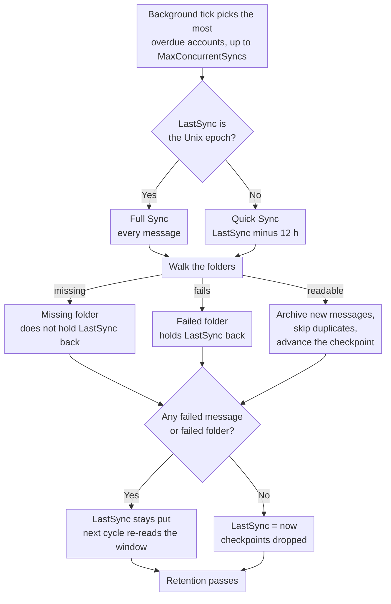

# 🔄 Sincronização de E-mail (Quick vs. Full Sync) {#mail-synchronization-quick-vs-full-sync}

[← Voltar para o Índice da Documentação](index.md)

## 📋 Visão Geral {#overview}

O Mail Archiver sincroniza automaticamente cada Caixa de correio habilitada em segundo plano por meio do `MailSyncBackgroundService`. O serviço executa um loop de polling curto (a cada 60 s), determina quais contas estão pendentes e as sincroniza — até `MailSync:MaxConcurrentSyncs` contas em paralelo dentro de um ciclo — antes de reagendar cada conta de acordo com seu próprio intervalo de sincronização. Os intervalos podem ser configurados globalmente via `appsettings.json` e substituídos por conta na página de Criar/Editar.

Existem dois modos de sincronização distintos:

| Modo | Acionado por | Escopo |
|------|--------------|-------|
| **Quick Sync** (incremental) | Cada ciclo de sincronização (intervalo por conta) | Apenas mensagens novas/alteradas desde a última sincronização bem-sucedida |
| **Full Sync** (resync) | Nova conta, botão manual, `AlwaysForceFullSync` ou intervalo de Full Sync por conta / global | Todas as mensagens em cada Pasta não excluída |

Ambos os modos são seguros para execução repetida – o Mail Archiver detecta duplicatas (por `MessageId`, ou por From/To/Subject/SentDate quando o `MessageId` está ausente) e ignora mensagens que já estão arquivadas.

---

## 🔁 O Ciclo de Sincronização em um Relance {#the-sync-cycle-at-a-glance}



A última decisão é a que importa. `LastSync` avança apenas quando a execução
termina sem mensagens com falha **e** sem pastas com falha. É por isso que uma
Caixa de correio com uma única pasta ilegível continua relendo a mesma janela em vez
de simplesmente passar por ela — e por que uma execução que termina prematuramente (timeout, cancelamento, limite de taxa) custa uma releitura em vez de perder e-mails.

---

## ⚡ Quick Sync (Sincronização Incremental) {#quick-sync-incremental-sync}

A Quick sync é o modo de operação normal que é executado automaticamente no intervalo configurado. O padrão global é `MailSync:IntervalMinutes` minutos (padrão 15); cada Conta pode substituir isso com seu próprio valor `SyncIntervalMinutes` definido na página de Criar/Editar (deixe vazio para usar o padrão global).

### Como funciona {#how-it-works}

1. Para cada Conta habilitada (excluindo contas de provedor `IMPORT`), o serviço lê o timestamp `LastSync` da Conta.
2. Um filtro de data é construído a partir de `LastSync`:
   - **IMAP**: `SearchQuery.DeliveredAfter(LastSync − 12 hours)`
   - **M365 (Graph)**: `receivedDateTime ge (LastSync − 12 hours)`
3. A sobreposição de 12 horas é intencional. Ela captura mensagens que foram entregues pelo provedor após o início da Sincronização anterior, mas com um timestamp de servidor ligeiramente mais antigo, e tolera pequenas variações de relógio entre o servidor de e-mail e o host do Mail Archiver. Duplicatas são filtradas pela verificação de duplicatas, portanto, a sobreposição nunca cria entradas duplas.
4. Para cada Pasta não excluída, a lista de mensagens filtradas é buscada em lotes e arquivada. Mensagens existentes são ignoradas.
5. Em caso de **conclusão bem-sucedida** (sem mensagens que falharam, sem pastas que falharam como um todo, sem atingir o limite de taxa), `LastSync` é definido como `DateTime.UtcNow` e o próximo ciclo começa a partir desse ponto.
6. Se **qualquer mensagem falhar** no processamento, ou se **qualquer Pasta não puder ser sincronizada de forma alguma** (veja [Folders That Fail as a Whole](#-folders-that-fail-as-a-whole)), `LastSync` **não** é atualizado, portanto o próximo ciclo tenta novamente a mesma janela.
7. Se a Conta sofrer **limitação de taxa** (veja [Rate Limit Handling](RateLimitHandling.md)), `LastSync` também é deixado intacto e a Sincronização é retomada a partir de um checkpoint por Pasta assim que a cota diária for redefinida.

### Quando você a vê {#when-you-see-it}

- Automaticamente, a cada poucos minutos, para todas as Contas habilitadas.
- Após a conclusão da Sincronização inicial de uma nova Conta (o primeiro ciclo é uma Full Sync, veja abaixo).
- Nenhuma ação do usuário é necessária.

## 🗄️ Sincronização Completa (Resync) {#full-sync-resync}

Uma Sincronização Completa ignora o filtro de data e baixa **cada** mensagem em cada Pasta não excluída do servidor, independentemente da idade.

### O que aciona uma Sincronização Completa {#what-triggers-a-full-sync}

Uma Sincronização Completa é acionada sempre que o `LastSync` de uma Conta é definido para o epoch Unix (`1970-01-01T00:00:00Z`). Isso acontece em quatro situações:

1. **Nova Conta** – Cada Conta IMAP ou M365 recém-criada começa com `LastSync = 1970-01-01`. O primeiro ciclo de sincronização agendado para essa Conta é, portanto, automaticamente uma Sincronização Completa, que realiza a importação inicial do Arquivo.
2. **Botão manual "Full Resync"** – Na página *Account Details*, o botão **Full Resync** (`MailAccounts/Resync`) redefine `LastSync` para o epoch e inicia a sincronização imediatamente em primeiro plano na requisição.
3. **`MailSync:AlwaysForceFullSync = true`** – Quando esta flag de configuração está habilitada, o serviço de segundo plano redefine `LastSync` para o epoch para **cada Conta habilitada no início de cada ciclo de sincronização**. Isso efetivamente transforma cada ciclo em uma Sincronização Completa. Isso é destinado apenas para solução de problemas e deve ser desativado assim que o problema for resolvido, pois aumenta drasticamente a carga no servidor de e-mail e na instância do Mail Archiver.
4. **Intervalo de Sincronização Completa por Conta ou global** – Quando uma Conta tem `FullSyncIntervalHours` definido (página Create/Edit), ou o padrão global `MailSync:FullSyncIntervalHours` é configurado em `appsettings.json`, o serviço de segundo plano aciona automaticamente uma Sincronização Completa assim que esse intervalo tiver decorrido desde a última sincronização completa da Conta (`LastFullSync`). O valor por Conta tem precedência; quando nenhum dos dois está definido, nenhuma sincronização completa automática é executada e apenas o botão de resync manual (e `AlwaysForceFullSync` acima) permanecem. Após a conclusão da sincronização completa, `LastFullSync` é atualizado para `DateTime.UtcNow` para que a próxima sincronização completa seja agendada a partir desse ponto.

### Comportamento durante uma Sincronização Completa {#behavior-during-a-full-sync}

- Nenhum filtro de `DeliveredAfter` / `receivedDateTime ge …` é aplicado. O servidor é solicitado a retornar todas as mensagens na Pasta.
- Se o servidor retornar menos resultados do que a Pasta realmente contém (alguns servidores IMAP limitam os resultados de `SEARCH`), o Mail Archiver detecta a discrepância e recorre à busca de todos os `UniqueId`s por número de sequência, para que nenhuma mensagem seja descartada silenciosamente.
- Mensagens que já estão no Arquivo são detectadas como duplicadas e ignoradas – a cópia arquivada existente **não** é sobrescrita. Se um duplicado for encontrado em um nome de Pasta diferente do anterior, o campo `FolderName` armazenado é atualizado para refletir a localização atual.
- Para Caixas de correio muito grandes, a Sincronização Completa pode levar várias horas ou até dias. Quando o rastreamento de largura de banda está habilitado, a sincronização pausa graciosamente na cota diária e retoma a partir de checkpoints por Pasta no dia seguinte (veja [Rate Limit Handling](RateLimitHandling.md)).
- `LastSync` é atualizado para `DateTime.UtcNow` apenas após uma Sincronização Completa ser concluída sem mensagens com falha e sem Pastas com falha, exatamente como uma Sincronização Rápida.

### Quando usar uma Sincronização Completa manual {#when-to-use-a-manual-full-sync}

Use o botão **Full Resync** quando:

- Você alterou a lista de **pastas excluídas** da Conta e deseja confirmar se o Arquivo corresponde à seleção atual.
- Você suspeita que o Arquivo está sem mensagens (ex: após uma migração de servidor, uma interrupção do provedor ou um incidente de desvio de relógio).
- Você migrou a Caixa de correio para um backend diferente e deseja verificar a integridade.
- Você deseja detectar novamente mensagens que foram movidas entre Pastas no servidor.
- Pastas que eram anteriormente invisíveis para o Mail Archiver tornaram-se visíveis novamente — ex: Pastas do Outlook.com criadas através de clientes de terceiros que foram filtradas da listagem de Pastas IMAP até serem renomeadas via interface web (veja [Personal Microsoft Account Setup → Troubleshooting](MSA_Outlook_Setup.md#-troubleshooting)). Uma Sincronização Completa é necessária porque uma Sincronização Rápida não preencheria as mensagens mais antigas nessas Pastas.

**Não** use a Sincronização Completa:

- Como uma operação regular – ela coloca uma carga desnecessária no provedor e na sua instância do Mail Archiver.
- Para "atualizar" corpos de mensagens ou metadados – duplicatas são ignoradas, portanto, as cópias arquivadas existentes não são atualizadas por uma Sincronização Completa. Para substituir uma mensagem arquivada, você deve excluí-la do Arquivo primeiro e, em seguida, executar uma sincronização (Rápida ou Completa).
- Permanentemente via `AlwaysForceFullSync=true` – deixe isso desativado em produção. É um interruptor de diagnóstico, não um modo de operação.

## 🆚 Quick Sync vs. Full Sync de Relance {#quick-sync-vs-full-sync-at-a-glance}

| Aspecto | Quick Sync | Full Sync |
|--------|-----------|-----------|
| Filtro de data | `LastSync − 12 h` até agora | Nenhum (todas as mensagens) |
| Volume típico | Algumas novas mensagens | Caixa de correio inteira |
| Duração | Segundos a minutos | Minutos a dias (dependendo do tamanho da Caixa de correio e limites do provedor) |
| Impacto na largura de banda | Baixo | Alto |
| `LastSync` atualizado com sucesso | Sim | Sim |
| `LastSync` atualizado em caso de falha / limite de taxa | Não (tentar no próximo ciclo) | Não (retomar do checkpoint) |
| Tratamento de duplicatas | Ignorar mensagens já arquivadas no Arquivo | Ignorar mensagens já arquivadas no Arquivo |
| Acionado por | Agendador (intervalo por Conta) | Nova Conta, botão manual, `AlwaysForceFullSync` ou intervalo de Full Sync |
| Recomendado para | Operação diária | Importação inicial e verificação ocasional |

---

## ⚙️ Configuração {#configuration}

O comportamento de sincronização é controlado pela seção `MailSync` de `appsettings.json` (ou variáveis de ambiente `MailSync__*` no Docker). Consulte [Setup.md](Setup.md) para a lista completa de parâmetros.

| Configuração | Padrão | Descrição |
|---------|---------|-------------|
| `MailSync:IntervalMinutes` | `15` | Padrão global para o intervalo de sincronização por Conta, em minutos. Cada Conta pode sobrescrever isso na página de Criar/Editar (deixe vazio para usar este padrão). |
| `MailSync:FullSyncIntervalHours` | _não definido_ | Padrão global opcional para resincronizações completas automáticas, em horas. Quando não definido (o padrão), nenhuma sincronização completa automática é executada, a menos que um valor de `FullSyncIntervalHours` por Conta seja definido. Valores por Conta sobrescrevem isso. |
| `MailSync:TimeoutMinutes` | `0` (nenhum) | Tempo limite de sincronização por Conta. Uma sincronização que dure mais tempo para no próximo limite de mensagem e retoma na próxima execução. `0` (o padrão, ou qualquer valor não positivo) significa que não há tempo limite. Veja [Stopping a Sync Early](#-stopping-a-sync-early). |
| `MailSync:ConnectionTimeoutSeconds` | `300` | Tempo limite de conexão IMAP. |
| `MailSync:CommandTimeoutSeconds` | `600` | Tempo limite de comando IMAP. |
| `MailSync:AlwaysForceFullSync` | `false` | Quando `true`, cada ciclo é uma Sincronização Completa para todas as Contas. **Apenas para diagnóstico – mantenha desativado em produção.** |
| `MailSync:IgnoreSelfSignedCert` | `false` | Aceitar certificados TLS autoassinados (raiz não confiável, cadeia incompleta) e incompatibilidades de hostname para conexões IMAP — por exemplo, Proton Bridge, cujo certificado é emitido para `127.0.0.1`. Outros problemas de cadeia, como certificados expirados, ainda são rejeitados. |
| `MailSync:MaxConcurrentSyncs` | `1` | Quantas sincronizações de Conta podem ser executadas ao mesmo tempo. As vagas são preenchidas conforme ficam livres, veja [How accounts are scheduled](#-how-accounts-are-scheduled). `1` mantém as sincronizações sequenciais; aumente para paralelizar — atente-se aos limites de taxa do provedor e ao uso de recursos locais. |
| `MailSync:InterAccountDelaySeconds` | `0` | Atraso de escalonamento opcional em segundos aplicado ao final de cada tarefa de sincronização de Conta. Útil para evitar inícios em rajada quando `MaxConcurrentSyncs > 1`. `0` o desativa. |
| `MailSync:MaxIssuesPerKind` | `20` | Quantos problemas de cada tipo um trabalho de sincronização memoriza para a página da Conta — Pastas com falha, Pastas ausentes e mensagens com falha são orçados separadamente. Qualquer coisa além disso é contada, mas não mantida. `0` desativa o detalhamento e deixa apenas os contadores. |
| `MailSync:GlobalExcludedFolders` | _vazio_ | Pastas excluídas da Sincronização para cada Conta, aditivo à própria lista de cada Conta. Veja [Excluded Folders](#-excluded-folders) abaixo. |
| `MailSync:ExcludeSubfolders` | `false` | Se uma entrada de exclusão também cobre as pastas abaixo daquela que ela nomeia, em ambas as listas. Veja [Excluded Folders](#-excluded-folders) abaixo. |

> 💡 Tanto o intervalo de sincronização normal quanto o intervalo de sincronização completa podem ser sobrescritos por Conta na página **Create/Edit Mail Account**. Deixe os campos por Conta vazios para utilizar os padrões globais acima. Para remover uma Conta do agendador inteiramente, desative-a (desative a opção *Enabled* na página de Detalhes da Conta).

---

## 🚫 Pastas Excluídas {#excluded-folders}

As pastas podem ser excluídas da sincronização de dois lugares, e os dois são **aditivos**: uma pasta
é ignorada quando corresponde a **qualquer uma** das listas. Uma não pode reincluir o que a outra excluiu, portanto,
adicionar uma entrada em qualquer lugar só pode remover pastas da sincronização.

| Origem | Escopo | Onde |
|--------|-------|-------|
| Lista de exclusão da Conta | Uma Conta | Página *Create/Edit Mail Account* |
| `MailSync:GlobalExcludedFolders` | Todas as contas da instalação | `appsettings.json` ou `MailSync__GlobalExcludedFolders__<n>` |

A lista global é **vazia por padrão**, portanto, uma instalação que nunca a configura se comporta exatamente
como antes. Ela existe para o caso em que muitas Caixas de correio são importadas do mesmo servidor e a
alternativa é manter uma lista de exclusão idêntica em cada Conta individual.

Ambas as listas usam as mesmas regras de correspondência, portanto, elas não podem divergir:

1. correspondência exata contra o caminho completo da pasta (`INBOX/Drafts`);
2. correspondência exata contra o próprio nome da pasta (`Drafts`), o que captura uma entrada digitada como o nome
   curto quando o servidor reporta um caminho com prefixo;
3. correspondência de sufixo de caminho, que captura variações de separador — `Drafts` também corresponde a `INBOX.Drafts` e
   `INBOX/Drafts` — e nomes com prefixo do servidor, como `[Provider]/Drafts`;
4. tudo abaixo da pasta que uma entrada nomeia, portanto, `Archive` também cobre `Archive/Team` e
   `INBOX.Archive.Team`, sempre que `MailSync:ExcludeSubfolders` estiver habilitado (está desativado por padrão,
   correspondendo ao comportamento anterior à existência da opção). Defina como `true` para excluir uma árvore de Caixa de correio
   nomeando sua raiz em vez de cada Pasta nela; com o padrão, uma entrada corresponde apenas à
   única Pasta que ela nomeia.

Todas as comparações não diferenciam maiúsculas de minúsculas. A regra de sufixo de caminho completo ancora no separador de caminho, portanto,
`Archive` não leva consigo uma pasta chamada `ArchiveWeek`. A comparação de nome não é ancorada
da mesma forma: uma entrada curta também corresponde a qualquer pasta cujo próprio nome **termina com** ela, portanto, `Archive`
leva consigo uma pasta chamada `OldArchive`. Para excluir exatamente uma Pasta entre outras com nomes semelhantes,
insira seu caminho completo.

A Regra 4 ancora no separador da mesma forma que a regra 3, portanto, ela leva pastas inteiras e nunca parte de um
nome: `Archive` cobre `Archive/Team`, enquanto uma pasta de e-mail chamada `Team Archive Review`
permanece na sincronização. Os ancestrais são comparados apenas pelo caminho, portanto, a comparação de nome não ancorada não é
transmitida para os filhos de uma Pasta. Um `.` conta como um separador onde quer que apareça, o que significa
que em um servidor que delimita com `/`, uma pasta de nível superior literalmente chamada `Archive.ics` é lida como
estando abaixo de `Archive`.

**Nenhum nome de Pasta é excluído por padrão.** Quais nomes valem a pena listar depende inteiramente do
servidor e seu idioma — uma árvore de Caixa de correio que também contém pastas de calendário, contato, tarefa e nota é um motivo comum para usar isso, mas o Mail Archiver não assume isso. Veja
[Setup.md](Setup.md) para um exemplo de configuração.

Alterar qualquer uma das listas não remove nada que já foi arquivado. Execute uma
[Full Sync](#-full-sync-resync) depois disso se quiser confirmar que o Arquivo corresponde à seleção
atual.

A exclusão se aplica a todos os lugares onde a lista de pastas é percorrida, não apenas ao arquivamento: uma pasta excluída
também é ignorada pela passagem de exclusão do lado do servidor (veja abaixo), portanto, uma entrada protege a pasta no
servidor também.

---

## 🗑️ Exclusão no Lado do Servidor Durante a Sincronização {#server-side-deletion-during-sync}

Se uma Conta tiver `DeleteAfterDays` configurado (> 0), o Mail Archiver exclui mensagens mais antigas que o limite configurado do **servidor de e-mail** após cada sincronização:

- **IMAP**: `SearchQuery.SentBefore(now − DeleteAfterDays)` por Pasta, depois expunge.
- **M365 (Graph)**: `receivedDateTime lt (now − DeleteAfterDays)` por Pasta, depois delete.

As cópias arquivadas no Mail Archiver **não** são afetadas por isso – apenas a Caixa de correio no lado do servidor é reduzida. Pastas em qualquer lista de exclusão ([Excluded Folders](#-excluded-folders)) são ignoradas por esta passagem de exclusão e permanecem intactas no servidor. Consulte [Retention Policies](RetentionPolicies.md) para o equivalente de Retenção local que controla por quanto tempo as cópias arquivadas são mantidas.

---

## 🛟 Recuperando Mensagens que o Servidor Relata como Ausentes {#recovering-messages-the-server-reports-as-missing}

Alguns servidores recusam uma mensagem por meio da busca normal de UID e ainda retornam um documento MIME utilizável para uma busca simples de `BODY[]`. Isso foi observado em versões legadas do Exchange on-premises, onde a busca falha com:

```
MailKit.MessageNotFoundException: The IMAP server did not return the requested message.
```

Sem um fallback, tal mensagem é contada como um e-mail com falha e, como `LastSync` não é avançado enquanto uma Conta possui falhas, a Conta relê as mesmas mensagens em cada execução e nunca progride.

**O que o Mail Archiver faz:** exatamente uma tentativa adicional de busca para aquele UID, e apenas para este erro específico. Problemas de autenticação, perda de conexão, throttling e erros de parse não são afetados, e o comportamento de transient-retry existente permanece inalterado. A tentativa é apenas de leitura: nenhuma mensagem é marcada como lida, nenhuma flag é alterada, nada é movido ou excluído. Ela conta como um sucesso apenas se os dados brutos realmente chegarem **e** forem analisados como uma mensagem MIME — qualquer coisa menos que isso permanece como um e-mail com falha. As mensagens recuperadas seguem então o caminho normal de arquivamento, incluindo a detecção de duplicatas, para que uma Sincronização completa repetida não as arquive duas vezes.

**Placeholders de erro do provedor:** o que o servidor retorna muitas vezes não é a mensagem original, mas um documento que o provedor gerou em seu lugar, por exemplo:

```
Subject: Retrieval using the IMAP4 protocol failed for the following message: 270198
From: Microsoft Exchange Server 2010

The server couldn't retrieve the following message: ...
```

Isso é arquivado exatamente como recebido e nunca é reescrito no remetente, assunto ou corpo citado dentro dele. O Mail Archiver não pode recuperar conteúdo que o próprio provedor se recusa a converter para MIME; o que ele preserva é a melhor representação que o servidor é capaz de expor, somada ao fato de que um placeholder é o que chegou. Cada um é registrado no nível `Warning` com Conta, Pasta, UID e assunto.

**Quando o fallback retorna vazio**, a mensagem permanece como um e-mail com falha exatamente como antes, e a tentativa é registrada em `Warning` em vez de passar silenciosamente — uma mensagem não recuperada nunca deve parecer arquivada. Caso um servidor venha a se comportar dessa maneira de forma consistente, o próximo passo documentado é buscar `BODY.PEEK[HEADER]` e `BODY.PEEK[TEXT]` separadamente e montá-los em um único documento MIME. Esse é um pedido genuinamente diferente, onde o fallback atual é o mesmo pedido lido de forma diferente. Ele não foi implementado deliberadamente: custa uma segunda viagem de ida e volta por mensagem e adiciona um estado de "cabeçalho chegou, texto não" para definir, e nenhum servidor visto até agora precisa disso.

Ambas as contagens aparecem na linha do Registro de auditoria de conclusão da Conta:

```
Sync completed for account: Example. New: 0, Failed: 0, Deleted: 0, Recovered: 25, Provider placeholders: 25, Failed folders: 0
```

`Recovered` conta as mensagens que o fallback resgatou; `Provider placeholders` é o subconjunto daquelas que acabaram sendo documentos de erro gerados pelo provedor. `Failed: 0` junto a eles é o ponto principal do recurso — a Conta não fica mais travada.

---

## 📁 Pastas que falham como um todo {#folders-that-fail-as-a-whole}

Uma mensagem pode falhar individualmente, e uma pasta pode falhar como uma unidade — o servidor a lista, mas ao abri-la ou pesquisá-la, ocorre um erro. Alguns servidores anunciam pastas através de `LIST`/`LSUB` que então respondem `NO ... doesn't exist` em `EXAMINE`.

Estas são contadas separadamente, uma por pasta:

```
Sync completed for account: Example. New: 120, Failed: 0, Deleted: 0, Recovered: 0, Provider placeholders: 0, Failed folders: 2
```

`Failed folders: 2` significa que duas pastas não puderam ser sincronizadas de forma alguma. Isso **não** significa que qualquer mensagem específica falhou — quando uma pasta não pode ser aberta, nada se sabe sobre as mensagens nela contidas, portanto, nenhum número de mensagens falhas seria verdadeiro.

**Por que este é um contador próprio.** Uma falha no nível da pasta costumava ser registrada como *mensagens* falhas, tantas quantas tivessem sido processadas naquela pasta até aquele momento. Esse número era inventado e sobrescrevia as falhas reais por mensagem da pasta. Uma pasta inacessível poderia, portanto, relatar centenas de mensagens falhas que, de fato, foram arquivadas perfeitamente.

**Efeito em `LastSync`, inalterado.** Uma pasta que falhou como um todo ainda impede que `LastSync` avance, exatamente como fazia quando era contada como mensagens falhas. Apenas o relatório mudou, não o comportamento: a Conta ainda tenta novamente a mesma janela no próximo ciclo. Isso é deliberado — uma Sincronização incremental que passasse por uma pasta que nunca conseguiu ler nunca voltaria para buscar o e-mail nela contido.

Ambas as contagens são visíveis no nível `Information`, e o aviso que as nomeia é emitido sempre que `LastSync` é retido:

```
Not updating LastSync for account Example: 0 failed emails, 2 folders that could not be synced at all
```

### Pastas que sumiram, em oposição a pastas quebradas {#folders-that-are-gone-as-opposed-to-broken}

Uma pasta que o servidor lista e depois se recusa a abrir não é automaticamente uma falha. O motivo mais comum não é um erro de forma alguma: a RFC 3501 proíbe um servidor de remover um nome da lista de inscrições quando a Caixa de correio por trás dele é excluída, portanto, uma pasta à qual alguém se inscreveu em um cliente IMAP ainda é relatada pelo `LSUB` anos depois. A descoberta de pastas faz a união de `LIST` e `LSUB`, então esses nomes chegam à Sincronização, e `EXAMINE` então responde `NO ... doesn't exist`.

Isso é uma resposta, não um erro. Não há nada para tentar novamente e nada para buscar, portanto, é contada separadamente e **não** retém `LastSync`:

```
Sync completed for account: Example. New: 120, Failed: 0, ..., Failed folders: 0, Missing folders: 16
```

Contá-la como uma falha interromperia a Conta permanentemente, porque uma pasta que não existe nunca voltará a existir. Foi exatamente isso que aconteceu em uma Caixa de correio com 16 inscrições obsoletas: a Conta parou de avançar `LastSync` e não conseguiu se recuperar sozinha.

Todo o resto permanece como uma falha e continua retendo a Conta — falta de Permissão, uma conexão interrompida, throttling, um erro de servidor. Esses podem ter sucesso na próxima execução.

`Missing folders: N` vale a pena ser tratado, embora seja inofensivo: significa que a Caixa de correio possui inscrições para pastas que não existem mais. Limpá-las é um `UNSUBSCRIBE` por nome, feito com qualquer cliente IMAP, e a Sincronização deliberadamente **não** o faz — um arquivador não deve modificar a Caixa de correio que lê.

Apenas IMAP. O Microsoft Graph enumera pastas através da API, onde uma pasta excluída simplesmente não é retornada, portanto, a situação não pode ocorrer lá.

Aplica-se a ambos os provedores, IMAP e M365 (Graph).

---

## 🗓️ Como as contas são agendadas {#how-accounts-are-scheduled}

Um tick de segundo plano é executado uma vez por minuto. Ele carrega as contas habilitadas, calcula quais estão pendentes e inicia tantas delas quanto houver slots de sincronização livres: `MailSync:MaxConcurrentSyncs` no total.
Ele **não** espera pelas sincronizações que inicia. Qualquer coisa que não caiba é deixada para o próximo tick, que decide tudo do zero novamente.

A próxima execução de cada conta é agendada quando sua sincronização **termina**, a partir daquele momento mais o seu intervalo.
Uma conta cuja sincronização leva mais tempo do que o seu intervalo é, portanto, agendada novamente assim que terminar, mas nunca duas vezes ao mesmo tempo: uma conta que já está em execução é ignorada, não colocada em fila.

Quando há mais contas pendentes do que slots disponíveis, a **mais atrasada vai primeiro**. Empates são desempatados pelo account id, de modo que um backlog seja processado de forma reproduzível.

Uma sincronização que termina acorda o agendador imediatamente, para que o loop não fique parado em seu minuto de tempo ocioso quando um slot já ficou livre: um backlog é processado sequencialmente mesmo com `MaxConcurrentSyncs: 1`, exatamente como o antigo loop de lote fazia, enquanto o minuto permanece apenas como o maior intervalo entre duas verificações na lista de contas.

Com mais de um slot, considere configurar `MailSync:TimeoutMinutes`, que é `0` (sem timeout) por padrão. Uma sincronização mantém seu slot enquanto estiver em execução, portanto, uma única conta que pare de progredir reduz permanentemente os slots disponíveis para todo o resto. Um timeout encerra tal execução como uma pausa que mantém seus checkpoints, e o slot fica livre novamente no próximo tick.

> ℹ️ Antes disso, o tick coletava todas as contas pendentes e esperava por todas elas antes de verificar novamente. Uma grande Caixa de correio, portanto, retinha todas as outras contas enquanto estivesse em execução: os slots ficavam livres, mas nada era reavaliado até que a última retornasse, de modo que uma instalação com `MaxConcurrentSyncs: 10` e uma Caixa de correio de seis horas efetivamente sincronizava tudo em um intervalo de seis horas. Contas que terminam rapidamente agora seguem seu próprio intervalo, independentemente do que mais esteja em execução.

No desligamento, o serviço aguarda até 30 segundos pelas sincronizações ainda em andamento em vez de encerrar o processo sob uma sessão IMAP aberta. Elas não são canceladas; consulte [Stopping a Sync Early](#-stopping-a-sync-early) para saber o que interrompe uma sincronização.

## ⏹️ Interrompendo uma Sincronização Antecipadamente {#stopping-a-sync-early}

Uma sincronização em execução para antes de percorrer todas as pastas por exatamente dois motivos: alguém cancela o trabalho na página **Jobs**, ou o `MailSync:TimeoutMinutes` da Conta expira. Ambos são verificados em três pontos: antes de cada pasta, antes de cada lote e antes de cada mensagem individual, para que nenhum deles precise esperar que uma pasta grande termine.

O tempo limite (timeout) aplica-se **apenas a sincronizações agendadas**. Uma sincronização iniciada pela UI, a ação "Sync now" ou uma resincronização completa, é executada sem um tempo limite, portanto, uma sincronização manual longa nunca é interrompida.

Os dois encerram o trabalho de forma diferente, e a diferença importa:

| | Status do trabalho | `LastSync` | Checkpoints | Passagens de Retenção |
|---|---|---|---|---|
| Cancelado pela UI | `Failed`, com "Job was cancelled" | não avançado | mantido | pulado |
| Tempo limite de sincronização expirado | `Timed Out` | não avançado | mantido | pulado |

Um tempo limite é uma **pausa, não uma falha**. A sincronização para onde está, mantém o que foi enviado para o Arquivo, deixa `LastSync` intacto e pula as passagens de Retenção no lado do servidor e local, porque executá-las invalidaria o propósito de limitar o tempo de execução. A próxima execução agendada retoma a partir do checkpoint.

### Checkpoints {#checkpoints}

O progresso é registrado por Conta e pasta em `mail_archiver.SyncCheckpoints`: o UID da última mensagem enviada para o Arquivo naquela pasta, juntamente com o UIDVALIDITY da pasta naquele momento. Cada instalação os escreve; eles costumavam estar vinculados ao `BandwidthTracking:Enabled`, o que significava que uma sincronização interrompida só poderia ser retomada onde aquela funcionalidade não relacionada estivesse ativada. Os checkpoints são descartados assim que uma Conta é concluída sem falhas.

Uma pasta retomada executa **exatamente a mesma busca** que executaria sem um checkpoint. Apenas os UIDs no nível ou abaixo da marca d'água são descartados do resultado posteriormente, portanto, a janela de busca nunca se move e nenhuma mensagem pode ficar de fora dela.

A marca d'água para de avançar assim que uma mensagem naquela pasta falha. As mensagens são percorridas em ordem crescente de UID, portanto, uma marca d'água acima de um UID que falhou informaria à próxima execução que a mensagem com falha já foi enviada para o Arquivo e ela nunca seria tentada novamente, que é exatamente o que o `LastSync` retido existe para forçar. Tudo acima da falha é, portanto, lido novamente na próxima vez; isso custa uma nova leitura e a verificação de duplicatas absorve o custo.

O checkpoint é ignorado, e a pasta é lida na íntegra, sempre que não for possível provar que ele se aplica: nenhum UID registrado ainda, nenhum UIDVALIDITY registrado, ou um UIDVALIDITY que não corresponde mais à pasta. O último caso significa que o servidor renumerou a Caixa de correio, então o UID armazenado nomeia uma mensagem diferente. Ler uma pasta novamente custa tempo e é absorvido pela verificação de duplicatas; pular uma causaria a perda silenciosa de e-mails, portanto, cada caso duvidoso é lido na íntegra.

O provedor Graph API não escreve checkpoints de UID, porque o Graph API não possui um equivalente aos UIDs do IMAP. Uma sincronização do M365 com tempo limite ou limite de largura de banda "retoma" apenas no sentido de que `LastSync` não é avançado, portanto, a próxima execução relê toda a janela e a verificação de duplicatas absorve a sobreposição.

> ℹ️ Antes disso, o checkpoint armazenava o **Date header** da última mensagem enviada para o Arquivo e o alimentava na busca da pasta, que o servidor responde por INTERNALDATE, um relógio diferente que pode ter anos de diferença em e-mails migrados, enquanto as mensagens são processadas em ordem de UID em vez de ordem de data. Ambos os descompassos poderiam mover a janela de busca para além de e-mails que nunca haviam sido enviados para o Arquivo. O mesmo caminho é usado quando uma sincronização faz pausa devido a um limite de largura de banda, de modo que a retomada também é corrigida por esta mudança.

### Caixas de correio grandes e o tempo limite {#large-mailboxes-and-the-timeout}

Uma primeira sincronização completa de uma Caixa de correio com 150.000 mensagens leva horas, e um tempo limite menor que isso a interromperia todas as vezes. Ela retoma a partir de seu checkpoint em vez de começar do zero, mas a Conta não alcançará um estado concluído e, portanto, não avançará `LastSync`, até que uma execução percorra todo o caminho. Revise o valor para suas Caixas de correio e defina para `0` se preferir não ter nenhum tempo limite.

---

## 👀 Observando a Sincronização {#observing-the-sync}

### A página da Conta responde "o que a última execução fez" {#the-account-page-answers-what-did-the-last-run-do}

Cada conta de e-mail possui um card de **Última Execução de Sincronização** mostrando a execução que terminou mais recentemente: quando terminou, quanto tempo levou, quantas mensagens processou e quantas eram novas. Ele sobrevive à retenção de job de 24 horas, portanto, uma Caixa de correio que esteve silenciosa o dia todo ainda tem uma resposta — apenas um reinício a limpa, e o card informa isso em vez de fingir que a conta está bem.

Quando algo deu errado, o card lista o ocorrido, agrupado e orçado por tipo:

- **Pastas que não puderam ser lidas** — a pasta falhou como uma unidade. Retém `LastSync`.
- **Pastas que o servidor não possui** — relatado pela descoberta, negado na abertura. Geralmente são assinaturas remanescentes de pastas excluídas; não retém `LastSync`. Veja [Pastas que foram removidas](#folders-that-are-gone-as-opposed-to-broken).
- **Mensagens que não puderam ser arquivadas** — com pasta, assunto, UID e a própria terminologia do servidor.

Cada grupo é limitado por `MailSync:MaxIssuesPerKind` e relata o que não couber como "e mais N", para que um fluxo de um tipo não possa enterrar os outros. Quando `LastSync` foi retido, o card também informa isso, em uma frase, porque essa é a pergunta que um timestamp desatualizado realmente levanta.

A lista de contas marca as contas cuja última execução relatou problemas, ao lado do timestamp. Deliberadamente apenas essas: um check em cada linha seria ruído e invalidaria o propósito do marcador.

- **Página de Detalhes da Conta**: Mostra o timestamp atual de `LastSync` e o job de sincronização ativo (pasta, contagem processada, contagem de novos, contagem de falhas). O botão **Full Resync** está localizado aqui.
- **Logs**: O progresso da sincronização é registrado no nível `Information`. No Docker:
  ```bash
  docker compose logs -f mailarchive-app | grep -i sync
  ```
  Consulte o [Guia de Logs do Docker Compose](DockerComposeLogs.md) para dicas de filtragem de logs.
- **Rate limiting**: Quando uma sincronização é pausada devido a limites de largura de banda, a conta mostra o status "Rate-Limited" e retoma automaticamente após a janela de reset. Veja [Tratamento de Rate Limit](RateLimitHandling.md).
- **Timeouts**: Uma sincronização interrompida por `MailSync:TimeoutMinutes` mostra "Timed Out" e retoma de seu checkpoint na próxima execução. Veja [Interrompendo uma Sincronização Antecipadamente](#-stopping-a-sync-early).

---
