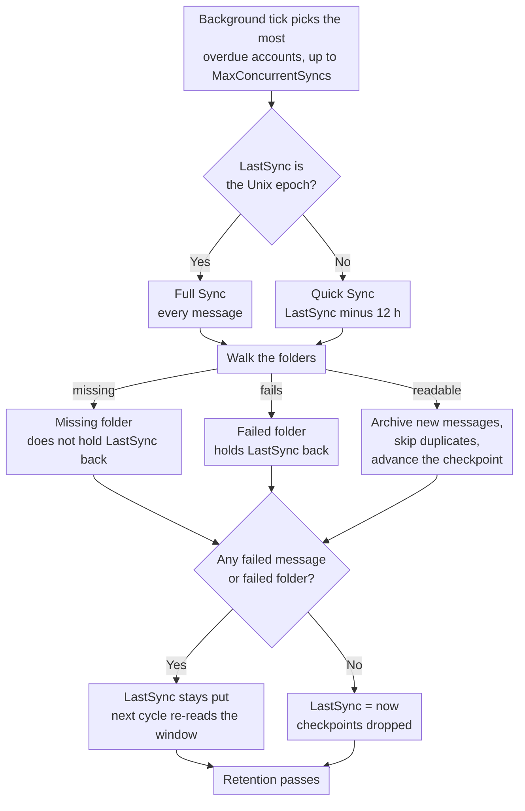

# 🔄 Mail Synchronization (Quick vs. Full Sync) {#mail-synchronization-quick-vs-full-sync}

[← Back to Documentation Index](index.md)

## 📋 Overview {#overview}

Mail Archiver автоматически синхронизирует каждое включенное почтовое ящик в фоновом режиме через `MailSyncBackgroundService`. Служба запускает короткий цикл опроса (каждые 60 s), определяет, какие учетные записи требуют синхронизации, и синхронизирует их — до `MailSync:MaxConcurrentSyncs` учетных записей параллельно в рамках одного цикла — перед тем как запланировать следующую синхронизацию для каждой учетной записи в соответствии с ее собственным интервалом. Интервалы можно настроить глобально через `appsettings.json` или переопределить для каждой учетной записи на странице Create/Edit.

Существует два различных режима синхронизации:

| Mode | Triggered by | Scope |
|------|--------------|-------|
| **Quick Sync** (incremental) | Каждый цикл синхронизации (интервал для каждой учетной записи) | Только новые/измененные сообщения с момента последней успешной синхронизации |
| **Full Sync** (resync) | Новая учетная запись, кнопка вручную, `AlwaysForceFullSync` или индивидуальный / глобальный интервал Full Sync | Каждое сообщение в каждой папке, не входящей в исключения |

Оба режима безопасны для многократного запуска — Mail Archiver обнаруживает дубликаты (по `MessageId` или по From/To/Subject/SentDate, если `MessageId` отсутствует) и пропускает сообщения, которые уже заархивированы.

---

## 🔁 Цикл синхронизации вкратце {#the-sync-cycle-at-a-glance}



Последнее решение — это то, которое имеет значение. `LastSync` продвигается только тогда, когда запуск
завершился без ошибок в сообщениях **и** без ошибок в папках. Именно поэтому
почтовый ящик с одной нечитаемой папкой продолжает повторно считывать то же самое окно
вместо того, чтобы тихо пройти мимо — и именно поэтому запуск, который завершается преждевременно (timeout, cancel, rate limit),
приводит к повторному чтению, а не к потере почты.

---

## ⚡ Quick Sync (Incremental Sync) {#quick-sync-incremental-sync}

Quick sync — это обычный режим работы, который запускается автоматически с настроенным интервалом. Глобальное значение по умолчанию составляет `MailSync:IntervalMinutes` минут (по умолчанию 15); для каждого аккаунта можно установить собственное значение `SyncIntervalMinutes` на странице Create/Edit (оставьте поле пустым, чтобы использовать глобальное значение по умолчанию).

### Как это работает {#how-it-works}

1. Для каждого включенного аккаунта (за исключением аккаунтов провайдера `IMPORT`) сервис считывает временную метку `LastSync` аккаунта.
2. Фильтр даты строится на основе `LastSync`:
   - **IMAP**: `SearchQuery.DeliveredAfter(LastSync − 12 hours)`
   - **M365 (Graph)**: `receivedDateTime ge (LastSync − 12 hours)`
3. 12-часовой нахлест (overlap) является намеренным. Он позволяет захватывать сообщения, которые были доставлены провайдером после начала предыдущей синхронизации, но имеют чуть более старую серверную метку времени, а также компенсирует небольшую разницу в показаниях часов между почтовым сервером и хостом Mail Archiver. Дубликаты отсеиваются проверкой на дубликаты, поэтому нахлест никогда не создает двойных записей.
4. Для каждой неисключенной папки отфильтрованный список сообщений запрашивается пакетами и архивируется. Существующие сообщения пропускаются.
5. При **успешном завершении** (нет неудачных сообщений, нет папок, которые не удалось синхронизировать целиком, не достигнут лимит запросов) значение `LastSync` устанавливается в `DateTime.UtcNow`, и следующий цикл начинается с этой точки.
6. Если **хотя бы одно сообщение не удалось** обработать или **какая-либо папка не смогла быть синхронизирована вовсе** (см. [Folders That Fail as a Whole](#-folders-that-fail-as-a-whole)), значение `LastSync` **не** обновляется, поэтому следующий цикл повторно пытается обработать тот же временной интервал.
7. Если для аккаунта установлено **ограничение частоты запросов** (см. [Rate Limit Handling](RateLimitHandling.md)), значение `LastSync` также остается без изменений, и синхронизация возобновится с контрольной точки для каждой папки после сброса ежедневной квоты.

### Когда вы это видите {#when-you-see-it}

- Автоматически, каждые несколько минут, для всех включенных аккаунтов.
- После завершения начальной синхронизации нового аккаунта (первый цикл — это Full Sync, см. ниже).
- Действия пользователя не требуются.

## 🗄️ Полная синхронизация (Full Sync / Resync) {#full-sync-resync}

Полная синхронизация игнорирует фильтр даты и загружает **каждое** сообщение из каждой неподпадающей под исключения папки с сервера, независимо от возраста.

### Что запускает полную синхронизацию {#what-triggers-a-full-sync}

Полная синхронизация запускается всякий раз, когда `LastSync` аккаунта устанавливается в значение Unix epoch (`1970-01-01T00:00:00Z`). Это происходит в четырех ситуациях:

1. **Новый аккаунт** – Каждый вновь созданный аккаунт IMAP или M365 начинается с `LastSync = 1970-01-01`. Таким образом, первый запланированный цикл синхронизации для этого аккаунта автоматически является полной синхронизацией, которая выполняет первоначальный импорт архива.
2. **Кнопка ручного «Full Resync»** – На странице *Account Details* кнопка **Full Resync** (`MailAccounts/Resync`) сбрасывает `LastSync` до значения epoch и запускает синхронизацию немедленно в фоновом режиме запроса.
3. **`MailSync:AlwaysForceFullSync = true`** – Когда этот флаг конфигурации включен, фоновая служба сбрасывает `LastSync` до значения epoch для **каждого включенного аккаунта в начале каждого цикла синхронизации**. Это фактически превращает каждый цикл в полную синхронизацию. Это предназначено только для поиска и устранения неисправностей, и его следует выключить, как только проблема будет решена, так как это резко увеличивает нагрузку на почтовый сервер и экземпляр Mail Archiver.
4. **Интервал полной синхронизации для аккаунта или глобальный** – Когда для аккаунта установлен `FullSyncIntervalHours` (страница Create/Edit) или настроен глобальный параметр по умолчанию `MailSync:FullSyncIntervalHours` в `appsettings.json`, фоновая служба автоматически запускает полную синхронизацию, как только с момента последней полной синхронизации аккаунта (`LastFullSync`) пройдет указанный интервал. Значение для конкретного аккаунта имеет приоритет; если ни одно из них не установлено, автоматическая полная синхронизация не выполняется, и остаются только кнопка ручной синхронизации (и `AlwaysForceFullSync` выше). После завершения полной синхронизации `LastFullSync` обновляется до `DateTime.UtcNow`, чтобы следующая полная синхронизация планировалась от этой точки.

### Поведение во время полной синхронизации {#behavior-during-a-full-sync}

- Фильтр `DeliveredAfter` / `receivedDateTime ge …` не применяется. Серверу запрашивается возврат всех сообщений в папке.
- Если сервер возвращает меньше результатов, чем фактически содержится в папке (некоторые IMAP-серверы ограничивают количество `SEARCH` результатов), Mail Archiver обнаруживает расхождение и переключается на получение всех `UniqueId` по порядковому номеру (sequence number), чтобы сообщения не были незаметно потеряны.
- Сообщения, которые уже есть в архиве, распознаются как дубликаты и пропускаются — существующая архивная копия **не** перезаписывается. Если дубликат найден в папке с другим именем, чем раньше, сохраненное поле `FolderName` обновляется, чтобы отразить текущее местоположение.
- Для очень больших почтовых ящиков полная синхронизация может занимать несколько часов или даже дней. При включенном отслеживании пропускной способности синхронизация корректно приостанавливается при достижении ежедневной квоты и возобновляется с контрольных точек каждой папки на следующий день (см. [Rate Limit Handling](RateLimitHandling.md)).
- `LastSync` обновляется до `DateTime.UtcNow` только после того, как полная синхронизация завершится без ошибок в сообщениях и без ошибок в папках, точно так же, как и быстрая синхронизация (Quick Sync).

### Когда использовать ручную полную синхронизацию {#when-to-use-a-manual-full-sync}

Используйте кнопку **Full Resync**, когда:

- Вы изменили список **исключенных папок** (excluded folders) аккаунта и хотите подтвердить, что архив соответствует текущему выбору.
- Вы подозреваете, что в архиве отсутствуют сообщения (например, после миграции сервера, сбоя провайдера или инцидента с рассинхронизацией времени).
- Вы перенесли почтовый ящик на другой бэкенд и хотите проверить полноту данных.
- Вы хотите повторно обнаружить сообщения, которые были перемещены между папками на сервере.
- Папки, которые ранее были невидимы для Mail Archiver, снова стали видимыми — например, папки Outlook.com, созданные через сторонние клиенты, которые были отфильтрованы из списка папок IMAP, пока они не были переименованы через веб-интерфейс (см. [Personal Microsoft Account Setup → Troubleshooting](MSA_Outlook_Setup.md#-troubleshooting)). Полная синхронизация необходима, так как быстрая синхронизация не подтянет старые письма в эти папки.

**НЕ** используйте полную синхронизацию:

- Как регулярную операцию — это создает ненужную нагрузку на провайдера и ваш экземпляр Mail Archiver.
- Для «обновления» тел сообщений или метаданных — дубликаты пропускаются, поэтому существующие архивные копии не обновляются при полной синхронизации. Чтобы заменить архивное сообщение, вы должны сначала удалить его из архива, а затем запустить синхронизацию (быструю или полную).
- На постоянной основе через `AlwaysForceFullSync=true` — не оставляйте это включенным в рабочей среде. Это диагностический переключатель, а не режим работы.

## 🆚 Сравнение Quick Sync и Full Sync {#quick-sync-vs-full-sync-at-a-glance}

| Аспект | Quick Sync | Full Sync |
|--------|-----------|-----------|
| Фильтр даты | от `LastSync − 12 h` до текущего момента | Отсутствует (все сообщения) |
| Типичный объем | Несколько новых сообщений | Весь почтовый ящик |
| Длительность | Секунды или минуты | Минуты или дни (в зависимости от размера ящика и лимитов провайдера) |
| Влияние на пропускную способность | Низкое | Высокое |
| `LastSync` обновляется при успехе | Да | Да |
| `LastSync` обновляется при ошибке / rate-limit | Нет (повтор в следующем цикле) | Нет (возобновление с контрольной точки) |
| Обработка дубликатов | Пропуск уже архивированных сообщений | Пропуск уже архивированных сообщений |
| Запускается | Планировщиком (интервал для каждого аккаунта) | Новый аккаунт, кнопка вручную, `AlwaysForceFullSync` или интервал Full Sync |
| Рекомендуется для | Ежедневной работы | Первичного импорта и периодической проверки |

## ⚙️ Конфигурация {#configuration}

Поведение синхронизации управляется разделом `MailSync` в `appsettings.json` (или переменными окружения `MailSync__*` в Docker). Полный список параметров см. в [Setup.md](Setup.md).

| Настройка | По умолчанию | Описание |
|---------|---------|-------------|
| `MailSync:IntervalMinutes` | `15` | Глобальное значение по умолчанию для интервала синхронизации каждого аккаунта в минутах. Для каждого аккаунта это значение можно переопределить на странице Create/Edit (оставьте пустым, чтобы использовать это значение по умолчанию). |
| `MailSync:FullSyncIntervalHours` | _unset_ | Необязательное глобальное значение по умолчанию для автоматической полной ресинхронизации в часах. Если не установлено (по умолчанию), автоматическая полная синхронизация не запускается, если только для аккаунта не задано значение `FullSyncIntervalHours`. Значения для конкретных аккаунтов имеют приоритет. |
| `MailSync:TimeoutMinutes` | `0` (none) | Тайм-аут синхронизации для каждого аккаунта. Синхронизация, которая длится дольше установленного времени, останавливается на границе следующего сообщения и возобновляется при следующем запуске. `0` (по умолчанию или любое неположительное значение) означает отсутствие тайм-аута. См. [Stopping a Sync Early](#-stopping-a-sync-early). |
| `MailSync:ConnectionTimeoutSeconds` | `300` | Тайм-аут соединения IMAP. |
| `MailSync:CommandTimeoutSeconds` | `600` | Тайм-аут команды IMAP. |
| `MailSync:AlwaysForceFullSync` | `false` | Если `true`, каждый цикл будет полной синхронизацией (Full Sync) для всех аккаунтов. **Только для диагностики — не включайте в рабочей среде.** |
| `MailSync:IgnoreSelfSignedCert` | `false` | Принимать самоподписанные TLS-сертификаты (недоверенный корень, неполная цепочка) и несоответствия имен хостов для IMAP-соединений — например, Proton Bridge, чей сертификат выдан на `127.0.0.1`. Другие проблемы с цепочкой, такие как истекшие сертификаты, по-прежнему будут отклоняться. |
| `MailSync:MaxConcurrentSyncs` | `1` | Количество одновременно выполняемых синхронизаций аккаунтов. Слоты пополняются по мере освобождения, см. [How accounts are scheduled](#-how-accounts-are-scheduled). `1` обеспечивает последовательную синхронизацию; увеличьте это значение для параллелизации — учитывайте ограничения провайдеров и использование локальных ресурсов. |
| `MailSync:InterAccountDelaySeconds` | `0` | Необязательная задержка (в секундах) между задачами синхронизации каждого аккаунта. Полезно, чтобы избежать резких всплесков нагрузки при `MaxConcurrentSyncs > 1`. `0` отключает эту функцию. |
| `MailSync:MaxIssuesPerKind` | `20` | Количество проблем каждого типа, которые задача синхронизации запоминает для страницы аккаунта — ошибки папок, отсутствующие папки и ошибки сообщений учитываются отдельно. Все, что превышает это число, просто подсчитывается, но не сохраняется. `0` отключает детализацию, оставляя только счетчики. |
| `MailSync:GlobalExcludedFolders` | _empty_ | Папки, исключенные из синхронизации для всех аккаунтов (добавляются к собственному списку каждого аккаунта). См. [Excluded Folders](#-excluded-folders) ниже. |
| `MailSync:ExcludeSubfolders` | `false` | Распространяется ли запись об исключении на вложенные папки ниже указанной в обоих списках. См. [Excluded Folders](#-excluded-folders) ниже. |

> 💡 Как обычный интервал синхронизации, так и интервал полной синхронизации можно переопределить для каждого аккаунта на странице **Create/Edit Mail Account**. Оставьте поля аккаунта пустыми, чтобы использовать глобальные значения по умолчанию, указанные выше. Чтобы полностью исключить аккаунт из планировщика, отключите его (переключите *Enabled* в положение off на странице Account Details).

## 🚫 Исключенные папки {#excluded-folders}

Папки можно исключить из синхронизации в двух местах, и эти списки являются **аддитивными**: папка пропускается, если она соответствует **любому** из списков. Ни один из них не может вернуть то, что исключил другой, поэтому добавление записи в любое место может только уменьшить количество синхронизируемых папок.

| Источник | Область действия | Где |
|--------|-------|-------|
| Список исключений аккаунта | Один аккаунт | страница *Create/Edit Mail Account* |
| `MailSync:GlobalExcludedFolders` | Каждый аккаунт установки | `appsettings.json` или `MailSync__GlobalExcludedFolders__<n>` |

Глобальный список **пуст по умолчанию**, поэтому установка, в которой он никогда не настраивался, ведет себя точно так же, как и раньше. Он существует для случаев, когда импортируется множество почтовых ящиков с одного и того же сервера, и альтернативой является поддержание идентичного списка исключений для каждого отдельного аккаунта.

Оба списка используют одни и те же правила сопоставления, поэтому они не могут разойтись:

1. точное совпадение с полным путем папки (`INBOX/Drafts`);
2. точное совпадение с собственным именем папки (`Drafts`), что позволяет поймать запись, введенную как короткое имя, когда сервер сообщает путь с префиксом;
3. совпадение по суффиксу пути, которое учитывает вариации разделителей — `Drafts` также соответствует `INBOX.Drafts` и `INBOX/Drafts` — и имена с префиксами сервера, такие как `[Provider]/Drafts`;
4. всё содержимое ниже папки, указанной в записи, поэтому `Archive` также охватывает `Archive/Team` и `INBOX.Archive.Team`, когда включен `MailSync:ExcludeSubfolders` (по умолчанию он выключен, что соответствует поведению до появления этой опции). Установите его в `true`, чтобы исключить дерево почтового ящика, указав его корень вместо каждой папки в нем; при значении по умолчанию запись соответствует только той одной папке, которую она называет.

Все сравнения нечувствительны к регистру. Правило суффикса полного пути привязывается к разделителю пути, поэтому `Archive` не забирает с собой папку с именем `ArchiveWeek`. Сравнение имен не имеет такой привязки: короткая запись также соответствует любой папке, чье собственное имя **заканчивается** на нее, поэтому `Archive` забирает с собой папку с именем `OldArchive`. Чтобы исключить ровно одну папку среди папок с похожими именами, введите ее полный путь.

Правило 4 привязывается к разделителю так же, как и правило 3, поэтому оно захватывает целые папки и никогда не захватывает часть имени: `Archive` охватывает `Archive/Team`, в то время как почтовая папка с именем `Team Archive Review` остается в синхронизации. Предки сравниваются только по пути, поэтому не привязанное к разделителю сравнение имен не передается дочерним папкам. `.` считается разделителем везде, где он появляется, что означает, что на сервере, использующем в качестве разделителя `/`, папка верхнего уровня с именем `Archive.ics` будет прочитана как находящаяся внутри `Archive`.

**Ни одно имя папки не исключается по умолчанию.** Какие имена стоит перечислять, полностью зависит от сервера и его языка — дерево почтового ящика, которое также содержит папки календаря, контактов, задач и заметок, является распространенной причиной использования этой функции, но Mail Archiver не делает таких предположений. См. [Setup.md](Setup.md) для примера конфигурации.

Изменение любого из списков не удаляет то, что уже было архивировано. После этого запустите [Full Sync](#-full-sync-resync), если хотите убедиться, что архив соответствует текущему выбору.

Исключение применяется везде, где происходит обход списка папок, а не только при архивации: исключенная папка также пропускается при проходе удаления на стороне сервера (см. ниже), так что запись защищает папку и на сервере тоже.

## 🗑️ Удаление на стороне сервера во время синхронизации {#server-side-deletion-during-sync}

Если для учетной записи настроено `DeleteAfterDays` (> 0), Mail Archiver удаляет сообщения старше установленного порога с **почтового сервера** после каждой синхронизации:

- **IMAP**: `SearchQuery.SentBefore(now − DeleteAfterDays)` для каждой папки, затем expunge.
- **M365 (Graph)**: `receivedDateTime lt (now − DeleteAfterDays)` для каждой папки, затем delete.

Архивные копии в Mail Archiver **не** затрагиваются этим процессом — очищается только почтовый ящик на стороне сервера. Папки, входящие в любой из списков исключений ([Excluded Folders](#-excluded-folders)), пропускаются этим этапом удаления и остаются нетронутыми на сервере. См. [Retention Policies](RetentionPolicies.md), чтобы узнать о локальных политиках хранения, которые определяют, как долго хранятся архивные копии.

---

## 🛟 Восстановление сообщений, которые сервер помечает как отсутствующие {#recovering-messages-the-server-reports-as-missing}

Некоторые серверы отклоняют сообщение при обычном запросе UID, но при этом возвращают пригодный для использования MIME-документ при обычном запросе `BODY[]`. Такое наблюдалось на устаревших локальных (on-premises) серверах Exchange, где запрос завершается ошибкой:

```
MailKit.MessageNotFoundException: The IMAP server did not return the requested message.
```

Без механизма отката (fallback) такое сообщение будет считаться неудачно доставленным письмом, а поскольку `LastSync` не продвигается вперед, пока у учетной записи есть ошибки, учетная запись будет повторно считывать одни и те же сообщения при каждом запуске и никогда не продвинется в работе.

**Что делает Mail Archiver:** выполняет ровно одну дополнительную попытку получения для этого UID, и только при возникновении этой конкретной ошибки. Проблемы с аутентификацией, разрыв соединения, ограничение скорости (throttling) и ошибки парсинга не затрагиваются, и существующее поведение при временных сбоях (transient-retry) остается неизменным. Попытка является только для чтения: сообщение не помечается как прочитанное, флаги не изменяются, ничего не перемещается и не удаляется. Попытка считается успешной только в том случае, если «сырые» данные действительно пришли **и** были успешно распознаны как MIME-сообщение — в любом другом случае сообщение остается помеченным как неудачное. Восстановленные сообщения затем проходят обычный путь архивации, включая обнаружение дубликатов, поэтому повторная полная синхронизация не приведет к их повторной архивации.

**Заполнители ошибок провайдера:** то, что возвращает сервер, часто является не оригинальным сообщением, а документом, который провайдер сгенерировал вместо него, например:

```
Subject: Retrieval using the IMAP4 protocol failed for the following message: 270198
From: Microsoft Exchange Server 2010

The server couldn't retrieve the following message: ...
```

Такое сообщение архивируется именно в том виде, в котором оно было получено, и его содержимое никогда не перезаписывается в поля отправителя, темы или тела сообщения. Mail Archiver не может восстановить контент, который сам провайдер отказывается преобразовывать в MIME; он сохраняет наилучшее представление, которое сервер способен предоставить, плюс сам факт того, что пришел заполнитель (placeholder). Каждое такое событие записывается на уровне `Warning` с указанием учетной записи, папки, UID и темы.

**Если при откате (fallback) возвращается пустой результат**, сообщение остается неудачным письмом, как и прежде, а попытка записывается на уровне `Warning`, а не проходит незаметно — не полученное сообщение никогда не должно выглядеть как архивированное. Если какой-либо сервер начнет вести себя так постоянно, документированным следующим шагом является получение `BODY.PEEK[HEADER]` и `BODY.PEEK[TEXT]` по отдельности с последующей сборкой в один MIME-документ. Это принципиально другой запрос, в то время как текущий механизм отката — это тот же самый запрос, прочитанный иначе. Это намеренно не реализовано: это требует второго цикла запросов на каждое сообщение и добавляет необходимость определения состояния «заголовок получен, текст — нет», а ни один из встреченных на данный момент серверов в этом не нуждается.

Оба счетчика отображаются в строке лога завершения работы учетной записи:

```
Sync completed for account: Example. New: 0, Failed: 0, Deleted: 0, Recovered: 25, Provider placeholders: 25, Failed folders: 0
```

`Recovered` подсчитывает сообщения, которые удалось спасти с помощью механизма отката; `Provider placeholders` — это подмножество тех сообщений, которые оказались сгенерированными провайдером документами об ошибках. `Failed: 0` рядом с ними — это суть данной функции: учетная запись больше не застревает.

## 📁 Папки, которые не работают целиком {#folders-that-fail-as-a-whole}

Сообщение может не синхронизироваться само по себе, а папка может не работать как единое целое — сервер перечисляет её, но при попытке открыть или выполнить поиск в ней возникает ошибка. Некоторые серверы анонсируют папки через `LIST`/`LSUB`, которые затем отвечают `NO ... doesn't exist` на `EXAMINE`.

Эти ошибки считаются отдельно, по одной на каждую папку:

```
Sync completed for account: Example. New: 120, Failed: 0, Deleted: 0, Recovered: 0, Provider placeholders: 0, Failed folders: 2
```

`Failed folders: 2` означает, что две папки вообще не удалось синхронизировать. Это **не** означает, что не удалось синхронизировать какое-то конкретное сообщение — когда папку невозможно открыть, ничего не известно о сообщениях в ней, поэтому любое число «неудачных сообщений» было бы неправдой.

**Почему это отдельный счетчик.** Раньше ошибка на уровне папки записывалась как количество неудачных *сообщений*, равное количеству обработанных сообщений в этой папке на тот момент. Это число было выдуманным, и оно перезаписывало реальные ошибки по сообщениям в папке. Таким образом, одна недоступная папка могла сообщить о сотнях неудачных сообщений, которые на самом деле были заархивированы совершенно успешно.

**Влияние на `LastSync`, без изменений.** Папка, которая не сработала целиком, по-прежнему препятствует продвижению `LastSync` точно так же, как это было, когда она считалась набором неудачных сообщений. Изменилась только отчетность, а не поведение: аккаунт по-прежнему пытается повторить тот же интервал на следующем цикле. Это сделано намеренно — инкрементальная синхронизация, которая прошла мимо папки, которую ей так и не удалось прочитать, никогда не вернется за почтой в ней.

Оба счетчика видны на уровне `Information`, а предупреждение, называющее их, выводится всякий раз, когда задерживается `LastSync`:

```
Not updating LastSync for account Example: 0 failed emails, 2 folders that could not be synced at all
```

### Папки, которые исчезли, в отличие от сломанных {#folders-that-are-gone-as-opposed-to-broken}

Папка, которую сервер перечисляет, а затем отказывается открывать, не является автоматической ошибкой. Самая распространенная причина вовсе не в сбое: RFC 3501 запрещает серверу удалять имя из списка подписок, когда почтовый ящик за ним удален, поэтому папка, на которую кто-то когда-то подписался в IMAP-клиенте, все еще сообщается через `LSUB` спустя годы. Обнаружение папок представляет собой объединение `LIST` и `LSUB`, поэтому эти имена попадают в синхронизацию, и `EXAMINE` затем отвечает `NO ... doesn't exist`.

Это ответ, а не ошибка. Здесь нечего повторять и не за чем возвращаться, поэтому это считается отдельно и **не** задерживает `LastSync`:

```
Sync completed for account: Example. New: 120, Failed: 0, ..., Failed folders: 0, Missing folders: 16
```

Подсчет этого как ошибки навсегда остановил бы работу аккаунта, потому что папка, которой не существует, никогда не начнет существовать снова. Именно это и произошло с почтовым ящиком, имевшим 16 устаревших подписок: аккаунт перестал продвигать `LastSync` и не смог восстановиться самостоятельно.

Все остальное остается ошибкой и продолжает сдерживать аккаунт — отсутствие прав, разорванное соединение, троттлинг, ошибка сервера. Эти ситуации могут разрешиться при следующем запуске.

`Missing folders: N` стоит принять во внимание, даже если это безобидно: это означает, что почтовый ящик содержит подписки на папки, которых больше не существует. Их очистка — это `UNSUBSCRIBE` на каждое имя, выполняемая любым IMAP-клиентом, и синхронизация намеренно этого **не** делает — архиватор не должен изменять почтовый ящик, который он читает.

Только IMAP. Microsoft Graph перечисляет папки через API, где удаленная папка просто не возвращается, поэтому такая ситуация там не может возникнуть.

Применимо к обоим провайдерам, IMAP и M365 (Graph).

## 🗓️ Как планируются учетные записи {#how-accounts-are-scheduled}

Фоновый тик выполняется раз в минуту. Он загружает включенные учетные записи, определяет, какие из них должны быть обработаны, и запускает столько из них, сколько есть свободных слотов для синхронизации: всего `MailSync:MaxConcurrentSyncs`.
Он **не** ждет завершения запущенных синхронизаций. Все, что не поместилось, остается для следующего тика, который принимает решение заново.

Следующий запуск каждой учетной записи планируется, когда ее синхронизация **завершается**: с этого момента плюс ее интервал.
Таким образом, учетная запись, чья синхронизация длится дольше ее интервала, снова будет готова к запуску сразу после завершения, но никогда не запустится дважды одновременно: уже работающая учетная запись пропускается, а не ставится в очередь.

Когда количество готовых к запуску учетных записей превышает количество слотов, **первой идет та, у которой наибольшая задержка**. При равенстве приоритетов используется account id, чтобы обработка очереди была воспроизводимой.

Завершение синхронизации немедленно пробуждает планировщик, поэтому цикл не простаивает свою минуту бездействия, если слот уже освободился: очередь обрабатывается последовательно, даже с `MaxConcurrentSyncs: 1`, точно так же, как это делал старый пакетный цикл, при этом минута остается только максимально возможным интервалом между двумя проверками списка учетных записей.

При наличии более одного слота рассмотрите возможность установки `MailSync:TimeoutMinutes`, который по умолчанию равен `0` (без таймаута). Синхронизация удерживает свой слот до тех пор, пока она выполняется, поэтому одна учетная запись, которая навсегда прекращает прогресс, постоянно сокращает количество слотов, доступных для всего остального. Таймаут завершает такой запуск как паузу, сохраняющую контрольные точки, и слот снова освобождается при следующем тике.

> ℹ️ До этого момента тик собирал все готовые к запуску учетные записи и ждал завершения всех них, прежде чем проверять список снова. Таким образом, один большой почтовый ящик задерживал все остальные учетные записи на все время своей работы: слоты освобождались, но ничего не переоценивалось до тех пор, пока не возвращалась последняя учетная запись. Следовательно, установка с `MaxConcurrentSyncs: 10` и одним шестичасовым почтовым ящиком фактически синхронизировала все с шестичасовым интервалом. Теперь учетные записи, которые завершаются быстро, придерживаются своего собственного интервала независимо от того, что еще запущено.

При завершении работы служба ждет до 30 секунд завершения текущих синхронизаций, вместо того чтобы прерывать процесс во время открытой IMAP-сессии. Они не отменяются; см. [Stopping a Sync Early](#-stopping-a-sync-early), чтобы узнать, что именно останавливает синхронизацию.

---

## ⏹️ Преждевременная остановка синхронизации {#stopping-a-sync-early}

Запущенная синхронизация останавливается до того, как будет обработана каждая папка, ровно по двум причинам: кто-то отменяет задачу на странице **Jobs**, или истекает время ожидания `MailSync:TimeoutMinutes` аккаунта. Оба случая проверяются в трех точках: перед каждой папкой, перед каждым пакетом (batch) и перед каждым отдельным сообщением, поэтому ни одному из них не приходится ждать завершения обработки большой папки.

Тайм-аут применяется **только к запланированным синхронизациям**. Синхронизация, запущенная из интерфейса, через действие "Sync now" или полная пересинхронизация, выполняется без тайм-аута, поэтому длительная ручная синхронизация никогда не будет прервана.

Эти два сценария завершают задачу по-разному, и эта разница имеет значение:

| | Статус задачи | `LastSync` | Контрольные точки (Checkpoints) | Проходы очистки (Retention passes) |
|---|---|---|---|---|
| Отменено из UI | `Failed`, с сообщением "Job was cancelled" | не продвигается | сохраняются | пропускаются |
| Истек тайм-аут синхронизации | `Timed Out` | не продвигается | сохраняются | пропускаются |

Тайм-аут — это **пауза, а не ошибка**. Синхронизация останавливается на текущем месте, сохраняет то, что уже было архивировано, оставляет `LastSync` нетронутым и пропускает проходы очистки на стороне сервера и локально, так как их выполнение лишило бы смысла ограничение времени работы. Следующий запланированный запуск возобновится с контрольной точки.

### Контрольные точки (Checkpoints) {#checkpoints}

Прогресс записывается для каждого аккаунта и папки в `mail_archiver.SyncCheckpoints`: UID последнего сообщения, архивированного в этой папке, вместе с UIDVALIDITY этой папки на тот момент. Каждая установка записывает их; раньше они были привязаны к `BandwidthTracking:Enabled`, что означало, что прерванная синхронизация могла возобновиться только там, где была включена эта несвязанная функция. Контрольные точки удаляются, как только аккаунт завершает работу без ошибок.

Возобновленная папка выполняет **точно такой же поиск**, какой был бы выполнен без контрольной точки. Только UID, находящиеся на уровне или ниже отметки (watermark), отсеиваются из результата после этого, поэтому окно поиска никогда не смещается и ни одно сообщение не может выпасть из него.

Отметка (watermark) перестает продвигаться, как только в этой папке происходит ошибка при обработке сообщения. Сообщения перебираются в порядке возрастания UID, поэтому отметка выше ошибочного UID сообщила бы следующему запуску, что ошибочное сообщение уже архивировано, и оно никогда не было бы повторно обработано, что как раз и предотвращается с помощью `LastSync`. Таким образом, все, что находится выше места сбоя, будет прочитано снова в следующий раз; это стоит повторного чтения, но проверка на дубликаты поглощает его.

Контрольная точка игнорируется, а папка читается полностью, если невозможно доказать ее применимость: UID еще не записан, UIDVALIDITY не записан или UIDVALIDITY больше не соответствует папке. Последний случай означает, что сервер перенумеровал почтовый ящик, и сохраненный UID указывает на другое сообщение. Повторное чтение папки занимает время и поглощается проверкой на дубликаты; пропуск же приведет к незаметной потере почты, поэтому в любом сомнительном случае папка читается полностью.

Провайдер Graph API не записывает контрольные точки UID, так как в Graph API нет эквивалента UID в IMAP. Синхронизация M365, прерванная по тайм-ауту или из-за ограничений пропускной способности, "возобновляется" только в том смысле, что `LastSync` не продвигается, поэтому следующий запуск перечитывает все окно, а проверка на дубликаты поглощает пересечение.

> ℹ️ До этого контрольная точка хранила **заголовок Date** последнего архивированного сообщения и передавала его в поиск по папке, на что сервер отвечал через INTERNALDATE — это другие часы, которые могут расходиться на годы при миграции почты, в то время как сообщения обрабатываются в порядке UID, а не в порядке даты. Оба несоответствия могли сместить окно поиска мимо почты, которая никогда не архивировалась. Тот же путь используется, когда синхронизация приостанавливается из-за ограничения пропускной способности, так что это изменение также исправляет возобновление работы.

### Большие почтовые ящики и тайм-аут {#large-mailboxes-and-the-timeout}

Первая полная синхронизация ящика с 150 000 сообщений длится несколько часов, и тайм-аут короче этого времени будет останавливать ее каждый раз. Она возобновляется с контрольной точки, а не начинается заново, но аккаунт не достигнет состояния завершенного и, следовательно, не продвинет `LastSync`, пока один из запусков не пройдет до конца. Проверьте значение для ваших почтовых ящиков и установите `0`, если вы предпочитаете вообще не иметь тайм-аута.

---

## 👀 Наблюдение за синхронизацией {#observing-the-sync}

### Страница аккаунта отвечает на вопрос «что сделала последняя сессия» {#the-account-page-answers-what-did-the-last-run-do}

Каждый почтовый аккаунт имеет карточку **Last Sync Run**, показывающую последний завершенный запуск: когда он закончился, сколько времени занял, сколько сообщений обработал и сколько из них были новыми. Эти данные сохраняются дольше, чем 24-часовое хранение заданий, поэтому для почтового ящика, который был неактивен весь день, все равно будет ответ — только перезапуск очищает эти данные, и карточка прямо об этом сообщает, а не делает вид, что с аккаунтом все в порядке.

Если что-то пошло не так, карточка перечисляет ошибки, сгруппированные и ограниченные по количеству для каждого типа:

- **Folders that could not be read** — ошибка при попытке прочитать папку как единое целое. Задерживает `LastSync`.
- **Folders the server does not have** — обнаружены при поиске, но отклонены сервером при попытке открытия. Обычно это остаточные подписки на удаленные папки; не задерживает `LastSync`. См. [Folders that are gone](#folders-that-are-gone-as-opposed-to-broken).
- **Messages that could not be archived** — с указанием папки, темы, UID и формулировкой самого сервера.

Каждая группа ограничена значением `MailSync:MaxIssuesPerKind` и сообщает о том, что не поместилось, фразой "and N more", чтобы поток ошибок одного типа не скрыл остальные. Если был задержан `LastSync`, карточка также сообщает об этом одним предложением, так как именно этот вопрос возникает при наличии устаревшей временной метки.

В списке аккаунтов рядом с временной меткой помечаются те аккаунты, последний запуск которых сообщил о проблемах. Намеренно только такие: отметка в каждой строке создавала бы лишний шум и лишала бы маркер смысла.

- **Account Details page**: Показывает текущую временную метку `LastSync` и активное задание синхронизации (папка, количество обработанных, новых и неудавшихся сообщений). Кнопка **Full Resync** находится здесь.
- **Logs**: Прогресс синхронизации записывается на уровне `Information`. В Docker:
  ```bash
  docker compose logs -f mailarchive-app | grep -i sync
  ```
  Советы по фильтрации логов см. в [Docker Compose Logs Guide](DockerComposeLogs.md).
- **Rate limiting**: Если синхронизация приостановлена из-за ограничений пропускной способности, аккаунт отображает статус "Rate-Limited" и возобновляется автоматически после сброса окна ограничений. См. [Rate Limit Handling](RateLimitHandling.md).
- **Timeouts**: Синхронизация, остановленная по `MailSync:TimeoutMinutes`, отображает статус "Timed Out" и возобновляется с контрольной точки при следующем запуске. См. [Stopping a Sync Early](#-stopping-a-sync-early).

---
