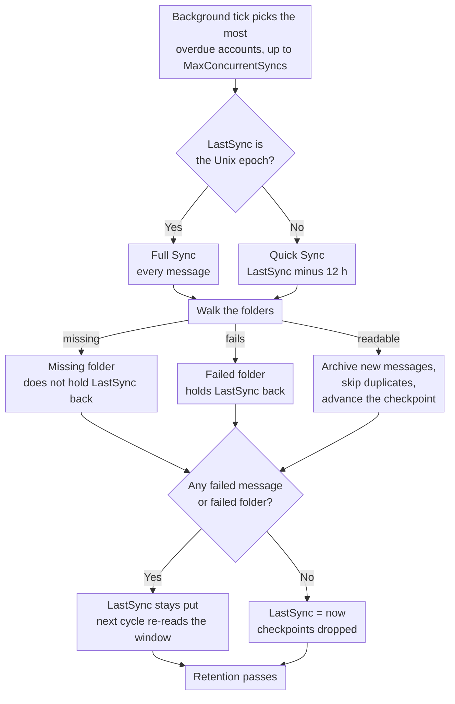

# 🔄 Sinhronizacija pošte (Hitra vs. Celotna sinhronizacija) {#mail-synchronization-quick-vs-full-sync}

[← Nazaj na indeks dokumentacije](index.md)

## 📋 Pregled {#overview}

Mail Archiver samodejno v ozadju sinhronizira vsako vklopljeno poštovno predal preko `MailSyncBackgroundService`. Storitev izvaja kratek intervalan ciklični nadzor (vsako 60 s), določi, katera računa so pripravljena, in jih sinhronizira — do `MailSync:MaxConcurrentSyncs` računov hkrati v enem ciklusu — nato pa vsak račun ponovno načrtuje glede na njegov lastni interval sinhronizacije. Intervale je mogoče konfigurirati globalno preko `appsettings.json` in jih spremeniti za posamezen račun na strani za ustvarjanje/urejanje.

Obstajata dva ločena načina sinhronizacije:

| Način | Sproži | Obseg |
|------|--------------|-------|
| **Quick Sync** (inkrementalna) | Vsak ciklus sinhronizacije (interval za posamezen račun) | Le nove/spemenjene sporočile od zadnje uspešne sinhronizacije |
| **Full Sync** (ponovna sinhronizacija) | Nov račun, ročni gumb, `AlwaysForceFullSync` ali interval za Full Sync za posamezen račun / globalno | Vsako sporočilo v vsaki mapi, ki ni izključena |

Ob oba načina je ponovno izvajanje amanetično – Mail Archiver zazna duplikate (preko `MessageId`, ali preko From/To/Subject/SentDate, ko `MessageId` ni prisotna) in preskoči sporočila, ki so že arhivirana.

---

## 🔁 Sinoptični pregled ciklusa sinhronizacije {#the-sync-cycle-at-a-glance}



Zadnja odločitev je tista, ki je pomembna. `LastSync` napreduje le takrat, ko je izvedba
končala brez neuspešnih sporočil **in** brez neuspešnih map. Zato poštovni predal z eno nečitljivo mapo nenehno ponovno bere isto okno namesto da bi tiho prešel mimo — in zakaj izvedba, ki se konča gledučasno (timeout, preklič, omejitev števila zahtev), pomeni ponovno branje namesto izgube pošte.

---

## ⚡ Hitra sinhronizacija (inkrementalna sinhronizacija) {#quick-sync-incremental-sync}

Hitra sinhronizacija je običajni operativni način, ki se samodejno izvaja v nastavljenem intervalu. Globalni privzetek je `MailSync:IntervalMinutes` minut (privzeto 15); vsak račun lahko to prekriži z lastno vrednostjo `SyncIntervalMinutes`, ki je nastavljena na strani za ustvarjanje/urejanje (pustite prazno za uporabo globalnega privzetka).

### Kako deluje {#how-it-works}

1. Za vsak omogočen račun (razen računov ponudnika `IMPORT`) storitev prebere časovni žig `LastSync` računa.
2. Datumski filter je izgrajen iz `LastSync`:
   - **IMAP**: `SearchQuery.DeliveredAfter(LastSync − 12 hours)`
   - **M365 (Graph)**: `receivedDateTime ge (LastSync − 12 hours)`
3. 12-urn remot overlap je nameren. Ta zajame sporočila, ki jih je ponudnik dostavil po začetku prejšnje sinhronizacije, vendar z nekoliko starejšim časovnim žigom strežnika, hkrati pa omogoča tolerance za manjše odклоčenje časa med e-poštnim strežnikom in gostiteljem Mail Archiverja. Dvojniki jih izfiltrira preverjanje dvojnikov, zato overlap nikoli ne ustvari dvojnih vnosov.
4. Za vsako neizključeno mapo je filtrirani seznam sporočil prenesen v paketih in arhiviran. Obstoječa sporočila so preskočena.
5. Ob **uspešni zaključitvi** (brez neuspešnih sporočil, brez map, ki so neuspešno sinhronizirane kot celota, brez doseganja omejitve hitrosti), je `LastSync` nastavljen na `DateTime.UtcNow` in naslednji cikel se začne od te točke.
6. Če se je **ob processing za katero sporočilo ne uspelo** ali če **ni bilo mogoče sinhronizirati nobene mape** (poglejte [Mape, ki neuspejo kot celota](#-folders-that-fail-as-a-whole)), se `LastSync` **ne** posodobi, zato naslednji cikel ponovno poskuša z istim oknom.
7. Če je račun **omejen glede hitrosti** (poglejte [Obvladovanje omejitve hitrosti](RateLimitHandling.md)), je tudi `LastSync` ostal nedotikljiv in se sinhronizacija nadaljuje od kontrolne točke za posamezno mapo, ko se dnevna kvota ponastavi.

### Kdaj to vidite {#when-you-see-it}

- Samodejno, vsake nekaj minut, za vse omogočene račune.
- Po tem, ko je končana začetna sinhronizacija novega računa (prvi cikel je Full Sync, poglejte spodaj).
- Ni zahtevano nobene uporabniške akcije.

## 🗄️ Celovit sinhronizacija (Resync) {#full-sync-resync}

Celovita sinhronizacija ignorira filter datuma in prelije **vsa** sporočila iz vsakega mape, ki ni izključena, s strežnika, ne glede na njihovo starost.

### Kaj sproži celovito sinhronizacijo {#what-triggers-a-full-sync}

Celovita sinhronizacija se sproži, kadar je `LastSync` računa nastavljen na Unix epoch (`1970-01-01T00:00:00Z`). To se zgodi v štirih situacijah:

1. **Nov račun** – Vsak nov ustvarjen IMAP ali M365 račun se začne s `LastSync = 1970-01-01`. Prvi načrtovani ciklus sinhronizacije za ta račun je zato samodejno celovita sinhronizacija, ki opravi začetni uvoz arhiva.
2. **Ročni gumb "Full Resync"** – Na strani *Account Details* gumb **Full Resync** (`MailAccounts/Resync`) ponastavi `LastSync` na epoch in takoj začne sinhronizacijo v prvi vrsti zahtev.
3. **`MailSync:AlwaysForceFullSync = true`** – Ko je ta konfiguracijska zastavica omogočena, servis v ozadju ponastavi `LastSync` na epoch za **vsak omogočen račun na začetku vsakega cikla sinhronizacije**. To dejansko spremeni vsak ciklus v celovito sinhronizacijo. To je namenjeno le za reševanje težav in ga je treba ponovno izklopiti, ko je težava odpravljena, saj to drastično poveča obremenitev e-poštnega strežnika in instance Mail Archiver.
4. **Interval celovite sinhronizacije na račun ali globalno** – Ko ima račun nastavljen `FullSyncIntervalHours` (stran Create/Edit) ali je nastavljena globalna privzeta vrednost `MailSync:FullSyncIntervalHours` v `appsettings.json`, servis v ozadju samodejno sproži celovito sinhronizacijo, ko mine ta interval od zadnje celovite sinhronizacije računa (`LastFullSync`). Vrednost na račun ima prednost; ko nobena ni nastavljena, se ne izvaja samodejna celovita sinhronizacija in ostane le ročni gumb za ponastavitev (in `AlwaysForceFullSync` zgoraj). Po tem, ko se celovita sinhronizacija zaključi, se `LastFullSync` posodobi na `DateTime.UtcNow`, tako da je naslednja celovita sinhronizacija načrtovana od te točke naprej.

### Obnašanje med celovito sinhronizacijo {#behavior-during-a-full-sync}

- Ni uporabljen filter `DeliveredAfter` / `receivedDateTime ge …`. Od strežnika se zahteva vrnitev vseh sporočil v mapi.
- Če strežnik vrne manj rezultatov, kot jih mapa dejansko vsebuje (nekateri IMAP strežniki omejujejo število `SEARCH` rezultatov), Mail Archiver zazna neskladje in se preklopi na pridobivanje vseh `UniqueId` po številki zaporedja, da sporočila ne bi bila tiho izpuščena.
- Sporočila, ki so že v arhivu, se zaznajo kot duplikati in preskočijo – obstoječa arhivirana kopija **ni** pretečena. Če je duplikat najden v drugačnem imenu mape kot prej, se shranjeno polje `FolderName` posodobi, da odraža trenutno lokacijo.
- Za zelo velike predvrtnike lahko celovita sinhronizacija traja več ur ali celo dni. Ko je omogočeno sledenje pasovni širini, sinhronizacija lehko zaustavi pri dnevni kvoti in nadaljuje od kontrolnih točk posamezne mape naslednji dan (glejte [Rate Limit Handling](RateLimitHandling.md)).
- `LastSync` se posodobi na `DateTime.UtcNow` šele po tem, ko se celovita sinhronizacija zaključi brez neuspešnih sporočil in brez neuspešnih map, točno tako kot Quick Sync.

### Kdaj uporabiti ročno celovito sinhronizacijo {#when-to-use-a-manual-full-sync}

Uporabite gumb **Full Resync**, ko:

- Ste spremenili seznam **izločenih map** računa in želite potrditi, da se arhiv ujema z izbiro.
- Sumite, da v arhivu manjkajo sporočila (npr. po migraciji strežnika, izpadu ponudnika ali incidentu s časovnim premikom).
- Ste migrirali predvrtnik na drugačno pozadinsko infrastrukturo in želite preveriti celovitost.
- Želite ponovno zaznati sporočila, ki so bila premiknena med mape na strežniku.
- So se mape, ki so bile prej Mail Archiver nevidne, ponovno pojavile — npr. mape Outlook.com, ustvarjene prek tretjih oseb, ki so bile izfiltrirane iz seznama IMAP map, dokler niso bile preimenovane prek spletnega uporabniškega vmesnika (glejte [Personal Microsoft Account Setup → Troubleshooting](MSA_Outlook_Setup.md#-troubleshooting)). Potrebna je celovita sinhronizacija, saj Quick Sync ne bi dodal starejših sporočil v te mape.

**Ne** uporabljajte celovite sinhronizacije:

- Kot običajno operacijo – poveča nepotrebno obremenitev ponudnika in vaše instance Mail Archiver.
- Za "osvežitev" vsebine sporočil ali metapodatkov – duplikati se preskočijo, zato celovita sinhronizacija ne posodobi obstoječih arhiviranih kopij. Da bi zamenjali arhivirano sporočilo, ga morate najprej izbrisati iz arhiva, nato pa izvedeti (Quick ali Full) sinhronizacijo.
- Trajno preko `AlwaysForceFullSync=true` – v produkciji to izклюčite. To je diagnostično stikalo, ne način delovanja.

---

## 🆚 Quick Sync vs. Full Sync na povzetek {#quick-sync-vs-full-sync-at-a-glance}

| Aspekt | Quick Sync | Full Sync |
|--------|-----------|-----------|
| Filter datuma | od `LastSync − 12 h` do zdaj | Brez (vsa sporočila) |
| Tipičen obseg | Nekaj novih sporočil | Celotno poštensko nabirko |
| Trajanje | Sekunde do minut | Minute do dni (odvisno od velikosti nabirke in omejitev ponudnika) |
| Vpliv na pasovni širino | Nizek | Visok |
| `LastSync` posodarljen ob uspehu | Da | Da |
| `LastSync` posodarljen ob napaki / omejitvi stopnje | Ne (ponovitev v naslednjem ciklu) | Ne (nadaljevanje od kontrolne točke) |
| Obvladovanje medih | Preskoči že arhivirana sporočila | Preskoči že arhivirana sporočila |
| Sproženo z | Razporejevalnik (interval po računu) | Nov račun, ročni gumb, `AlwaysForceFullSync` ali interval za Full Sync |
| Priporočeno za | Vsakodnevno delovanje | Začetni uvoz in občasno preverjanje |

## ⚙️ Konfiguracija {#configuration}

Obnašanje sinhronizacije nadzoruje oddelek `MailSync` v `appsettings.json` (ali spremenljivke okolja `MailSync__*` v Dockerju). Za celoten seznam parametrov poglejte [Setup.md](Setup.md).

| Nastavitev | Privzeto | Opis |
|---------|---------|-------------|
| `MailSync:IntervalMinutes` | `15` | Globalni privzeto za interval sinhronizacije na račun, v minutah. Vsak račun lahko to prekliče na strani Create/Edit (pustite prazno za uporabo te privzeto vrednosti). |
| `MailSync:FullSyncIntervalHours` | _unset_ | Izbirni globalni privzeto za samodejne popolne ponovne sinhronizacije, v urah. Ko ni nastavljeno (privzeto), se ne izvaja samodejna popolna sinhronizacija, razen če je nastavjena vrednost `FullSyncIntervalHours` za posamezen račun. Vrednosti za posamezen račun prenašajo to nastavitev. |
| `MailSync:TimeoutMinutes` | `0` (none) | Čas izteka sinhronizacije za posamezen račun. Sinhronizacija, ki traja dlje, se ustavi pri naslednji meji sporočila in nadaljuje pri naslednjem zagonu. `0` (privzeto, ali katera koli nepozitivna vrednost) pomeni brez časa izteka. Poglejte [Stopping a Sync Early](#-stopping-a-sync-early). |
| `MailSync:ConnectionTimeoutSeconds` | `300` | Čas izteka IMAP povezave. |
| `MailSync:CommandTimeoutSeconds` | `600` | Čas izteka IMAP ukaza. |
| `MailSync:AlwaysForceFullSync` | `false` | Ko je `true`, je vsak cikel Polna sinhronizacija (Full Sync) za vse račune. **Samo za diagnostiko – v produkciji držite izključeno.** |
| `MailSync:IgnoreSelfSignedCert` | `false` | Sprejemanje samodejane certifikacije TLS (nepoveren koren, nepopolna veriga) in neskladov hostnega imena za IMAP povezave — npr. Proton Bridge, čiji certifikat je izdan za `127.0.0.1`. Ostale težave z verigo, kot je potečena certifikacija, so še vedno zavržene. |
| `MailSync:MaxConcurrentSyncs` | `1` | Koliko sinhronizacij računov lahko teče hkrati. Mesta se ponovno napolnijo, ko so prosti, poglejte [How accounts are scheduled](#-how-accounts-are-scheduled). `1` ohranja sinhronizacije zaporedne; povečajte za vzporedno obdelavo — upoštevajte omejitve hitrosti ponudnika in lokalno porabo virov. |
| `MailSync:InterAccountDelaySeconds` | `0` | Izbirni zamudni interval v sekundah, ki se uporabi ob koncu vsake naloge sinhronizacije računa. Uporabno za izogibanje nenavadnim začetkom, ko je `MaxConcurrentSyncs > 1`. `0` to izključi. |
| `MailSync:MaxIssuesPerKind` | `20` | Koliko težav vs kinda si žeton sinhronizacije zapomni za stran računa — neuspešni klas器, manjkajoči klas器 in neuspeli sporočili se štejejo posebej. Vse, kar je čez to, se šteje, ne pa shranjuje. `0` izključi podrobnosti in pusti samo številke. |
| `MailSync:GlobalExcludedFolders` | _empty_ | Klas器, izključeni iz sinhronizacije za vsak račun, dodajni k lastni listi vsakega računa. Poglejte [Excluded Folders](#-excluded-folders) spodaj. |
| `MailSync:ExcludeSubfolders` | `false` | Ali izključni zapis zajema tudi klasire pod tistega, ki ga navaja, v obeh listih. Poglejte [Excluded Folders](#-excluded-folders) spodaj. |

> 💡 Tole lahko prekličite za posamezen račun na strani **Create/Edit Mail Account** tako za običajni interval sinhronizacije kot za interval popolne sinhronizacije. Polja za posamezen račun pustite prazna, da se uporabijo zgoraj navedene globalne privzeto vrednosti. Da bi račun popolnoma odstranili iz načrtovalnika, ga izključite (preklopite *Enabled* na *off* na strani Account Details).

---

## 🚫 Izključeni mapi {#excluded-folders}

Mapi lahko izključite iz sinhronizacije na dveh mestih in to sta **nadgradilni (additive)**: mapa je preskočena, če ustreza **katere koli** od obeh seznamov. Noben seznam ne more ponovno vključiti tistega, kar je izključil drugi, zato lahko vnos kjerkoli le odstrani mape iz sinhronizacije.

| Vir | Obseg | Kje |
|--------|-------|-------|
| Seznam izključitev računa | En račun | stran *Create/Edit Mail Account* |
| `MailSync:GlobalExcludedFolders` | Vsak račun v namestitvi | `appsettings.json` ali `MailSync__GlobalExcludedFolders__<n>` |

Globalni seznam je **privzeto prazen**, zato se namestitev, ki ga nikoli ne konfigurira, obnaša točno tako kot prej. Obstaja za primer, ko se iz istega strežnika uvozi več poštovnih predalov in bi bila alternativa vzdrževanje identičnega seznama izključitev pri vsakem posameznem računu.

Oba seznama uporabljata enaka pravila ujemanja, zato se ne lahko odmakneta:

1. natančno ujemanje s polno potjo mapi (`INBOX/Drafts`);
2. natančno ujemanje z imenom same mape (`Drafts`), kar zajame vnos, tipkan kot kratko ime, ko strežnik poroča pot z prefiksom;
3. ujemanje z sufiksom poti, ki zajema različice ločevalnikov — `Drafts` ujema tudi `INBOX.Drafts` in `INBOX/Drafts` — ter imena s prefiksom strežnika, kot je `[Provider]/Drafts`;
4. vse pod mapo, ki jo vnos navaja, zato `Archive` pokriva tudi `Archive/Team` in `INBOX.Archive.Team`, kadar je `MailSync:ExcludeSubfolders` omogočeno (privzeto je izклюčeno, kar ustreza vedenju, preden je bila ta možnost na voljo). Nastavite na `true`, da izključite drevo poštovnega predala tako, da navedete njegovo korenino namesto vsake mape v njem; s privzeto nastavitvijo vnos ustreza le tisti mapi, ki jo navaja.

Vsa primerjavanja so ne glede na velikost črk. Pravilo sufiksa polne poti se uskladi s ločilom poti, zato `Archive` ne vključuje mape z imenom `ArchiveWeek`. Primerjavo imen ni mogoče uskladiti na isti način: kratki vnos ustreza tudi katerikoli mapi, katere ime se **konča z** njim, zato `Archive` zajame mapo z imenom `OldArchive`. Če želite izključiti točno eno mapo med similarly imenovanimi, vnesite njeno polno pot.

Pravilo 4 se uskladi z ločilom na isti način kot pravilo 3, zato zajema cele mape in nikoli le dela imena: `Archive` pokriva `Archive/Team`, medtem ko poštovna mapa z imenom `Team Archive Review` ostane v sinhronizaciji. Predniki se primerjajo le po poti, zato se neurejeno primerjavo imen ne prenaša na zamejene mape. `.` šteje kot ločilnik, kadar koli se pojavi, kar pomeni, da na strežniku, ki uporablja `/` kot ločilnik, se mapa prve ravni z dejanskim imenom `Archive.ics` bere kot pod `Archive`.

**Nobena mapa po privzetih nastavitvah ni izključena.** To, katere imena je vredno navesti, je popolnoma odvisno od strežnika in njegovega jezika — drevo poštovnega predala, ki vsebuje tudi mape za koledar, kontakte, naloge in beležke, je pogost razlog za uporabo, vendar Mail Archiver tega ne predpostavlja. Za primer konfiguracije poglejte [Setup.md](Setup.md).

S spremembo poljubnega seznama ne odstranite že arhiviranih podatkov. Po tem za potrditev, da se arhiv ujema z trenutno izbiro, zaženite [Full Sync](#-full-sync-resync).

Izključitev velja wszde, kjer se obhodlja seznam map, ne le za arhiviranje: izključena mapa je preskočena tudi pri fazi brisanja na strani strežnika (glejte spodaj), zato vnos zaščiti mapo tudi na strežniku.

## 🗑️ Brisanje na strani strežnika med sinhronizacijo {#server-side-deletion-during-sync}

Če ima ima račun konfiguriran `DeleteAfterDays` (> 0), Mail Archiver po vsaki sinhronizaciji izbriše sporočilo, ki so starejša od konfiguriranega praga, s **poštanskega strežnika**:

- **IMAP**: `SearchQuery.SentBefore(now − DeleteAfterDays)` na mapo, nato izbriše (expunge).
- **M365 (Graph)**: `receivedDateTime lt (now − DeleteAfterDays)` na mapo, nato izbriše.

Arhivirane kopije v Mail Archiveru niso **podobno** vplivane na to – zgolj se mailbox na strani strežnika zreduži. Mape na seznamu izključitev ([Excluded Folders](#-excluded-folders)) so preskočene med tem procesom brisanja in ostanejo nedotaknjene na strežniku. Za lokalni prot|_{\text{opol}}ma gledeč na zadrževanje podatkov, ki nadzoruje, kako dolgo so arhivirane kopije shranjene, poglejte [Retention Policies](RetentionPolicies.md).

---

## 🛟 Obnavljanje sporočil, ki jih strežnik prijavi kot manjkajoča {#recovering-messages-the-server-reports-as-missing}

Nekateri strežniki zavrnejo sporočilo pri običajnem povzetku UID, vendar pa še vedno vrnejo uporaben MIME dokument za navaden `BODY[]` povzetek. To je bilo opazilo na starejših lokalnih sistemih Exchange, kjer povzetek ne uspe z napako:

```
MailKit.MessageNotFoundException: The IMAP server did not return the requested message.
```

Brez nadomestnega postopka (fallback) se šteje to sporočilo kot neuspešno e-poštno sporočilo, in ker se `LastSync` ne napreduje, dokler ima račun napake, račun ob vsakem zagonu ponovno bere ista sporočila in nikoli ne napreduje.

**Kaj Mail Archiver naredi:** natančno en dodatni poskus povzetka za ta UID in le za to specifično napako. Te težave z avtentikacijo, izgubo povezave, omejevanjem (throttling) in napake pri razlaganju (parse errors) niso vključene, obstoječe vedenje za začasne ponovne poskuse (transient-retry) pa ostaja nespremenjeno. Poskus je samo za branje: sporočilo ni označeno kot prebrano, zastavica ni spremenjena, nič ni premaknuto ali izbrisano. Šteje se kot uspešno le, če so surovi podatki dejansko priseli **in** bili razlagani kot MIME sporočilo — vse pod tem ostane neuspešno e-poštno sporočilo. Obnovljena sporočila nato sledijo običajni poti arhiviranja, vključno s preverjanjem ponovitev, tako da ponovni popolni sinhronizacija teh sporočil ne arhivira dvakrat.

**Nih placeholderji ponudnika:** tisto, kar vrne strežnik, pogosto ni izvirno sporočilo, temveč dokument, ki ga je namesto njega ustvaril ponudnik, na primer:

```
Subject: Retrieval using the IMAP4 protocol failed for the following message: 270198
From: Microsoft Exchange Server 2010

The server couldn't retrieve the following message: ...
```

To se arhivira točno tako, kot je bilo prejeto, in v njem nikoli ne bo prepisano v pošiljatelja, zdobo ali vsebino citata. Mail Archiver ne more obnoviti vsebine, ki je ponudnik sam zavrnil pretvoriti v MIME; ohranja najboljšo predstavitev, ki jo je strežnik sposoben izpostaviti, poleg dejstva, da je prišlo samo mesto za nadomestek (placeholder). Vsak primer je zabeležen na ravni `Warning` z računom, mapo, UID in zdobo.

**Ko nadomestni postopek vrne prazno vrednost**, sporočilo ostane neuspešno e-poštno sporočilo, točno kot prej, in poskus je zabeležen pri `Warning` namesto da bi se tiho prebil — neizvlečeno sporočilo nikoli ne sme izgledati kot arhivirano. Če se bo strežnik vedno tako obnašal, je dokumentiran naslednji korak, da se povzeta `BODY.PEEK[HEADER]` in `BODY.PEEK[TEXT]` ločeno in sestavita v en MIME dokument. To je dejansko drugačna zahteva, medtem ko je trenutni fallback ista zahteva, a prebrana drugač. To je namerno ni implementirano: zahteva drugi obisk (round trip) na sporočilo in dodaja stanje "začetni del je prispel, besedilo ni", ki ga je treba definirati, in do zdaj nismo videli nobene strežnika, ki bi to potreboval.

Oba številčna vrednost sta vidni v vrstici dnevnika za zaključek računa:

```
Sync completed for account: Example. New: 0, Failed: 0, Deleted: 0, Recovered: 25, Provider placeholders: 25, Failed folders: 0
```

`Recovered` šteje sporočila, ki jih je nadomestni postopek rešil; `Provider placeholders` je podskupina tistih, ki so se izkazala za dokumente napak, ki jih je ustvaril ponudnik. `Failed: 0` skupaj z njimi je bistvo funkcije — račun več ni blokiran.

---

## 📁 Mapi, ki ne delujejo kot celota {#folders-that-fail-as-a-whole}

Sporočilo lahko ne uspe prejemati same po sebi, mapa pa lahko ne uspe kot celota — strežnik jo navede, odpiranje ali iskanje v njej pa povzroči napako. Nekateri strežniki objavljajo mape prek `LIST`/`LSUB`, ki nato odgovarjajo s `NO ... doesn't exist` na `EXAMINE`.

Ti se štejejo ločeno, ena za vsako mapo:

```
Sync completed for account: Example. New: 120, Failed: 0, Deleted: 0, Recovered: 0, Provider placeholders: 0, Failed folders: 2
```

`Failed folders: 2` pomeni, da dve mapi sploh nista lahko sinhronizirani. To **ne** pomeni, da je poslano kakšno določeno sporočilo — ko mape ni mogoče odpreti, o sporočilih v njej ni nič znano, zato število neuspešnih sporočil ne bi bilo resnično.

**Zakaj je to poseben števec.** Napako na ravni mape je nekoč beležilo kot neuspešna *sporočila*, in to v številih toliko, kolikih je bilo v tisti mapi do tistega trenutka obdelanih. To število je bilo izmišljeno in je prepišalo dejanske neuspešne posamezne prejem mesečnikov mape. Zato bi lahko ena nedostopna mapa poročala o stesekah neuspešnih sporočil, ki so bila dejansko odlično arhivirana.

**Vpliv na `LastSync`, neposredno.** Mapa, ki ne deluje kot celota, še vedno preprečuje napredovanje `LastSync`, prav tako kot je to storila, ko je bila štejena kot neuspešna sporočila. Spremenilo se je le poročanje, ne pa vedenje: račun še vedno poskuša zadejati isto okno v naslednjem ciklu. To je namerno — inkrementalna sinhronizacija, ki je prešla mimo mape, ki je nikoli ne uspela prebrati, se nikoli ne bi vrnila po pošto, ki je v njej.

Oba številka sta vidni na ravni `Information`, opozorilo, ki ju imenuje, pa se izda, kadar je `LastSync` zadržan:

```
Not updating LastSync for account Example: 0 failed emails, 2 folders that could not be synced at all
```

### Mapi, ki so izginile, v nasprotju z okvarjenimi {#folders-that-are-gone-as-opposed-to-broken}

Mapa, ki jo strežnik navede in nato odkloni odpiranje, ni samodejno napaka. Najpogostejši razlog sploh ni okvara: RFC 3501 strežniku ne dovoljuje odstraniti imena iz seznama naročnikov, ko je poštni predal za njim izbrisan, zato je mapa, na katero se je nekdo nekoč naročil v IMAP odjemalcu, še vedno poročana tudi `LSUB` let kasneje. Iskanje map izvzeta iz unije `LIST` in `LSUB`, zato ta imena dosežejo sinhronizacijo in `EXAMINE` nato odgovarja na `NO ... doesn't exist`.

To je odgovor, ne napaka. Ničesar ni za ponovni poskus in ničesar, česar ne bi bilo smiselno ponovno obiskati, zato se to šteje ločeno in **ne** zadržuje `LastSync`:

```
Sync completed for account: Example. New: 120, Failed: 0, ..., Failed folders: 0, Missing folders: 16
```

Če bi to štejeno kot napako, bi se račun trajno ustavil, ker mapa, ki ne obstaja, nikoli ne bo znova začela obstajati. To je bil točno tisti primer pri poštnem predalu z 16 zastarelim naročniki: račun je prenehal napredovati `LastSync` in se ni mogel sam odpraviti.

Vse ostalo ostane napaka in še naprej zadržuje račun — ni dovoljenja, prekinjena povezava, omejitev hitrosti (throttling), napaka strežnika. Ti lahko uspejo pri naslednjem zagonu.

`Missing folders: N` je vredno ukrepanja, čeprav je neškodljivo: to pomeni, da poštni predal vsebuje naročnine na mape, ki ne obstajajo več. Čiščenje teh naročnin je `UNSUBSCRIBE` na ime, opravljeno z katerimkoli IMAP odjemalcem, sinhronizacija pa to namerno **ne** izvaja — arhivator ne sme spreminjati poštnega predala, ki ga bere.

Samo IMAP. Microsoft Graph šteje mape prek API, kjer izbrisanih map preprosto ne vrne, zato se situacija tam ne lahko zgodi.

Velja za oba ponudnika, IMAP in M365 (Graph).

## 🗓️ Kako so načrtovana računi {#how-accounts-are-scheduled}

V ozadju teče interval (tick) enkrat na minuto. Naloži omogočene račune, izračuna, kateri so pripravljeni, in začne toliko njih, kolikor je prostih prostih mest za sinhronizacijo: skupaj `MailSync:MaxConcurrentSyncs`.
**Ne čaka** na sinhronizacije, ki jih je začel. Vse, kar ne ustrezata, ostane za naslednji interval, ki ponovno odloča od začetka.

Naslednji zagon vsakega računa je načrtovan, ko se njegova sinhronizacija **konča**, od tistega trenutka plus njegov interval.
Račun, čija sinhronizacija traja dlje kot njegov interval, je torej znova pripravljen takoj ko je končana, vendar nikoli dvakrat hkrati: račun, ki že teče, se preskoči, ne pa vstavi v vrsto.

Ko je pripravljen več računov kot je prostih mest, **najprej gre tisti, ki najbolj zamuja**. Ob enakih vrednostih se odloči po ID računa, da se zaostale naloge predelajo ponovljivo.

Končana sinhronizacija takoj aktivira načrtovalnik, tako da zanka ne čaka na svoj minutni čas mirovanja, ko se je že uveljavilo prosto mesto: zaostale naloge se predelajo zaporedno tudi z `MaxConcurrentSyncs: 1`, prav tako kot je delal stari zbirni zomek (batch loop), medtem ko je minuta ostala le najdaljši interval med dvema pregledoma seznama računov.

Če imate več kot eno mesto, razmislite o nastavitvi `MailSync:TimeoutMinutes`, ki je privzeto `0` (brez časovnega omejitev). Sinhronizacija ohranja svoje mesto tako dolgo, dokler teče, zato lahko en sam račun, ki trajno ustavi napredovanje, trajno zmanjša število prostih mest za vse ostale. Časovna omejitev (timeout) konča takšen zagon kot pavzo, ki ohranja svoje kontrolne točke, mesto pa postane ponovno prosto pri naslednjem intervalu.

> ℹ️ Pred tem je interval zbral vse pripravljene račune in čakal na vse тях, preden bi znova pogledal. Zato je ena velika poštovni predal zadržala vse ostale račune tako dolgo, kot je trajala njena sinhronizacija: mesta so se uveljavila, vendar ničesar ni bilo ponovno ocenjeno, dokler se zadnji ni vrnil, zato je bila namestitev z `MaxConcurrentSyncs: 10` in enim šesturnim poštovnim predalom dejansko sinhronizirala vse na šesturnem intervalu. Računi, ki se hitro končajo, se zdaj držijo svojega intervala, ne glede na to, kaj drugega teče.

Ob izklopju storitev čaka do 30 sekund na sinhronizacije, ki še tečejo, namesto da bi ugasila proces pod odprto IMAP sesijo. Te niso prekinjane; za informacije o tem, kaj sinhronizacijo ustavi, poglejte [Stopping a Sync Early](#-stopping-a-sync-early).

---

## ⏹️ Prečasna ustavitev sinhronizacije {#stopping-a-sync-early}

Tečiša sinhronizacija se ustavi predenega, da bi prešla skozi vse mape, iz natančno dveh razlogov: nekdo prekliče opravilo na strani **Jobs** ali pa poteče `MailSync:TimeoutMinutes` računa. Oba razloga se preverita v treh točkah: pred vsako mapo, pred vsako paketo in pred vsako posamezno sporočilo, tako da nobena od teh ne čaka na zaključek obsežne mape.

Časovna omejitev (timeout) velja **le za načrtovane sinhronizacije**. Sinhronizacija, začeta preko uporabniškega vmesnika, akcije "Sync now" ali popolne ponovne sinhronizacije, teče brez časovne omejitve, zato dolga ročna sinhronizacija nikoli ne padevično prekmaljš.

Oba načina zaprejo opravilo drugačije in razlika je pomembna:

| | Status opravila | `LastSync` | Checkpoints | Retention passes |
|---|---|---|---|---|
| Prekličano iz uporabniškega vcesnika | `Failed`, z "Job was cancelled" | ni napredkovalo | ohranjeno | preskočeno |
| Potečena časovna omejitve sinhronizacije | `Timed Out` | ni napredkovalo | ohranjeno | preskočeno |

Časovna omejitev je **pavza, ne neuspešnost**. Sinhronizacija se ustavi tam, kjer je, obdrži tisto, kar je že arhiviralo, pusti `LastSync` nedotak prisneto in preskoči faze ohranjanja na strani strežnika in lokalno, saj bi te faze uničile namen omejitve trajanja. Naslednje načrtovano opravilo nadaljuje od kontrolne točke (checkpoint).

### Checkpoints {#checkpoints}

Napredovanje se beleži za vsak račun in mapo v `mail_archiver.SyncCheckpoints`: UID zadnje arhivirane zgodine v tej mapi skupaj z UIDVALIDITY te mape v tistem trenutku. Vsaka namestitev jih zapisuje; prej so bile povezane z `BandwidthTracking:Enabled`, kar je pomenilo, da je lahko prekinjena sinhronizacija nadaljala le tam, kjer je bila povezana funkcija vklopljena. Checkpointi se ponovno zavrtijo takoj, ko račun zaključi brez napak.

Ponovno začeta mapa izvaja **točno isto iskanje**, kot bi izvajala brez checkpointa. Le UID-ji na ali pod vodilom (watermark) so kasneje iztaknjeni iz rezultata, zato se okno iskanja nikoli ne premakne in nobena zgodba ne more izstopiti iz njega.

Vodil (watermark) ne napreduje več, ko poslmsg v tej mapi ne uspe. Zgodbe se obdelujejo v naraščajočem vrstnem redom UID, zato bi vodilo nad neuspešnim UID sporočilo naslednjemu obravnavanju povedalo, da je neuspešno sporočilo že arhivirano, in ga ne bi več poskušalo ponovno obdelati, kar je točno namen zadržanega `LastSync`. Zato se vse nad napako naslednjič spet prebere; to povzroči ponovno branje in preverjanje duplikatov to absorbira.

Checkpoint se prezre in mapa se prečita v celoti, ko ni mogoče dokazati njegove veljavnosti: še ni zabeleženega UID, ni zabeleženega UIDVALIDITY ali pa se UIDVALIDITY ne ujema več z mapo. V zadnjem primeru pomeni, da je strežnik preštevil poštni predal, zato imenani UID imenuje druga zgodbo. Ponovno branje mape zahteva čas in ga preverjanje duplikatov absorbe; če bi ga preskočili, bi se poštevno izgubila pošta, zato vsak okrajni primer prebere v celoti.

Ponudnik Graph API ne piše UID checkpointov, ker Graph API nima ujemajoča IMAP-ovih UID-ov. M365 sinhronizacija, ki je časovno omejena ali omejena s pasovno širino, se "nadaljuje" le v smislu, da se `LastSync` ne napreduje, zato naslednje obravnavanje ponovno prebere celotno okno in preverjanje duplikatov absorbeje overlap.

> ℹ️ Pred tem je checkpoint shranoval **Date header** zadnje arhivirane zgodine in ga vključeval v iskanje v mapi, na kaj strežnik odgovarja z INTERNALDATE, kar je drugačna ura, ki lahko pri migrirani pošti odstopa za več let, medtem ko se zgodbe obdelujejo po vrstnem reduju UID in ne po datumu. Oba neskladja bi lahko premaknila okno iskanja čez pošto, ki še nikoli ni bila arhivirana. Sledenjo pot se uporablja tudi, ko sinhronizacija zaustavi omejitev pasivne širine, zato je tudi nadaljevanje popravljeno s to spremembo.

### Veliki poštni predali in časovna omejitev {#large-mailboxes-and-the-timeout}

Prva popolna sinhronizacija poštnega predala z 150.000 sporočili traja uras, časovna omejitev, ki je krajša od tega, pa bi jo vsakič ustavila. Nadaljuje od svojega checkpointa namesto da bi začela znova, vendar račun ne bo dosegel stanja zaključka in zato ne bo napredoval do `LastSync`, dokler en obisk ne konča celotnega procesa. Preverite vrednost za svoje poštne predale in nastavite na `0`, če želite, da sploh ne bo časovne omejitve.

---

## 👀 Opazovanje sinhronizacije {#observing-the-sync}

### Stran računa odgovarja na vprašanje "kaj je naredil zadnji zagon" {#the-account-page-answers-what-did-the-last-run-do}

Vsak e-poštni račun ima kartico **Last Sync Run**, ki prikazuje zadnji zaključen zagon: kdaj se je končal, koliko je trajal, koliko sporočil je obdelal in koliko je bilo novih. Podatki preživijo 24-urno zadrževanje opravil, zato ima nabojni box, ki je bil ves dan neaktiven, še vedno odgovor — le ponovni zagon ga izbriše, kartica pa to jasno navede, namesto da bi pretvarjala, da je z računom vse v порядке.

Ko je prišlo do napake, jo kartica navede, razvrščeno in omejeno glede na vrsto:

- **Folders that could not be read** — mapa ni bila lahko prebrana kot enota. To zadržuje `LastSync`.
- **Folders the server does not have** — poročeno s prepoznavanjem, zavrnjeno ob odpiranju. Običajno gre za preostale naročnine na izbrisanih mapah; ne zadržuje `LastSync`. Poglejte [Folders that are gone](#folders-that-are-gone-as-opposed-to-broken).
- **Messages that could not be archived** — z oznako mape, teme, UID in lastno besedilo strežnika.

Vsaka skupina je omejena s `MailSync:MaxIssuesPerKind` in poroča tisto, kar ni ustrezalo, kot "in še N", da plov deluge ene vrste ne lahko zakrije drugih. Ko je bil `LastSync` zadržan, kartica to navede tudi v enem stavku, saj je to vprašanje, ki ga dejansko postavlja zastarel časovni žig.

Seznam računov obeleži račune, katerih zadnji zagon je poročal o težavah, poleg časovnega žiga. Namerno le te: kljukica na vsakem vrstnem reda bi bila hrošč in bi izničila namen oznake.

- **Account Details stran**: Prikazuje trenutni `LastSync` časovni žig in aktivno sinhronizacijsko opravilo (mapa, število obdelanih sporočil, število novih sporočil, število neuspešnih sporočil). Gumb **Full Resync** se nahaja tukaj.
- **Logs**: Napredovanje sinhronizacije je zabeleženo na ravni `Information`. V Dockerju:
  ```bash
  docker compose logs -f mailarchive-app | grep -i sync
  ```
  Za nasvete glede filtriranja dnevnišških zapisov poglejte [Docker Compose Logs Guide](DockerComposeLogs.md).
- **Rate limiting**: Ko je sinhronizacija ustavljena zaradi omejitev pasivne širine hrošča, račun prikaže status "Rate-Limited" in se samodejno nadaljuje po obdobju ponastavitve. Poglejte [Rate Limit Handling](RateLimitHandling.md).
- **Timeouts**: Sinhronizacija, ki jo je ustavil `MailSync:TimeoutMinutes`, prikaže "Timed Out" in se nadaljuje od svojega kontrolnega točka ob naslednjem zagonu. Poglejte [Stopping a Sync Early](#-stopping-a-sync-early).

---
