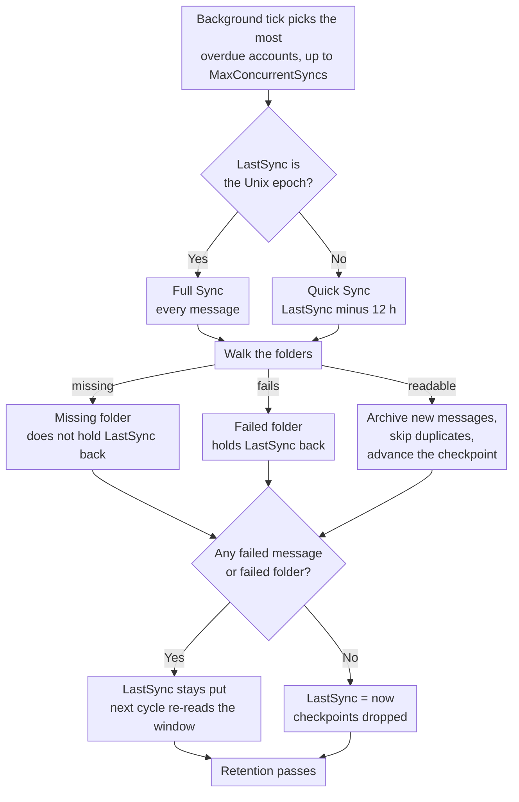

# 🔄 邮件同步 (快速同步 vs. 全量同步) {#mail-synchronization-quick-vs-full-sync}

[← 返回文档索引](index.md)

## 📋 概述 {#overview}

Mail Archiver 会通过 `MailSyncBackgroundService` 在后台自动同步每个已启用的邮箱。该服务运行一个短轮询循环（每 60 秒），确定哪些账户需要同步，并进行同步 —— 在一个周期内最多可并行同步 `MailSync:MaxConcurrentSyncs` 个账户 —— 然后根据每个账户自身的同步间隔重新调度。间隔可以通过 `appsettings.json` 进行全局配置，也可以在创建/编辑页面中针对单个账户进行覆盖。

有两种不同的同步模式：

| 模式 | 触发方式 | 范围 |
|------|--------------|-------|
| **Quick Sync** (增量同步) | 每个同步周期 (按账户间隔) | 仅限自上次成功同步以来新增/变更的消息 |
| **Full Sync** (全量同步) | 新账户、手动按钮、`AlwaysForceFullSync` 或按账户/全局 Full Sync 间隔 | 每个未排除文件夹中的所有消息 |

两种模式都可以安全地重复运行 —— Mail Archiver 会检测重复项（通过 `MessageId`，或者在 `MessageId` 缺失时通过 From/To/Subject/SentDate）并跳过已归档的消息。

## 🔁 同步周期概览 {#the-sync-cycle-at-a-glance}



最后的决定才是至关重要的。只有当运行结束且**既没有**失败的消息，**也没有**失败的文件夹时，`LastSync` 才会推进。这就是为什么一个包含单个无法读取文件夹的邮箱会不断地重复读取同一个窗口，而不是静默地跳过它 —— 同时也解释了为什么提前结束的运行（超时、取消、速率限制）会导致重新读取，而不是丢失邮件。

---

## ⚡ 快速同步 (增量同步) {#quick-sync-incremental-sync}

快速同步是按配置的时间间隔自动运行的常规运行模式。全局默认值为 `MailSync:IntervalMinutes` 分钟 (默认为 15)；每个账户都可以通过在“创建/编辑”页面设置其自身的 `SyncIntervalMinutes` 值来覆盖此设置 (留空则使用全局默认值)。

### 工作原理 {#how-it-works}

1. 对于每个已启用的账户 (不包括 `IMPORT` 提供商账户)，服务会读取账户的 `LastSync` 时间戳。
2. 根据 `LastSync` 构建日期过滤器：
   - **IMAP**: `SearchQuery.DeliveredAfter(LastSync − 12 hours)`
   - **M365 (Graph)**: `receivedDateTime ge (LastSync − 12 hours)`
3. 12 小时的重叠是刻意设计的。它能捕获在上次同步开始后由提供商投递、但服务器时间戳略旧的消息，并容忍邮件服务器与 Mail Archiver 主机之间微小的时钟偏差。重复项会被重复检查机制过滤掉，因此重叠永远不会创建重复条目。
4. 对于每个非排除的文件夹，过滤后的消息列表将分批获取并存档。现有的消息将被跳过。
5. 在**成功完成** (没有失败的消息、没有整个文件夹失败、未触发速率限制) 时，`LastSync` 被设置为 `DateTime.UtcNow`，下一个周期将从该点开始。
6. 如果**任何消息处理失败**，或者**任何文件夹完全无法同步** (参见 [整个文件夹失败](#-folders-that-fail-as-a-whole))，`LastSync` 将**不会**更新，因此下一个周期会重新尝试相同的窗口。
7. 如果账户受到**速率限制** (参见 [速率限制处理](RateLimitHandling.md))，`LastSync` 也将保持不变，并在每日配额重置后从每个文件夹的检查点恢复同步。

### 何时出现 {#when-you-see-it}

- 自动地，每隔几分钟，针对所有已启用的账户。
- 在新账户的初始同步完成后 (第一次周期是全量同步，见下文)。
- 无需用户操作。

## 🗄️ 全量同步 (Full Sync/Resync) {#full-sync-resync}

全量同步会忽略日期过滤器，并从服务器下载每个非排除文件夹中的**所有**邮件，无论其时间跨度。

### 触发全量同步的情况 {#what-triggers-a-full-sync}

每当账户的 `LastSync` 被设置为 Unix epoch (`1970-01-01T00:00:00Z`) 时，就会触发全量同步。这发生在以下四种情况中：

1. **新账户** – 每个新创建的 IMAP 或 M365 账户都以 `LastSync = 1970-01-01` 开始。因此，该账户的第一个计划同步周期会自动执行全量同步，以完成初始归档导入。
2. **手动“Full Resync”按钮** – 在 *Account Details* 页面上，点击 **Full Resync** 按钮 (`MailAccounts/Resync`) 会将 `LastSync` 重置为 epoch，并在请求的前台立即开始同步。
3. **`MailSync:AlwaysForceFullSync = true`** – 当启用此配置标志时，后台服务会在**每个同步周期的开始，为每个已启用的账户**将 `LastSync` 重置为 epoch。这实际上会将每个周期都变成全量同步。这仅用于故障排除，一旦问题解决应立即关闭，因为它会大幅增加邮件服务器和 Mail Archiver 实例的负载。
4. **单账户或全局全量同步间隔** – 当账户设置了 `FullSyncIntervalHours`（创建/编辑页面），或者在 `appsettings.json` 中配置了全局默认值 `MailSync:FullSyncIntervalHours` 时，后台服务会在距离账户上次全量同步 (`LastFullSync`) 经过该间隔后，自动触发一次全量同步。单账户值具有优先权；当两者均未设置时，不会运行自动全量同步，仅保留手动重同步按钮（以及上述 `AlwaysForceFullSync`）。全量同步完成后，`LastFullSync` 会更新为 `DateTime.UtcNow`，以便从该时间点开始调度下一次全量同步。

### 全量同步期间的行为 {#behavior-during-a-full-sync}

- 不应用 `DeliveredAfter` / `receivedDateTime ge …` 过滤器。系统会请求服务器返回文件夹中的所有邮件。
- 如果服务器返回的结果少于文件夹实际包含的数量（某些 IMAP 服务器会限制 `SEARCH` 结果），Mail Archiver 会检测到这种差异，并回退到通过序列号获取所有 `UniqueId`，以确保不会静默丢失邮件。
- 已在归档中的邮件会被检测为重复项并被跳过——现有的归档副本**不会**被覆盖。如果在与之前不同的文件夹名称中发现重复项，存储的 `FolderName` 字段将更新以反映当前位置。
- 对于非常大的邮箱，全量同步可能需要数小时甚至数天。启用带宽跟踪时，同步会在达到每日配额时优雅地暂停，并在第二天从每个文件夹的检查点恢复（参见 [Rate Limit Handling](RateLimitHandling.md)）。
- 只有在全量同步完成且没有失败的邮件和失败的文件夹后，`LastSync` 才会更新为 `DateTime.UtcNow`，这与 Quick Sync 的逻辑完全一致。

### 何时使用手动全量同步 {#when-to-use-a-manual-full-sync}

在以下情况下使用 **Full Resync** 按钮：

- 您更改了账户的**排除文件夹 (excluded folders)** 列表，并希望确认归档内容与当前选择一致。
- 您怀疑归档中缺失邮件（例如：在服务器迁移、服务商停机或时钟偏移事件之后）。
- 您将邮箱迁移到了不同的后端，并希望验证完整性。
- 您希望重新检测在服务器文件夹之间移动过的邮件。
- 之前对 Mail Archiver 不可见的文件夹重新变得可见 —— 例如，通过第三方客户端创建的 Outlook.com 文件夹，在通过 Web UI 重命名之前，它们会被从 IMAP 文件夹列表中过滤掉（参见 [Personal Microsoft Account Setup → Troubleshooting](MSA_Outlook_Setup.md#-troubleshooting)）。此时需要进行全量同步，因为 Quick Sync 不会回填这些文件夹中的旧邮件。

**不要**使用全量同步进行以下操作：

- 作为常规操作 – 这会对服务商和您的 Mail Archiver 实例造成不必要的负载。
- 为了“刷新”邮件正文或元数据 – 重复项会被跳过，因此全量同步不会更新现有的归档副本。要替换归档邮件，您必须先从归档中删除该邮件，然后运行（快速或全量）同步。
- 通过 `AlwaysForceFullSync=true` 进行永久操作 – 在生产环境中请保持其关闭。它是一个诊断开关，而不是一种运行模式。

## 🆚 快速同步与全量同步概览 {#quick-sync-vs-full-sync-at-a-glance}

| 维度 | 快速同步 (Quick Sync) | 全量同步 (Full Sync) |
|--------|-----------|-----------|
| 日期过滤器 | `LastSync − 12 h` 至现在 | 无（所有邮件） |
| 典型数据量 | 少量新邮件 | 整个邮箱 |
| 持续时间 | 秒级至分钟级 | 分钟级至天级（取决于邮箱大小和提供商限制） |
| 带宽影响 | 低 | 高 |
| 成功时更新 `LastSync` | 是 | 是 |
| 失败 / 频率限制时更新 `LastSync` | 否（在下一个周期重试） | 否（从检查点恢复） |
| 重复处理 | 跳过已归档邮件 | 跳过已归档邮件 |
| 触发方式 | 调度器（按账户间隔） | 新账户、手动按钮、`AlwaysForceFullSync` 或 全量同步间隔 |
| 推荐场景 | 日常运行 | 初始导入和偶尔的验证 |

---

## ⚙️ 配置 {#configuration}

同步行为由 `appsettings.json` 的 `MailSync` 部分控制（或 Docker 中的环境变量 `MailSync__*`）。完整的参数列表请参见 [Setup.md](Setup.md)。

| 设置 | 默认值 | 描述 |
|---------|---------|-------------|
| `MailSync:IntervalMinutes` | `15` | 每个账号同步间隔的全局默认值，单位为分钟。每个账号都可以在“创建/编辑”页面覆盖此设置（留空则使用此默认值）。 |
| `MailSync:FullSyncIntervalHours` | _未设置_ | 可选的自动全量重新同步全局默认值，单位为小时。当未设置时（默认情况），除非设置了每个账号的 `FullSyncIntervalHours` 值，否则不会运行自动全量同步。每个账号的值会覆盖此设置。 |
| `MailSync:TimeoutMinutes` | `0` (无) | 每个账号的同步超时时间。运行时间过长的同步会在下一个消息边界处停止，并在下次运行时恢复。`0`（默认值或任何非正值）表示没有超时限制。参见 [提前停止同步](#-stopping-a-sync-early)。 |
| `MailSync:ConnectionTimeoutSeconds` | `300` | IMAP 连接超时。 |
| `MailSync:CommandTimeoutSeconds` | `600` | IMAP 命令超时。 |
| `MailSync:AlwaysForceFullSync` | `false` | 当 `true` 时，每个周期都是所有账号的全量同步。**仅用于诊断 —— 请勿在生产环境中使用。** |
| `MailSync:IgnoreSelfSignedCert` | `false` | 接受 IMAP 连接中的自签名 TLS 证书（不受信任的根证书、不完整的证书链）和主机名不匹配问题 —— 例如 Proton Bridge，其证书是颁发给 `127.0.0.1` 的。其他链问题（如证书过期）仍会被拒绝。 |
| `MailSync:MaxConcurrentSyncs` | `1` | 同时运行的账号同步数量。插槽会在释放时重新填充，参见 [账号调度方式](#-how-accounts-are-scheduled)。`1` 使同步保持顺序执行；增加此值可实现并行化 —— 请注意服务商的速率限制和本地资源占用。 |
| `MailSync:InterAccountDelaySeconds` | `0` | 可选的秒级交错延迟，应用于每个账号同步任务结束时。有助于避免在 `MaxConcurrentSyncs > 1` 时出现爆发式启动。`0` 会禁用此功能。 |
| `MailSync:MaxIssuesPerKind` | `20` | 同步作业为账号页面记录的每种问题的数量 —— 失败的文件夹、缺失的文件夹和失败的消息是分别计数的。超出此数量的部分仅会被计数，而不会被保留。`0` 会关闭详细信息，仅保留计数器。 |
| `MailSync:GlobalExcludedFolders` | _空_ | 每个账号排除在同步之外的文件夹，这会叠加到每个账号自身的列表中。参见下文的 [排除的文件夹](#-excluded-folders)。 |
| `MailSync:ExcludeSubfolders` | `false` | 排除条目是否也涵盖其所命名文件夹之下的子文件夹（在两个列表中均适用）。参见下文的 [排除的文件夹](#-excluded-folders)。 |

> 💡 普通同步间隔和全量同步间隔都可以在 **Create/Edit Mail Account** 页面按账号进行覆盖。将每个账号的字段留空即可回退到上述全局默认值。要将账号完全从调度器中移除，请禁用它（在 Account Details 页面将 *Enabled* 切换为 off）。

---

## 🚫 排除的文件夹 {#excluded-folders}

文件夹可以通过两个地方进行排除同步，且两者是**累加**的：如果文件夹匹配**其中任一**列表，则会被跳过。任何列表都无法重新包含已被另一个列表排除的内容，因此在任何地方添加条目都只会导致文件夹从同步中移除。

| 来源 | 范围 | 位置 |
|--------|-------|-------|
| 账户排除列表 | 单个账户 | *Create/Edit Mail Account* 页面 |
| `MailSync:GlobalExcludedFolders` | 安装中的每个账户 | `appsettings.json` 或 `MailSync__GlobalExcludedFolders__<n>` |

全局列表**默认为空**，因此从未配置该列表的安装程序其行为与以前完全一致。它的存在是为了应对从同一服务器导入多个邮箱的情况，否则必须在每个账户上维护完全相同的排除列表。

两个列表使用相同的匹配规则，因此它们不会产生偏差：

1. 与文件夹的全路径（`INBOX/Drafts`）进行精确匹配；
2. 与文件夹自身名称（`Drafts`）进行精确匹配，这可以捕获当服务器报告带有前缀的路径时输入的短名称；
3. 路径后缀匹配，这可以捕获分隔符的变化 —— `Drafts` 也会匹配 `INBOX.Drafts` 和 `INBOX/Drafts` —— 以及服务器前缀名称，如 `[Provider]/Drafts`；
4. 匹配条目名称下方的所有内容，因此只要启用 `MailSync:ExcludeSubfolders`（默认关闭，与该选项存在之前的行为一致），`Archive` 也会覆盖 `Archive/Team` 和 `INBOX.Archive.Team`。将其设置为 `true` 可以通过命名其根目录而不是其中的每个文件夹来排除整个邮箱树；在默认情况下，条目仅匹配其命名的那一个文件夹。

所有比较都是不区分大小写的。全路径后缀规则锚定在路径分隔符上，因此 `Archive` 不会带走名为 `ArchiveWeek` 的文件夹。名称比较的锚定方式不同：短条目也会匹配任何自身名称**以其结尾**的文件夹，因此 `Archive` 会带走名为 `OldArchive` 的文件夹。要在名称相似的文件夹中精确排除一个，请输入其全路径。

规则 4 像规则 3 一样锚定在分隔符上，因此它匹配整个文件夹，而从不匹配名称的一部分：`Archive` 覆盖 `Archive/Team`，而名为 `Team Archive Review` 的邮件文件夹仍会保留在同步中。祖先节点仅通过路径进行比较，因此未锚定的名称比较不会传递给文件夹的子文件夹。`.` 在其出现的地方都被视为分隔符，这意味着在以 `/` 作为分隔符的服务器上，字面上名为 `Archive.ics` 的顶级文件夹会被读取为位于 `Archive` 之下。

**默认情况下不会排除任何文件夹名称。** 是否值得列出某些名称完全取决于服务器及其语言 —— 邮箱树同时携带日历、联系人、任务和便签文件夹是使用此功能的一个常见原因，但 Mail Archiver 不会对此做假设。请参阅 [Setup.md](Setup.md) 获取配置示例。

更改任一列表都不会移除已归档的内容。如果您想确认归档内容与当前选择匹配，请在之后运行 [Full Sync](#-full-sync-resync)。

排除适用于遍历文件夹列表的所有地方，而不仅仅是归档：被排除的文件夹在服务器端删除阶段也会被跳过（见下文），因此条目也会保护服务器上的文件夹。

## 🗑️ 同步期间的服务端删除 {#server-side-deletion-during-sync}

如果账户配置了 `DeleteAfterDays` (> 0)，Mail Archiver 会在每次同步后从**邮件服务器**中删除早于配置阈值的邮件：

- **IMAP**：每个文件夹执行 `SearchQuery.SentBefore(now − DeleteAfterDays)`，然后进行 expunge。
- **M365 (Graph)**：每个文件夹执行 `receivedDateTime lt (now − DeleteAfterDays)`，然后进行 delete。

Mail Archiver 中的存档副本**不会**受到此操作的影响——仅对服务端邮箱进行修剪。任一排除列表（[Excluded Folders](#-excluded-folders)）中的文件夹都会被此删除过程跳过，并保留在服务器上。有关控制存档副本保留时长的本地保留对应机制，请参阅 [Retention Policies](RetentionPolicies.md)。

---

## 🛟 恢复服务器报告缺失的消息 {#recovering-messages-the-server-reports-as-missing}

某些服务器在通过常规 UID 获取时拒绝一条消息，但对于普通的 `BODY[]` 获取仍会返回一个可用的 MIME 文档。这在旧版本地部署的 Exchange 上有所观察，其获取失败时显示：

```
MailKit.MessageNotFoundException: The IMAP server did not return the requested message.
```


如果没有回退机制，此类消息将被计为失败邮件，并且由于在账户存在失败时 `LastSync` 不会推进，账户在每次运行时都会重新读取相同的消息，从而导致无法取得进展。

**Mail Archiver 的处理方式：** 针对该 UID 进行仅有一次的额外获取尝试，且仅针对此特定错误。身份验证问题、连接丢失、节流和解析错误不受影响，现有的瞬时重试行为保持不变。该尝试是只读的：没有消息被标记为已读，没有标志被更改，没有任何内容被移动或删除。只有当原始数据实际到达 **且** 被解析为 MIME 消息时，才计为成功 —— 任何低于此标准的情况仍视为失败邮件。恢复的消息随后进入正常的归档路径，包括重复检测，因此重复的全量同步不会将其归档两次。

**提供商错误占位符：** 服务器返回的往往不是原始消息，而是提供商生成的替代文档，例如：

```
Subject: Retrieval using the IMAP4 protocol failed for the following message: 270198
From: Microsoft Exchange Server 2010

The server couldn't retrieve the following message: ...
```


此类内容会按接收到的原样进行归档，且永远不会被重写到其内部引用的发件人、主题或正文中。Mail Archiver 无法恢复提供商本身拒绝转换为 MIME 的内容；它所保留的是服务器能够提供的最佳表示形式，以及“到达的是占位符”这一事实。每条记录都会在 `Warning` 级别进行日志记录，并包含账户、文件夹、UID 和主题。

**当回退尝试返回为空时**，该消息将保持为之前的失败邮件状态，且该尝试会记录在 `Warning` 而不是静默通过 —— 未检索到的消息绝不能看起来像是已归档。如果某个服务器始终表现出这种行为，记录在案的后续步骤是分别获取 `BODY.PEEK[HEADER]` 和 `BODY.PEEK[TEXT]`，然后将它们组装成一个 MIME 文档。那是一个真正不同的请求，而当前的回退机制是使用不同的方式读取相同的请求。该功能被刻意未实现：它会导致每条消息增加一次往返开销，并需要定义一种“报头已到达，正文未到达”的状态，且目前为止尚未发现任何需要此功能的服务器。

两个计数都会出现在账户的完成日志行中：

```
Sync completed for account: Example. New: 0, Failed: 0, Deleted: 0, Recovered: 25, Provider placeholders: 25, Failed folders: 0
```

`Recovered` 统计由回退机制挽救的消息；`Provider placeholders` 是其中被证实为提供商生成的错误文档的子集。与它们并列的 `Failed: 0` 正是该功能的意义所在 —— 账户不再卡住。

## 📁 整体失败的文件夹 {#folders-that-fail-as-a-whole}

单条消息可能会失败，文件夹也可能作为一个整体失败 —— 服务器列出了该文件夹，但打开或搜索它时会报错。某些服务器通过 `LIST`/`LSUB` 宣告文件夹，随后在 `EXAMINE` 上回答 `NO ... doesn't exist`。

这些是分开计数的，每个文件夹计一个：

```
Sync completed for account: Example. New: 120, Failed: 0, Deleted: 0, Recovered: 0, Provider placeholders: 0, Failed folders: 2
```

`Failed folders: 2` 表示有两个文件夹完全无法同步。这 **并不** 意味着某条特定的消息失败了 —— 当一个文件夹无法打开时，无法得知其中消息的任何信息，因此任何失败消息的数量都无法真实反映情况。

**为什么它是一个独立的计数器。** 过去，文件夹级别的失败会被记录为失败的 *消息*，数量等于该文件夹截至目前已处理的消息数。这个数字是虚构的，并且会覆盖文件夹真实的单条消息失败数。因此，一个无法访问的文件夹可能会报告数百条实际上已完美归档的消息失败。

**对 `LastSync` 的影响，保持不变。** 整体失败的文件夹仍然会阻止 `LastSync` 推进，就像之前将其计为消息失败时一样。改变的只是报告方式，而非行为：账户仍会在下一个周期重试相同的窗口。这是刻意为之 —— 如果增量同步跳过了它从未成功读取的文件夹，那么它将永远不会再回来处理其中的邮件。

这两个计数在 `Information` 级别都是可见的，每当 `LastSync` 被阻碍时，都会发出包含其名称的警告：

```
Not updating LastSync for account Example: 0 failed emails, 2 folders that could not be synced at all
```

### 已消失的文件夹，而非损坏的文件夹 {#folders-that-are-gone-as-opposed-to-broken}

服务器列出了一个文件夹但随后拒绝打开，这并不自动视为失败。最常见的原因根本不是故障：RFC 3501 禁止服务器在背后的邮箱被删除时从订阅列表中移除名称，因此某人在 IMAP 客户端中订阅过的文件夹在多年后的 `LSUB` 中仍会被报告。文件夹发现过程取 `LIST` 和 `LSUB` 的并集，因此这些名称会进入同步过程，随后 `EXAMINE` 回答 `NO ... doesn't exist`。

这是一个回答，而不是错误。没有需要重试的内容，也没有需要再次处理的内容，因此它被单独计数，且 **不会** 阻碍 `LastSync`：

```
Sync completed for account: Example. New: 120, Failed: 0, ..., Failed folders: 0, Missing folders: 16
```

将其计为失败会导致账户永久停止，因为不存在的文件夹永远不会再次存在。这正是拥有 16 个陈旧订阅的邮箱所发生的情况：账户停止了 `LastSync` 的推进，且无法自行恢复。

其他所有情况仍被视为失败并持续阻碍账户 —— 无权限、连接断开、节流、服务器错误。这些情况在下次运行时可能会成功。

即使 `Missing folders: N` 是无害的，也值得采取行动：这意味着邮箱携带了已不存在的文件夹订阅。清除它们是针对每个名称的 `UNSUBSCRIBE`，可以使用任何 IMAP 客户端完成，而同步过程会刻意 **不** 执行此操作 —— 归档程序不得修改其读取的邮箱。

仅限 IMAP。Microsoft Graph 通过 API 枚举文件夹，被删除的文件夹根本不会被返回，因此不会出现这种情况。

同时适用于 IMAP 和 M365 (Graph) 两种提供商。

## 🗓️ 账户调度方式 {#how-accounts-are-scheduled}

后台每分钟运行一次 tick。它加载已启用的账户，计算哪些账户到期，并根据空闲的同步槽位启动尽可能多的账户：总计 `MailSync:MaxConcurrentSyncs` 个。
它**不会**等待已启动的同步任务。任何无法放入槽位的任务都会留到下一次 tick，届时将重新进行决策。

每个账户的下一次运行是在其同步**完成**时调度的，时间为完成时刻加上其间隔时间。
因此，如果一个账户的同步时间超过了其间隔时间，它在完成后会立即再次到期，但绝不会同时运行两次：正在运行中的账户会被跳过，而不是进入队列。

当到期的账户数量超过可用槽位时，**最逾期的账户优先执行**。若发生冲突，则按账户 ID 排序，以确保积压任务的处理具有可重现性。

同步完成会立即唤醒调度器，因此当槽位释放时，循环不会在空闲等待一分钟：即使在 `MaxConcurrentSyncs: 1` 的情况下，积压任务也会连续处理，这与旧的批处理循环完全一致，而“一分钟”仅作为查看账户列表之间可能出现的最长间隔。

如果拥有多个槽位，请考虑设置 `MailSync:TimeoutMinutes`，其默认值为 `0`（无超时）。同步任务在运行期间会一直占用其槽位，因此如果单个账户永久停止进展，会永久减少其他所有账户可用的槽位。超时会将此类运行视为“暂停”并保留其检查点，槽位将在下一个 tick 重新释放。

> ℹ️ 在此之前，tick 会收集所有到期的账户并在再次查看之前等待所有账户完成。因此，一个大型邮箱会导致其他所有账户在同步期间都被阻塞：虽然槽位释放了，但在最后一个任务返回之前，系统不会重新评估任何内容。因此，在 `MaxConcurrentSyncs: 10` 且包含一个六小时邮箱的安装环境下，实际上所有内容的同步间隔都会变成六小时。现在，快速完成的账户无论其他任务运行如何，都会遵循自己的间隔时间。

在关闭服务时，服务会等待最多 30 秒以处理仍在进行的同步，而不是在打开的 IMAP 会话下直接终止进程。同步任务不会被取消；有关哪些操作会停止同步，请参阅 [Stopping a Sync Early](#-stopping-a-sync-early)。

---

## ⏹️ 提前停止同步 {#stopping-a-sync-early}

正在运行的同步在遍历完每个文件夹之前停止，只有两个原因：有人在 **Jobs** 页面取消了该任务，或者账户的 `MailSync:TimeoutMinutes` 已到期。这两者都会在三个时间点进行检查：在每个文件夹之前、在每个批次之前以及在每条消息之前，因此无需等待大型文件夹处理完成。

超时仅适用于 **计划同步 (scheduled syncs)**。从 UI 启动的同步（“Sync now” 操作或全量重新同步）在运行时没有超时限制，因此长时间的手动同步永远不会被中断。

两者结束任务的方式不同，这种差异非常重要：

| | 任务状态 | `LastSync` | Checkpoints | Retention passes |
|---|---|---|---|---|
| 从 UI 取消 | `Failed`，并显示 "Job was cancelled" | 不推进 | 保留 | 跳过 |
| 同步超时到期 | `Timed Out` | 不推进 | 保留 | 跳过 |

超时是 **暂停，而非失败**。同步会在当前位置停止，保留已归档的内容，保持 `LastSync` 不变，并跳过服务端和本地的 retention passes，因为运行这些操作会违背限制运行时间的初衷。下一次计划运行将从 checkpoint 处恢复。

### Checkpoints {#checkpoints}

进度会按账户和文件夹记录在 `mail_archiver.SyncCheckpoints` 中：该文件夹中最后一条已归档消息的 UID，以及该时刻文件夹的 UIDVALIDITY。每个安装实例都会写入这些信息；它们以前与 `BandwidthTracking:Enabled` 绑定，这意味着中断的同步只能在那个无关功能恰好开启的地方恢复。一旦账户在无故障的情况下完成，checkpoint 就会被丢弃。

恢复运行的文件夹会执行与没有 checkpoint 时 **完全相同的搜索**。只有处于或低于水位线 (watermark) 的 UID 会在之后从结果中剔除，因此搜索窗口永远不会移动，也不会有消息遗漏。

一旦该文件夹中的某条消息失败，水位线就会停止推进。消息按 UID 升序进行遍历，因此如果水位线高于失败的 UID，下一次运行会认为该失败消息已被归档，从而永远不会重试，而这正是被延迟的 `LastSync` 所要强制执行的操作。因此，失败位置之上的所有内容在下次运行时都会被重新读取；这会产生一次重读成本，而重复检查 (duplicate check) 会吸收这一成本。

每当无法证明 checkpoint 适用时，系统都会忽略该 checkpoint 并全量读取文件夹：尚未记录 UID、尚未记录 UIDVALIDITY，或者 UIDVALIDITY 与文件夹不再匹配。最后一种情况意味着服务器重新编号了邮箱，因此存储的 UID 指向了不同的消息。重新读取文件夹会消耗时间，并由重复检查吸收；跳过读取会导致邮件静默丢失，因此所有可疑情况都会进行全量读取。

Graph API 提供商不写入 UID checkpoints，因为 Graph API 没有等同于 IMAP UID 的机制。超时或受带宽限制的 M365 同步所谓的“恢复”，仅指 `LastSync` 不会推进，因此下次运行时会重新读取整个窗口，并由重复检查吸收重叠部分。

> ℹ️ 在此之前，checkpoint 存储最后一条归档消息的 **Date header** 并将其输入到文件夹搜索中，服务器通过 INTERNALDATE 进行响应，这是一种不同的时钟，在迁移邮件上可能会有数年的偏差，而消息是按 UID 顺序而非日期顺序处理的。这两种不匹配都可能导致搜索窗口跳过从未归档过的邮件。当同步因带宽限制而暂停时也使用相同的路径，因此通过此更改，恢复机制也得到了修复。

### 大型邮箱与超时 {#large-mailboxes-and-the-timeout}

一个拥有 150,000 条消息的邮箱在第一次全量同步时会运行数小时，如果超时时间短于此，每次都会导致同步停止。它会从 checkpoint 处恢复而不是重新开始，但账户在某次运行彻底完成之前，不会达到 completed 状态，因此也不会推进 `LastSync`。请检查您邮箱的数值，如果您希望完全没有超时限制，请将其设置为 `0`。

---

## 👀 观察同步情况 {#observing-the-sync}

### 账户页面回答了“上次运行做了什么” {#the-account-page-answers-what-did-the-last-run-do}

每个邮件账户都带有一个 **Last Sync Run** 卡片，显示最近完成的一次运行情况：包括结束时间、运行耗时、处理的消息数量以及新消息数量。该信息在 24 小时作业保留期内依然有效，因此即使邮箱整天处于静默状态，仍能提供答案——只有重启才会清除该信息，且卡片会明确说明这一点，而不是假装账户一切正常。

当出现问题时，卡片会按类型对问题进行分组并进行额度限制列出：

- **Folders that could not be read** — 文件夹作为一个单元读取失败。这会阻碍 `LastSync`。
- **Folders the server does not have** — 由发现机制报告，在打开时被拒绝。通常是已删除文件夹的残留订阅；不会阻碍 `LastSync`。参见 [Folders that are gone](#folders-that-are-gone-as-opposed-to-broken)。
- **Messages that could not be archived** — 包含文件夹、主题、UID 以及服务器自身的描述。

每个分组都由 `MailSync:MaxIssuesPerKind` 进行限制，并将无法容纳的内容报告为“以及 N 个更多”，因此某一类问题的激增不会掩盖其他类问题。当 `LastSync` 被阻碍时，卡片也会用一句话说明情况，因为这正是陈旧时间戳实际引发的问题。

账户列表会在时间戳旁边标记出上次运行报告存在问题的账户。我们刻意只标记这些账户：如果每一行都打钩，则会产生噪音并使标记失去意义。

- **Account Details 页面**：显示当前的 `LastSync` 时间戳和活跃的同步作业（文件夹、已处理计数、新消息计数、失败计数）。**Full Resync** 按钮位于此处。
- **Logs**：同步进度在 `Information` 级别进行记录。在 Docker 中：
  ```bash
  docker compose logs -f mailarchive-app | grep -i sync
  ```
  有关日志过滤技巧，请参阅 [Docker Compose Logs Guide](DockerComposeLogs.md)。
- **Rate limiting**：当同步因带宽限制而暂停时，账户会显示 "Rate-Limited" 状态，并在重置窗口后自动恢复。参见 [Rate Limit Handling](RateLimitHandling.md)。
- **Timeouts**：被 `MailSync:TimeoutMinutes` 中止的同步会显示 "Timed Out"，并在下次运行时从其检查点恢复。参见 [Stopping a Sync Early](#-stopping-a-sync-early)。

---
